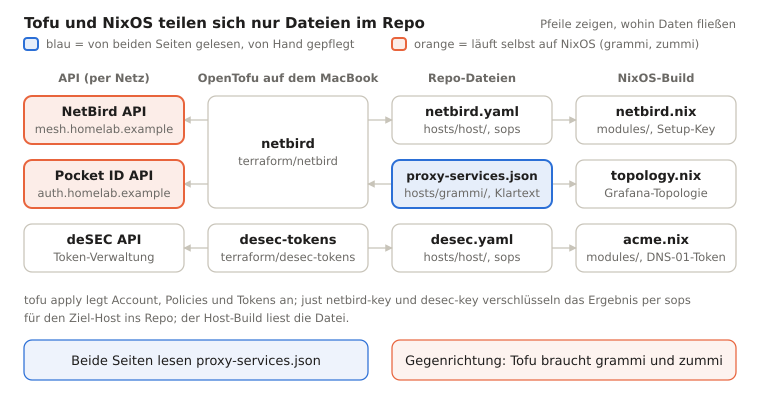

# nixlab – Projektdokumentation

Stand: 19.10.2026 · [English](README.md) · [PDF](nixlab-documentation.de.pdf)

> Diese Dokumentation beschreibt ein privates Repo. Domain und interne Adressen sind durch Beispielwerte ersetzt: die Domain durch `homelab.example` ([RFC 2606](https://www.rfc-editor.org/rfc/rfc2606)), IPv4 nach [RFC 5737](https://www.rfc-editor.org/rfc/rfc5737) (`192.0.2.0/24`, `198.51.100.0/24`, `203.0.113.0/24`), IPv6 nach [RFC 3849](https://www.rfc-editor.org/rfc/rfc3849) (`2001:db8::/32`), der Tailnet-Name durch `example-tailnet.ts.net`. Die echte Mesh-Range ist ein /22 aus RFC 1918. Module, Dokumentation und Build-Werkzeuge sind zusammen mit Claude (Anthropic) entstanden. Lizenz: [MIT](LICENSE).


## Überblick

nixlab ist das Flake-Monorepo für das Homelab **homelab.example**: fünf NixOS-Hosts und ein Mac mini mit nix-darwin, dazu drei OpenTofu-Module für den NetBird-Account, die deSEC-API-Tokens und die GitHub-Repos samt Deploy-Keys. Bedient wird alles über ein `justfile` vom MacBook aus; die Hosts ziehen ihre Konfiguration selbst aus dem privaten GitHub-Repo und aktualisieren sich nachts.

Kurzantwort auf die Frage *„Hast du NixOS und OpenTofu irgendwie miteinander verdrahtet?“*: **Ja, aber bewusst lose – über Dateien im Repo, nicht über ein gemeinsames Tool.** OpenTofu schreibt sops-verschlüsselte Dateien in `hosts/<host>/`, die NixOS-Module beim Build lesen, und beide Seiten lesen dieselbe Dienstliste `hosts/grammi/proxy-services.json`. Kein terranix, kein Tofu-Lauf aus Nix heraus. Details im Abschnitt [NixOS & OpenTofu](#nixos--opentofu).

Zielgruppe: Leute, die NixOS-Flakes, sops-nix und Terraform/OpenTofu lesen können.

## Repository-Struktur

Ein Flake, `nixosConfigurations` für fünf Hosts plus `darwinConfigurations.zorlock`. Jeder Host bekommt eine explizite Modulliste in `flake.nix`; was fehlt, fehlt mit Begründung im Kommentar daneben.

| Pfad | Inhalt |
| --- | --- |
| `flake.nix` / `flake.lock` | Inputs, Host-Definitionen, Pakete, `lib.topology`, `checks` |
| `modules/` | 16 geteilte Module: base, nix, ssh, firewall, networking (ifstate), acme, crowdsec, tailscale, netbird, metrics/metrics-shipping, logging/log-shipping, qemu-guest, deploy, auto-upgrade-git |
| `hosts/<host>/` | `configuration.nix`, Hardware, Dienst-Module, sops-Dateien (`secrets.yaml`, `netbird.yaml`, `desec.yaml`) |
| `pkgs/` | Eigene Pakete: garage-ui, logchef, paperless-gpt, prometheus-paperless-exporter, ollama-metrics-proxy |
| `terraform/netbird/` | OpenTofu: NetBird-Account, Policies, DNS-Zonen, Reverse-Proxy-Dienste, Personen/Gruppen (inkl. Pocket ID) |
| `terraform/desec-tokens/` | OpenTofu: eng gescopte deSEC-Tokens pro Host für DNS-01 |
| `terraform/github/` | OpenTofu: die Repos `nixlab` (privat) und `nixlab-docs` (öffentlich), Deploy-Keys pro Host |
| `topology.nix` | Generiert das Topologie-Dashboard für Grafana aus den Host-Configs |
| `justfile` | Alle Bedienabläufe: deploy, secrets, netbird-\*, desec-\* |
| `docs/` | Diese Projektdokumentation (de/en) und ihr Build, Installationsanleitungen (ursalia, cuckoosegg), Upstream-Issue-Entwürfe |
| `dnsconfig.js` | Symlink ins separate DNSControl-Repo – öffentliche DNS-Records leben dort |
| `.sops.yaml` | age-Empfänger pro Host, `admin` (Offline-Recovery) und `workstation` (1Password) |

### Inputs und ihre Pins

Nur `nixpkgs`, `nixpkgs-unstable` und `sops-nix` laufen im nächtlichen Auto-Upgrade mit (`updateInputs` in `modules/deploy.nix`). Alles, was bei einem kaputten Release das ganze Lab aussperren würde, ist separat gepinnt und wird von Hand gebumpt.

| Input | Branch / Tag | Wer nutzt es | Nachts mit? |
| --- | --- | --- | --- |
| `nixpkgs` | nixos-26.05 | alle NixOS-Hosts | ja |
| `nixpkgs-unstable` | nixos-unstable | grammi (Grist), ursalia (Paperless 3.x), zorlock (mactop) | ja |
| `sops-nix` | main | alle | ja |
| `nixpkgs-netbird` | nixos-unstable | NetBird-Server und alle Clients | nein – Server zuerst, dann Clients |
| `nixpkgs-pocketid` | nixos-26.05 | zummi (pocket-id-Paket) | nein |
| `disko` | main | ursalia (alle Mounts) | nein |
| `lanzaboote` | v1.1.0 | ursalia (Secure Boot) | nein |
| `nixpkgs-darwin`, `nix-darwin` | 26.05-darwin | zorlock | nein (kein Auto-Upgrade) |

`nix flake check` prüft zusätzlich, dass `hosts/grammi/dashboards/topology.json` zu dem passt, was `topology.nix` gerade erzeugt – ein neuer Exporter ohne `just topology` lässt den Check fehlschlagen.

## Module

Die 16 Module unter `modules/` tragen die gemeinsame Konfiguration aller Hosts; jede Datei erklärt im Kopfkommentar, warum sie so ist. Die öffentliche Fassung enthält sie anonymisiert unter `modules/` – als Referenz, nicht direkt importierbar: einige lesen `hosts/<host>/*.yaml` und setzen sops-nix voraus. Drei sind bewusst allgemein gehalten und haben eigene Optionen.

| Modul | Zweck | Optionen / Besonderheiten |
| --- | --- | --- |
| [auto-upgrade-git.nix](modules/auto-upgrade-git.nix) | Nächtliches `nixos-rebuild switch`, committet und pusht die neue `flake.lock` zurück ins Repo | `services.autoUpgradeGit`: `enable`, `flakeDir`, `flakeAttr`, `updateInputs`, `dates`, `allowReboot`, `rebootWindow`, `deployKeySecret`, `gitAuthorEmail` |
| [log-shipping.nix](modules/log-shipping.nix) | journald- und nginx-Logs per Vector an VictoriaLogs | `services.logShipping`: `enable`, `victoriaLogsUrl` |
| [metrics-shipping.nix](modules/metrics-shipping.nix) | vmagent scrapt die lokalen Exporter und schreibt per remote_write an VictoriaMetrics | `services.metricsShipping`: `enable`, `remoteWriteUrl`, `exporterPorts` |
| [deploy.nix](modules/deploy.nix) | Die Lab-Policy für auto-upgrade-git: GitHub-Deploy-Key, gepinnter Hostkey, Reboot-Fenster 04:00–06:00 | getrennt vom Mechanismus, damit der wiederverwendbar bleibt |
| [acme.nix](modules/acme.nix) | ACME-Defaults für jeden TLS-Host: DNS-01 gegen deSEC | Token aus `hosts/<host>/desec.yaml` (von Tofu) |
| [netbird.nix](modules/netbird.nix) | NetBird-Client im Mesh, Registrierung per Setup-Key, lokale Metriken | Setup-Key aus `hosts/<host>/netbird.yaml` (von Tofu) |
| [tailscale.nix](modules/tailscale.nix) | Gemeinsamer Tailscale-Agent | `tailscale serve` bleibt in der Host-Config |
| [ssh.nix](modules/ssh.nix) | Wer sich von wo anmelden darf: root nur über Mesh oder Tailscale | Schlüssel bleiben pro Host |
| [firewall.nix](modules/firewall.nix) | Öffentlich nur 22/80/443, Tailnet als vertrauenswürdiges Interface | |
| [crowdsec.nix](modules/crowdsec.nix) | CrowdSec-Engine und Firewall-Bouncer, Whitelist für die Lab-Hosts | Umgehungen für Fehler in den nixpkgs-Modulen, im Kopf dokumentiert |
| [networking.nix](modules/networking.nix) | ifstate-Gerüst, systemd-resolved mit DNS-over-TLS, keine Fallback-Resolver | Adressen und Routen bleiben in der Host-Config |
| [metrics.nix](modules/metrics.nix) | Prometheus-Exporter pro Host | Schutz über die Firewall statt über Bind-Adressen |
| [logging.nix](modules/logging.nix) | Begrenzt journald, das sonst bis 4 GB wächst | |
| [qemu-guest.nix](modules/qemu-guest.nix) | QEMU Guest Agent mit gesperrter RPC-Liste: Snapshots ja, Shell und Dateizugriff über den Kanal nein | |
| [nix.nix](modules/nix.nix) | Nix-Daemon, Garbage Collection, Store-Optimierung | |
| [base.nix](modules/base.nix) | Locale, Konsole, Zeit und Werkzeuge zum Debuggen | |

## Hosts & Rollen

Drei gemietete VMs tragen die öffentlichen Dienste, ursalia und zorlock stehen zu Hause, cuckoosegg im Subraum. Alle sind über `<host>.peer.homelab.example` im NetBird-Mesh erreichbar; root-SSH gibt es nur dort.

| Host | Plattform | Rolle | Besonderheiten |
| --- | --- | --- | --- |
| grammi | NixOS, gemietete VM | NetBird-Server (`mesh.homelab.example`) + Reverse Proxy, Traefik, Monitoring (VictoriaMetrics/-Logs, Grafana, logchef), Mealie, Grist, PostgreSQL | Zentrale Senke für Metriken und Logs aller Hosts |
| zummi | NixOS, gemietete VM | Pocket ID (`auth.homelab.example`) – Login für alle Dienste und NetBird | pocket-id separat gepinnt |
| aldrin | NixOS, gemietete VM | Garage S3 (`s3.aldrin.homelab.example`), garage-ui (`s3-admin`), Backup-Ziel für restic | Fork-Paket garage-ui mit Subpath-Support |
| ursalia | NixOS, Bare Metal (ThinkCentre M720q) | Paperless-ngx 3 + paperless-gpt (`dokumente`), Samba für den Scanner, Routing-Peer ins Heim-LAN, Build-Host für cuckoosegg | LUKS + btrfs via disko, TPM-Unlock, Secure Boot (lanzaboote), kein CrowdSec |
| cuckoosegg | NixOS, VM auf dem Subraum-Proxmox | NetBird-Routing-Peer in die Subraum-Netze | Gruppe `subraum-devices` statt `servers`, kein Repo/Deploy-Key, wird per Push deployed |
| zorlock | macOS + nix-darwin, Mac mini M4 | Ollama auf der Apple-GPU (`llm`), genutzt von paperless-gpt | Keins der `modules/*.nix`; FileVault-Unlock nach Reboot per LAN-SSH |

## Services

Dienste sind nach Funktion benannt, nicht nach Produkt. Es gibt drei Arten der Erreichbarkeit: direkt öffentlich, öffentlich hinter dem NetBird-Reverse-Proxy mit SSO, oder nur im Mesh.

| Name (`.homelab.example`) | App | Host | Erreichbar |
| --- | --- | --- | --- |
| `auth` | Pocket ID | zummi | öffentlich (nginx) |
| `mesh` | NetBird Management/Dashboard | grammi | öffentlich (Traefik terminiert TLS) |
| `s3.aldrin` | Garage S3-API | aldrin | öffentlich (nginx) |
| `rezepte` | Mealie | grammi | Reverse Proxy + SSO |
| `grist` | Grist | grammi | Reverse Proxy + SSO |
| `logs` | logchef | grammi | Reverse Proxy + SSO |
| `metrics` | Grafana | grammi | Reverse Proxy + SSO |
| `vm` / `vl` | VictoriaMetrics / VictoriaLogs UI | grammi | Reverse Proxy + SSO (über Traefik-Entrypoint `apps`, Port 8090) |
| `s3-admin` | garage-ui | aldrin | nur Mesh |
| `dokumente` | Paperless + paperless-gpt (`/paperless-gpt/`) | ursalia | nur Mesh; öffentlicher Zugang über den Proxy in Arbeit |
| `llm` | Ollama (hinter Caddy) | zorlock | nur Mesh |

**Reverse Proxy:** Traefik auf grammi besitzt Port 443. `mesh.homelab.example` terminiert es selbst, alles andere reicht es per TCP-Passthrough mit PROXY-Protokoll v2 an `netbird-proxy` weiter, das TLS und ACME (tls-alpn-01) selbst macht. Login am Proxy ist SSO gegen Pocket ID, begrenzt auf die NetBird-Gruppen der jeweiligen App.

**Mesh-only-Namen:** Jeder Name ist eine eigene NetBird-DNS-Zone mit einem A-Record auf die Mesh-Adresse (192.0.2.x). Öffentliches DNS kennt sie nicht; das Zertifikat kommt per DNS-01 über deSEC.

**Querschnitt auf allen Linux-Hosts:** vmagent schickt Metriken, Vector schickt journald- und nginx-Logs an grammi. CrowdSec liest die nginx/Traefik-Logs auf den öffentlichen Hosts. restic-Backups gehen in Garage-Buckets auf aldrin, für Paperless zusätzlich append-only zu BorgBase.

## NixOS & OpenTofu

Ja, beides ist verdrahtet – über das Repo als gemeinsame Schnittstelle. OpenTofu verwaltet das, was außerhalb der Maschinen per API existiert (NetBird-Account, deSEC-Tokens, Pocket-ID-Gruppen); NixOS verwaltet die Maschinen. Die beiden reden nie direkt miteinander: Tofu läuft nur auf dem MacBook über `just`, Nix wertet nie Tofu-State aus.



Tofu schreibt nie direkt auf einen Host: jedes Ergebnis landet als Datei im Repo und erreicht den Host erst mit dem nächsten Deploy.

### Die Berührungspunkte

| Richtung | Datei | Erzeugt von | Gelesen von | Inhalt |
| --- | --- | --- | --- | --- |
| Tofu → NixOS | `hosts/<host>/netbird.yaml` | `just netbird-key <host>` (`tofu output setup_keys` → `sops encrypt`) | `modules/netbird.nix` (`sopsFile`) | Einmal-Setup-Key, 24 h gültig |
| Tofu → NixOS | `hosts/<host>/desec.yaml` | `just desec-key <host>` (`tofu output acme_tokens` → `sops encrypt`) | `modules/acme.nix` (`sopsFile`) | deSEC-Token nur für TXT-Records, VMs auf ihre IP gepinnt |
| gemeinsam | `hosts/grammi/proxy-services.json` | von Hand | `terraform/netbird/reverse-proxy.tf` (`jsondecode(file(...))`) und `topology.nix` | Name → App, Port, Gruppen der Reverse-Proxy-Dienste |
| Repo → beide | `hosts/<host>/github.yaml` + `github-deploy.pub` | `just github-key <host>` (`ssh-keygen` → `sops encrypt`) | privat: `modules/deploy.nix` (`sopsFile`); öffentlich: `terraform/github` (`file(...)`) | Deploy-Key für `/etc/nixos`; Tofu sieht nur den öffentlichen Teil |
| NixOS → Tofu | NetBird-Server auf grammi | `hosts/grammi/netbird.nix` | Provider über `https://mesh.homelab.example` | Die API, gegen die Tofu überhaupt erst läuft |
| NixOS → Tofu | Bootstrap-Tokens | `just netbird-setup-owner`, `netbird-proxy-token` (SSH auf grammi, Server-API) | `terraform/netbird/secrets.yaml` bzw. `hosts/grammi/netbird-proxy.yaml` | Owner-PAT, Proxy-Token |

Der Ablauf für einen neuen Host: Tofu legt den Setup-Key an, `just netbird-key` schreibt ihn verschlüsselt für genau diesen Host (age-Key aus seinem SSH-Host-Key) nach `hosts/<host>/netbird.yaml`, Commit, Deploy innerhalb von 24 h. Der Host registriert sich beim Start selbst; Peers selbst verwaltet Tofu nicht, es findet sie per `data "netbird_peer"` über den Namen.

### Was bewusst nicht verdrahtet ist

- **Keine gemeinsame Host-Liste.** Hosts stehen dreimal: `nixosConfigurations` in `flake.nix`, `local.hosts` in den Tofu-Modulen und `hosts :=` im `justfile`. Ein neuer Host muss an allen drei Stellen eingetragen werden.
- **Kein terranix / kein Tofu im Nix-Build.** Tofu-State liegt lokal (gitignored, im Haupt-Checkout, auch aus Worktrees), weil er Setup-Keys und Tokens im Klartext hält.
- **Kein Provisioning der Maschinen.** Die VMs werden beim Anbieter von Hand angelegt, ursalia/cuckoosegg nach `docs/install-*.md`.
- **Öffentliches DNS** liegt in DNSControl (eigenes Repo, nur per Symlink eingebunden), nicht in Tofu.

Die Grenze ist also: Was Nix aus dem Repo heraus deterministisch bauen kann, macht Nix. Was nur einmal per API erzeugt wird und ein Geheimnis zurückgibt, macht Tofu – und übergibt es verschlüsselt als Datei.

## Secrets, Netzwerk & Zugriff

### Secrets (sops-nix, age)

Jede Host-Datei ist für genau zwei Empfänger verschlüsselt: den age-Key aus dem SSH-Host-Key des Hosts und den Offline-Recovery-Key `admin`. Das MacBook kann Host-Secrets also nicht lesen – `just secrets <host>` editiert sie auf dem Host und holt das Ergebnis zurück. Verschlüsseln für einen Host geht dagegen überall (nur der öffentliche Key ist nötig); genau das nutzen `netbird-key` und `desec-key`.

| Datei | Empfänger | Inhalt |
| --- | --- | --- |
| `hosts/<host>/secrets.yaml` | Host + admin | Deploy-Key, App-Passwörter, OIDC-Clients, restic |
| `hosts/<host>/netbird.yaml` | Host + admin | NetBird-Setup-Key (von Tofu) |
| `hosts/<host>/desec.yaml` | Host + admin | deSEC-Token (von Tofu) |
| `hosts/<host>/github.yaml` | Host + admin | GitHub-Deploy-Key (von `just github-key`) |
| `terraform/*/secrets.yaml` | workstation + admin | API-Tokens für die Provider |

Der Workstation-Key liegt in 1Password und wird über `SOPS_AGE_KEY_CMD` gelesen, nie als Datei. `env.sh` in jedem Tofu-Modul entschlüsselt die Tokens nur in die Shell des jeweiligen Rezepts.

### Netzwerk

- **NetBird-Mesh** (`192.0.2.0/24`, Peer-Namen unter `peer.homelab.example`): Control Plane auf grammi, Login über Pocket ID. Private Range (RFC 1918) statt CGNAT, weil tailscaled Pakete aus 100.64/10 verwirft, solange beide Clients parallel laufen.
- **Gruppen:** `servers` (alle Hosts außer cuckoosegg), `subraum-devices`, `admin-workstations` (MacBook), dazu Personengruppen aus Pocket ID.
- **Heim-LAN** (`198.51.100.0/24`): Route über ursalia, für Gruppe `home-lan`, nicht für Geräte, die schon zu Hause sind (Posture-Check `not-at-home`).
- **Subraum:** Route über cuckoosegg für `subraum-access`. cuckoosegg selbst darf nur grammis Ingest (TCP 8428/9428) erreichen und nur vom MacBook per SSH erreicht werden.
- **Tailscale** läuft während der Migration noch parallel und dient als Break-Glass: `NIXLAB_DOMAIN=example-tailnet.ts.net just deploy zummi`.

### Zugriff

Öffentlich offen sind nur 22/80/443. root-SSH lässt `modules/ssh.nix` nur von Mesh- oder Tailscale-Adressen zu; jeder Host hat ein eigenes Login-Keypair. Das Mesh ist derzeit nur IPv4, Dual-Stack ist als offener Punkt notiert.

## Deployment & Betrieb

Die Pull-Hosts (zummi, aldrin, grammi, ursalia) halten `/etc/nixos` als Checkout des privaten GitHub-Repos und bauen sich selbst. cuckoosegg wird gepusht, zorlock lokal per `darwin-rebuild` umgestellt.

| Host | Manueller Deploy | Automatisch |
| --- | --- | --- |
| zummi, aldrin, grammi, ursalia | `just ship <host> "<Nachricht>"` = commit, push, `git pull` + `nixos-rebuild switch` auf dem Host | nächtliches Auto-Upgrade, Reboot-Fenster 04:00–06:00 |
| cuckoosegg | `just deploy-push cuckoosegg` (gebaut auf ursalia, kopiert zum Ziel) | ursalia pusht täglich um 06:30 |
| zorlock | `just deploy-zorlock` (`darwin-rebuild switch` mit sudo) | keins |

### Nächtliches Upgrade

`modules/auto-upgrade-git.nix` aktualisiert `nixpkgs`, `nixpkgs-unstable` und `sops-nix`, baut, schaltet um und pusht die neue `flake.lock` mit dem Deploy-Key des Hosts zurück nach GitHub. Der GitHub-Host-Key ist gepinnt, weil niemand zusieht. Ein Konfigurationsfehler, der erst beim Kaltstart auffällt, legt den Host also um 04:00 lahm – bei den VMs gibt es dafür die Konsole des Anbieters.

### Wichtige Rezepte

| Rezept | Zweck |
| --- | --- |
| `just check <host>` | `git pull` + `nixos-rebuild dry-activate` |
| `just secrets <host>` / `pull-secrets <host>` | Host-Secrets auf dem Host editieren und zurückholen |
| `just topology` | Topologie-Dashboard neu erzeugen (sonst schlägt `nix flake check` fehl) |
| `just netbird-plan` / `netbird-apply` | NetBird-Account ändern |
| `just netbird-key <host>` | Neuer Setup-Key für einen Host, 24 h Zeit zum Deployen |
| `just netbird-import` | Verlorenen Tofu-State aus dem Account wiederherstellen |
| `just netbird-renew-token` | Jährliche Erneuerung des Service-User-Tokens |
| `just github-key <host>` | Neuer GitHub-Deploy-Key für einen Host (Schlüssel per sops, Registrierung per Tofu) |
| `just github-plan` / `github-apply` | Repos und Deploy-Keys auf GitHub ändern |
| `just desec-key <host>` / `desec-verify` | deSEC-Token tauschen bzw. Scopes von jedem Host aus prüfen |
| `just gc <host>` | Store-Generationen älter als 7 Tage löschen |
| `just docs` | Diese Doku bauen: private PDFs (de/en) und die anonymisierte öffentliche Fassung in `public-docs/` (Clone von `nixlab-docs`, gitignored), dort committet und gepusht |

Rezepte, die sops auf dem MacBook brauchen, laufen mit vorangestellter Anmeldung bei 1Password, die den age-Key über `SOPS_AGE_KEY_CMD` bereitstellt:

```
eval $(op signin) && export SOPS_AGE_KEY_CMD='op read "op://<vault>/<item>/password"' && just netbird-plan
```

### Troubleshooting

- Nach einem `nixos-rebuild` sagt `systemctl --failed` nichts über die Vergangenheit – der Switch räumt Failed-States ab. Stattdessen `journalctl -u <unit>`.
- NetBird down, Tailscale noch da: `NIXLAB_DOMAIN=example-tailnet.ts.net` vor das Rezept setzen.
- Tofu-Rezepte verweigern den Lauf gegen leeren State, damit keine zweite `servers`-Gruppe oder Token-Garnitur entsteht.

## Offene Punkte & Konventionen

### Konventionen

- Pro Thema ein eigener Git-Worktree (`.worktrees/<thema>`), nach Abschluss entfernen und Branch löschen. Tofu-State bleibt dabei immer im Haupt-Checkout.
- Erst planen, dann nach Freigabe umsetzen.
- Subdomains nach Funktion (`rezepte`, nicht `mealie`).
- Neue Webdienste auf grammi nutzen PostgreSQL statt SQLite.
- Dual-Stack, wo immer möglich.
- Kommentare im Code erklären das *Warum*, inklusive der Fehler, die zu einer Entscheidung geführt haben, mit Datum.
- Code-Kommentare, Commit-Messages und Changelogs auf Englisch; die Projektdoku gibt es auf Deutsch und Englisch.

### Offen

- [ ] NetBird-Mesh auf Dual-Stack (IPv6-Overlay) umstellen
- [ ] Reverse-Proxy-Stufe 3 abschließen: Paperless öffentlich unter `dokumente` (Uploads, paperless-gpt, Onboarding weiterer Nutzer)
- [ ] Upstream-PRs im NetBird-Provider (#247 `direct_upstream`/Cluster-Targets, #248 `crowdsec_mode`); danach Proxy-Targets auf grammi auf `localhost` umstellen
- [ ] Tailscale von den Servern entfernen, sobald nichts mehr darauf angewiesen ist
- [ ] Grafana-Alerting (Kontaktpunkt fehlt noch) für SMART, fwupd, Paperless
- [ ] Update-Benachrichtigung für die von Hand gepinnten Inputs (NetBird, Pocket ID)
- [ ] Root-Passwörter deklarativ über sops
- [ ] Host-Liste an einer Stelle führen statt in `flake.nix`, den Tofu-Modulen und `justfile`
