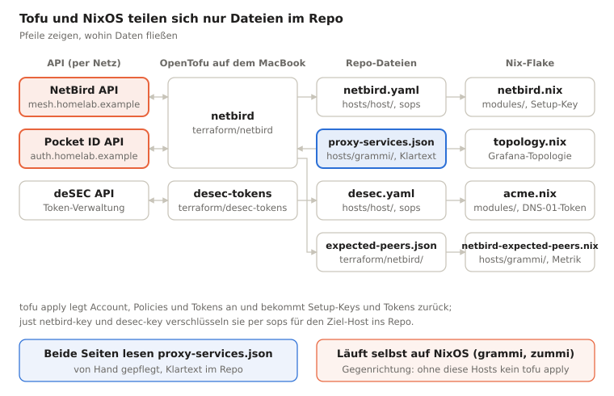

# nixlab – Projektdokumentation

Stand: 19.10.2026 · [English](README.md) · [PDF](nixlab-documentation.de.pdf) · [Website](https://tioan.github.io/nixlab-docs/de/)

> Diese Dokumentation beschreibt ein privates Repo. Domain und interne Adressen sind durch Beispielwerte ersetzt: die Domain durch `homelab.example` ([RFC 2606](https://www.rfc-editor.org/rfc/rfc2606)), IPv4 nach [RFC 5737](https://www.rfc-editor.org/rfc/rfc5737) (`192.0.2.0/24`, `198.51.100.0/24`, `203.0.113.0/24`), IPv6 nach [RFC 3849](https://www.rfc-editor.org/rfc/rfc3849) (`2001:db8::/32`), der Tailnet-Name durch `example-tailnet.ts.net`. Die echte Mesh-Range ist ein /22 aus RFC 1918. Module, Dokumentation und Build-Werkzeuge sind zusammen mit Claude (Anthropic) entstanden. Lizenz: [MIT](LICENSE).


## Überblick

nixlab ist das Flake-Monorepo für das Homelab **homelab.example**: fünf NixOS-Hosts, ein Mac mini mit nix-darwin und die Admin-Workstation gusto (ein MacBook, nix-darwin + home-manager), dazu drei OpenTofu-Module für den NetBird-Account, die deSEC-API-Tokens und die GitHub-Repos samt Deploy-Keys. Bedient wird alles über ein `justfile` von gusto aus; die Hosts ziehen ihre Konfiguration selbst aus dem privaten GitHub-Repo und aktualisieren sich nachts.

Kurzantwort auf die Frage *„Hast du NixOS und OpenTofu irgendwie miteinander verdrahtet?“*: **Ja, aber bewusst lose – über Dateien im Repo, nicht über ein gemeinsames Tool.** OpenTofu schreibt sops-verschlüsselte Dateien in `hosts/<host>/`, die NixOS-Module beim Build lesen, und beide Seiten lesen dieselbe Dienstliste `hosts/grammi/proxy-services.json`. Kein terranix, kein Tofu-Lauf aus Nix heraus. Details unter [NixOS & OpenTofu](#nixos--opentofu).

Zielgruppe: Leute, die NixOS-Flakes, sops-nix und Terraform/OpenTofu lesen können.

## NixOS & OpenTofu

Ja, beides ist verdrahtet – über das Repo als gemeinsame Schnittstelle. OpenTofu verwaltet das, was außerhalb der Maschinen per API existiert (NetBird-Account, deSEC-Tokens, Pocket-ID-Gruppen); NixOS verwaltet die Maschinen. Die beiden reden nie direkt miteinander: Tofu läuft nur auf dem MacBook über `just`, Nix wertet nie Tofu-State aus.



Tofu schreibt nie direkt auf einen Host: jedes Ergebnis landet als Datei im Repo und erreicht den Host erst mit dem nächsten Deploy.

### Die Berührungspunkte

| Richtung | Datei | Erzeugt von | Gelesen von | Inhalt |
| --- | --- | --- | --- | --- |
| Tofu → NixOS | `hosts/<host>/netbird.yaml` | `just netbird-key <host>` (`tofu output setup_keys` → `sops encrypt`) | `modules/netbird.nix` (`sopsFile`) | Einmal-Setup-Key, 24 h gültig |
| Tofu → NixOS | `hosts/<host>/desec.yaml` | `just desec-key <host>` (`tofu output acme_tokens` → `sops encrypt`) | `modules/acme.nix` (`sopsFile`) | deSEC-Token nur für TXT-Records, VMs auf ihre IP gepinnt |
| Tofu → NixOS | `terraform/netbird/expected-peers.json` | `just netbird-apply` (`tofu output expected_peers`, aus den Policies in `expected-peers.tf` berechnet) | `hosts/grammi/netbird-expected-peers.nix` (`builtins.readFile`) | Soll-Anzahl NetBird-Peers je Host als Metrik `netbird_expected_peers`, im NetBird-Dashboard neben der echten Network Map (z. B. aldrin 6, grammi 8) |
| Tofu → NixOS | `terraform/netbird/admin-peers.json` | `just netbird-apply` (`tofu output admin_peers`, aus der Gruppe `admin-workstations`, `admin-peers.tf`) | `flake.nix` (`builtins.readFile`, Option `services.docsSite.allow`) | Mesh-Adressen der Admin-Geräte – wer die private Doku lesen darf |
| gemeinsam | `hosts/grammi/proxy-services.json` | von Hand | `terraform/netbird/reverse-proxy.tf` (`jsondecode(file(...))`) und `topology.nix` | Name → App, Port, Gruppen der Reverse-Proxy-Dienste |
| Repo → beide | `hosts/<host>/github.yaml` + `github-deploy.pub` | `just github-key <host>` (`ssh-keygen` → `sops encrypt`) | privat: `modules/deploy.nix` (`sopsFile`); öffentlich: `terraform/github` (`file(...)`) | Deploy-Key für `/etc/nixos`; Tofu sieht nur den öffentlichen Teil |
| NixOS → Tofu | NetBird-Server auf grammi | `hosts/grammi/netbird.nix` | Provider über `https://mesh.homelab.example` | Die API, gegen die Tofu überhaupt erst läuft |
| NixOS → Tofu | Bootstrap-Tokens | `just netbird-setup-owner`, `netbird-proxy-token` (SSH auf grammi, Server-API) | `terraform/netbird/secrets.yaml` bzw. `hosts/grammi/netbird-proxy.yaml` | Owner-PAT, Proxy-Token |

Der Ablauf für einen neuen Host: Tofu legt den Setup-Key an, `just netbird-key` schreibt ihn verschlüsselt für genau diesen Host (age-Key aus seinem SSH-Host-Key) nach `hosts/<host>/netbird.yaml`, Commit, Deploy innerhalb von 24 h. Der Host registriert sich beim Start selbst; Peers selbst verwaltet Tofu nicht, es findet sie per `data "netbird_peer"` über den Namen.

### Was bewusst nicht verdrahtet ist

- **Keine gemeinsame Host-Liste.** Hosts stehen dreimal: `nixosConfigurations` in `flake.nix`, `local.hosts` in den Tofu-Modulen und `hosts :=` im `justfile`. Ein neuer Host muss an allen drei Stellen eingetragen werden.
- **Kein terranix / kein Tofu im Nix-Build.** Tofu-State liegt lokal (gitignored, im Haupt-Checkout, auch aus Worktrees), weil er Setup-Keys und Tokens im Klartext hält.
- **Kein Provisioning der Maschinen.** Die VMs werden beim Anbieter von Hand angelegt, ursalia/cuckoosegg nach `docs/install-*.md`.
- **Öffentliches DNS** liegt in DNSControl (eigenes Repo, nur per Symlink eingebunden), nicht in Tofu.

Die Grenze ist also: Was Nix aus dem Repo heraus deterministisch bauen kann, macht Nix. Was nur einmal per API erzeugt wird und ein Geheimnis zurückgibt, macht Tofu – und übergibt es verschlüsselt als Datei.

## Secrets, Netzwerk & Zugriff

### Secrets (sops-nix, age)

Jede Host-Datei ist für genau zwei Empfänger verschlüsselt: den age-Key aus dem SSH-Host-Key des Hosts und den Offline-Recovery-Key `admin`. Das MacBook kann Host-Secrets also nicht lesen – `just secrets <host>` editiert sie auf dem Host und holt das Ergebnis zurück. Verschlüsseln für einen Host geht dagegen überall (nur der öffentliche Key ist nötig); genau das nutzen `netbird-key` und `desec-key`.

| Datei | Empfänger | Inhalt |
| --- | --- | --- |
| `hosts/<host>/secrets.yaml` | Host + admin | Deploy-Key, App-Passwörter, OIDC-Clients, restic |
| `hosts/<host>/netbird.yaml` | Host + admin | NetBird-Setup-Key (von Tofu) |
| `hosts/<host>/desec.yaml` | Host + admin | deSEC-Token (von Tofu) |
| `hosts/<host>/github.yaml` | Host + admin | GitHub-Deploy-Key (von `just github-key`) |
| `terraform/*/secrets.yaml` | workstation + admin | API-Tokens für die Provider |

Der Workstation-Key liegt in 1Password und wird über `SOPS_AGE_KEY_CMD` gelesen, nie als Datei. `env.sh` in jedem Tofu-Modul entschlüsselt die Tokens nur in die Shell des jeweiligen Rezepts.

### Netzwerk

- **NetBird-Mesh** (`192.0.2.0/24`, Peer-Namen unter `peer.homelab.example`): Control Plane auf grammi, Login über Pocket ID. Private Range (RFC 1918) statt CGNAT, weil tailscaled Pakete aus 100.64/10 verwirft, solange beide Clients parallel laufen.
- **Gruppen:** `servers` (alle Hosts außer cuckoosegg), `subraum-devices`, `admin-workstations` (MacBook), dazu Personengruppen aus Pocket ID.
- **Heim-LAN** (`198.51.100.0/24`): Route über ursalia (Metrik 100), die beiden Apple TVs als Rückfall (Gruppe `home-routers`, Metrik 200, eigener Setup-Key per `just netbird-router-key`, keiner Person zugeordnet, in keiner Policy); für Gruppe `home-lan`, nicht für Geräte, die schon zu Hause sind (Posture-Check `not-at-home`). Die Apple TVs sollten in der App „Quantum-Resistance“ eingeschaltet haben; seit 2026-10-21 läuft Rosenpass im Mesh permissiv, ohne ginge es auch, nur nicht quantenresistent.
- **Anbindung von ursalia:** WLAN ins Hauptnetz des Heim-LANs (Intel BE200, `hosts/ursalia/wifi.nix`): wpa_supplicant, WPA3 mit WPA2-Rückfall, Land DE, alle Bänder, Passwort per sops. Am endgültigen Platz gibt es kein Kabel; eno1 behält DHCP als Rückfall mit schlechterer Routen-Metrik, damit das WLAN die Hauptverbindung bleibt, wenn beide aktiv sind.
- **Anbindung von zorlock:** ebenfalls WLAN (`en1`, Broadcom); `hosts/zorlock/wifi.nix` stellt sicher, dass `homelab` als bevorzugtes Netz eingetragen ist (`networksetup`, fügt nur hinzu, Passwort per sops in `hosts/zorlock/wifi.yaml`). nix-darwin hat kein WLAN-Modul; die Bandwahl bleibt bei macOS.
- **Subraum:** Route über cuckoosegg für `subraum-access`. cuckoosegg selbst darf nur grammis Ingest (TCP 8428/9428) erreichen und nur vom MacBook per SSH erreicht werden.
- **Tailscale** läuft während der Migration noch parallel und dient als Break-Glass: `NIXLAB_DOMAIN=example-tailnet.ts.net just deploy zummi`.

### Zugriff

Öffentlich offen sind nur 22/80/443. root-SSH lässt `modules/ssh.nix` nur von Mesh- oder Tailscale-Adressen zu; jeder Host hat ein eigenes Login-Keypair. Das Mesh ist derzeit nur IPv4, Dual-Stack ist als offener Punkt notiert.

#### Private Doku: nur Admin-Geräte

Die private Fassung dieser Doku (`doku.homelab.example`, auf aldrin und ursalia) enthält jede interne Adresse und beschreibt, wie das Lab betrieben wird. Das ist mehr, als jedes Gerät im Mesh sehen muss. Deshalb liefert nginx sie nur an die Mesh-Adressen der Admin-Geräte aus; alle anderen bekommen 403 – mit einer eigenen Seite, die sagt, warum, von welcher Adresse die Anfrage kam und wie man ein Gerät freischaltet (ohne Navigation, damit die Seitentitel nicht sichtbar werden). Der Name selbst löst für alle Peers auf.

**Von außen** führt derselbe Name auf die öffentliche, anonymisierte Doku (GitHub Pages): Öffentlich ist `doku` ein CNAME auf den Reverse Proxy, dessen Dienst `doku` ohne Login an einen Listener auf aldrin (Port 8091, nur Mesh) weiterreicht, der nur eine Weiterleitung kennt. Wer im Mesh ist, kommt über die NetBird-Zone direkt zu aldrin und ursalia.

| Wer | Weg | Ergebnis |
| --- | --- | --- |
| Extern oder NetBird aus | Reverse Proxy (grammi) → aldrin:8091 | 301 auf die öffentliche Doku |
| Im Mesh, Gerät in `admin-workstations` | direkt aldrin/ursalia | private Doku |
| Im Mesh, anderes Gerät | direkt aldrin/ursalia | 403-Seite |

**Warum über den Proxy:** So steht `doku` mit den anderen öffentlichen Namen im NetBird-Dashboard, statt als eigener öffentlicher vHost auf aldrin. Der Proxy selbst kann nicht umleiten, nur weiterreichen – daher der Weiterleitungs-Listener. Er hat einen eigenen Port, statt dass der Doku-vHost den Proxy an seiner Adresse erkennt: Der Proxy ist ein eigener Peer, dessen Mesh-Adresse Tofu nicht kennt. Die Verknüpfung von `homelab.example` mit der öffentlichen Doku ist dabei bewusst in Kauf genommen; die echten Adressen bleiben dort weiter ersetzt.

**Wer als Admin-Gerät zählt:** die Geräte der Gruppe `admin-workstations` (`terraform/netbird/subraum.tf`), heute das MacBook – dasselbe Gerät, das auch per SSH an die Subraum-Geräte darf. Bewusst nicht die Personengruppe `homelab_admins`: die füllt sich aus Pocket ID mit *allen* Geräten eines Admin-Users. Heute wären das keine (Calla hat keine eigenen Geräte), und ein Telefon, das sich unter einem Admin-User anmeldet, wäre sofort drin. Admin ist hier ein Gerät, das in Tofu mit Namen steht, nicht eine Anmeldung. Ein weiteres Gerät in `admin-workstations` bekommt damit auch SSH auf die Subraum-Geräte – dasselbe Vertrauen. Tofu liest die Mitglieder bei jedem `just netbird-apply` und schreibt Name → Adresse nach `terraform/netbird/admin-peers.json`; `flake.nix` übergibt die Adressen an `services.docsSite.allow`. Ein neues Admin-Gerät kommt also nach `just netbird-apply`, Commit und Deploy von aldrin und ursalia hinein.

**Warum in nginx und nicht in einer NetBird-Policy:** `to-servers` erlaubt den Geräten aller Personen (`homelab` und `homelab_admins`) alle Ports auf allen Servern. NetBird-Policies können nur erlauben, nicht verbieten – eine engere Regel für die Doku änderte nichts, solange `to-servers` so bleibt. `to-servers` auf eine Port-Liste je Dienst einzuschränken, ginge, berührt aber jeden Dienst auf jedem Server für eine statische Seite. Die Doku über einen eigenen Port abzutrennen, scheitert am selben Punkt. Die Policy entscheidet also weiter, welche Hosts ein Gerät erreicht, und nginx, wer die Doku bekommt.

**Warum keine Anmeldung (Pocket ID):** Die Doku liest man, wenn etwas kaputt ist. Ein Login hinge sie an zummi (Pocket ID) und, über den Reverse Proxy, an grammi – genau die Hosts, von denen sie unabhängig sein soll. Eine Adressliste braucht zur Laufzeit nichts außer nginx auf dem Host selbst.

**Was das bewusst in Kauf nimmt:**

- Die Liste ist so aktuell wie das letzte `just netbird-apply` mit anschließendem Deploy. Ein neues Admin-Gerät sieht bis dahin 403, ein entferntes Gerät kommt bis dahin noch hinein.
- Die Adresse steht für das Gerät, nicht für die Person: Wer ein Admin-Gerät benutzt, liest die Doku.
- Leer darf die Liste nicht werden – `just netbird-admin-peers` verweigert eine leere Ausgabe, und das Modul bricht den Build mit einer Assertion ab, statt still allen 403 zu geben.
- Nur IPv4, wie das Mesh. Mit dem IPv6-Overlay kommen die v6-Adressen in dieselbe Liste.

#### Paperless: von außen Freigabelinks (PIN) und App (SSO)

Im Mesh löst `dokumente.homelab.example` über die NetBird-Zone direkt zu ursalia auf (volle App, Login per Pocket ID).

**Von außen** ist `dokumente` ein CNAME auf den Reverse Proxy. Dessen Dienst `dokumente` bietet zwei Anmeldungen und reicht beide an einen Listener auf ursalia weiter (Port 8092, nur Mesh, HTTP durch den Tunnel):

- **PIN**, für Dritte mit einem Freigabelink: nur `share/<slug>` (Dokumente und Bündel, beides `SharedLinkView` in Paperless), sonst 404. Ein abgelaufener oder unbekannter Link führt in Paperless auf die Login-Seite; der Listener beantwortet das mit einem kurzen Hinweistext.
- **SSO** über Pocket ID (Gruppen `paperless-users`/`paperless-admins`): die volle App samt paperless-gpt wie im Mesh. Danach folgt noch der Pocket-ID-Login von Paperless selbst, meist ohne Eingabe.

| Wer | Weg | Ergebnis |
| --- | --- | --- |
| Extern mit PIN | Reverse Proxy (grammi) → ursalia:8092 | nur `/share/<slug>`, sonst 404 |
| Extern mit SSO | Reverse Proxy (grammi) → ursalia:8092 | volle App |
| Im Mesh | direkt ursalia:443 | volle App, Freigabelinks ohne PIN |

**Woran der Listener SSO erkennt:** am Header `X-NetBird-User`. Der Proxy löscht bei jeder Anfrage, was der Client unter diesem Namen schickt, und setzt ihn nur bei SSO-Sitzungen auf die E-Mail-Adresse (`stampNetBirdIdentity` in NetBird, geprüft mit 0.81.0 – bei NetBird-Updates erneut prüfen). Der Header wählt nur die Pfade, er meldet niemanden an: Paperless verlangt weiter seinen eigenen Login. Ein Mesh-Peer, der den Header direkt an Port 8092 schickt, bekommt nichts, was er über 443 nicht ohnehin bekäme.

**Warum derselbe Name:** Paperless baut den Freigabelink aus dem Origin der Oberfläche. Ein Link `https://dokumente.homelab.example/share/<slug>` funktioniert so für Dritte ohne Umschreiben – egal ob im Mesh oder per SSO erzeugt. Ein eigener Name für eine der beiden Anmeldungen hieße, Links von Hand anzupassen.

**Warum der Listener filtert und nicht die PIN:** Die PIN ist eine zweite Hürde vor dem nicht ratbaren Slug, kein Ersatz. Dass PIN-Besucher die App nicht sehen, hängt allein an nginx auf ursalia. Der Proxy-Dienst hat keinen Pfadfilter (Ziel-`path`), sonst käme die Weiterleitung auf `/accounts/login/` bei abgelaufenen Links nicht mehr beim Listener an.

**PIN:** genau 6 Ziffern (mehr nimmt die NetBird-API nicht an), eine für alle Freigaben. Neu: `just dokumente-share-pin` (zufällig, nach `terraform/netbird/secrets.yaml`), dann `just netbird-apply`; anzeigen: `just dokumente-share-pin-show`. Der Proxy sperrt eine Client-Adresse nach 5 falschen PINs in 5 Minuten für 15 Minuten.

**Was das bewusst in Kauf nimmt:**

- Eine noch gültige PIN-Sitzung (Cookie des Proxys) überspringt die Anmeldeseite. Wer dann per SSO in die App will, landet auf einer Hinweisseite und muss erst die Website-Daten löschen oder ein privates Fenster nehmen.
- Wer die PIN kennt, kommt an jeden Link, dessen Slug er kennt – nicht an andere. Freigaben in Paperless deshalb mit Ablaufdatum anlegen.
- Die Unterscheidung PIN/SSO hängt an einem Verhalten des Proxys, nicht an einer dokumentierten Schnittstelle.
- CrowdSec sieht weder PIN-Versuche noch Anfragen an die App (TCP-Passthrough, kein HTTP-Log auf grammi), wie bei allen Proxy-Namen; es bleiben die Sperre des Proxys und der Login von Paperless.
- ursalias nginx loggt als Absender die Mesh-Adresse des Proxys, nicht die des Besuchers (kein `realip`: es würde die Adresse vor `allow`/`deny` umschreiben).

#### MQTT von außen: TLS-Passthrough zu Home Assistant

`mqtt.homelab.example:8883` ist das Mosquitto-Add-on auf Home Assistant, für MQTT-Geräte, die auch außerhalb der Wohnung laufen (AWTRIX NG auf einem Ulanzi TC002). Überall derselbe Name, derselbe Port und dasselbe Zertifikat, ein Gerät wird also einmal eingerichtet:

| Wo | Weg |
| --- | --- |
| Zu Hause | die OPNsense beantwortet `mqtt.homelab.example` mit HAs LAN-Adresse (lokaler DNS-Eintrag) → HA:8883 direkt, auch ohne Internet |
| Außen | öffentlicher CNAME auf den Reverse Proxy → `netbird-proxy` auf grammi, Port 8883 → durchs Mesh zu HA:8883 |

**HA ist ein NetBird-Peer** (NetBird-Add-on, `terraform/netbird/home-assistant.tf`), in einer eigenen Gruppe `home-assistant` – nicht in `servers`, es erreicht also genau zwei Dinge, und außer dem Proxy erreicht nichts HA. Die DNS-Verwaltung durch NetBird ist für die Gruppe aus: HA löst weiter über die OPNsense auf, auch wenn das Internet weg ist.

**TLS endet in Mosquitto, nicht am Proxy.** Der Service `mqtt` (`terraform/netbird/reverse-proxy.tf`) läuft im L4-Modus `tls` mit dem Peer HA als Ziel: Der Proxy liest nur die SNI und reicht die Verbindung unverändert durch. Für einen L4-Service mit eigenem Port bindet der Proxy diesen Port selbst auf allen Adressen (einen PROXY-Header muss dort nur 127.0.0.1 schicken); grammis Firewall öffnet 8883 in `hosts/grammi/netbird-proxy.nix`.

**Das Zertifikat** gilt für `homeassistant.homelab.example` und `mqtt.homelab.example`. HAs Let's-Encrypt-Add-on holt es per DNS-01 – aber ohne eigenen deSEC-Token (der ließe sich an keine Adresse binden, die Heimadresse wechselt). Es fragt stattdessen dns01proxy auf grammi (`hosts/grammi/dns01proxy.nix`, Provider `dns-httpreq`), unter `https://acme.homelab.example:8446`:

- Der Port ist nur im Mesh offen, und die Policy `home-assistant-acme` lässt nur HA hin. HA löst den Namen über die OPNsense auf (lokaler Eintrag auf grammis Mesh-Adresse, `tofu output acme_proxy_address`), alle anderen Peers über die NetBird-Zone.
- Der Proxy schreibt die TXT-Records mit grammis an die Adresse gebundenem Token. HAs Account (Passwort im Add-on, bcrypt-Hash in `hosts/grammi/dns01proxy.yaml`, `just dns01proxy-key-homeassistant`) darf nur Challenges für die beiden Namen oben beantworten.
- dns01proxy spricht selbst HTTPS und holt sein eigenes Zertifikat für `acme.homelab.example` auf demselben Weg.

**Die beiden lokalen DNS-Einträge** sind Host-Overrides in Unbound auf der OPNsense (Services → Unbound DNS → Overrides), von Hand gesetzt – der API-Schlüssel `inventory-ro` darf nur lesen:

| Name | Adresse | Wozu |
| --- | --- | --- |
| `mqtt.homelab.example` | 198.51.100.168 (HAs LAN-Adresse) | MQTT bleibt im Heimnetz und läuft auch ohne Internet |
| `acme.homelab.example` | 192.0.2.122 (grammis Mesh-Adresse, `tofu output acme_proxy_address`) | HA erreicht dns01proxy; NetBird verwaltet HAs DNS nicht |

Ändert sich HAs Adresse oder grammis Mesh-Adresse (neue Lease, NetBird-Neuregistrierung), muss der Override von Hand nachgezogen werden.

Das Add-on erneuert nicht von selbst: Eine HA-Automation startet es täglich und startet Mosquitto wöchentlich neu, damit das erneuerte Zertifikat geladen wird.

**Was das bewusst in Kauf nimmt:**

- Kein Login am Proxy – L4 hat keinen. Einzige Hürde sind die Benutzer von Mosquitto, und dazu gehört jeder Login, den das Add-on annimmt (seine eigene Liste und die Home-Assistant-Benutzer).
- Mosquitto sieht für jede Verbindung von außen die Mesh-Adresse des Proxys als Absender (das Add-on kann keinen PROXY-Header annehmen) – weder HA noch CrowdSec können also einzelne Clients per Adresse sperren. Der Proxy kann nach Land oder Adressbereich filtern (`access_restrictions`), vorerst nicht gesetzt.
- Die Erneuerung des Zertifikats braucht grammi und das Mesh – mit 30 Tagen Puffer vor Ablauf.
- Ein Gerät, das bei ausgefallenem Internet neu startet, braucht die Uhrzeit von woanders als aus dem Internet, um das Zertifikat zu prüfen.

## Deployment & Betrieb

Die Pull-Hosts (zummi, aldrin, grammi, ursalia) halten `/etc/nixos` als Checkout des privaten GitHub-Repos und bauen sich selbst. cuckoosegg wird gepusht, zorlock und gusto werden auf dem Mac selbst per `darwin-rebuild` umgestellt ([macOS-Hosts](#macos-hosts)).

| Host | Manueller Deploy | Automatisch |
| --- | --- | --- |
| zummi, aldrin, grammi, ursalia | `just ship <host> "<Nachricht>"` = commit, push, `git pull` + `nixos-rebuild switch` auf dem Host | nächtliches Auto-Upgrade, Reboot-Fenster 04:00–06:00 |
| cuckoosegg | `just deploy-push cuckoosegg` (gebaut auf ursalia, kopiert zum Ziel) | ursalia pusht täglich um 06:30 |
| zorlock | `just mac-switch zorlock` (= `deploy-zorlock`: `git pull` + `darwin-rebuild switch` mit sudo, mit Zusammenfassung) | keins |
| gusto | `just mac-switch` auf gusto, aus der Arbeitskopie | keins – `just mac-upgrade` für die Homebrew-Pins |

### Nächtliches Upgrade

`modules/auto-upgrade-git.nix` aktualisiert `nixpkgs`, `nixpkgs-unstable` und `sops-nix`, baut, schaltet um und pusht die neue `flake.lock` mit dem Deploy-Key des Hosts zurück nach GitHub. Der GitHub-Host-Key ist gepinnt, weil niemand zusieht. Ein Konfigurationsfehler, der erst beim Kaltstart auffällt, legt den Host also um 04:00 lahm – bei den VMs gibt es dafür die Konsole des Anbieters.

## Monitoring

Alles landet auf grammi: **vmagent** auf jedem Host schickt Metriken an VictoriaMetrics (`:8428`), **Vector** journald- und nginx-Logs an VictoriaLogs (`:9428`), beides über das Mesh. Grafana (`metrics`) und logchef (`logs`) liegen hinter dem Reverse Proxy mit SSO. Die Exporter je Host kommen aus `modules/metrics.nix`; was keinen eigenen Endpunkt hat, geht über den textfile-Collector von node_exporter (`/var/lib/prometheus-node-exporter-text-files`), geschrieben von kleinen Timern oder Diensten:

| Textfile-Metrik | Host | Quelle |
| --- | --- | --- |
| `tailscale_*` | Hosts mit Tailscale | `tailscale metrics write`, alle 30 s |
| `fwupd_updates_*` | ursalia | `fwupdmgr get-updates` nach jedem Metadaten-Refresh |
| `wifi_link_*` | ursalia | `iw dev wlp2s0f0 link` (PHY-Modus, Breite, MCS, NSS), alle 30 s |
| `node_wifi_*`, `wifi_link_*` | zorlock | `system_profiler SPAirPortDataType -json` alle 60 s, dieselben Namen wie auf ursalia (unter macOS ohne Empfangsrate, Retries und eigenen PHY-Modus für den Empfang; SSID/BSSID schwärzt macOS ohne Ortungsdienste auch für root, im Dashboard „n/a“), dazu `wifi_link_noise_dbm` |
| `netbird_expected_peers` | grammi | `terraform/netbird/expected-peers.json`, beim Bauen ins System übernommen |

Die Dashboards liegen als JSON in `hosts/grammi/dashboards/` und werden aus dem Repo provisioniert (Änderungen nur per Commit + Deploy von grammi). `topology.json` erzeugt `just topology`.

| Dashboard | Zeigt |
| --- | --- |
| Hosts Overview | Scrape-Ziele, CPU/RAM/Platte/Netz je Host, fehlgeschlagene Units, Zertifikate, Backups (btrbk, restic), ausstehende Firmware, WLAN-Band/-Signal |
| Topology | Hosts, Exporter und Datenflüsse als Graphviz-Diagramm |
| NetBird | Erreichbarkeit der Control Plane je Host; Peers je Host als Soll (Tofu) / known (Network Map) / connected P2P / connected Relay, dazu Abweichungen; Verlauf der Verbindungen, P2P-Latenz, Sync- und Aufbauzeiten; netbird-server (Signal, Relay, gRPC, API) |
| WLAN | Band von ursalia und zorlock (2,4 / 5 / 6 GHz) über die Zeit, Kanal, Signal, PHY-Modus, Linkrate, Verkehr, MCS, Retries, Verbindungsdauer |
| Disk Health | SMART/NVMe von ursalia: Status, kritische Warnungen, Verschleiß, Reserve, Temperatur, geschriebene Daten |
| Paperless | Zustand (Celery, Redis, DB, Index, Classifier), Dokumente, Inbox, fehlgeschlagene Tasks, Speicher, Log-Warnungen |
| paperless-gpt | OCR- und Vorschlags-Rückstau, OCR-Zeit je Seite, LLM-Anfragen, -Dauern, -Tokens, -Fehler; GPU und Speicher von zorlock |
| Web & Security | Anfragen an nginx und Traefik, Statuscodes, Dauern; CrowdSec-Bans, -Alerts, Parser-Treffer |
| Garage (S3 storage) | Garage auf aldrin: Cluster-Zustand, Platte, S3-Anfragen/-Fehler/-Dauer, Resync- und GC-Warteschlangen |
| VictoriaMetrics & VictoriaLogs | Ingest-Rate, Plattenbelegung, Abfragedauer, aktive Serien |
| zorlock (Mac mini) | mactop: Thermal State, CPU/GPU, Leistung, Temperaturen, Speicher, Lüfter; Ollama-Anfragen, -Geschwindigkeit, Ladezeiten der Modelle |

**Soll gegen known (NetBird):** „expected“ berechnet OpenTofu aus den Policies mit der Gruppenmitgliedschaft beim letzten `just netbird-apply` (Beispiel: aldrin 6, grammi 8, cuckoosegg 4). „known“ ist, was der Management-Server tatsächlich verteilt. Ein später hinzukommendes Gerät erhöht known sofort, das Soll erst nach dem nächsten Apply + Deploy von grammi – gewollt, damit ein neuer Peer auffällt. Das Modell ignoriert Posture Checks; siehe Kopf von `expected-peers.tf`.

**Grafana-Falle:** State-Timelines mit `mergeValues` und Farbmodus „thresholds“ machen aus Zahlen Schwellwert-Stufen („1+“, „< 1“), bevor die Wert-Zuordnungen greifen. Farbmodus „fixed“ verwenden und Text und Farbe in die Zuordnungen legen.

## macOS-Hosts

Zwei Maschinen in diesem Repo laufen mit macOS und nix-darwin statt NixOS: **zorlock**, der Mac mini mit Ollama, und **gusto**, das MacBook, die Admin-Workstation. Beide sind `darwinConfigurations` im selben Flake und nutzen dasselbe für macOS getestete nixpkgs (`nixpkgs-darwin`). Ansonsten sind sie Gegensätze – der eine ein Server, an dem niemand sitzt, der andere ein Laptop, der nur von einem Menschen benutzt wird – und manches ist deshalb bewusst unterschiedlich gelöst. Diese Seite erklärt, was beide teilen, wo sie sich unterscheiden und warum.

| | zorlock | gusto |
| --- | --- | --- |
| Rolle | LLM-Server (Ollama für paperless-gpt) | Admin-Workstation: Deploys, Secrets, Tofu, Doku |
| Konfiguration | `hosts/zorlock/` | `hosts/gusto/` (System) + `home.nix`, `ssh.nix` (home-manager) |
| Gebaut und geschaltet | auf zorlock, aus `/etc/nixos` (`just mac-switch zorlock`) | auf gusto, aus der Arbeitskopie (`just mac-switch`) |
| Homebrew | aus | an – die Apps sind Casks |
| home-manager | nein | ja, für admins Dotfiles |
| NetBird-Client | nix-darwin `services.netbird`, Client aus `nixpkgs-netbird` | Homebrew-Cask `netbird-ui` aus NetBirds Tap |
| NetBird-Anmeldung | Setup-Key aus sops, unbeaufsichtigt | SSO (Pocket ID) in der App |
| SSH hinein | ja, als admin, nur Schlüssel | nein – Entfernte Anmeldung bleibt aus |
| sops-Secrets | ja (Deploy-Key, deSEC-Token, NetBird-Key, WLAN) | keine |
| Monitoring, Logs | vmagent, Vector → grammi | keins – nicht in der Topologie |
| Verfügbarkeit | immer an (`criticality: service`) | zeitweise (`kind: laptop`) |

Keins der `modules/*.nix` gilt für die Macs – diese Module sind für NixOS geschrieben (systemd, ifstate, nginx). Was sich übertragen lässt, steht in der `configuration.nix` des jeweiligen Hosts in nix-darwin-Form. Das einzige Modul, das beide teilen, ist `modules/darwin/homebrew.nix`.

### Homebrew: eine Richtlinie für beide Macs

Manche macOS-Software gibt es nur als Homebrew-Cask, oder sie soll vom Hersteller signiert kommen: 1Password, Vivaldi, Arq, Ghostty, die NetBird-App. `modules/darwin/homebrew.nix` wird von jeder `darwinConfiguration` importiert und legt eine Richtlinie fest (entschieden am 2026-10-21). Sie greift nur, wo ein Host `homebrew.enable = true` setzt – heute gusto; auf zorlock ändert das Modul nichts, seine System-Closure ist mit und ohne es identisch.

**Homebrew und seine Taps sind in `flake.lock` festgeschrieben.** Homebrew selbst wird nicht mit dem `curl | bash`-Skript installiert, sondern über den Input `nix-homebrew`. `homebrew-core`, `homebrew-cask` und jeder Drittanbieter-Tap sind Flake-Inputs (`flake = false`), dazu `mutableTaps = false`. Es gibt keinen Git-Checkout, den `brew update` verschieben könnte: Welche Version eines Casks ein Switch installiert, hängt allein an `flake.lock` – dieselbe Logik wie bei nixpkgs. Ein Host fügt einen Tap mit einer Zeile hinzu,

```nix
nix-homebrew.taps."netbirdio/homebrew-tap" = inputs.netbirdio-tap;
```

und `homebrew.taps` (die Liste, die nix-darwin in den Brewfile schreibt) ergibt sich daraus automatisch.

**Ein Switch tut, was in der Konfig steht – und sonst nichts.**

- `onActivation.autoUpdate = false`: kein `brew update` beim Switch.
- `onActivation.upgrade = false`: auch kein `brew upgrade` beim Switch; ein installierter Cask bleibt auf seiner Version, bis er gezielt aktualisiert wird.
- `onActivation.cleanup = "zap"`: Was installiert, aber nicht deklariert ist, wird entfernt, Casks samt ihren App-Daten (`brew uninstall --zap`). Eine Zeile aus `homebrew.casks` zu löschen, deinstalliert die App also wirklich mit ihren Einstellungen. `just mac-diff` zeigt das, bevor es passiert.
- `global.autoUpdate = false` und `global.brewfile = true`: dasselbe für `brew` von Hand, und `HOMEBREW_BUNDLE_FILE` zeigt auf den erzeugten Brewfile, sodass ein einfaches `brew bundle check` gegen die Konfig vergleicht.

Apps mit eigenem Updater und Mac-App-Store-Apps aktualisieren sich weiter selbst; die Richtlinie betrifft nur, was Homebrew tut.

**Kein `brew shellenv`.** Weder die Shell-Integration von nix-darwin noch die von nix-homebrew wird genutzt – beide würden in jeder neuen Shell `brew shellenv` ausführen und Homebrew *vor* Nix in den `PATH` stellen. Stattdessen kommen `/opt/homebrew/bin` und `sbin` direkt in den System-`PATH`, hinter die Nix-Profile und vor die macOS-eigenen Verzeichnisse:

```text
~/.nix-profile/bin : /etc/profiles/per-user/$USER/bin : /run/current-system/sw/bin : /nix/var/nix/profiles/default/bin : /opt/homebrew/bin : /opt/homebrew/sbin : /usr/local/bin : /usr/bin : …
```

Ein Tool aus Nix gewinnt immer gegen dasselbe Tool aus Homebrew, Homebrew gegen Apples Platzhalter, und beim Öffnen einer Shell läuft kein `brew`.

#### Die mac-*-Rezepte

| Rezept | Was es tut |
| --- | --- |
| `just mac-diff [host]` | Baut die Konfig und zeigt, was ein Switch ändern würde: die Nix-Closure (`nvd diff`), die Casks und Formulae, die **entfernt** würden (`brew bundle cleanup --zap` ohne `--force`), und die, die **installiert** würden. Ändert nichts. |
| `just mac-switch [host]` | Baut, schaltet und endet mit einer kompakten Zusammenfassung: Nix-Pakete neu/entfernt/aktualisiert (nvd) und Homebrew `- entfernt` / `+ neu`. |
| `just mac-upgrade` | Aktualisiert nur die Homebrew-Pins (`nix-homebrew`, `homebrew-core`, `homebrew-cask`, `netbirdio-tap`), schaltet, führt `brew upgrade` aus und zeigt `alt -> neu` je aktualisiertem Paket, dazu die NetBird-Client-Version auf gusto neben dem Pin des Mesh. Ergebnis ist eine Änderung an `flake.lock`, die committet wird. |

Standard-Host ist `gusto`, gebaut aus der Arbeitskopie (auch mit nicht committeten Änderungen – nix sieht aber nur Dateien, die git kennt, neue also erst `git add`). `zorlock` wird per SSH erreicht: `git pull` in `/etc/nixos`, dann dasselbe Skript mit sudo. `deploy-zorlock` und `check-zorlock` sind jetzt Kurzformen von `mac-switch zorlock` und `mac-diff zorlock`. Die eigentliche Arbeit macht `modules/darwin/rebuild.sh` auf dem Mac.

`mac-upgrade` gibt es nur für gusto: Es ändert `flake.lock`, und das wird auf der Workstation committet; zorlock hat kein Homebrew.

### NetBird auf den beiden Macs

Beide Macs sind Peers im NetBird-Mesh, bekommen ihren Client aber auf zwei verschiedenen Wegen. Das ist Absicht.

#### zorlock: nix-darwin-Modul, Client aus dem Mesh-Pin

`hosts/zorlock/netbird.nix` schaltet nix-darwins `services.netbird` ein. Das Modul startet nur den Daemon – `netbird service run` als launchd-Daemon, als root, Zustand in `/var/lib/netbird` – und überlässt Anmeldung und Einstellungen dem Benutzer. Den Rest erledigt ein zweiter launchd-Job, `netbird-login`, nach demselben Muster wie auf den Linux-Hosts:

- Das **Client-Binary** kommt aus dem Input `nixpkgs-netbird`, dem Pin, den der NetBird-Server auf grammi und alle NixOS-Clients nutzen. Das ganze Mesh zieht gemeinsam mit `nix flake update nixpkgs-netbird` um – Server zuerst, dann die Clients.
- Die **Anmeldung** läuft unbeaufsichtigt: `netbird-login` registriert sich einmal mit einem Einmal-Setup-Key aus `hosts/zorlock/netbird.yaml` (sops, `just netbird-key zorlock`). Danach ist der Key verbraucht, die Identität des Peers liegt in `/var/lib/netbird/config.json`.
- **Rosenpass** (permissiv wie überall) und der lokale Prometheus-Endpunkt des Clients (`127.0.0.1:9191`, von vmagent abgefragt) schaltet derselbe Job ein – das nix-darwin-Modul hat kein `config.d` wie das NixOS-Modul.
- Nach einem Neustart kommt zorlock erst ins Mesh, wenn FileVault entsperrt ist (per SSH aus dem Heim-LAN), weil der Daemon auf dem Datenvolume liegt.

Das braucht ein Server: keine GUI-Sitzung (zorlock soll abgemeldet bleiben, Ollama zählt freien Arbeitsspeicher), von selbst wiederkommen, dieselbe Client-Version wie der Rest des Mesh und Metriken.

#### gusto: die offizielle App als Homebrew-Cask

gusto installiert `netbirdio/homebrew-tap/netbird-ui`, den Cask aus NetBirds eigenem Tap, festgeschrieben als Flake-Input `netbirdio-tap` (entschieden am 2026-10-21). Der Cask ist die signierte Menüleisten-App; er hängt von der Formula `netbird` aus demselben Tap ab (CLI und Daemon), und sein Installer registriert den Daemon als `/Library/LaunchDaemons/netbird.plist`. Das ist dieselbe Software, die auch das offizielle `.pkg`-Installationspaket auf einen Mac bringt, nur über die Konfig installiert und entfernt. Die Formula steht zusätzlich einzeln in der Konfig (`homebrew.brews`), damit `cleanup = "zap"` den Daemon nie als verwaist ansieht und unter der App wegzieht.

- Die **Anmeldung** ist interaktiv: in der App, per SSO über Pocket ID – der Peer gehört dann zum Benutzer des Admins und seinen Gruppen, wie es sich für das Gerät eines Menschen gehört. Es gibt keinen Setup-Key und keine sops-Datei für gusto.
- **Rosenpass** wird einmal in den Einstellungen der App gesetzt (Quantum-Resistance); der Daemon behält das in seiner eigenen Konfig. Seit 2026-10-21 ist es auf der Workstation **aus** – ein Test gegen Tunnel, die nach dem Ablauf des Rosenpass-Schlüssels ohne WireGuard-Handshake auf „Connected“ stehen blieben (upstream #3107, #3121); alle anderen Peers bleiben permissiv und akzeptieren die Workstation daher weiter. gusto startet genauso, aus. Bleiben die toten Tunnel, geht Rosenpass überall aus; sind sie weg, bleibt es so, bis upstream das Re-Keying repariert.
- **Version**: das, was der festgeschriebene Tap enthält. Sie ändert sich nur mit `just mac-upgrade`, das die Client-Version von gusto neben der von `nixpkgs-netbird` anzeigt, damit die beiden nicht weit auseinanderlaufen. Die übliche Regel gilt weiter: Zuerst wird der Server (grammi) aktualisiert, die Clients folgen.
- **Updates von anderswo**: Der eigene Update-Hinweis der App und das über das Dashboard gesteuerte Auto-Update von NetBird dürfen die Version nicht an der Konfig vorbei verschieben; das wird beim ersten Switch geprüft und abgeschaltet, falls die App es anbietet.
- Kein Metrik-Endpunkt und kein Log-Versand – gusto wird nicht überwacht.

#### Warum nicht auf beiden gleich?

| Frage | Antwort |
| --- | --- |
| Warum nutzt gusto nicht das nix-darwin-Modul wie zorlock? | Das Modul hat keine Menüleisten-App; alles liefe über die Kommandozeile. Auf einem Laptop, der ständig das Netz wechselt, sieht man über die App auf einen Blick, ob das Mesh steht, wechselt Profile und meldet sich neu an. Die Anmeldung ist auf gusto ohnehin SSO, und dafür braucht es einen Browser und einen Menschen – der unbeaufsichtigte Setup-Key-Job, der zorlocks Variante lohnend macht, entfällt. |
| Warum nutzt zorlock nicht den Cask? | Ein Server muss nach einem Neustart von selbst wiederkommen, ohne dass sich jemand anmeldet, mit derselben Client-Version wie das Mesh und mit Metriken. Die App des Casks braucht eine GUI-Sitzung, und ihre Version folgt dem Tap, nicht dem Mesh-Pin. |
| Warum nicht `netbird-ui` aus nixpkgs auf gusto? | nixpkgs paketiert die UI in erster Linie für Linux; ob sie auf macOS sauber baut und läuft (Signatur, Menüleiste), ist nicht geprüft, und es wäre nicht das signierte Binary, das NetBird ausliefert. |
| Mac App Store? | NetBird bietet keine Version im Mac App Store an (nur für iOS). |
| Was kostet es? | Die Client-Version von gusto ist getrennt von der des Mesh festgeschrieben (`netbirdio-tap` statt `nixpkgs-netbird`). `just mac-upgrade` macht den Abstand sichtbar; geschlossen wird er von Hand. |

#### Der Peer in Tofu

`terraform/netbird/subraum.tf` holt sich die Admin-Workstation über den Peer-Namen (`data "netbird_peer"`) für die Gruppe `admin-workstations` – die Gruppe, die die Subraum-Geräte und die Doku-Site erreichen darf. Ein Wechsel der Workstation (altes MacBook → gusto) läuft mit beiden Peers kurz parallel in der Gruppe: zweiter data source `gusto`, `just netbird-apply`, aldrin und ursalia deployen (Freigabeliste der Doku-Site), testen, erst dann den alten Peer entfernen.

### gusto im Einzelnen

Hier die Gründe hinter gustos Aufbau; die vollständige Liste, was darauf ist, jede Einstellung und die Abläufe im Alltag stehen unter [gusto – die Admin-Workstation](#gusto--die-admin-workstation).

#### Nackt starten

gusto wurde bewusst schlank aufgesetzt (2026-10-21): keine App-Liste aus der alten Installation übernommen, nur eine kleine Grundausstattung. Alles Weitere kommt dazu, sobald es gebraucht wird – eine Zeile in `hosts/gusto/configuration.nix` (Cask) oder `home.nix` (CLI-Tool), `just mac-switch`, und falls es Daten gibt, kommen sie aus dem Backup zurück.

| Wo | Was |
| --- | --- |
| Casks | 1Password + `1password-cli`, Vivaldi, Arq, Claude, Ghostty, NetBird |
| System (`environment.systemPackages`) | git, gh, just, jq, neovim (`EDITOR`), curl, wget, rsync |
| admin (home-manager) | zsh, atuin, fzf, zoxide, direnv + nix-direnv, bat, eza, ripgrep, fd, tree, lazygit, btop, yazi, tmux, nvd, nix-output-monitor, uv, typst |
| Schrift | Maple Mono NF (Nerd Font) für Ghostty und die TUIs |
| Repo-Werkzeuge | sops, age, ssh-to-age, opentofu, nvd – aus der devShell des Flakes; dnscontrol aus einer eigenen für das DNSControl-Repo, siehe unten |

`op` kommt als Cask und nicht aus nixpkgs, weil die CLI über die 1Password-App mit Touch ID entsperrt – das geht nur mit dem signierten Binary des Herstellers.

#### XDG und home-manager

Projektregel: Konfiguration liegt unter `~/.config/<tool>`, wo immer das Tool es unterstützt – zsh (`ZDOTDIR=~/.config/zsh`), git (`~/.config/git/config`), Ghostty, tmux, direnv. Ein Tool ohne XDG-Unterstützung behält die echte Datei am klassischen Ort und bekommt einen Link `~/.config/<tool>` darauf, z. B. `~/.config/ssh → ~/.ssh`. Daten landen in `~/.local/share`, Zustand (zsh-Verlauf) in `~/.local/state`.

Der `PATH` bekommt genau ein persönliches Verzeichnis, `~/.local/bin`: `GOBIN` zeigt dorthin, `CARGO_INSTALL_ROOT` ist `~/.local`, und `uv tool install` nutzt es von sich aus. `GOPATH` und `CARGO_HOME` liegen unter `~/.local/share`. Kein `~/go/bin`, `~/.cargo/bin` oder pnpm-Pfad mehr.

git: Name `admin`, Standardadresse `mail@admin.org`; für alles unter `~/Projects/homelab/` schaltet ein `includeIf gitdir:` auf `admin@homelab.example` um.

#### SSH: nur 1Password

Die privaten Schlüssel gibt es nur in 1Password; dessen Agent bietet sie an. Zwei Links machen den Agent unter einem Pfad ohne Leerzeichen erreichbar: `~/.1password/agent.sock` (home-manager) und `SSH_AUTH_SOCK` – in jeder Shell (home-manager) und für GUI-Apps über `launchd.user.envVariables`.

`~/.ssh/config` erzeugt home-manager (`hosts/gusto/ssh.nix`):

- **Globale Zeilen zuerst**, vor jedem `Host`-Block (`extraOptionOverrides`): `IdentityAgent`, `IdentitiesOnly`, `Compression`, `SendEnv`. Der erste Wert, den ssh findet, gewinnt – kein späterer Block und keine eingebundene Datei kann den Agent woandershin lenken. Genau daran war die alte Konfig gescheitert: Ein `Host *` in einer eingebundenen Datei schickte IdentityAgent zum Agent eines anderen Benutzers.
- **Ein Schlüssel pro Ziel**: `IdentityFile` nennt die *öffentliche* Hälfte (`hosts/gusto/ssh/*.pub`, verlinkt nach `~/.ssh/pub/`). Daran erkennt der Agent, welchen Schlüssel er anbieten soll; die private Hälfte liegt nie auf der Platte.
- **Lab-Hosts werden erzeugt** aus `inventory.json` – jeder verwaltete Host außer gusto: `<host>` / `<host>.peer.homelab.example` über das Mesh als root (zorlock als admin); `<host>.example-tailnet.ts.net`, solange Tailscale noch läuft; und für Hosts mit öffentlicher Adresse (aldrin, grammi, zummi) `<host>.homelab.example` als admin – root ist auf öffentlichen Adressen gesperrt (`modules/ssh.nix`), so funktioniert dieser Ausweg, wenn das Mesh nicht geht. Die alternativen Namen nutzen `HostKeyAlias <host>.peer.homelab.example`, damit alle gegen den einen Host-Key aus dem Inventar geprüft werden.
- **Host-Keys** kommen aus dem Inventar (`/etc/ssh/ssh_known_hosts`, wie auf jedem Host); GitHubs Schlüssel ist in `configuration.nix` festgeschrieben. `just known-hosts` braucht es auf gusto nicht.
- Von Hand: `zorlock-lan` (FileVault entsperren), `opnsense`, `arkkvm`/`arkkvm01`, der Subraum-Router als Jumphost (mit seinen Portweiterleitungen), vogon, amnesia, unifi, git.c3pb.de, edi, ein Block für alte Switches, der Legacy-Algorithmen nur *ergänzt* (`+…`), und GitHub (mit 60 s ControlMaster).

#### devShell und direnv

Die Werkzeuge des Repos werden nicht global installiert. `flake.nix` hat `devShells.aarch64-darwin.default` mit sops, age, ssh-to-age, opentofu und nvd aus den Pins des Flakes; `.envrc` (`use flake`) lässt direnv sie laden, sobald eine Shell den Checkout betritt – einmal pro Checkout `direnv allow`. nix-direnv cacht die Shell und schützt sie vor der Garbage Collection. Die Doku-Werkzeuge sind nicht drin: `just docs` und `just docs-serve` holen sich ihre eigenen per `nix shell`.

sops nimmt auf gusto den age-Schlüssel der Workstation direkt aus 1Password: home-manager setzt `SOPS_AGE_KEY_CMD='op read "op://<vault>/<item>/password"'`, `op` entsperrt per Touch ID über die App – kein `op signin`, keine Schlüsseldatei.

#### DNSControl

Die öffentlichen DNS-Records liegen im Repo nebenan, `~/Projects/homelab/DNSControl` (lokal, ohne Remote; hier als Symlink `dnsconfig.js` eingebunden). dnscontrol kommt aus einer zweiten, schlanken devShell `devShells.aarch64-darwin.dns`, die nur dnscontrol und sops enthält; die `.envrc` dort lädt sie mit `use flake ../nixlab#dns`. Eine eigene `flake.nix` bekommt DNSControl nicht – so bleibt dnscontrol auf den Pins dieses Flakes, ohne zweites `flake.lock`.

Die Zugangsdaten der Provider (deSEC, OVH, hosting.de) liegen sops-verschlüsselt in `creds.sops.json` im Repo, nie im Klartext auf der Platte. Die `.sops.yaml` dort nennt dieselben Empfänger wie die Tofu-Module: den Workstation-Schlüssel und den Recovery-Key `admin` – ohne 1Password bleiben sie also lesbar. Den Rest erledigt ein Wrapper:

- `bin/dnscontrol` steht durch die `.envrc` (`PATH_add bin`) vor dem echten Binary, dessen Pfad sie in `DNSCONTROL_BIN` ablegt.
- Bei den Befehlen, die mit Providern reden – `preview`, `push`, `ppreview`, `ppush`, `check-creds`, `get-zones`, `get-certs` – hängt er `--creds '!sops -d …/creds.sops.json --output-type json'` an, außer `--creds` steht schon in der Zeile. Alles andere reicht er unverändert durch. `--output-type` steht absichtlich am Ende: Einen `--creds`-Wert, der auf `.json` endet, hält dnscontrol auch hinter dem `!` für einen Dateinamen.
- sops entschlüsselt mit dem Workstation-Schlüssel (`SOPS_AGE_KEY_CMD`, Touch ID), dnscontrol liest das JSON aus der Ausgabe. Nichts davon landet auf der Platte.

Der Aufruf bleibt `dnscontrol preview` und `dnscontrol push`. Ein Token wechseln heißt: `sops creds.sops.json` und committen. Eine `creds.json` sperrt die `.gitignore` des Repos, damit nie wieder Klartext hineingerät. Eine ausführbare `creds.json` statt des Wrappers geht nicht: dnscontrol prüft das Ausführbar-Bit bei Namen auf `.json` nicht.

## Neuen Host aufnehmen

Ein Host steht an mehreren Stellen im Repo, weil NixOS und OpenTofu bewusst keine gemeinsame Host-Liste haben (siehe [Was bewusst nicht verdrahtet ist](#was-bewusst-nicht-verdrahtet-ist)). Diese Anleitung geht sie der Reihe nach durch.

### 1. Maschine bereitstellen

Gemietete VMs werden beim Anbieter von Hand angelegt; Bare Metal und die Subraum-VM folgen den Installationsanleitungen unter `docs/install-*.md`. Am Ende steht ein NixOS mit SSH-Host-Key – aus dem entsteht gleich der age-Schlüssel des Hosts.

### 2. Konfiguration anlegen

- `hosts/<host>/configuration.nix` und `hardware-configuration.nix` anlegen.
- In `flake.nix` unter `nixosConfigurations` eintragen, mit expliziter Modulliste. Was bewusst fehlt, bekommt einen Kommentar mit Begründung daneben.

### 3. Überall eintragen, wo Hosts aufgezählt sind

| Datei | Eintrag |
| --- | --- |
| `flake.nix` | `nixosConfigurations.<host>` |
| `inventory.json` | `hosts.<host>` mit `"managed": true` – Art, Site, Owner, Entsperren (siehe [Inventar](#inventar)) |
| `justfile` | `hosts := "…"` (nur Pull-Hosts, für `ship-all`) |
| `terraform/netbird/main.tf` | `local.hosts`: Host → Setup-Key-Gruppe (`servers` o. ä.) |
| `terraform/desec-tokens/main.tf` | `local.hosts`: erlaubte Quelladressen, `acme_names` |
| `terraform/github/main.tf` | `local.hosts`: Deploy-Key nur lesend oder mit Schreibrecht |

### 4. sops-Empfänger

Den age-Schlüssel aus dem SSH-Host-Key des neuen Hosts ableiten (`ssh-to-age` auf `/etc/ssh/ssh_host_ed25519_key.pub`) und in `.sops.yaml` eintragen: einen Anker unter `keys` und eine `creation_rule` für `hosts/<host>/(secrets|netbird|desec|github)\.yaml$` mit dem Host und `admin` als Empfängern. Der öffentliche Host-Key selbst kommt in `inventory.json` (`sshHostKeys`, oder später per `just inventory-collect`); `checks.inventory-sops` gleicht beides ab.

### 5. Schlüssel und Tokens erzeugen

| Rezept | Ergebnis | Hinweis |
| --- | --- | --- |
| `just netbird-key <host>` | `hosts/<host>/netbird.yaml` | Einmal-Setup-Key, **24 h gültig** – direkt danach deployen |
| `just desec-key <host>` | `hosts/<host>/desec.yaml` | nur für Hosts mit eigenen Zertifikaten |
| `just github-key <host>` | `hosts/<host>/github.yaml` + `github-deploy.pub` | nur für Pull-Hosts |

Rezepte, die sops brauchen, nehmen den Workstation-Key aus 1Password (auf gusto von home-manager eingerichtet, siehe [just-Rezepte](#just-rezepte)).

### 6. Deployen und prüfen

- Erster Deploy innerhalb von 24 h nach `netbird-key`. Der Host registriert sich beim Start selbst im Mesh; Tofu findet ihn über `data "netbird_peer"` am Namen.
- `just topology` ausführen und das Ergebnis committen – sonst schlägt `nix flake check` fehl.
- `just inventory-collect` (Host-Key, Interfaces), `network`/`ipv4` von Hand ergänzen, dann `just inventory-test`; auf gusto `just mac-switch` (dessen known_hosts kommt aus dem Inventar) – ein neuer verwalteter Host bekommt dort auch automatisch seinen SSH-Block, dazu `hosts/gusto/ssh/<host>.homelab.example.pub`.
- App-Secrets erst eintragen, wenn der Host läuft: [Secrets eintragen](#secrets-eintragen).
- Doku nachziehen: [Hosts & Rollen](#hosts--rollen), [Services](#services-2).

## Neuen Dienst veröffentlichen

Dienste heißen nach ihrer Funktion (`rezepte`, nicht `mealie`); neue Webdienste auf grammi nutzen PostgreSQL. Zuerst entscheiden, wie der Dienst erreichbar sein soll – davon hängt ab, welche Dateien sich ändern.

| Erreichbarkeit | Für | Beispiele |
| --- | --- | --- |
| Nur im Mesh | Admin-Oberflächen, Dienste für die eigenen Geräte | `s3-admin`, `llm` |
| Öffentlich hinter dem Reverse Proxy mit SSO | Web-Apps, die auch von unterwegs ohne NetBird-App erreichbar sein sollen | `rezepte`, `grist`, `metrics`, `dokumente` |
| Direkt öffentlich | Dienste mit eigenem Login für Maschinen oder alle | `auth`, `s3.aldrin` |

### Nur im Mesh

1. In `terraform/netbird/mesh-services.tf` eine Zeile unter `local.mesh_services`: Name → Host(s). Daraus entsteht eine eigene NetBird-DNS-Zone mit A-Record(s) auf die Mesh-Adresse(n); öffentliches DNS kennt den Namen nicht.
2. `just netbird-apply` – neue Zonen kommen seit NetBird 0.81 ohne Neustart bei den Clients an.
3. Auf dem Host einen nginx-vHost mit `enableACME`, `acmeRoot = null` (DNS-01 über deSEC) und `allow 192.0.2.0/24; deny all;`.
4. Steht der Dienst auf ursalia oder zorlock: den Namen in `acme_names` des Hosts in `terraform/desec-tokens/main.tf` ergänzen und `just desec-apply` – deren Tokens dürfen nur genau diese TXT-Records schreiben.
5. Host deployen, `just topology` (neuer vHost).

### Öffentlich hinter dem Reverse Proxy

Für Dienste auf grammi:

1. Eintrag in `hosts/grammi/proxy-services.json`: Name → App, Port, Pocket-ID-Gruppen. Tofu (`reverse-proxy.tf`) und `topology.nix` lesen dieselbe Datei.
2. Der Dienst lauscht auf allen Adressen; öffentlich sind nur 80/443 offen, `nb-mesh` ist vertrauenswürdig.
3. In DNSControl einen CNAME `<name>` → `proxy.homelab.example` pushen – einige Minuten vor dem Apply, sonst cacht der Resolver NXDOMAIN.
4. Erst grammi deployen, dann `just netbird-apply`. Das ruft am Ende `just netbird-proxy-certs` auf: Es fragt jeden neuen Namen einmal von außen ab, damit der Proxy sein Zertifikat holt, und startet `netbird-proxy` danach einmal neu – sonst hängt das Dashboard bei „Issuing certificate…“ (NetBird-Diskussion #7118).

Dienste auf anderen Hosts bekommen eine eigene Ressource in `terraform/netbird/reverse-proxy.tf` mit dem Host als Peer-Ziel (Beispiele: `dokumente` auf ursalia – SSO für die App, PIN nur für Freigabelinks –, `doku` auf aldrin). Auch hier: CNAME vorher pushen, `just netbird-apply` erledigt die Zertifikate.

### Direkt öffentlich

nginx-vHost auf dem Host (ACME per DNS-01), A/AAAA-Records in DNSControl, CrowdSec liest die nginx-Logs mit. Nur für Dienste, die ohnehin eine eigene Anmeldung haben.

### Danach

- Doku: [Services](#services-2), bei neuem Host-Verzeichnis-Inhalt auch [Inhalt von hosts/&lt;host&gt;/](#inhalt-von-hostshost).
- Dual-Stack, wo es geht (A und AAAA).

## Secrets eintragen

App-Passwörter, OIDC-Clients und Ähnliches liegen in `hosts/<host>/secrets.yaml`, verschlüsselt für den Host und den Recovery-Key `admin`. Das MacBook kann diese Dateien nicht entschlüsseln – deshalb wird auf dem Host editiert (Hintergrund: [Secrets, Netzwerk & Zugriff](#secrets-netzwerk--zugriff)).

### Ablauf

1. `just sync <host>` – sonst liegt auf dem Host ein veralteter Stand von `secrets.yaml`, und `pull-secrets` holt ihn zurück ins Repo.
2. `just secrets <host>` – öffnet sops auf dem Host (mit dessen Host-Key, ohne 1Password-Anmeldung) und holt das Ergebnis danach per `pull-secrets` ins Repo.
3. Werte immer in Anführungszeichen: `key: "wert"`, einfache Anführungszeichen, wenn der Wert `"` oder `\` enthält. Ein unquotierter Wert kann von YAML als Zahl oder Bool gelesen werden; sops-nix bricht dann `setupSecrets` ab und **kein** Secret dieser Generation wird installiert.
4. Die NixOS-Seite (`sops.secrets."<name>"`) im Host-Modul ergänzen, committen, deployen: `just ship <host> "<nachricht>"`.

### Was nicht von Hand editiert wird

| Datei | Erzeugt von |
| --- | --- |
| `hosts/<host>/netbird.yaml` | `just netbird-key <host>` |
| `hosts/<host>/desec.yaml` | `just desec-key <host>` |
| `hosts/<host>/github.yaml` | `just github-key <host>` |
| `terraform/*/secrets.yaml` | sops auf dem MacBook mit dem Workstation-Key aus 1Password |

Alles, was auf dem MacBook sops braucht, läuft mit vorangestellter Anmeldung – siehe [just-Rezepte](#just-rezepte).

## Schlüssel rotieren

Was sich wie erneuern lässt und was danach zu tun ist. Die Rezepte ersetzen den alten Schlüssel jeweils sofort – deshalb direkt danach committen und deployen.

| Schlüssel | Rezept | Danach | Wann |
| --- | --- | --- | --- |
| NetBird-Setup-Key eines Hosts | `just netbird-key <host>` | Deploy innerhalb von 24 h | bei Neuinstallation oder verlorenem Client-State |
| deSEC-Token eines Hosts | `just desec-key <host>` | sofort deployen, dann `just desec-verify` | bei Verdacht, sonst nie |
| GitHub-Deploy-Key eines Hosts | `just github-key <host>` | commit + deploy | bei Verdacht |
| Tofu-Token für NetBird (Service-User `terraform`) | `just netbird-renew-token` | – | jährlich |
| App-Secrets | `just secrets <host>` (siehe [Secrets eintragen](#secrets-eintragen)) | deploy | bei Verdacht |

### SSH-Host-Key (= sops-Empfänger)

Der age-Schlüssel eines Hosts ist aus seinem SSH-Host-Key abgeleitet. Ein neuer Host-Key heißt deshalb auch:

1. Neuen age-Schlüssel per `ssh-to-age` ableiten und in `.sops.yaml` ersetzen.
2. Die Dateien des Hosts mit `sops updatekeys` neu verschlüsseln – dafür braucht es einen Schlüssel, der sie noch lesen kann (der alte Host-Key oder `admin`).
3. Den neuen öffentlichen Key in `inventory.json` übernehmen: `just inventory-collect --force <host>`. `nix flake check` (`checks.inventory-sops`) schlägt fehl, bis Inventar und `.sops.yaml` übereinstimmen.
4. Committen und deployen, bevor der alte Key verschwindet – die known_hosts aller Hosts kommt aus dem Inventar. Auf gusto: `just mac-switch`.

### Nach einer Rotation

- Alte Schlüssel beim Gegenüber löschen (GitHub, deSEC und NetBird erledigt das Rezept per Tofu).
- `just docs`, falls sich Namen oder Abläufe geändert haben.

## Repository-Struktur

Ein Flake, `nixosConfigurations` für fünf Hosts plus `darwinConfigurations` für die beiden Macs (zorlock, gusto) und zwei `devShells`: eine zum Arbeiten am Repo, eine mit dnscontrol für das DNSControl-Repo. Jeder Host bekommt eine explizite Modulliste in `flake.nix`; was fehlt, fehlt mit Begründung im Kommentar daneben.

| Pfad | Inhalt |
| --- | --- |
| `flake.nix` / `flake.lock` | Inputs, Host-Definitionen, Pakete, `lib.topology`, `lib.inventory`, `checks` |
| `modules/` | 17 geteilte Module: base, nix, ssh, firewall, networking (ifstate), acme, crowdsec, tailscale, netbird, metrics/metrics-shipping, logging/log-shipping, qemu-guest, deploy, auto-upgrade-git, docs-site |
| `modules/darwin/` | Für die Macs: `homebrew.nix` (eine Homebrew-Richtlinie für jeden darwin-Host) und `rebuild.sh` (die Mechanik hinter den `mac-*`-Rezepten) |
| `hosts/gusto/` | Die Workstation: `configuration.nix` (System, Casks, macOS-Einstellungen), `home.nix` und `ssh.nix` (home-manager), `ssh/*.pub` (öffentliche Hälften der 1Password-SSH-Schlüssel) |
| `.envrc` | direnv: lädt die devShell des Flakes (sops, age, tofu, …) im Checkout |
| `hosts/<host>/` | `configuration.nix`, Hardware, Dienst-Module, sops-Dateien (`secrets.yaml`, `netbird.yaml`, `desec.yaml`) |
| `pkgs/` | Eigene Pakete: garage-ui, logchef, paperless-gpt, prometheus-paperless-exporter, ollama-metrics-proxy |
| `terraform/netbird/` | OpenTofu: NetBird-Account, Policies, DNS-Zonen, Reverse-Proxy-Dienste, Personen/Gruppen (inkl. Pocket ID) |
| `terraform/desec-tokens/` | OpenTofu: eng gescopte deSEC-Tokens pro Host für DNS-01 |
| `terraform/github/` | OpenTofu: die Repos `nixlab` (privat) und `nixlab-docs` (öffentlich), Deploy-Keys pro Host |
| `topology.nix` | Generiert das Topologie-Dashboard für Grafana aus den Host-Configs |
| `inventory.json` / `inventory.nix` | Lab-Inventar (jede Maschine: Art, Site, Uplink, Beziehungen, Entsperren) und seine Prüfung, siehe [Inventar](#inventar) |
| `inventory.schema.json` | JSON-Schema zum Bearbeiten von `inventory.json`, generiert |
| `tests/` | Tests, die `nix flake check` auswertet (`inventory.nix`) |
| `justfile` | Alle Bedienabläufe: deploy, secrets, netbird-\*, desec-\* |
| `docs/` | Diese Projektdokumentation: Seiten unter `site/{de,en}/`, Zensical-Konfiguration, Build (`build.sh`, `site-src.sh`, `assemble.py`, `gen-reference.py`), Paket der privaten Site (`package.nix`) und was sie sonst von Dritten laden würde – Schriften, glightbox (`assets.nix`), Installationsanleitungen (ursalia, cuckoosegg, gusto), Upstream-Issue-Entwürfe |
| `dnsconfig.js` | Symlink ins separate DNSControl-Repo – öffentliche DNS-Records leben dort |
| `.sops.yaml` | age-Empfänger pro Host, `admin` (Offline-Recovery) und `workstation` (1Password) |

## Wo ändere ich was?

Welche Datei für welche Änderung zuständig ist, wie oft das vorkommt und was danach zu tun ist.

| Was | Wo | Wie oft | Danach |
| --- | --- | --- | --- |
| Dienst, Paket oder Option auf einem Host | `hosts/<host>/*.nix` | häufig | `just ship <host> "…"` |
| Etwas für alle Hosts | `modules/*.nix` | gelegentlich | `just ship-all "…"`; neues Modul: öffentlich oder in `docs/modules-private.txt`? |
| Name hinter dem Reverse Proxy (grammi) | `hosts/grammi/proxy-services.json` | selten | CNAME in DNSControl, grammi deployen, `just netbird-apply` |
| Name nur im Mesh | `terraform/netbird/mesh-services.tf` | selten | `just netbird-apply` |
| Wer die private Doku lesen darf | Gruppe `admin-workstations` (`terraform/netbird/subraum.tf`, Peer-Namen) | selten | `just netbird-apply`, `admin-peers.json` committen, aldrin und ursalia deployen |
| NetBird-Policies, Gruppen, Personen, Routen | `terraform/netbird/*.tf` | selten | `just netbird-plan`, `just netbird-apply` |
| Öffentliche DNS-Records | DNSControl-Repo (`dnsconfig.js`) | selten | dort `dnscontrol preview`, `dnscontrol push`, committen |
| Was ein deSEC-Token darf | `terraform/desec-tokens/main.tf` | selten | `just desec-apply` |
| Repos, Deploy-Keys | `terraform/github/` | selten | `just github-plan`, `just github-apply` |
| Version eines automatisch aktualisierten Inputs | `flake.lock` | nachts automatisch | – |
| Version eines separat gepinnten Inputs | `flake.lock` (`nix flake update <input>`) | von Hand | Hosts deployen, die ihn nutzen |
| Grafana-Dashboard | `hosts/grammi/dashboards/*.json` | gelegentlich | grammi deployen |
| Topologie (neuer Host, Exporter, vHost) | `topology.nix` erzeugt sie | bei Bedarf | `just topology`, committen |
| Maschinendaten: Art, Hardware, Site, Uplink, Strom, Entsperren, Netze, Interfaces, Host-Keys | `inventory.json` | mit jedem neuen Gerät | `just inventory-collect`, `just inventory-test` ([Inventar](#inventar)) |
| Eine App oder ein CLI-Tool auf der Workstation | `hosts/gusto/configuration.nix` (Cask) oder `hosts/gusto/home.nix` (CLI) | bei Bedarf | `just mac-diff`, `just mac-switch` |
| Homebrew-Richtlinie der Macs | `modules/darwin/homebrew.nix` | selten | `just mac-switch` auf jedem Mac mit Homebrew |
| Versionen der Casks | `flake.lock` (Homebrew-Inputs) | von Hand | `just mac-upgrade`, committen |
| Inventar-Format (Felder, Gerätearten) | `spec` in `inventory.nix` | selten | `just inventory-schema`, Testfall, Doku |
| Secrets eines Hosts | `hosts/<host>/secrets.yaml` | selten | [Secrets eintragen](#secrets-eintragen) |
| Diese Dokumentation | `docs/site/{de,en}/` | mit jeder Änderung | `just docs` |

## Inhalt von hosts/&lt;host&gt;/

Was in einem Host-Verzeichnis liegt und wer es schreibt. Nicht jeder Host hat jede Datei.

| Datei | Inhalt | Geschrieben von |
| --- | --- | --- |
| `configuration.nix` | Host-Konfiguration: Netz, Dienste, vHosts | von Hand |
| `hardware-configuration.nix` | Hardware, Dateisysteme | `nixos-generate-config`, danach von Hand |
| `disk-config.nix` | Partitionierung (disko, nur ursalia) | von Hand |
| weitere `*.nix` | ein Dienst pro Datei, z. B. `backup.nix`, `samba.nix`, `netbird.nix`, `traefik.nix` | von Hand |
| `secrets.yaml` | App-Secrets, verschlüsselt für Host + admin | `just secrets <host>` |
| `netbird.yaml` | NetBird-Setup-Key | `just netbird-key <host>` (Tofu) |
| `desec.yaml` | deSEC-Token für DNS-01 | `just desec-key <host>` (Tofu) |
| `github.yaml` | privater Teil des Deploy-Keys | `just github-key <host>` |
| `github-deploy.pub` | öffentlicher Teil, von `terraform/github` gelesen | `just github-key <host>` |
| weitere `*.yaml` | sops-Dateien einzelner Dienste, z. B. `netbird-server.yaml`, `netbird-proxy.yaml` (grammi), `push-cuckoosegg.yaml` (ursalia) | ihre Rezepte, z. B. `just netbird-server-secrets`, `just netbird-proxy-token` |
| `push-key.pub` | öffentlicher Schlüssel für den Push-Deploy (nur cuckoosegg) | `just cuckoosegg-push-key` |
| `dashboards/*.json` | Grafana-Dashboards (nur grammi) | von Hand, `topology.json` per `just topology` |
| `proxy-services.json` | Dienste hinter dem Reverse Proxy (nur grammi) | von Hand, gelesen von Tofu und `topology.nix` |

## Inputs und ihre Pins

Nur `nixpkgs`, `nixpkgs-unstable` und `sops-nix` laufen im nächtlichen Auto-Upgrade mit (`updateInputs` in `modules/deploy.nix`). Alles, was bei einem kaputten Release das ganze Lab aussperren würde, ist separat gepinnt und wird von Hand gebumpt.

| Input | Branch / Tag | Wer nutzt es | Nachts mit? |
| --- | --- | --- | --- |
| `nixpkgs` | nixos-26.05 | alle NixOS-Hosts | ja |
| `nixpkgs-unstable` | nixos-unstable | grammi (Grist), ursalia (Paperless 3.x), zorlock (mactop) | ja |
| `sops-nix` | main | alle | ja |
| `nixpkgs-netbird` | nixos-unstable | NetBird-Server und alle Clients | nein – Server zuerst, dann Clients |
| `nixpkgs-pocketid` | nixos-26.05 | zummi (pocket-id-Paket) | nein |
| `disko` | main | ursalia (alle Mounts) | nein |
| `lanzaboote` | v1.1.0 | ursalia (Secure Boot) | nein |
| `nixpkgs-darwin`, `nix-darwin` | 26.05-darwin | zorlock, gusto | nein (kein Auto-Upgrade) |
| `home-manager` | release-26.05 | gusto (Dotfiles) | nein – zusammen mit `nix-darwin` |
| `nix-homebrew` | main | Macs mit Homebrew (gusto): Homebrew selbst | nein – `just mac-upgrade` |
| `homebrew-core`, `homebrew-cask` | main (`flake = false`) | Macs mit Homebrew: die festgeschriebenen Taps | nein – `just mac-upgrade` |
| `netbirdio-tap` | main (`flake = false`) | gusto: NetBird-App (Cask `netbird-ui`) | nein – `just mac-upgrade` |

Die Homebrew-Inputs sind der Grund, warum ein Cask eine feste Version hat: Mit `mutableTaps = false` kann Homebrew seine Taps nicht selbst aktualisieren, siehe [macOS-Hosts](#macos-hosts).

`nix flake check` prüft zusätzlich, dass `hosts/grammi/dashboards/topology.json` zu dem passt, was `topology.nix` gerade erzeugt – ein neuer Exporter ohne `just topology` lässt den Check fehlschlagen.

## Hosts & Rollen

Drei gemietete VMs tragen die öffentlichen Dienste, ursalia und zorlock stehen zu Hause, cuckoosegg im Subraum; gusto ist die Admin-Workstation (ein MacBook). Alle Server sind über `<host>.peer.homelab.example` im NetBird-Mesh erreichbar; root-SSH gibt es nur dort. Art, Site, Uplink und Entsperren jeder Maschine – auch der Router, des KVM und der Appliances – stehen im [Inventar](#inventar).

| Host | Plattform | Rolle | Besonderheiten |
| --- | --- | --- | --- |
| grammi | NixOS, gemietete VM | NetBird-Server (`mesh.homelab.example`) + Reverse Proxy, Traefik, Monitoring (VictoriaMetrics/-Logs, Grafana, logchef), Mealie, Grist, PostgreSQL | Zentrale Senke für Metriken und Logs aller Hosts |
| zummi | NixOS, gemietete VM | Pocket ID (`auth.homelab.example`) – Login für alle Dienste und NetBird | pocket-id separat gepinnt |
| aldrin | NixOS, gemietete VM | Garage S3 (`s3.aldrin.homelab.example`), garage-ui (`s3-admin`), Backup-Ziel für restic, Doku-Site (`doku`) | Fork-Paket garage-ui mit Subpath-Support |
| ursalia | NixOS, Bare Metal (ThinkCentre M720q) | Paperless-ngx 3 + paperless-gpt (`dokumente`), Doku-Site (`doku`), Samba für den Scanner, Routing-Peer ins Heim-LAN, Build-Host für cuckoosegg, Claude-Code-Brücke zum NanoKVM Go+ (nur bei Bedarf) | LUKS + btrfs via disko, TPM-Unlock, Secure Boot (lanzaboote), WLAN (Intel BE200), kein CrowdSec |
| cuckoosegg | NixOS, VM auf dem Subraum-Proxmox | NetBird-Routing-Peer in die Subraum-Netze | Gruppe `subraum-devices` statt `servers`, kein Repo/Deploy-Key, wird per Push deployed |
| zorlock | macOS + nix-darwin, Mac mini M4 | Ollama auf der Apple-GPU (`llm`), genutzt von paperless-gpt | Keins der `modules/*.nix`; FileVault-Unlock nach Reboot per LAN-SSH |
| gusto | macOS + nix-darwin + home-manager, MacBook Pro | Admin-Workstation: Deploys, Secrets, Tofu, Doku | Laptop, kein sshd, keine Secrets, nicht überwacht; Apps als Homebrew-Casks, NetBird als offizielle App – siehe [gusto](#gusto--die-admin-workstation) und [macOS-Hosts](#macos-hosts) |

## gusto – die Admin-Workstation

gusto ist das MacBook Pro, von dem aus alles in diesem Repo läuft: Deploys, Secrets, Tofu, die Doku. Es ist der zweite nix-darwin-Host neben zorlock und das einzige Gerät im Lab, an dem ein Mensch sitzt. Diese Seite ist die vollständige Referenz dafür – was darauf ist, wo jeder Teil konfiguriert wird, wie es im Alltag benutzt wird und was zu prüfen ist, wenn etwas nicht geht. *Warum* es so gebaut ist (Homebrew-Richtlinie, NetBird als App, die Unterschiede zu zorlock), steht unter [macOS-Hosts](#macos-hosts).

### Überblick

| | |
| --- | --- |
| Hardware | Apple MacBook Pro (Apple Silicon), im Inventar `kind: laptop`, `availability: intermittent` |
| System | macOS (Englisch, Region Deutschland), FileVault an |
| Konfiguration | `darwinConfigurations.gusto` in `flake.nix`: nix-darwin + home-manager (Benutzer `admin`) |
| Gebaut und geschaltet | auf gusto selbst, aus dem Arbeitsklon `~/Projects/homelab/nixlab` – `just mac-switch` |
| Apps | Homebrew-Casks; Homebrew und seine Taps in `flake.lock` festgeschrieben (`modules/darwin/homebrew.nix`) |
| Repo-Werkzeuge | aus der devShell des Flakes, von direnv im Repo-Ordner geladen |
| SSH | nur Client, Schlüssel nur in 1Password; kein Remote Login (kein sshd) |
| Mesh | NetBird-Peer `gusto` (Cask `netbird-ui`), Gruppe `admin-workstations` |
| Secrets | keine eigenen – sops auf gusto *nutzt* den Workstation-age-Schlüssel aus 1Password |
| Monitoring | keins; nicht in der Topologie, nichts im Lab hängt davon ab (`criticality: lab`) |
| Sicherung | Arq 7 nach Garage auf aldrin, dazu Time Machine |

### Dateien

| Datei | Inhalt |
| --- | --- |
| `hosts/gusto/configuration.nix` | System: Hostname, Nix-Einstellungen, Touch ID für sudo, Casks, Systempakete, Schrift, SSH-Hostkeys, `SSH_AUTH_SOCK` für GUI-Apps, macOS-Einstellungen, Einbindung von home-manager |
| `hosts/gusto/home.nix` | admins Home: Umgebung, Links, zsh und Helfer, CLI-/TUI-Werkzeuge, Ghostty, git |
| `hosts/gusto/ssh.nix` | `~/.ssh/config` und `~/.ssh/pub/` |
| `hosts/gusto/ssh/*.pub` | Öffentliche Hälften der SSH-Schlüssel (einer pro Ziel), verlinkt nach `~/.ssh/pub/` |
| `modules/darwin/homebrew.nix` | Homebrew-Richtlinie, gemeinsam mit zorlock |
| `modules/darwin/rebuild.sh` | Die Mechanik hinter den `mac-*`-Rezepten |
| `.envrc` | `use flake` – direnv lädt die devShell im Repo-Ordner |
| `docs/install-gusto.md` | gusto von Grund auf aufsetzen (nur in der privaten Doku) |

Flake-Inputs nur für gusto: `home-manager`, `nix-homebrew`, `homebrew-core`, `homebrew-cask`, `netbirdio-tap` – siehe [Flake-Inputs](#inputs-und-ihre-pins).

### Was installiert ist

gusto wurde am 2026-10-21 bewusst „nackt“ aufgesetzt: keine App-Liste aus der vorherigen Installation übernommen, nur die Grundausstattung unten. Alles andere kommt dazu, wenn es gebraucht wird (siehe [Im Alltag](#im-alltag)).

#### Apps (Homebrew-Casks)

| Cask | Wofür |
| --- | --- |
| `1password`, `1password-cli` | Passwörter, der SSH-Agent mit allen SSH-Schlüsseln, `op` für Skripte (age-Schlüssel für sops). Die CLI als Cask, nicht aus nixpkgs: Sie entsperrt über die App mit Touch ID, und das geht nur mit dem signierten Binary des Herstellers. |
| `vivaldi` | Browser |
| `arq` | Sicherung nach Garage auf aldrin |
| `claude` | Claude-Desktop-App, inkl. der lokalen MCP-Server (Feedbin, arkkvm, MoneyMoney, Home Assistant) |
| `ghostty` | Terminal |
| `netbirdio/homebrew-tap/netbird-ui` (+ Formula `netbird`) | NetBird-Menüleisten-App und Daemon – siehe [NetBird](#netbird) |
| `shottr` | Screenshots |
| `telegram`, `whatsapp` | Messenger |
| `spotify` | Musik |
| `visual-studio-code` | Editor (Microsofts Build wegen Remote-SSH und Pylance); Telemetrie aus, `settings.json` kommt aus home-manager und ist schreibgeschützt |

Aus dem Mac App Store (`homebrew.masApps`, über `mas`; braucht die App-Store-Anmeldung): **TestFlight**. `zap` entfernt App-Store-Apps nicht – eine gelöschte Zeile lässt die App installiert.

#### Systemweit (nix-darwin)

`git`, `gh`, `just`, `jq`, `neovim` (`EDITOR`/`VISUAL`, bleibt auch unter sudo erhalten), `curl`, `wget`, `rsync`; zsh als Systemshell (`programs.zsh`); die Schrift **Maple Mono NF** (Nerd Font) für Ghostty und die TUIs.

#### admin (home-manager)

| Werkzeug | Hinweise |
| --- | --- |
| zsh | Konfig in `~/.config/zsh`, Autosuggestions, Syntax-Hervorhebung, Verlauf in `~/.local/state/zsh/history` |
| atuin | Shell-Verlauf in SQLite, Suche mit Ctrl-R / ↑; Update-Prüfung aus |
| fzf | Ctrl-T (Dateien), Alt-C (cd) |
| zoxide | `z <Teil eines Pfads>` |
| direnv + nix-direnv | Umgebungen pro Ordner; hält Flake-Shells im Cache und schützt sie vor der GC |
| bat, eza, ripgrep, fd, tree | Ersatz für `cat`/`ls`/`grep`/`find`; eza bringt `ls`, `ll`, `la`, `lt` mit |
| lazygit, btop, yazi, tmux | TUIs; yazi als `y` (wechselt beim Beenden in den letzten Ordner), tmux mit Maus, `tmux-256color` |
| nvd, nix-output-monitor | Closure-Vergleiche, lesbare Build-Ausgabe (`nom`) |
| uv | Python-Werkzeuge (`uv tool install` → `~/.local/bin`) |
| typst | Dokumente (real-fast-document) |

#### Repo-Werkzeuge (devShell)

`sops`, `age`, `ssh-to-age`, `opentofu`, `nvd` – aus `devShells.aarch64-darwin.default`, in den Versionen aus `flake.lock`. Sie sind in jeder Shell im Repo-Ordner da (direnv), sonst nicht. `dnscontrol` kommt aus `devShells.aarch64-darwin.dns` und ist nur im DNSControl-Ordner da, dort hinter einem Wrapper, der die Zugangsdaten mit sops entschlüsselt – siehe [macOS-Hosts](#dnscontrol). Die Doku-Werkzeuge (pandoc, WeasyPrint, Zensical) gehören nicht dazu; `just docs` und `just docs-serve` holen sich ihre eigenen.

### Umgebung

| Variable / Pfad | Wert | Warum |
| --- | --- | --- |
| `PATH` | Nix-Profile, dann `/opt/homebrew/bin:sbin`, dann die macOS-Ordner; für admin `~/.local/bin` davor | Nix vor Homebrew, Homebrew vor Apples Platzhaltern; nirgends `brew shellenv` |
| `SSH_AUTH_SOCK` | `~/.1password/agent.sock` | jeder SSH-Client spricht mit 1Password – in Shells (home-manager) und GUI-Apps (`launchd.user.envVariables`) |
| `SOPS_AGE_KEY_CMD` | `op read "op://<vault>/<item>/password"` | sops holt den Workstation-Schlüssel aus 1Password, wenn es ihn braucht; nie auf der Platte |
| `EDITOR`, `VISUAL` | `nvim` | |
| `GOPATH` / `GOBIN` | `~/.local/share/go` / `~/.local/bin` | XDG; Programme in den einen persönlichen PATH-Ordner |
| `CARGO_HOME` / `CARGO_INSTALL_ROOT` | `~/.local/share/cargo` / `~/.local` | ebenso; `cargo install` schreibt nach `<root>/bin` |
| `ZDOTDIR` | `~/.config/zsh` | gesetzt vom Platzhalter `~/.zshenv`, den home-manager schreibt |

#### Von home-manager verwaltete Dateien und Links

| Pfad | |
| --- | --- |
| `~/.zshenv` → `~/.config/zsh/.zshenv`, `.zshrc` | zsh |
| `~/.config/git/config` | git |
| `~/.config/ghostty/config` | Ghostty |
| `~/.config/tmux/tmux.conf`, `~/.config/atuin/config.toml`, `~/.config/direnv/…`, `~/.config/lazygit/config.yml` | die Werkzeuge |
| `~/.ssh/config`, `~/.ssh/pub/` | SSH |
| `~/.1password/agent.sock` → `~/Library/Group Containers/2BUA8C4S2C.com.1password/t/agent.sock` | Pfad ohne Leerzeichen für den Agent; 1Password legt ihn nicht selbst an |
| `~/.config/ssh` → `~/.ssh` | XDG-Regel: Werkzeuge ohne XDG-Unterstützung bekommen einen Link unter `~/.config` |

Findet home-manager eine Datei schon vor, die es schreiben will (erster Switch auf frischem macOS), wird sie in `<Name>.before-hm` umbenannt, statt den Switch abzubrechen.

### macOS-Einstellungen

Am 2026-10-21 einzeln entschieden; alles nicht Genannte ist macOS-Standard.

| Bereich | Einstellung | nix-darwin-Option |
| --- | --- | --- |
| Menüleisten-Uhr | 24 h, Wochentag, kein Datum | `menuExtraClock.Show24Hour`, `ShowDayOfWeek`, `ShowDate = 2` |
| Dock | immer sichtbar, keine Vergrößerung, Symbolgröße 66 | `dock.autohide`, `magnification`, `tilesize` |
| | keine Startanimation, kein Hüpfen | `dock.launchanim`, `CustomUserPreferences."com.apple.dock"."no-bouncing"` |
| | ins App-Symbol minimieren, Effekt „Skalieren“, keine zuletzt benutzten Apps | `minimize-to-application`, `mineffect`, `show-recents` |
| | aktive Ecke unten rechts: Schnelle Notiz | `dock.wvous-br-corner = 14` |
| | Dock-Inhalt | (noch) nicht verwaltet |
| Finder | Pfadleiste an, Statusleiste aus, Symbole auf dem Schreibtisch, Listenansicht, Ordner zuerst (Fenster und Schreibtisch) | `finder.ShowPathbar`, `ShowStatusBar`, `CreateDesktop`, `FXPreferredViewStyle = "Nlsv"`, `_FXSortFoldersFirst`, `_FXSortFoldersFirstOnDesktop` |
| Allgemein | dunkles Erscheinungsbild, alle Dateiendungen, automatische Großschreibung, Punkt nach doppeltem Leerzeichen | `NSGlobalDomain.AppleInterfaceStyle`, `AppleShowAllExtensions`, `NSAutomaticCapitalizationEnabled`, `NSAutomaticPeriodSubstitutionEnabled` |
| Trackpad | Force Click an, Zeigergeschwindigkeit 1 | `NSGlobalDomain."com.apple.trackpad.forceClick"`, `"com.apple.trackpad.scaling"` |
| Tastatur | Eingabequellen Deutsch (Haupt) und U.S. | `CustomUserPreferences."com.apple.HIToolbox".AppleEnabledInputSources` – U.S. für KVM-Sitzungen (NanoKVM Go+ und ArkKVM tippen PC-Scancodes); wirkt nach einmal Ab- und Anmelden |
| Netzwerknamen | `gusto` als Computer-, lokaler Host- und SMB-NetBIOS-Name | `networking.*Name`, `smb.NetBIOSName` |
| Sprache, Region | Englisch, Deutschland | nicht über Nix – bei der macOS-Einrichtung |

Nach jedem Switch läuft `activateSettings -u` als admin, damit die meisten Einstellungen ohne Abmelden greifen.

### Nix

Experimentelle Features `nix-command flakes`; `admin` ist trusted user; keine Channels; `min-free` 5 GiB / `max-free` 20 GiB; Store-Optimierung an; Garbage Collection sonntags 12:15, alles älter als 30 Tage. Keine zusätzlichen Binary-Caches – alle Inputs folgen nixpkgs, ein Community-Cache hätte keine Treffer.

### Sicherheit

- **FileVault** an (macOS-Einrichtung).
- **sudo mit Touch ID** (`/etc/pam.d/sudo_local`, das macOS-Updates in Ruhe lassen), auch in tmux (`pam_reattach`).
- **Kein Remote Login**: gusto hat kein sshd und nimmt keine SSH-Verbindungen an. Weder das Inventar noch `.sops.yaml` haben einen Schlüssel dafür, also wird nie ein Secret dafür verschlüsselt.
- **Schlüssel und Secrets nur in 1Password**: SSH-Schlüssel (Agent), der age-Schlüssel für sops (`op read`), die Arq-Zugangsdaten. Nichts Privates unter `~/.ssh`.

### SSH

`~/.ssh/config` wird erzeugt (`hosts/gusto/ssh.nix`). Ganz oben, vor jedem `Host`-Block: `IdentityAgent ~/.1password/agent.sock`, `IdentitiesOnly yes`, `Compression yes`, `SendEnv LANG LC_*` – in ssh_config gewinnt der erste Wert, also kann nichts weiter unten sie ändern. Jedes `IdentityFile` nennt einen **öffentlichen** Schlüssel in `~/.ssh/pub/`; daran erkennt der Agent, welchen einen Schlüssel er anbieten soll.

Hostkeys: Lab-Hosts aus `inventory.json` (`/etc/ssh/ssh_known_hosts`), GitHub fest hinterlegt; der Rest landet beim ersten Kontakt in `~/.ssh/known_hosts`.

| `ssh …` | Ziel | Benutzer | Schlüssel (`~/.ssh/pub/`) | Hinweise |
| --- | --- | --- | --- | --- |
| `aldrin`, `grammi`, `zummi`, `ursalia`, `cuckoosegg` (auch `<host>.peer.homelab.example`) | `<host>.peer.homelab.example` (NetBird) | root | `<host>.homelab.example.pub` | aus dem Inventar erzeugt: jeder verwaltete Host außer gusto |
| `zorlock` | `zorlock.peer.homelab.example` | admin | `zorlock.homelab.example.pub` | kein root auf macOS |
| `<host>.example-tailnet.ts.net` | Tailscale | wie oben | wie oben | Notzugang, solange Tailscale läuft; nicht für cuckoosegg. Fällt mit Tailscale weg. |
| `aldrin.homelab.example`, `grammi.homelab.example`, `zummi.homelab.example` | öffentliche Adresse | admin | wie oben | Ausweichweg, wenn das Mesh nicht geht – root ist auf öffentlichen Adressen gesperrt (`modules/ssh.nix`) |
| `zorlock-lan` | 198.51.100.86 | admin | `zorlock.homelab.example.pub` | FileVault-Entsperren nach einem Neustart, aus dem Heimnetz |
| `opnsense` | 198.51.100.1 | root | `opnsense.pub` | |
| `arkkvm`, `arkkvm01` | `arkkvm01` (DHCP-Name) | root | `arkkvm.pub` | |
| `subraum-router` | hackspace.c3pb.de | admin | `c3pb.de.pub` | Jumphost; Weiterleitungen 8006 → Proxmox, 8080/8081 → Home Assistant |
| `vogon`, `amnesia`, `unifi` | `<name>.subraum.c3pb.de` über `subraum-router` | root | `<name>.subraum.c3pb.de.pub` | |
| `git.c3pb.de` | | git | `git.c3pb.de.pub` | |
| `edi` | | admin | – | `HostKeyAlgorithms +ssh-rsa` |
| `switch-*`, `172.31.64.*`, `172.31.65.*` | | bernd (Switches) | – | alte Switches: *ergänzt* SHA-1-KEX, `ssh-rsa`, CBC-Ciphers |
| `github.com` | | git | `github.com.pub` | ControlMaster, 60 s |
| `github-443` | ssh.github.com:443 | git | `github.com.pub` | für Netze, die Port 22 sperren |

Die zusätzlichen Namen (Tailnet, öffentlich) tragen `HostKeyAlias <host>.peer.homelab.example`, werden also alle gegen den einen Hostkey aus dem Inventar geprüft. Ein neuer verwalteter Host erscheint nach `just mac-switch` von selbst – nur seine öffentliche Schlüsseldatei muss nach `hosts/gusto/ssh/`.

### git

`~/.config/git/config`: Name `admin`, Adresse `mail@admin.org`; unterhalb von `~/Projects/homelab/` (`includeIf gitdir:`) `admin@homelab.example`. `init.defaultBranch = main`, `pull.rebase = true`, Alias `lg = log --oneline`. GitHub per SSH mit dem Schlüssel `github.com SSH (admin)` aus 1Password; `gh` für die API.

### NetBird

Die offizielle App aus NetBirds Tap (Cask `netbird-ui`, Formula `netbird` für den Daemon), festgeschrieben als Input `netbirdio-tap`. Anmeldung per SSO (Pocket ID) in der App, Peer-Name `gusto`, Gruppe `admin-workstations` (Subraum-Geräte, Doku-Site). Rosenpass ist auf der Workstation vorerst **aus** (Test seit 2026-10-21). Die Version folgt dem Tap, nicht `nixpkgs-netbird`; `just mac-upgrade` zeigt beide an. Details und der Vergleich mit zorlock: [macOS-Hosts](#netbird-auf-den-beiden-macs).

### Sicherung

- **Arq 7** sichert die ganze Platte in das Garage-Bucket auf aldrin, mit einem eigenen Backup-Plan für gusto (der Plan des vorigen MacBooks bleibt nur zum Wiederherstellen). Verschlüsselungspasswort und Garage-Zugangsdaten liegen in 1Password.
- **Time Machine** zusätzlich.
- Zum Neuaufbau braucht gusto keine Sicherung: System und Dotfiles sind dieses Repo, die Schlüssel liegen in 1Password. Die Sicherung ist für Daten.

### Im Alltag

| Aufgabe | Wie |
| --- | --- |
| App hinzufügen | Cask in `hosts/gusto/configuration.nix` → `just mac-diff` → `just mac-switch` |
| CLI-Werkzeug hinzufügen | `programs.<tool>` oder `home.packages` in `hosts/gusto/home.nix` → `just mac-switch` |
| Etwas entfernen | Zeile löschen → `just mac-switch`; Casks gehen samt Daten (`zap`) – `just mac-diff` zeigt es vorher |
| Apps aktualisieren (Homebrew) | `just mac-upgrade` – aktualisiert nur die Tap-Inputs, Switch, `brew upgrade`, Zusammenfassung; danach `flake.lock` committen |
| System aktualisieren (Nix) | `nix flake update nixpkgs-darwin nix-darwin home-manager` → `just mac-switch` → auch `just mac-switch zorlock` (gleiche Inputs) |
| NixOS-Host deployen | `just ship <host> "<Nachricht>"` oder `just deploy <host>` – übers Mesh als root |
| Secrets bearbeiten | `just secrets <host>` (Touch ID für `op`) |
| Doku | `just docs-serve` (Vorschau), `just docs` (PDFs + öffentliches Repo) |
| Neuer Klon oder Worktree | einmal `direnv allow` darin |

Alle `mac-*`-Rezepte nehmen den Host als optionalen Parameter (Standard `gusto`; `zorlock` läuft per SSH nach einem `git pull` dort). Neue Dateien muss git kennen (`git add`), bevor ein Switch sie sieht.

### Fehlersuche

| Symptom | Prüfen |
| --- | --- |
| `ssh-add -L`: „The agent has no identities“ / „Could not open a connection“ | 1Password läuft und ist entsperrt, Settings → Developer → *Use the SSH agent*; `ls -l ~/.1password/agent.sock`; `echo $SSH_AUTH_SOCK` |
| ssh bietet den falschen Schlüssel an / „Too many authentication failures“ | `ssh -G <host> \| grep -E 'identityfile\|identityagent'` – genau eine `.pub` aus `~/.ssh/pub/` |
| Hostkey passt nicht bei einem Lab-Host | Host neu installiert oder Schlüssel getauscht: Inventar aktualisiert? Dann `just mac-switch` (die Hostkeys gehören zum System) |
| `sops`, `tofu` nicht gefunden | nicht im Repo-Ordner, oder `direnv allow` fehlt |
| sops: „failed to get the data key“ | `op read "op://<vault>/<item>/password" \| age-keygen -y` muss das `age1…` der Workstation ausgeben |
| `brew` installiert nichts / Tap fehlt | Taps kommen nur aus `flake.lock` (`mutableTaps = false`); `brew tap` und `brew update` sind nicht der Weg – Input anlegen, `just mac-switch` |
| Eine Einstellung greift nicht | einmal ab- und anmelden (Eingabequellen, manche Dock-/Finder-Schlüssel) |
| `.before-hm`-Dateien im Home | Reste vom ersten Switch; vergleichen und löschen |
| NetBird getrennt | Menüleisten-App → Connect; `netbird status -d`; Daemon: `sudo launchctl print system/netbird` |

## Inventar

`inventory.json` führt jede Maschine des Labs, ob dieser Flake sie konfiguriert oder nicht: was für ein Gerät es ist (Hersteller, Modell, Seriennummer), wo es steht, wie dieser Ort ans Internet kommt, worauf es läuft oder worin es steckt, woher es Strom bekommt, wie seine Platte nach einem Reboot entsperrt wird, seine Netze, Interfaces und Adressen und seine SSH-Host-Keys. Dazu kommen die Dienste, die darauf laufen oder von außen eingekauft sind, was jeder Dienst braucht, wohin seine Daten gesichert werden, und die Anbieter und Verträge hinter Hosts, Anschlüssen und Diensten. Das sind die Angaben, die in keiner NixOS-Config stehen. Genutzt werden heute die Host-Keys: Die known_hosts jedes Hosts kommt von hier, und `nix flake check` gleicht sie mit den age-Schlüsseln in `.sops.yaml` ab. Der Rest soll später der Gruppierung in der Topologie und den Abhängigkeiten im Alerting dienen (der Uplink ist weg, also nicht für jeden Host dahinter alarmieren).

| Datei | Aufgabe |
| --- | --- |
| `inventory.json` | Die Daten. JSON, damit Nix (`builtins.fromJSON`) und OpenTofu (`jsondecode`) sie beide ohne Umweg lesen. |
| `inventory.nix` | Format (`spec`), Validierung, abgeleitete Sicht, Generator für das JSON-Schema. In `flake.nix` als `lib.inventory`. |
| `inventory.schema.json` | JSON-Schema für den Editor (Vervollständigung, Hover-Hilfe, Fehler direkt im Text). Generiert, nie von Hand ändern. |
| `tests/inventory.nix` | Tests für die Validierung: ein vollständiges Beispielinventar und ein Fall je Regel. |
| `software.nix` | Was die Dienste betreiben, gelesen aus den Host-Konfigurationen (`lib.software`, `just services`). |
| `flake.nix` | `lib.inventory`, die Checks und `programs.ssh.knownHosts` für jeden Host (NixOS und nix-darwin). |

Faustregel für den Inhalt: **nur, was sich nicht aus einer Config ableiten lässt.** OS, Architektur, CPU/RAM, Mesh-Adresse und Exporter bleiben draußen; die liest `topology.nix` aus `nixosConfigurations`. Version, Lizenz und Sprache eines Dienstes kommen aus seinem Paket und werden nicht eingetragen. Was ein Dienst *braucht* und wohin seine Daten *gehören*, ist Absicht und keine Config – das steht hier drin (`dependsOn`, `backup`). Jede Beziehung steht **nur in einer Richtung** drin; die Gegenrichtung wird abgeleitet, damit beide nicht auseinanderlaufen können.

### Aufbau

Acht Abschnitte, jeder ein Objekt aus Einträgen mit ID als Schlüssel. IDs bestehen aus Kleinbuchstaben, Ziffern und Bindestrichen (unverändert als Graphviz-Knoten oder Label verwendbar).

```
owners    ◄──────── hosts.owner
providers ◄──────── uplinks.provider, sites.provider, services.provider, contracts.provider
contracts ◄──────── hosts.contracts[], uplinks.contracts[], services.contracts[]
uplinks   ◄──────── sites.uplinks[]
sites     ◄──────── hosts.site, networks.site
networks  ◄──────── hosts.interfaces.<name>.network
hosts     ◄──────── hosts.runsOn / inside / power / manages[] / unlock.tang[], networks.dhcpServer, services.hosts[]
services  ◄──────── services.dependsOn[] / uses[] / endpoints[].via / backup[].to
```

Ein Schlüssel `"$schema": "./inventory.schema.json"` ganz oben ist erlaubt und wird ignoriert; er sagt dem Editor, wo das Schema liegt.

#### owners

Wer ein Gerät administriert: entscheidet, wen man anruft und was man ändern darf.

Alle Felder mit Typ, Standardwert und Bedeutung: [Inventar-Schema → owners](#owners-1).

#### uplinks

Ein Internetanschluss. Mehrere Sites können sich einen teilen (selten), eine Site kann mehrere haben (primär und Backup).

Alle Felder mit Typ, Standardwert und Bedeutung: [Inventar-Schema → uplinks](#uplinks-1).

Alle Felder sind optional, damit ein Anschluss schon eingetragen werden kann, bevor die Details bekannt sind.

#### sites

Ein Ort, an dem Geräte stehen.

Alle Felder mit Typ, Standardwert und Bedeutung: [Inventar-Schema → sites](#sites-1).

#### hosts

Jedes Gerät mit einer Adresse, auf die es ankommt: Server, VMs, Router, APs, KVMs, PDUs, Appliances.

Alle Felder mit Typ, Standardwert und Bedeutung: [Inventar-Schema → hosts](#hosts-1).

##### Gerätearten

| Art | Für |
| --- | --- |
| `server` | Physische Maschine mit Diensten |
| `hypervisor` | Physische Maschine, die VMs/Container für andere betreibt |
| `vm`, `container` | Virtuell; die einzigen Arten, die `runsOn` haben dürfen |
| `router`, `switch`, `ap` | Netz (`ap` = WLAN-Access-Point) |
| `pdu`, `ups` | Strom |
| `kvm` | IP-KVM, extern oder als Karte im Host; die einzige Art, die `manages` haben darf |
| `nas`, `workstation`, `laptop` | Wie benannt |
| `appliance` | Alles andere mit Adresse: Apple TV, Drucker, … |

Ob ein Host virtuell ist, folgt aus `kind` (`vm`, `container`) – nicht aus `runsOn`. Eine gemietete VM ist eine `vm` ohne `runsOn`: Der Hypervisor des Anbieters steht nicht im Inventar.

#### networks

Ein Layer-2-Netz mit seinem IPv4-Präfix: das Heimnetz, ein VLAN im Hackerspace.

Alle Felder mit Typ, Standardwert und Bedeutung: [Inventar-Schema → networks](#networks-1).

Ein Netz ohne Interface ist erlaubt – es kann vor seinen Geräten eingetragen werden.

#### providers

Eine Firma oder ein Verein, von dem das Lab abhängt: Provider, Hoster, ein von außen eingekaufter Dienst, der Hackerspace.

Alle Felder mit Typ, Standardwert und Bedeutung: [Inventar-Schema → providers](#providers-1).

#### contracts

Was an einen Anbieter bezahlt wird. Ein Anbieter kann mehrere haben – zwei VMs und eine Zusatz-IPv4 beim selben Hoster sind drei Verträge. Hosts, Anschlüsse und Dienste nennen ihre Verträge (`contracts: [...]`); was ein Vertrag abdeckt, wird abgeleitet.

Alle Felder mit Typ, Standardwert und Bedeutung: [Inventar-Schema → contracts](#contracts-1). Die Kosten stehen in ganzen Cent pro Monat, pro Jahr – mit dem Monat, in dem abgebucht wird – oder einmalig, in ihrer eigenen Währung; Summen werden je Währung geführt und nie umgerechnet.

Kunden- und Vertragsnummern gehören **nicht** in `inventory.json`: Sie stehen in `inventory.secrets.yaml` (sops, Workstation- und Admin-Schlüssel), mit der Vertrags-ID als Schlüssel. Nichts liest diese Datei automatisch.

```yaml
realtox-grammi:
  customer: "…"
  contract: "…"
```

#### services

Was die Hosts betreiben und was von außen eingekauft ist. Die Grundausstattung jedes Hosts (sshd, Exporter, vmagent, Vector, CrowdSec, Mesh-Client) ist hier kein Dienst – sie ist überall gleich und steht in den Modulen.

Alle Felder mit Typ, Standardwert und Bedeutung: [Inventar-Schema → services](#services-1).

**Abhängigkeiten.** `dependsOn` und jedes `via` sind die harten: Zusammen müssen sie zyklenfrei sein, und ein Dienst darf nicht hart von einem weniger kritischen abhängen (ein `core`-Dienst von einem `lab`-Dienst) – entweder den anderen hochstufen oder nach `uses` verschieben. `uses` gehört nicht zur Kette: Ist Pocket ID weg, hält NetBird seine Tunnel und lehnt nur neue Logins ab.

**Backups.** Eine Kopie gilt als *außer Haus*, wenn ihr Ziel auf keinem der eigenen Hosts des Dienstes läuft oder ein Dienst von außen ist. Ein `stateful`-Dienst auf Hosts ohne Kopie außer Haus ist kein Fehler, steht aber unter `gaps` – lokale Snapshots auf derselben Platte sind kein Backup.

### Interfaces

`hosts.<id>.interfaces` ordnet Interface-Namen ihre Daten zu. Der Name ist der des Betriebssystems (`eno1`, `wlp2s0f0`, `en0`); bei einer Appliance ein beliebiges Label (`lan`, `wan`). Ein VLAN-Interface auf einem Trunk (`eno1.20`) ist ein eigener Eintrag; seine VLAN-ID kommt aus seinem Netz.

```json
"interfaces": {
  "eno1":    { "mac": "52:54:00:12:34:56", "medium": "ethernet", "linkLocal": "eui64",
               "network": "lan", "ipv4": { "mode": "reserved", "address": "192.0.2.10" } },
  "eno1.20": { "network": "iot", "linkLocal": "fe80::1234", "ipv4": { "mode": "dhcp" } }
}
```

Alle Felder mit Typ, Standardwert und Bedeutung: [Inventar-Schema → hosts](#hosts-1).

**Link-Local.** Nur bei EUI-64 folgt die Adresse aus der MAC (`fe80::` + MAC mit umgedrehtem U/L-Bit und `ff:fe` in der Mitte); das abgeleitete `ipv6LinkLocal` wird dann berechnet. Viele Systeme nutzen stattdessen `stable-privacy` (RFC 7217: stabil, aber nicht berechenbar), auch macOS und tvOS leiten sie nicht aus der MAC ab. Ist die Adresse stabil und bekannt, trägt man sie direkt ein (`"fe80::…"`); genau das macht `just inventory-collect`, wenn sie nicht zu EUI-64 passt. `eui64` braucht eine `mac`; mit einer *lokal verwalteten* WLAN-MAC (private WLAN-Adresse) ist es ein Fehler, weil diese MAC – und damit die Adresse – meist zufällig ist. Eine lokal verwaltete Ethernet-MAC ist in Ordnung (QEMUs `52:54:00:…` ist eine).

**IPv4 – `ipv4.mode`:**

| Modus | Bedeutung | Regeln |
| --- | --- | --- |
| `reserved` | Feste DHCP-Lease per MAC (Reservierung auf dem `dhcpServer`) | `address` und `mac` Pflicht; das Netz braucht einen `dhcpServer`. MAC noch nicht nachgeschlagen: der Platzhalter `aa:bb:cc:dd:ee:ff` – wird nie weitergegeben (`mac` in der abgeleiteten Sicht null, nicht in `reservations`), steht unter `pending` |
| `static` | Auf dem Gerät selbst eingetragen | `address` Pflicht; außerhalb des `dhcpPool` |
| `dhcp` | Dynamisch | keine `address` |

Jede `address` liegt im `ipv4`-Präfix des Netzes, ist weder Netz- noch Broadcast-Adresse (außer bei /31, /32) und kommt je Netz nur einmal vor. Ein Netz ohne `ipv4` kann keine Adressen aufnehmen.

**IPv6** steht hier nur als Link-Local und als festes Präfix je Netz: DHCPv6-Reservierungen hängen an der DUID, nicht an der MAC, und ein Provider-Präfix (SLAAC) wechselt.

### SSH-Host-Keys

`sshHostKeys` enthält die öffentlichen Host-Keys eines Geräts – verwaltet oder nicht – als `"<typ> <base64>"` ohne Kommentar: `ssh-ed25519`, `ecdsa-sha2-nistp256/384/521` oder `ssh-rsa`. Ein ed25519-Key genügt; andere nur, wenn das Gerät kein ed25519 hat (Dropbear, KVMs). Geprüft wird das Format, ob die Key-Daten zum Typ passen (das Base64 beginnt mit dem kodierten Typnamen) und dass kein Key doppelt vorkommt – so fiele eine geklonte VM auf, die ihren Host-Key behalten hat.

Wohin sie gehen:

| Abnehmer | Wie |
| --- | --- |
| Jeder NixOS-Host und zorlock | `programs.ssh.knownHosts` aus `lib.inventory.knownHosts` (in `flake.nix` das Modul `inventoryKnownHosts` in jeder Host-Liste). Deploys und ursalias unbeaufsichtigter Push nach cuckoosegg brauchen kein Trust-on-first-use |
| gusto (Workstation) | `programs.ssh.knownHosts` wie jeder Host – `/etc/ssh/ssh_known_hosts` nach dem nächsten `just mac-switch` |
| Eine Workstation außerhalb dieses Repos | `just known-hosts` schreibt `~/.ssh/known_hosts.nixlab`; ssh liest sie mit `UserKnownHostsFile ~/.ssh/known_hosts ~/.ssh/known_hosts.nixlab` unter `Host *` in `~/.ssh/config` |
| `.sops.yaml` | `checks.inventory-sops`: Für jeden verwalteten Host muss `ssh-to-age` seines ed25519-Keys den age-Empfänger `&<host>` in `.sops.yaml` ergeben. Fängt einen Host-Key, der sich ohne `sops updatekeys` geändert hat (Neuinstallation, Rotation), und einen vertippten Key. Hosts ohne Key werden übersprungen |

Namen je Key: die ID des Hosts, bei verwalteten Hosts `<host>.peer.homelab.example` (der Mesh-Name) und jede feste IPv4-Adresse seiner Interfaces (`static`/`reserved`). Ein Eintrag je Key, benannt `<host>` bzw. `<host>-<n>` bei mehreren Keys.

### Von den Geräten einsammeln

`just inventory-collect` holt, was mühsam abzutippen ist:

- **Verwaltete Hosts**, über das Mesh (root, zorlock als `admin`):
    - Host-Keys per `ssh-keyscan` (nur der ed25519-Key, wenn es einen gibt);
    - je Interface Name, MAC, `ethernet`/`wifi` und Link-Local – `eui64`, wenn die Adresse zur MAC passt, sonst die Adresse selbst. Unter Linux jedes Interface mit einem Gerät dahinter (Hardware oder virtio; kein `lo`, Mesh, Tunnel, Bridges, veths), unter macOS die Hardware-Ports ohne Thunderbolt;
    - bei Hardware, die nicht virtuell ist: `vendor`, `model`, `productId`, `serial`. Unter Linux aus `/sys/class/dmi/id` (Lenovo: Modell aus `product_version`, Maschinentyp aus `product_name`; alle anderen: Modell aus `product_name`), unter macOS aus `system_profiler` (Modell als „Mac mini (M4, 16 GB)“, die Modellkennung als `productId`). Platzhalter wie „To be filled by O.E.M.“ fallen weg.
- **Nicht verwaltete Geräte**: nur Host-Keys, an ihrer ersten festen IPv4-Adresse – `network`/`ipv4` also vorher eintragen.

| Aufruf | Wirkung |
| --- | --- |
| `just inventory-collect` | Alle Geräte; **ergänzt** nur, was fehlt, ein abweichender Wert wird ausgegeben und bleibt |
| `just inventory-collect ursalia beryl` | Nur diese Geräte |
| `just inventory-collect --force ursalia` | Übernimmt bei Abweichungen den Wert des Geräts und gibt jeden überschriebenen Wert aus |

Ein geänderter Host-Key soll eine Entscheidung sein, daher `--force` – am besten mit dem Host dazu. Auch `--force` rührt nie an, was das Gerät nicht meldet: `network`, `ipv4`, Notizen und Interfaces, die es nicht mehr hat (die von Hand entfernen).

### Beziehungen

| Feld | Bedeutung | Darf zeigen auf | Abgeleitete Gegenrichtung |
| --- | --- | --- | --- |
| `runsOn` | Virtualisierung | `vm` → `hypervisor`; `container` → `hypervisor`, `server`, `nas`, `vm` | `guests` |
| `inside` | Physischer Einbau (PCIe-Karte, Modul) | jeden Host | `contains` |
| `power` | Stromversorgung | jeden Host | `powers` |
| `manages` | Out-of-Band-Zugriff (am KVM eingetragen) | jeden Host außer sich selbst | `managedBy` |
| `unlock.tang` | Tang-Server für NBDE | jeden Host außer sich selbst | `tangClients` |
| `interfaces.*.network` | Zugehörigkeit zu einem Netz | ein Netz an der Site des Hosts | `networks.<id>.interfaces` |
| `networks.dhcpServer` | DHCP für ein Netz | einen Host mit Interface darin | – |

`runsOn`, `inside` und `power` bilden zusammen den Abhängigkeitsgraphen: Ohne was kann ein Host nicht arbeiten? Er muss zyklenfrei sein; das abgeleitete `upstream` eines Hosts ist seine transitive Hülle. `runsOn` und `inside` schließen sich aus.

`inside` sagt nichts über Strom: Ob eine PCIe-KVM-Karte vom Slot ihres Hosts lebt (Standby-Strom) oder von PoE/USB, sagt `power`. Eine Karte, die nur aus dem Slot zieht, bekommt `"power"` auf ihren Host. Dann deutet „Host und KVM beide weg“ auf Strom oder Netz, „Host weg, KVM noch da“ aufs OS – und der KVM ist der Weg hinein.

### Entsperren

```json
"unlock": { "methods": ["tpm", "nbde"], "threshold": 1, "tang": ["nas"], "fallback": "remote-ssh" }
```

Alle Felder mit Typ, Standardwert und Bedeutung: [Inventar-Schema → hosts](#hosts-1).

| Fall | `unlock` |
| --- | --- |
| Unverschlüsselt | weglassen |
| TPM, Passphrase an der Konsole als Rückfall | `{"methods": ["tpm"], "fallback": "console"}` |
| Nur ein Mensch, per SSH (z. B. FileVault) | `{"methods": [], "fallback": "remote-ssh"}` |
| TPM **oder** Tang | `{"methods": ["tpm", "nbde"], "tang": ["a"]}` |
| TPM **und** Tang (Platte entsperrt nur im eigenen Netz) | `{"methods": ["tpm", "nbde"], "threshold": 2, "tang": ["a"]}` |
| Nur Tang, zwei Server | `{"methods": ["nbde"], "tang": ["a", "b"], "fallback": "console"}` |

NBDE ist eine eigene Abhängigkeit: Ein Host, der Tang **braucht** (`nbde` ohne `tpm`, oder `threshold` 2), kommt erst wieder hoch, wenn einer seiner Tang-Server selbst ohne Hilfe läuft. Die Validierung verfolgt diese Ketten. Gibt es einen Host, der nie ohne Mensch hochkäme – zwei Hosts, die gegenseitig ihr einziger Tang-Server sind, oder ein Tang-Server, der selbst an der Passphrase-Abfrage wartet –, ist das ein Fehler. Das abgeleitete `unattendedBoot` sagt je Host, ob er nach Reboot oder Stromausfall von allein wiederkommt.

Nicht geprüft: ob ein Tang-Server wirklich Tang betreibt. Das steht in seiner Config, nicht hier.

### Prüfung

`nix flake check` (oder nur der Inventar-Teil: `just inventory-test`) prüft in drei Stufen. Jede Stufe läuft nur, wenn die vorige nichts gefunden hat, damit aus einem Tippfehler keine zwanzig Folgefehler werden. Jeder Fehler nennt den Pfad:

**1. Struktur** – zuerst die oberste Ebene, allein, dann jeder Eintrag:

- oben nur `$schema` und die acht Abschnitte, alle vorhanden
- gültige IDs und Interface-Namen, keine unbekannten Felder (fängt Tippfehler), Pflichtfelder vorhanden
- Typen, Enums, Mindest-/Höchstwerte, Formate (MAC, IPv4-Adresse und -Präfix, IPv6-Präfix, Link-Local, SSH-Key), keine Duplikate in Listen
- Referenzen zeigen auf einen vorhandenen Eintrag des richtigen Abschnitts

```
hosts.vps.critcality: unknown field (known: availability, contracts, criticality, inside, interfaces, kind, managed, manages, model, note, owner, power, productId, runsOn, serial, site, sshHostKeys, unlock, vendor)
hosts.nas.interfaces.eno1.mac: "52-54-00-12-34-56" is not a lower-case MAC address like aa:bb:cc:dd:ee:ff
hosts.app.runsOn: "pve2" is not in hosts
uplinks.fiber-home.asn: expected a whole number, got "AS64496"
```

**2. Regeln zwischen Einträgen:**

- `runsOn` nur für `vm`/`container` und nur auf einer erlaubten Art; nicht zusammen mit `inside`
- `manages` nur für `kvm`; nichts zeigt auf sich selbst
- `runsOn`/`inside`/`power` ohne Zyklen
- `site` vorhanden oder erbbar; ein ausdrückliches `site` passt zum geerbten
- jede Site hat einen Uplink; kein Uplink, keine Site, kein Owner ohne Verwendung; IPv6-Details eines Uplinks nur mit `ipv6`
- `unlock`: mindestens eine Methode oder ein Rückfall; `threshold` ≤ Zahl der Methoden; `tang` genau dann, wenn `nbde`
- `managed` stimmt mit `flake.nix` überein: Jeder Eintrag aus `nixosConfigurations`/`darwinConfigurations` steht hier als managed, und jeder managed-Eintrag hat eine Konfiguration
- Hardware: `vendor`/`productId`/`serial` nicht bei `vm`/`container`; keine Seriennummer doppelt
- SSH-Keys: Key-Daten passen zum Typ, kein Key bei zwei Geräten
- Interfaces: Netz an der Site des Hosts; `ipv4` braucht ein Netz, `address` je nach Modus, im Präfix, nicht Netz-/Broadcast-Adresse, statisch außerhalb des Pools, je Netz eindeutig; `reserved` braucht `mac` und einen `dhcpServer`; MAC eindeutig und kein Multicast; `eui64` braucht eine MAC und keine private WLAN-MAC
- Netze: Präfix ohne Host-Bits; Pool im Präfix, Start ≤ Ende, nur mit `ipv4` und `dhcpServer`; `dhcpServer` an der Site und mit Interface im Netz; VLAN-ID je Site eindeutig
- Dienste: genau eins von `hosts`/`provider`; `package` nur auf verwalteten Hosts und nicht zusammen mit `version`; kein `core`/`service`-Dienst auf einem `intermittent`-Host; kein Verweis auf sich selbst, nichts zugleich in `dependsOn` und `uses`, keine harte Abhängigkeit von einem weniger kritischen Dienst; `dependsOn`/`via` zyklenfrei; `via` bei `proxy`, nicht bei `loopback`; jeder `fqdn` nur einmal; `backup` nur bei `stateful`, `to` genau bei `restic`/`arq` und auf ein `stateful`-Ziel; `contracts` nur mit `provider`
- Verträge: `dueMonth` genau bei `year`; `renews` nicht vor `since`; ein Vertrag, den ein Host, Anschluss oder Dienst nennt, ist mit dessen Anbieter geschlossen (bei einem Host: dem Anbieter seiner Site); kein Anbieter, auf den nichts verweist

```
hosts.app.runsOn: a vm cannot run on nas (kind nas; allowed: hypervisor)
hosts: runsOn/inside/power form a cycle through pve, ups1
hosts.laptop.managed: true, but flake.nix has no configuration of that name
hosts.router.interfaces.lan.ipv4.address: 192.0.2.150 is static but inside the DHCP pool of network lan
networks.lan.vlan: 20 is also used by networks.iot at site home
hosts.router.sshHostKeys[0]: same key as hosts.nas.sshHostKeys[0] - a cloned machine that kept its host key?
services.auth.dependsOn: docs is lab, less critical than this core service - raise it or move it to uses
services.proxy: a core service cannot run on laptop (availability intermittent) - make it lab or move it
services: dependsOn/via form a cycle through notes, proxy
hosts.vps.contracts: isp-fiber is with isp, the site dc with hoster
contracts.vps-plan.cost.dueMonth: required with period year - the month it is charged in
```

**3. Entsperr-Ketten** – siehe [Entsperren](#entsperren):

```
hosts.nas.unlock: never unlocks unattended - none of its Tang servers (vps) comes up without a human
```

**Getrennt davon**, als eigener Check, weil er `ssh-to-age` braucht: `checks.inventory-sops` (siehe [SSH-Host-Keys](#ssh-host-keys)).

```
hosts.cuckoosegg: host key gives age1z9rt…, .sops.yaml has age1z8uz… - host key changed without sops updatekeys, or a wrong key in inventory.json
```

Das Schema in `inventory.schema.json` deckt nur Stufe 1 ab (ohne Referenzen) und ist für den Editor da; maßgeblich ist die Prüfung in `inventory.nix`. Die Fehlermeldungen sind wie der Code englisch.

### Abgeleitete Sicht

`lib.inventory.inventory` (auf der Konsole: `just inventory`) ist das geprüfte Inventar mit allem Abgeleiteten. Jeder Eintrag bekommt seine `id`, dazu:

| Abschnitt | Abgeleitet |
| --- | --- |
| `owners.<id>` | `hosts` – die Hosts, die er administriert |
| `uplinks.<id>` | `sites` – die Sites an diesem Anschluss |
| `sites.<id>` | `hosts` – alles dort, geerbte Sites eingeschlossen |
| `hosts.<id>` | `site` (wirksam, geerbt entlang `runsOn`/`inside`), `virtual`, `uplinks` (seiner Site, primärer zuerst), `guests`, `contains`, `powers`, `managedBy`, `tangClients`, `upstream` (transitiv, nächster zuerst), `unattendedBoot`, `services` (die darauf laufen) |
| `hosts.<id>.interfaces.<name>` | `name`, `vlan` (aus seinem Netz), `ipv6LinkLocal` (bei `eui64` berechnet, bei fester Adresse wie eingetragen, sonst `null`) |
| `pending` | jede Platzhalter-MAC, die noch ersetzt werden muss, jeder Vertrag ohne `cost`; `just inventory-test` gibt die Liste aus |
| `gaps` | erlaubt, aber einen Blick wert: `stateful`-Dienste ohne Backup außer Haus, Verträge, auf die nichts verweist; gibt `just inventory-test` aus |
| `services.<id>` | `external` (hat einen `provider`), `sites` (seiner Hosts), `requires` (`dependsOn` + `via`), `upstream` (transitiv über `requires`, nächster zuerst), `upstreamHosts` (seine Hosts, die seines Upstreams und alles, worauf diese laufen, worin sie stecken, woher sie Strom bekommen – die Grundlage für Alert-Abhängigkeiten), `neededBy`, `usedBy`, `backup[].offsite`, `offsiteBackup` |
| `providers.<id>` | `services`, `contracts`, `sites`, `uplinks`, `affects` (was mit ihm ausfällt: Dienste auf Hosts an einer Site, die er betreibt, oder hinter Anschlüssen, die alle seine sind, und alles, was hart von diesen oder seinen eigenen Diensten abhängt), `degrades` (Dienste, die sie oder deren Abhängige nur über `uses` nutzen), `monthly` (je Währung) |
| `contracts.<id>` | `monthly` (Jahresbetrag durch 12, auf den Cent abgerundet; `null` bei `once` oder ohne Kosten), `covers` (`hosts`, `uplinks`, `services`, die ihn nennen) |
| `costs` | `monthly` – das Lab pro Monat, je Währung; `byMonth` – zwölf Einträge, was in welchem Kalendermonat abgebucht wird (Monatsbeträge jeden Monat, Jahresbeträge in ihrem `dueMonth`). Einmalzahlungen bleiben draußen |
| `networks.<id>` | `interfaces` – jedes Interface darin (`host`, `interface`, `mac`, `address`, `mode`); `reservations` – was der `dhcpServer` per MAC vergeben muss (`host`, `interface`, `mac`, `address`), nach Adresse sortiert |

Neben `inventory`: `lib.inventory.knownHosts` (der Wert für `programs.ssh.knownHosts`) und `lib.inventory.knownHostsFile` (dasselbe als known_hosts-Text).

Optionale Felder sind in der abgeleiteten Sicht immer vorhanden: Standardwerte eingesetzt (`criticality`, `availability`, `unlock.threshold`), sonst `null` bzw. `[]`. Wer sie nutzt, braucht nie ein `or`.

Ist das Inventar ungültig, wirft `inventory` mit **allen** Fehlern auf einmal; `lib.inventory.errors` ist die Liste selbst (leer, wenn gültig).

### Software-Sicht

`lib.software.services` (auf der Konsole: `just services`, alles mit `just services --json`) folgt dem `package`-Pfad jedes Dienstes in die Konfigurationen seiner Hosts und meldet, was dort ist – nichts wird eingetragen, nichts gebaut:

| Feld | Bedeutung |
| --- | --- |
| `name`, `version` | Des Pakets (vom ersten Host; `perHost` hat jeden Host) |
| `license` | SPDX-IDs aus `meta.license` |
| `language` | Geschätzt aus dem Bauweg: `goModules` → Go, `cargoDeps` → Rust, die Caches der JS-Builder → JavaScript, ein `dist`-Output → Python, ein C-Compiler im stdenv → C/C++ (`languageGuessed` true), sonst `null` (eine statische Seite) |
| `dependencies` | Direkte Abhängigkeiten, wie das Paket sie angibt (`name`, `version`): Python-Pakete einer Python-Anwendung, Bibliotheken eines C/C++-Programms. Go- und Rust-Module werden in einem Stück geladen und tauchen nicht auf – die SBOM pro Host hat den vollständigen Closure |
| `perHost` | Dasselbe pro Host, ohne Abhängigkeiten – Hosts auf unterschiedlichen Pins unterscheiden sich hier |

`checks.inventory-packages` schlägt fehl, wenn ein `package`-Pfad auf einem der Hosts des Dienstes zu keinem Paket führt (umbenannte Option, Host hat den Dienst verloren). Anders als die übrigen Inventar-Checks wertet er die Hosts aus und gehört deshalb nicht zu `just inventory-test`.

**SBOM pro Host.** `just sbom [host …]` (ohne Hosts: jeder verwaltete Host) schreibt den vollständigen Laufzeit-Closure dessen, was ein Host betreibt – `/run/current-system` – als CycloneDX (`sbom/<host>.cdx.json`), SPDX und CSV, erzeugt von sbomnix. Es läuft dort, wo das System ist: auf gusto selbst, auf den anderen über das Mesh, gepinnt auf das eigene nixpkgs des Hosts (der erste Lauf holt es dort, etwa 180 MB, bis zur nächsten GC); ein Linux-System lässt sich auf dem Mac nicht lesen. `sbom/` ist von git ignoriert – die Dateien ändern sich mit jedem Upgrade. Nicht enthalten: nixpkgs-Metadaten wie Lizenzen (die hat sbomnix nur bei einem Flake-Verweis, nicht bei einem laufenden System – die Lizenzen der Dienste stehen in der Software-Sicht) und die Go- und Rust-Module innerhalb eines Pakets.

### Beispiele

Die Beispiele sind das Testinventar aus `tests/inventory.nix`, als JSON geschrieben. Es deckt jedes Feld und jede Beziehung ab.

**Gemietete VM** – virtuell, der Hypervisor des Anbieters steht nicht im Inventar:

```json
"vps": { "kind": "vm", "site": "dc", "owner": "lab", "managed": true, "criticality": "core" }
```

**VM auf dem Hypervisor anderer, der an einer USV hängt** – `site` wird von `pve` geerbt:

```json
"pve":  { "kind": "hypervisor", "site": "home", "owner": "club", "managed": false, "power": "ups1" },
"ups1": { "kind": "ups", "site": "home", "owner": "lab", "managed": false },
"app":  { "kind": "vm", "runsOn": "pve", "owner": "lab", "managed": true,
          "unlock": { "methods": ["nbde"], "tang": ["nas"] } }
```

Abgeleitet für `app`: `site` = `home`, `upstream` = `["pve", "ups1"]`, `unattendedBoot` = `true` (über die Kette app → nas → vps).

**NAS mit TPM und Tang gemeinsam, darin eine PCIe-KVM-Karte:**

```json
"nas": { "kind": "nas", "vendor": "Example Corp", "model": "Example NAS", "productId": "EX-1000",
         "serial": "NAS0001", "site": "home", "owner": "lab", "managed": true,
         "unlock": { "methods": ["tpm", "nbde"], "threshold": 2, "tang": ["vps"] } },
"kvmcard": { "kind": "kvm", "inside": "nas", "power": "nas", "manages": ["nas"],
             "owner": "lab", "managed": false }
```

Abgeleitet für `nas`: `contains`, `powers` und `managedBy` = `["kvmcard"]`, `tangClients` = `["app"]`.

**Laptop** – offline ist normal, nur ein Mensch entsperrt:

```json
"laptop": { "kind": "laptop", "site": "home", "owner": "lab", "managed": true,
            "availability": "intermittent", "unlock": { "methods": [], "fallback": "console" } }
```

**Netze, eine Reservierung und ein Router** – der Router vergibt die Adresse von `nas` per MAC; seine eigene ist statisch, außerhalb des Pools:

```json
"networks": {
  "lan": { "name": "Home LAN", "site": "home", "ipv4": "192.0.2.0/24", "ipv6": "2001:db8:1::/64",
           "dhcpServer": "router", "dhcpPool": { "start": "192.0.2.100", "end": "192.0.2.199" } },
  "iot": { "name": "IoT", "site": "home", "vlan": 20, "ipv4": "198.51.100.0/24" }
},
"router": { "kind": "router", "site": "home", "owner": "lab", "managed": false,
            "sshHostKeys": ["ssh-ed25519 AAAAC3NzaC1lZDI1NTE5AAAAI…"],
            "interfaces": { "lan": { "network": "lan", "ipv4": { "mode": "static", "address": "192.0.2.1" } } } }
```

Abgeleitet: `networks.lan.reservations` = `nas/eno1` (192.0.2.10) und `app/ens18` (192.0.2.11); `nas.interfaces.eno1.ipv6LinkLocal` = `fe80::5054:ff:fe12:3456`; known_hosts-Namen für `nas` = `nas`, `nas.peer.example`, `192.0.2.10`.

**Site mit Hauptanschluss und LTE-Backup:**

```json
"uplinks": {
  "fiber-home": { "provider": "isp", "contracts": ["isp-fiber"], "asn": 64496, "medium": "fiber",
                  "bandwidth": { "down": 1000, "up": 500 }, "ipv4": "cgnat", "ipv6": true },
  "lte-backup": { "medium": "lte" }
},
"sites": {
  "home": { "city": "Exampletown", "kind": "residential", "uplinks": ["fiber-home", "lte-backup"] }
}
```

**Ein Anbieter mit zwei Verträgen an einer VM, der jährliche im März fällig:**

```json
"providers": { "hoster": { "name": "Example Hosting", "url": "https://hosting.example" } },
"contracts": {
  "vps-plan": { "provider": "hoster", "product": "VPS M", "since": "2025-03-01", "renews": "2027-03-01",
                "cost": { "amount": 12000, "currency": "EUR", "period": "year", "dueMonth": 3 } },
  "vps-ipv4": { "provider": "hoster", "cost": { "amount": 150, "currency": "EUR", "period": "month" } }
},
"vps": { "kind": "vm", "site": "dc", "contracts": ["vps-plan", "vps-ipv4"], … }
```

Abgeleitet: `contracts.vps-plan.monthly` = `1000`, `providers.hoster.monthly` = `{"EUR": 1150}`; in `costs.byMonth` trägt der März die 120,00.

**Dienste: ein Login, ein Reverse-Proxy, etwas dahinter, ein Backup-Ziel und Mail von außen:**

```json
"auth":    { "name": "Login", "hosts": ["vps"], "criticality": "core", "package": "services.auth.package",
             "endpoints": [{ "fqdn": "auth.example.org", "exposure": "public" }], "uses": ["mail"],
             "data": "stateful", "backup": [{ "method": "restic", "to": "storage" }] },
"proxy":   { "name": "Reverse proxy", "hosts": ["vps"], "criticality": "core", "data": "stateless", … },
"docs":    { "name": "Docs", "hosts": ["app", "nas"], "criticality": "lab", "uses": ["auth"], "data": "stateless",
             "endpoints": [{ "fqdn": "docs.example.org", "exposure": "proxy", "via": "proxy" }] },
"notes":   { "name": "Notes", "hosts": ["app"], "dependsOn": ["auth"], "data": "stateful",
             "backup": [{ "method": "pgdump" }, { "method": "restic", "to": "storage" }] },
"storage": { "name": "S3", "hosts": ["nas"], "version": "2.1", "data": "stateful", "backup": [{ "method": "btrbk" }] },
"mail":    { "name": "Mail", "provider": "mail", "contracts": ["mail-plan"], "data": "stateful" }
```

Abgeleitet: `docs.upstreamHosts` = `app, nas, pve, ups1, vps`; `auth.neededBy` = `notes`, `auth.usedBy` = `docs`; `providers.mail.degrades` = `auth`; `gaps` nennt `storage` (nur btrbk auf der eigenen Platte).

**Woanders lesen.** In Nix (eine weitere Flake-Ausgabe, ein Modul über `specialArgs`):

```nix
self.lib.inventory.inventory.hosts.app.upstream   # [ "pve" "ups1" ]
```

In OpenTofu – die Rohdaten, ohne abgeleitete Werte und ohne Prüfung (die bleibt bei `nix flake check`):

```hcl
locals {
  inventory = jsondecode(file("${path.module}/../../inventory.json"))
  servers   = [for id, h in local.inventory.hosts : id if h.managed]
}
```

### Tests

`tests/inventory.nix` enthält ein vollständiges, erfundenes Inventar (die Beispiele oben) und 94 Fälle. Jeder Fall ändert genau eine Sache und nennt die erwarteten Fehler – exakter Wortlaut und Reihenfolge – oder, bei gültigen Varianten, Werte der abgeleiteten Sicht. Ein Fall schlägt auch fehl, wenn ein kaputtes Inventar `.inventory` nicht werfen lässt.

| Gruppe | Deckt ab |
| --- | --- |
| gültig | Basisinventar mit allen abgeleiteten Werten; Container auf einer VM; Tang-Schleife durch `threshold` 1 aufgelöst; Flake-Abgleich abgeschaltet |
| Uplinks | IPv6-Präfixlänge außerhalb des Bereichs, IPv6-Details ohne IPv6 |
| Struktur | Unbekannter/fehlender Top-Level-Schlüssel, Tippfehler im Feldnamen, Enum, Pflichtfeld, Typ, Mindestwert, Referenz ins Leere und in den falschen Abschnitt, ungültige ID, Duplikate |
| Regeln | `runsOn` auf Nicht-Virtuellem und auf falscher Art, `runsOn` + `inside`, `manages` außerhalb eines KVM und auf sich selbst, Selbstbezug, Zyklus, fehlende/nicht erbbare/widersprüchliche `site`, Site ohne Uplink, unbenutzte Einträge, Inventar ≠ Flake |
| Entsperren | Kein Weg zum Entsperren, `threshold` zu hoch oder ohne Methoden, `nbde` ohne `tang` und umgekehrt, eigener Tang-Server, Tang-Schleife, Tang-Server, der auf einen Menschen wartet |
| Hardware | `vendor`/`serial` bei einer VM, `model` bei einer VM erlaubt, Seriennummer doppelt; abgeleitete Hardware-Felder und Standardwerte |
| SSH-Keys | Falsches Format, mit Kommentar, Key-Daten eines anderen Typs, derselbe Key bei zwei Hosts; abgeleitete known_hosts-Einträge und -Datei |
| Interfaces | MAC-Format, Interface-Name, Link-Local-Wert, MAC doppelt, Multicast-MAC, `eui64` aus privater WLAN-MAC und ohne MAC, Netz an anderer Site, `ipv4` ohne Netz, Adresse je Modus, reserviert ohne MAC oder DHCP-Server, Adresse außerhalb/Broadcast/im Pool/ohne Präfix/doppelt; abgeleitetes Link-Local (EUI-64 einer QEMU-MAC, fest, zufällig) und VLAN |
| Netze | Präfix-Format, VLAN-Bereich und Duplikat je Site (dieselbe ID an anderer Site erlaubt), Host-Bits, Pool außerhalb/rückwärts/ohne Server, DHCP-Server ohne Interface oder an anderer Site; abgeleitete Reservierungen |
| Dienste | Weder/beides von `hosts` und `provider`, leere `hosts`, `package` mit `version`/ohne Hosts/auf nicht verwaltetem Host, kritischer Dienst auf einem zeitweise erreichbaren Host (ein `lab`-Dienst erlaubt), Selbstverweise, `uses` doppelt zu `dependsOn`, schwächere harte Abhängigkeit, Zyklen über `dependsOn` und `via`, Endpoint-Regeln und doppelte Namen, Domain-Format, alle Backup-Regeln; abgeleitete Abhängigkeiten, Upstream-Hosts, Backups außer Haus, `gaps` |
| Anbieter, Verträge | Vertrag mit falschem Anbieter an Host, Anschluss und Dienst, an einem Anschluss ohne Anbieter, an einem Dienst auf Hosts; `dueMonth`, `renews` vor `since`, Betrag nicht in ganzen Cent, Datumsformat; ungenutzter und unbekannter Anbieter; abgeleitete Summen je Währung und Monat, `pending` bei fehlenden Kosten |

```
just inventory-test
```

baut `checks.<system>.inventory` (die echte Datei ist gültig), `inventory-tests` (alle Fälle bestehen), `inventory-schema` (Schema aktuell), `inventory-diagram` (das [Schema-Diagramm](#alle-felder-auf-einen-blick) aktuell) und `inventory-sops` (Host-Keys ↔ `.sops.yaml`). Bei einem Fehler listet die Meldung jeden fehlgeschlagenen Fall mit „want“ und „got“.

**Eine neue Regel** bekommt im selben Commit einen Fall: in `base` mit `set`/`del` genau eine Sache ändern, die exakte Meldung eintragen. **Geänderter Wortlaut** einer Meldung lässt die Tests fehlschlagen – Fall und diese Seite zusammen anpassen.

### Abläufe

| Was | Schritte |
| --- | --- |
| Neuer Host / neues Gerät | Eintrag in `inventory.json` (bei einem Flake-Host `"managed": true` – sonst schlägt `nix flake check` ohnehin fehl), `just inventory-collect`, `network`/`ipv4` von Hand, `just inventory-test` |
| Host-Key geändert (Neuinstallation) | `just inventory-collect --force <host>`, `.sops.yaml` + `sops updatekeys` (siehe [Schlüssel rotieren](#schlüssel-rotieren)), deployen, `just known-hosts` |
| Neue DHCP-Reservierung | Interface mit `mac`, `network`, `ipv4.mode: reserved` + `address`; die Liste für den Router: `networks.<id>.reservations` in `just inventory` |
| Details eines Anschlusses nachtragen | Felder in `uplinks.<id>`, sonst nichts zu tun |
| Neuer Dienst | Eintrag in `services` mit `hosts` (und `package` auf verwaltetem Host) oder `provider`, `endpoints`, `dependsOn`/`uses`, `data`, `backup`; `just inventory-test` – ein fehlendes Backup außer Haus erscheint unter „worth a look“ |
| Neuer Vertrag | Eintrag in `contracts`, die ID in `contracts` des Hosts, Anschlusses oder Dienstes, den er bezahlt; Kunden-/Vertragsnummer in `inventory.secrets.yaml` (`sops inventory.secrets.yaml`) |
| Neues Feld oder neue Geräteart | `spec` in `inventory.nix`, dann `just inventory-schema` und `just inventory-diagram`, ein Testfall in `tests/inventory.nix`, diese Seite (de/en); `docs/inventory-example.json`, wenn das Beispiel der [Schema-Seite](#inventar-schema) es zeigen soll |
| Ansehen | `just inventory` |

## Inventar-Schema

`inventory.json` folgt einem festen Format: acht Abschnitte, jeder ein Objekt aus Einträgen mit ID als Schlüssel, jedes Feld mit einem Typ, manche davon Verweise in einen anderen Abschnitt. Diese Seite ist die vollständige Referenz dieses Formats – jedes Feld mit Typ, ob es Pflicht ist, seinem Standardwert und seiner Bedeutung, ein Beispiel pro Abschnitt und ein ganzes Beispiel-Inventar. *Wozu* das Inventar da ist, wie es geprüft wird und was daraus abgeleitet wird, steht unter [Inventar](#inventar).

Das Format ist an genau einer Stelle definiert, in `spec` in `inventory.nix`. Alles auf dieser Seite, was ein Feld beschreibt, wird daraus erzeugt und kann deshalb nicht von dem abweichen, was die Prüfung tatsächlich prüft:

| Erzeugt | Aus | Aktuell gehalten durch |
| --- | --- | --- |
| `inventory.schema.json` – JSON Schema für den Editor | `spec` | `just inventory-schema`, `checks.inventory-schema` |
| Die Feldtabellen unten | `inventory.schema.json` | den Doku-Build (`docs/gen-reference.py`) |
| Das Diagramm aller Felder | `spec` | `just inventory-diagram`, `checks.inventory-diagram` |
| Die Beispiele unten | `docs/inventory-example.json` | den Doku-Build; ein Test (`tests/inventory.nix`) hält die Datei gültig |

Die Feldbeschreibungen in den Tabellen sind englisch – sie stehen so im Schema und erscheinen genauso als Hover-Hilfe im Editor.

### Überblick

Die Pfeile zeigen von dem Feld, das den Verweis enthält, auf den Abschnitt, den es nennt. Verweise eines Abschnitts auf sich selbst stehen in seinem Kasten (↺). Jeder Kasten führt zu seinem Abschnitt weiter unten.

<figure class="nx-diagram">
<svg viewBox="0 0 680 416" role="img" aria-label="Die acht Abschnitte von inventory.json und die Felder, die von einem auf einen anderen verweisen" xmlns="http://www.w3.org/2000/svg">
<style>.nx-t{font-family:'DejaVu Sans',sans-serif;font-size:14px;font-weight:bold;fill:#2c2c2a}.nx-s{font-family:'DejaVu Sans',sans-serif;font-size:11px;fill:#5f5e5a}.nx-line{fill:none;stroke:#888780;stroke-width:1.4}.nx-gray rect{fill:#f1efe8;stroke:#888780}.nx-gray .nx-t{fill:#2c2c2a}.nx-gray .nx-s{fill:#5f5e5a}.nx-purple rect{fill:#eeedfe;stroke:#534ab7}.nx-purple .nx-t{fill:#26215c}.nx-purple .nx-s{fill:#534ab7}.nx-coral rect{fill:#faece7;stroke:#993c1d}.nx-coral .nx-t{fill:#4a1b0c}.nx-coral .nx-s{fill:#993c1d}</style>
<path class="nx-line" d="M260 48 H180"/><path class="nx-line" d="M186 44 L180 48 L186 52"/>
<text class="nx-s" x="220" y="42" text-anchor="middle">owner</text>
<path class="nx-line" d="M500 40 H420"/><path class="nx-line" d="M426 36 L420 40 L426 44"/>
<text class="nx-s" x="460" y="34" text-anchor="middle">hosts[]</text>
<path class="nx-line" d="M420 66 H450 V198 H500"/><path class="nx-line" d="M494 194 L500 198 L494 202"/>
<text class="nx-s" x="456" y="130" text-anchor="start">contracts[]</text>
<path class="nx-line" d="M340 76 V170"/><path class="nx-line" d="M336 164 L340 170 L344 164"/>
<text class="nx-s" x="346" y="128" text-anchor="start">site</text>
<path class="nx-line" d="M290 76 V130 H120 V170"/><path class="nx-line" d="M116 164 L120 170 L124 164"/>
<text class="nx-s" x="205" y="147" text-anchor="middle">interfaces.*.network</text>
<path class="nx-line" d="M80 170 V110 H275 V76"/><path class="nx-line" d="M271 82 L275 76 L279 82"/>
<text class="nx-s" x="178" y="104" text-anchor="middle">dhcpServer</text>
<path class="nx-line" d="M180 198 H260"/><path class="nx-line" d="M254 194 L260 198 L254 202"/>
<text class="nx-s" x="220" y="192" text-anchor="middle">site</text>
<path class="nx-line" d="M300 226 V270 H100 V320"/><path class="nx-line" d="M96 314 L100 320 L104 314"/>
<text class="nx-s" x="200" y="264" text-anchor="middle">uplinks[]</text>
<path class="nx-line" d="M340 226 V320"/><path class="nx-line" d="M336 314 L340 320 L344 314"/>
<text class="nx-s" x="346" y="290" text-anchor="start">provider</text>
<path class="nx-line" d="M180 348 H260"/><path class="nx-line" d="M254 344 L260 348 L254 352"/>
<text class="nx-s" x="220" y="342" text-anchor="middle">provider</text>
<path class="nx-line" d="M580 226 V348 H420"/><path class="nx-line" d="M426 344 L420 348 L426 352"/>
<text class="nx-s" x="574" y="290" text-anchor="end">provider</text>
<path class="nx-line" d="M560 76 V170"/><path class="nx-line" d="M556 164 L560 170 L564 164"/>
<text class="nx-s" x="566" y="128" text-anchor="start">contracts[]</text>
<path class="nx-line" d="M660 48 H670 V364 H420"/><path class="nx-line" d="M426 360 L420 364 L426 368"/>
<text class="nx-s" x="540" y="380" text-anchor="middle">provider</text>
<path class="nx-line" d="M100 376 V400 H610 V226"/><path class="nx-line" d="M606 232 L610 226 L614 232"/>
<text class="nx-s" x="360" y="395" text-anchor="middle">contracts[]</text>
<a data-target="owners" tabindex="0" role="link" class="nx-gray"><rect x="20" y="20" width="160" height="56" rx="8" stroke-width="1"/><text class="nx-t" x="100" y="44" text-anchor="middle">owners</text><text class="nx-s" x="100" y="62" text-anchor="middle">wer administriert</text></a>
<a data-target="hosts" tabindex="0" role="link" class="nx-gray"><rect x="260" y="20" width="160" height="56" rx="8" stroke-width="1"/><text class="nx-t" x="340" y="44" text-anchor="middle">hosts</text><text class="nx-s" x="340" y="62" text-anchor="middle">↺ runsOn, power …</text></a>
<a data-target="services" tabindex="0" role="link" class="nx-purple"><rect x="500" y="20" width="160" height="56" rx="8" stroke-width="1"/><text class="nx-t" x="580" y="44" text-anchor="middle">services</text><text class="nx-s" x="580" y="62" text-anchor="middle">↺ dependsOn, uses …</text></a>
<a data-target="networks" tabindex="0" role="link" class="nx-gray"><rect x="20" y="170" width="160" height="56" rx="8" stroke-width="1"/><text class="nx-t" x="100" y="194" text-anchor="middle">networks</text><text class="nx-s" x="100" y="212" text-anchor="middle">Layer 2 + Präfix</text></a>
<a data-target="sites" tabindex="0" role="link" class="nx-gray"><rect x="260" y="170" width="160" height="56" rx="8" stroke-width="1"/><text class="nx-t" x="340" y="194" text-anchor="middle">sites</text><text class="nx-s" x="340" y="212" text-anchor="middle">wo etwas steht</text></a>
<a data-target="contracts" tabindex="0" role="link" class="nx-coral"><rect x="500" y="170" width="160" height="56" rx="8" stroke-width="1"/><text class="nx-t" x="580" y="194" text-anchor="middle">contracts</text><text class="nx-s" x="580" y="212" text-anchor="middle">was bezahlt wird</text></a>
<a data-target="uplinks" tabindex="0" role="link" class="nx-gray"><rect x="20" y="320" width="160" height="56" rx="8" stroke-width="1"/><text class="nx-t" x="100" y="344" text-anchor="middle">uplinks</text><text class="nx-s" x="100" y="362" text-anchor="middle">Internetanschlüsse</text></a>
<a data-target="providers" tabindex="0" role="link" class="nx-coral"><rect x="260" y="320" width="160" height="56" rx="8" stroke-width="1"/><text class="nx-t" x="340" y="344" text-anchor="middle">providers</text><text class="nx-s" x="340" y="362" text-anchor="middle">Firmen, Vereine</text></a>
</svg>
</figure>

### Alle Felder auf einen Blick

Jeder Abschnitt mit allen Feldern – **fett** sind Pflichtfelder, verschachtelte Objekte ausgeschrieben (`unlock.methods`, `endpoints[].fqdn`, `interfaces.<name>.mac`), und jedes Verweisfeld hat seinen Pfeil (Verweise innerhalb eines Abschnitts nur in der Typspalte: `→ hosts`).


### Konventionen

**IDs.** Einträge haben eine ID als Schlüssel: Kleinbuchstaben, Ziffern und Bindestriche, am Anfang ein Buchstabe oder eine Ziffer (`grammi`, `realtox-dus`, `home-main`). Ein Verweisfeld enthält eine solche ID und muss einen vorhandenen Eintrag des richtigen Abschnitts nennen.

**Pflicht und optional.** Ein Feld ist optional, wenn die Tabelle nicht *Pflicht* sagt. Fehlende optionale Felder füllt die abgeleitete Sicht auf – mit dem Standardwert aus der Tabelle, sonst `null` oder `[]` –, damit ein Nutzer der Daten nie `or` schreiben muss.

**Unbekannte Felder sind Fehler.** Ein Tippfehler (`critcality`) wird mit der Liste der bekannten Felder gemeldet, im Editor sofort und in `nix flake check`.

**Eine Richtung.** Jede Beziehung steht dort, wo sie beginnt (`hosts.runsOn`, `services.dependsOn`, `hosts.contracts`); die Gegenrichtung (`guests`, `neededBy`, `covers`) wird abgeleitet.

**Formate.** Strings mit einem Format werden dagegen geprüft:

| Format | Beispiel | Verwendet von |
| --- | --- | --- |
| IPv4-Adresse | `192.0.2.10` | `interfaces.<name>.ipv4.address`, `dhcpPool` |
| IPv4-Präfix (ohne Host-Bits) | `192.0.2.0/24` | `networks.ipv4` |
| IPv6-Präfix | `2001:db8:1::/64` | `networks.ipv6` |
| MAC-Adresse, Kleinbuchstaben | `52:54:00:12:34:56` | `interfaces.<name>.mac` |
| Link-Local | `eui64`, `stable-privacy`, `random` oder `fe80::1234` | `interfaces.<name>.linkLocal` |
| SSH-Public-Key ohne Kommentar | `ssh-ed25519 AAAAC3Nz…` | `hosts.sshHostKeys` |
| Datum | `2026-10-22` | `contracts.since`, `contracts.renews` |
| Domainname, Kleinbuchstaben | `cloud.example.org` | `services.endpoints[].fqdn` |
| Interface-Name | `eno1`, `eno1.20`, `wlp2s0f0` | Schlüssel von `hosts.interfaces` |

**Geld** steht in ganzen Cent (`899` = 8,99) – keine Kommazahlen, keine Rundung.

**Was das Schema nicht ausdrücken kann.** Ein JSON Schema prüft einen Eintrag für sich. Alles zwischen Einträgen – Verweise, Zyklen, Adressen innerhalb eines Präfixes, ein Vertrag mit dem richtigen Anbieter – prüft nur `inventory.nix`; jeder Abschnitt unten nennt diese Regeln kurz, [Prüfung](#prüfung) hat sie alle.

### owners

Wer ein Gerät administriert – wen man anruft und was geändert werden darf.

| Feld | Typ | | Bedeutung (aus dem Schema, englisch) |
| --- | --- | --- | --- |
| `contact` | String |  | Who to talk to when this owner's devices are affected. |
| `name` | String | Pflicht | Display name. |
| `note` | String |  | Free text: anything worth knowing that has no field of its own. |

```json
{
  "owners": {
    "lab": {
      "name": "Example lab",
      "contact": "admin@example.org"
    },
    "club": {
      "name": "Example hackerspace",
      "note": "Root on their hypervisor is root on our VM there."
    }
  }
}
```

Regel über das Schema hinaus: Jeder Owner hat mindestens einen Host.

### providers

Eine Firma oder ein Verein, von dem das Lab abhängt: Provider, Hoster, ein von außen eingekaufter Dienst, der Hackerspace.

| Feld | Typ | | Bedeutung (aus dem Schema, englisch) |
| --- | --- | --- | --- |
| `contact` | String |  | How to reach them (support address, phone, ticket system). |
| `name` | String | Pflicht | Display name of the company or club. |
| `note` | String |  | Free text: anything worth knowing that has no field of its own. |
| `url` | String |  | Website or customer portal. |

```json
{
  "providers": {
    "isp": {
      "name": "Example ISP",
      "url": "https://isp.example"
    },
    "hoster": {
      "name": "Example Hosting",
      "url": "https://hosting.example",
      "contact": "support@hosting.example"
    },
    "club": {
      "name": "Example hackerspace"
    },
    "mailco": {
      "name": "Example Mail"
    }
  }
}
```

Regel über das Schema hinaus: Auf jeden Anbieter verweist etwas – eine Site, ein Anschluss, ein Dienst oder ein Vertrag.

### contracts

Was an einen Anbieter bezahlt wird. Ein Anbieter kann mehrere haben; ein Host, Anschluss oder Dienst nennt die, über die er bezahlt wird.

| Feld | Typ | | Bedeutung (aus dem Schema, englisch) |
| --- | --- | --- | --- |
| `cost` | Objekt |  | What it costs. Leave it out until known - the contract is then listed in pending. |
| `cost.amount` | Ganzzahl ≥ 0 | Pflicht | Amount per period in cents (899 = 8.99) - whole numbers only. |
| `cost.currency` | eins von `EUR` `USD` `CHF` `GBP` | Pflicht | Currency of amount. Totals are kept per currency, never converted. |
| `cost.dueMonth` | Ganzzahl 1–12 |  | Only with period year, and required there: the month (1-12) the yearly amount is charged in. |
| `cost.period` | eins von `month` `year` `once` | Pflicht | How often amount is charged. |
| `note` | String |  | Free text: anything worth knowing that has no field of its own. |
| `notice` | String |  | Notice period, as the contract words it. |
| `product` | String |  | Product or plan name as the provider calls it. |
| `provider` | ID aus [providers](#providers-1) | Pflicht | Who the contract is with. |
| `renews` | String: a date like 2026-10-22 |  | Next date the contract renews or ends unless cancelled. |
| `since` | String: a date like 2026-10-22 |  | Start of the contract. |

```json
{
  "contracts": {
    "fiber": {
      "provider": "isp",
      "product": "Fiber 600",
      "cost": {
        "amount": 4995,
        "currency": "EUR",
        "period": "month"
      },
      "since": "2024-05-01",
      "notice": "1 month"
    },
    "vps": {
      "provider": "hoster",
      "product": "VPS M",
      "cost": {
        "amount": 12000,
        "currency": "EUR",
        "period": "year",
        "dueMonth": 3
      },
      "since": "2025-03-01",
      "renews": "2027-03-01"
    },
    "vps-ipv4": {
      "provider": "hoster",
      "product": "Additional IPv4",
      "cost": {
        "amount": 150,
        "currency": "EUR",
        "period": "month"
      }
    },
    "mail": {
      "provider": "mailco",
      "cost": {
        "amount": 3000,
        "currency": "USD",
        "period": "year",
        "dueMonth": 11
      }
    }
  }
}
```

Regeln über das Schema hinaus: `cost.dueMonth` genau bei `period` `year`; `renews` nicht vor `since`; ein Vertrag, den ein Host, Anschluss oder Dienst nennt, ist mit dessen Anbieter geschlossen (bei einem Host: dem Anbieter seiner Site). Ein Vertrag ohne `cost` steht unter `pending`, einer, den nichts nennt, unter `gaps`.

### uplinks

Ein Internetanschluss. Alle Felder sind optional, damit ein Anschluss eingetragen werden kann, bevor seine Details bekannt sind.

| Feld | Typ | | Bedeutung (aus dem Schema, englisch) |
| --- | --- | --- | --- |
| `asn` | Ganzzahl ≥ 1 |  | Autonomous system number of the provider's network, without the AS prefix. |
| `bandwidth` | Objekt |  | Booked bandwidth in Mbit/s. |
| `bandwidth.down` | Ganzzahl ≥ 1 | Pflicht | Downstream in Mbit/s. |
| `bandwidth.up` | Ganzzahl ≥ 1 | Pflicht | Upstream in Mbit/s. |
| `contracts` | Liste von ID aus [contracts](#contracts-1), ohne Duplikate |  | The contracts this is paid for by (a rented VM, its extra IPv4, a line, a plan). |
| `ipv4` | eins von `public` `cgnat` `none` |  | What the line gives for IPv4. |
| `ipv4Static` | Boolean |  | Whether the public IPv4 address is fixed. Only meaningful with ipv4 = public. |
| `ipv6` | Boolean |  | Whether the line has native IPv6. |
| `ipv6PrefixLength` | Ganzzahl 1–128 |  | Size of the IPv6 prefix the provider delegates (e.g. 56 for a /56). Only with ipv6. |
| `ipv6Static` | Boolean |  | Whether the delegated IPv6 prefix is fixed. Only with ipv6. |
| `medium` | eins von `fiber` `dsl` `cable` `lte` `satellite` `datacenter` |  | Kind of line. |
| `note` | String |  | Free text: anything worth knowing that has no field of its own. |
| `provider` | ID aus [providers](#providers-1) |  | Internet provider (for a data centre: the hoster). |

```json
{
  "uplinks": {
    "home-fiber": {
      "provider": "isp",
      "contracts": [
        "fiber"
      ],
      "asn": 64496,
      "medium": "fiber",
      "bandwidth": {
        "down": 600,
        "up": 300
      },
      "ipv4": "public",
      "ipv4Static": false,
      "ipv6": true,
      "ipv6PrefixLength": 56,
      "ipv6Static": false
    },
    "home-lte": {
      "medium": "lte",
      "ipv4": "cgnat",
      "note": "Backup line, USB stick on the router."
    },
    "club-line": {
      "medium": "cable",
      "ipv4": "public",
      "ipv4Static": true,
      "ipv6": true
    },
    "dc": {
      "provider": "hoster",
      "asn": 64497,
      "medium": "datacenter",
      "ipv4": "public",
      "ipv4Static": true,
      "ipv6": true
    }
  }
}
```

Regeln über das Schema hinaus: `ipv6PrefixLength` und `ipv6Static` nur mit `ipv6`; jeder Anschluss gehört zu einer Site; `contracts` sind mit dem `provider` des Anschlusses geschlossen.

### sites

Ein Ort, an dem Geräte stehen.

| Feld | Typ | | Bedeutung (aus dem Schema, englisch) |
| --- | --- | --- | --- |
| `city` | String | Pflicht | City the site is in. |
| `kind` | eins von `residential` `hackerspace` `datacenter` | Pflicht | Kind of place. |
| `note` | String |  | Free text: anything worth knowing that has no field of its own. |
| `provider` | ID aus [providers](#providers-1) |  | Who runs the place (hoster, club); empty for a home. |
| `uplinks` | Liste von ID aus [uplinks](#uplinks-1), ohne Duplikate | Pflicht | Internet lines of the site, the primary one first, backups after it. |

```json
{
  "sites": {
    "home": {
      "city": "Exampletown",
      "kind": "residential",
      "uplinks": [
        "home-fiber",
        "home-lte"
      ]
    },
    "club": {
      "city": "Exampletown",
      "kind": "hackerspace",
      "provider": "club",
      "uplinks": [
        "club-line"
      ]
    },
    "dc": {
      "city": "Exampleburg",
      "kind": "datacenter",
      "provider": "hoster",
      "uplinks": [
        "dc"
      ]
    }
  }
}
```

Regeln über das Schema hinaus: mindestens ein Anschluss, der primäre zuerst; an jeder Site steht etwas.

### networks

Ein Layer-2-Netz mit seinem IPv4-Präfix.

| Feld | Typ | | Bedeutung (aus dem Schema, englisch) |
| --- | --- | --- | --- |
| `dhcpPool` | Objekt |  | Range the DHCP server hands out dynamically; static addresses must lie outside it. |
| `dhcpPool.end` | String: an IPv4 address | Pflicht | Last address of the pool. |
| `dhcpPool.start` | String: an IPv4 address | Pflicht | First address of the pool. |
| `dhcpServer` | ID aus [hosts](#hosts-1) |  | The host serving DHCP for IPv4 here; it needs an interface in this network. |
| `ipv4` | String: an IPv4 prefix like 192.0.2.0/24 |  | IPv4 prefix. |
| `ipv6` | String: an IPv6 prefix like 2001:db8::/64 |  | IPv6 prefix, when it is fixed (ULA or static GUA). |
| `name` | String | Pflicht | Display name. |
| `note` | String |  | Free text: anything worth knowing that has no field of its own. |
| `site` | ID aus [sites](#sites-1) | Pflicht | Where the network is. |
| `vlan` | Ganzzahl 1–4094 |  | 802.1Q VLAN id. Leave out for an untagged network. |

```json
{
  "networks": {
    "lan": {
      "name": "Home LAN",
      "site": "home",
      "ipv4": "192.0.2.0/24",
      "ipv6": "2001:db8:1::/64",
      "dhcpServer": "router",
      "dhcpPool": {
        "start": "192.0.2.100",
        "end": "192.0.2.199"
      }
    },
    "club-v10": {
      "name": "Hackerspace LAN",
      "site": "club",
      "vlan": 10,
      "ipv4": "198.51.100.0/24"
    }
  }
}
```

Regeln über das Schema hinaus: Das Präfix hat keine Host-Bits; der Pool liegt darin, Start vor Ende, und braucht `ipv4` und `dhcpServer`; der DHCP-Server steht an der Site und hat ein Interface im Netz; eine VLAN-ID nur einmal pro Site.

### hosts

Jedes Gerät mit einer Adresse, die zählt – von diesem Flake verwaltet oder nicht.

| Feld | Typ | | Bedeutung (aus dem Schema, englisch) |
| --- | --- | --- | --- |
| `availability` | eins von `always-on` `intermittent` | Standard `"always-on"` | intermittent: being offline is normal (a laptop) and is not an incident. |
| `contracts` | Liste von ID aus [contracts](#contracts-1), ohne Duplikate |  | The contracts this is paid for by (a rented VM, its extra IPv4, a line, a plan). |
| `criticality` | eins von `core` `service` `lab` | Standard `"service"` | core: the lab stops working without it; service: a service is down; lab: nothing depends on it. |
| `inside` | ID aus [hosts](#hosts-1) |  | Physically built into another device, e.g. a PCIe KVM card in its host. |
| `interfaces` | Objekt: Name → Objekt |  | Network interfaces by name (as the OS calls them; for an appliance any label like lan/wan). A VLAN interface (eno1.10) is an entry of its own. |
| `interfaces.<name>.ipv4` | Objekt |  | IPv4 addressing of this interface in its network. |
| `interfaces.<name>.ipv4.address` | String: an IPv4 address |  | The address - required for reserved and static. |
| `interfaces.<name>.ipv4.mode` | eins von `reserved` `static` `dhcp` | Pflicht | reserved: fixed DHCP lease by MAC; static: configured on the device; dhcp: dynamic. |
| `interfaces.<name>.linkLocal` | String: eui64, stable-privacy, random or an fe80:: address |  | How the IPv6 link-local address is formed: eui64 (computed from mac), stable-privacy (RFC 7217), random - or the fixed fe80:: address itself. |
| `interfaces.<name>.mac` | String: a lower-case MAC address like aa:bb:cc:dd:ee:ff |  | Hardware address, lower case. |
| `interfaces.<name>.medium` | eins von `ethernet` `wifi` |  | Physical medium. |
| `interfaces.<name>.network` | ID aus [networks](#networks-1) |  | The network this interface is in. |
| `interfaces.<name>.note` | String |  | Free text: anything worth knowing that has no field of its own. |
| `kind` | eins von `server` `hypervisor` `vm` `container` `router` `switch` `ap` `pdu` `ups` `kvm` `nas` `workstation` `laptop` `appliance` | Pflicht | What the device is. |
| `managed` | Boolean | Pflicht | Configured by this flake (nixosConfigurations/darwinConfigurations). Must match the flake. |
| `manages` | Liste von ID aus [hosts](#hosts-1), ohne Duplikate |  | Only kvm: the machines this KVM gives out-of-band access to. |
| `model` | String |  | Hardware model without the vendor (ThinkCentre M720q), or for a VM the provider's product or plan name. |
| `note` | String |  | Free text: anything worth knowing that has no field of its own. |
| `owner` | ID aus [owners](#owners-1) | Pflicht | Who administers the device. |
| `power` | ID aus [hosts](#hosts-1) |  | Where the power comes from: a PDU/UPS, a PoE switch, or the host a card sits in. |
| `productId` | String |  | The vendor's product id for drivers and firmware: Lenovo machine type (10T7...), Apple model identifier (Mac16,10). Not for vm/container. |
| `runsOn` | ID aus [hosts](#hosts-1) |  | Only vm/container: the machine it runs on. Optional - a rented VM's host is not in the inventory. |
| `serial` | String |  | Serial number. Unique lab-wide. Not for vm/container. |
| `site` | ID aus [sites](#sites-1) |  | Where the device is. Optional for entries with runsOn or inside - they inherit it. |
| `sshHostKeys` | Liste von String: an OpenSSH public key "<type> <base64>" without comment, ohne Duplikate |  | The device's SSH host public keys (/etc/ssh/ssh_host_*_key.pub without the comment). Feeds known_hosts and the sops check. |
| `unlock` | Objekt |  | Disk unlock after a reboot. Leave it out for an unencrypted disk. |
| `unlock.fallback` | eins von `remote-ssh` `console` |  | How a human unlocks when the methods fail: over SSH (initrd, FileVault) or at the console/KVM. |
| `unlock.methods` | Liste von eins von `tpm` `nbde`, ohne Duplikate | Pflicht | Automatic unlock methods. Empty when only a human can unlock. |
| `unlock.tang` | Liste von ID aus [hosts](#hosts-1), ohne Duplikate |  | Tang servers for nbde; any one of them is enough. |
| `unlock.threshold` | Ganzzahl ≥ 1 | Standard `1` | How many of the methods must succeed (Clevis sss threshold). Defaults to 1. |
| `vendor` | String |  | Hardware manufacturer (Lenovo, Apple, GL.iNet). Not for vm/container. |

```json
{
  "hosts": {
    "router": {
      "kind": "router",
      "vendor": "Example Networks",
      "model": "R1",
      "site": "home",
      "owner": "lab",
      "managed": false,
      "criticality": "core",
      "interfaces": {
        "lan": {
          "network": "lan",
          "ipv4": {
            "mode": "static",
            "address": "192.0.2.1"
          }
        }
      }
    },
    "nas": {
      "kind": "nas",
      "vendor": "Example Corp",
      "model": "NAS 4",
      "productId": "EX-1000",
      "serial": "NAS0001",
      "site": "home",
      "owner": "lab",
      "managed": true,
      "unlock": {
        "methods": [
          "tpm"
        ],
        "fallback": "console"
      },
      "sshHostKeys": [
        "ssh-ed25519 AAAAC3NzaC1lZDI1NTE5AAAAINasNasNasNasNasNasNasNasNasNasNasNasNas"
      ],
      "interfaces": {
        "eno1": {
          "mac": "52:54:00:12:34:56",
          "medium": "ethernet",
          "linkLocal": "eui64",
          "network": "lan",
          "ipv4": {
            "mode": "reserved",
            "address": "192.0.2.10"
          }
        }
      }
    },
    "kvm": {
      "kind": "kvm",
      "inside": "nas",
      "power": "nas",
      "manages": [
        "nas"
      ],
      "owner": "lab",
      "managed": false,
      "criticality": "lab"
    },
    "laptop": {
      "kind": "laptop",
      "vendor": "Example Corp",
      "model": "Book 14",
      "site": "home",
      "owner": "lab",
      "managed": true,
      "criticality": "lab",
      "availability": "intermittent",
      "unlock": {
        "methods": [],
        "fallback": "console"
      },
      "interfaces": {
        "wlan0": {
          "mac": "aa:bb:cc:dd:ee:02",
          "medium": "wifi",
          "linkLocal": "stable-privacy",
          "network": "lan",
          "ipv4": {
            "mode": "dhcp"
          }
        }
      }
    },
    "pve": {
      "kind": "hypervisor",
      "site": "club",
      "owner": "club",
      "managed": false,
      "interfaces": {
        "vmbr0": {
          "network": "club-v10",
          "ipv4": {
            "mode": "static",
            "address": "198.51.100.2"
          }
        }
      }
    },
    "club-vm": {
      "kind": "vm",
      "model": "Proxmox VM",
      "runsOn": "pve",
      "owner": "lab",
      "managed": true,
      "unlock": {
        "methods": [
          "nbde"
        ],
        "tang": [
          "nas"
        ],
        "fallback": "remote-ssh"
      },
      "interfaces": {
        "ens18": {
          "mac": "bc:24:11:aa:bb:cc",
          "medium": "ethernet",
          "network": "club-v10",
          "ipv4": {
            "mode": "dhcp"
          }
        }
      }
    },
    "vps": {
      "kind": "vm",
      "model": "VPS M",
      "site": "dc",
      "owner": "lab",
      "managed": true,
      "criticality": "core",
      "contracts": [
        "vps",
        "vps-ipv4"
      ],
      "sshHostKeys": [
        "ssh-ed25519 AAAAC3NzaC1lZDI1NTE5AAAAIVpsVpsVpsVpsVpsVpsVpsVpsVpsVpsVpsVpsVps"
      ]
    }
  }
}
```

Regeln über das Schema hinaus (die wichtigsten – [Prüfung](#prüfung) hat alle):

- `site` ist Pflicht, außer sie lässt sich entlang `runsOn` oder `inside` erben, und eine angegebene stimmt mit der geerbten überein.
- `runsOn` nur bei `vm`/`container`, auf einer erlaubten Geräteart; `manages` nur bei `kvm`; `vendor`/`productId`/`serial` nicht bei `vm`/`container`.
- `runsOn`, `inside` und `power` ohne Zyklen; jeder Host mit `nbde` erreicht einen Tang-Server, der ohne Menschen hochkommt.
- `managed` stimmt in beide Richtungen mit `flake.nix` überein.
- Adressen: innerhalb des Präfixes des Netzes, passend zum Modus (`reserved` braucht `mac` und einen DHCP-Server, `static` liegt außerhalb des Pools), jede nur einmal pro Netz; MACs und Host-Keys nur einmal im ganzen Lab.

### services

Was die Hosts betreiben und was von außen eingekauft ist.

| Feld | Typ | | Bedeutung (aus dem Schema, englisch) |
| --- | --- | --- | --- |
| `backup` | Liste von Objekt, ohne Duplikate |  | How its data is backed up. Only for stateful. |
| `backup[].method` | eins von `restic` `arq` `btrbk` `pgdump` `provider-snapshot` | Pflicht | restic/arq copy to another service (to); btrbk, pgdump and provider-snapshot stay on the same machine or provider. |
| `backup[].note` | String |  | Free text: anything worth knowing that has no field of its own. |
| `backup[].to` | ID aus [services](#services-1) |  | Only restic/arq, required there: the service the copy goes to. |
| `contracts` | Liste von ID aus [contracts](#contracts-1), ohne Duplikate |  | The contracts this is paid for by (a rented VM, its extra IPv4, a line, a plan). |
| `criticality` | eins von `core` `service` `lab` | Standard `"service"` | core: the lab stops working without it; service: a service is down; lab: nothing depends on it. |
| `data` | eins von `stateful` `stateless` | Pflicht | stateful: it keeps data that is lost with it; stateless: it can be rebuilt from the repository. |
| `dependsOn` | Liste von ID aus [services](#services-1), ohne Duplikate |  | Services it cannot work without. |
| `endpoints` | Liste von Objekt, ohne Duplikate |  | How the service is reached. |
| `endpoints[].exposure` | eins von `public` `proxy` `mesh` `lan` `loopback` | Pflicht | public: open on the internet from its own host; proxy: through a reverse proxy (name it in via); mesh: only inside the overlay network; lan: only in a local network; loopback: only on the host itself. |
| `endpoints[].fqdn` | String: a lower-case domain name like cloud.example.org | Pflicht | Name it is reached by. |
| `endpoints[].note` | String |  | Free text: anything worth knowing that has no field of its own. |
| `endpoints[].port` | Ganzzahl 1–65535 |  | Port, when it is not the protocol's default. |
| `endpoints[].via` | ID aus [services](#services-1) |  | The service it is reached through - the reverse proxy for exposure proxy (required there). Counts as a dependency. |
| `hosts` | Liste von ID aus [hosts](#hosts-1), ohne Duplikate |  | The machines it runs on. Exactly one of hosts and provider. |
| `name` | String | Pflicht | Display name. |
| `note` | String |  | Free text: anything worth knowing that has no field of its own. |
| `package` | String |  | Only on managed hosts: option path of the package in the host's configuration (services.paperless.package) - version, license and language are read from there. |
| `provider` | ID aus [providers](#providers-1) |  | For a service bought from outside: who runs it. Exactly one of hosts and provider. |
| `software` | String |  | The software it is (Paperless-ngx, Garage) - the version comes from package or version. |
| `uses` | Liste von ID aus [services](#services-1), ohne Duplikate |  | Services it works without, but degraded (new logins fail, one feature is missing). |
| `version` | String |  | Version, by hand - only where there is no package to read it from. |

```json
{
  "services": {
    "login": {
      "name": "Login",
      "software": "Example IdP",
      "hosts": [
        "vps"
      ],
      "package": "services.example-idp.package",
      "criticality": "core",
      "endpoints": [
        {
          "fqdn": "auth.example.org",
          "exposure": "public"
        }
      ],
      "uses": [
        "mail"
      ],
      "data": "stateful",
      "backup": [
        {
          "method": "restic",
          "to": "storage",
          "note": "Bucket vps-backups."
        }
      ]
    },
    "proxy": {
      "name": "Reverse proxy",
      "hosts": [
        "vps"
      ],
      "criticality": "core",
      "endpoints": [
        {
          "fqdn": "proxy.example.org",
          "exposure": "public"
        }
      ],
      "data": "stateless"
    },
    "storage": {
      "name": "S3 storage",
      "software": "Example S3",
      "hosts": [
        "nas"
      ],
      "endpoints": [
        {
          "fqdn": "s3.example.org",
          "exposure": "lan",
          "port": 3900
        }
      ],
      "data": "stateful",
      "backup": [
        {
          "method": "btrbk",
          "note": "Hourly snapshots on the same disk."
        }
      ]
    },
    "docs": {
      "name": "Documents",
      "hosts": [
        "club-vm"
      ],
      "dependsOn": [
        "login"
      ],
      "endpoints": [
        {
          "fqdn": "docs.example.org",
          "exposure": "proxy",
          "via": "proxy"
        }
      ],
      "data": "stateful",
      "backup": [
        {
          "method": "pgdump"
        },
        {
          "method": "restic",
          "to": "storage"
        }
      ]
    },
    "route": {
      "name": "Route into the hackerspace",
      "software": "Overlay routing peer",
      "hosts": [
        "club-vm"
      ],
      "data": "stateless"
    },
    "mail": {
      "name": "Mail",
      "provider": "mailco",
      "contracts": [
        "mail"
      ],
      "data": "stateful"
    }
  }
}
```

Regeln über das Schema hinaus: genau eins von `hosts` und `provider`; `package` nur auf verwalteten Hosts und nicht zusammen mit `version`; kein `core`/`service`-Dienst auf einem `intermittent`-Host; keine harte Abhängigkeit (`dependsOn`, `via`) von einem weniger kritischen Dienst und keine im Kreis; `via` Pflicht bei `exposure` `proxy`; jeder `fqdn` nur einmal; `backup` nur bei `stateful`, `to` genau bei `restic`/`arq`. Ein `stateful`-Dienst, dessen Backups alle auf den eigenen Hosts bleiben – `storage` oben –, steht unter `gaps`.

### Ein vollständiges Beispiel

Ein gültiges Inventar mit allen Abschnitten – die Quelle der Beispiele oben, `docs/inventory-example.json`. Zum Kopieren als Anfang; `"$schema": "./inventory.schema.json"` ganz oben gibt dem Editor seine Vervollständigung.

```json
{
  "owners": {
    "lab": {
      "name": "Example lab",
      "contact": "admin@example.org"
    },
    "club": {
      "name": "Example hackerspace",
      "note": "Root on their hypervisor is root on our VM there."
    }
  },
  "providers": {
    "isp": {
      "name": "Example ISP",
      "url": "https://isp.example"
    },
    "hoster": {
      "name": "Example Hosting",
      "url": "https://hosting.example",
      "contact": "support@hosting.example"
    },
    "club": {
      "name": "Example hackerspace"
    },
    "mailco": {
      "name": "Example Mail"
    }
  },
  "contracts": {
    "fiber": {
      "provider": "isp",
      "product": "Fiber 600",
      "cost": {
        "amount": 4995,
        "currency": "EUR",
        "period": "month"
      },
      "since": "2024-05-01",
      "notice": "1 month"
    },
    "vps": {
      "provider": "hoster",
      "product": "VPS M",
      "cost": {
        "amount": 12000,
        "currency": "EUR",
        "period": "year",
        "dueMonth": 3
      },
      "since": "2025-03-01",
      "renews": "2027-03-01"
    },
    "vps-ipv4": {
      "provider": "hoster",
      "product": "Additional IPv4",
      "cost": {
        "amount": 150,
        "currency": "EUR",
        "period": "month"
      }
    },
    "mail": {
      "provider": "mailco",
      "cost": {
        "amount": 3000,
        "currency": "USD",
        "period": "year",
        "dueMonth": 11
      }
    }
  },
  "uplinks": {
    "home-fiber": {
      "provider": "isp",
      "contracts": [
        "fiber"
      ],
      "asn": 64496,
      "medium": "fiber",
      "bandwidth": {
        "down": 600,
        "up": 300
      },
      "ipv4": "public",
      "ipv4Static": false,
      "ipv6": true,
      "ipv6PrefixLength": 56,
      "ipv6Static": false
    },
    "home-lte": {
      "medium": "lte",
      "ipv4": "cgnat",
      "note": "Backup line, USB stick on the router."
    },
    "club-line": {
      "medium": "cable",
      "ipv4": "public",
      "ipv4Static": true,
      "ipv6": true
    },
    "dc": {
      "provider": "hoster",
      "asn": 64497,
      "medium": "datacenter",
      "ipv4": "public",
      "ipv4Static": true,
      "ipv6": true
    }
  },
  "sites": {
    "home": {
      "city": "Exampletown",
      "kind": "residential",
      "uplinks": [
        "home-fiber",
        "home-lte"
      ]
    },
    "club": {
      "city": "Exampletown",
      "kind": "hackerspace",
      "provider": "club",
      "uplinks": [
        "club-line"
      ]
    },
    "dc": {
      "city": "Exampleburg",
      "kind": "datacenter",
      "provider": "hoster",
      "uplinks": [
        "dc"
      ]
    }
  },
  "networks": {
    "lan": {
      "name": "Home LAN",
      "site": "home",
      "ipv4": "192.0.2.0/24",
      "ipv6": "2001:db8:1::/64",
      "dhcpServer": "router",
      "dhcpPool": {
        "start": "192.0.2.100",
        "end": "192.0.2.199"
      }
    },
    "club-v10": {
      "name": "Hackerspace LAN",
      "site": "club",
      "vlan": 10,
      "ipv4": "198.51.100.0/24"
    }
  },
  "hosts": {
    "router": {
      "kind": "router",
      "vendor": "Example Networks",
      "model": "R1",
      "site": "home",
      "owner": "lab",
      "managed": false,
      "criticality": "core",
      "interfaces": {
        "lan": {
          "network": "lan",
          "ipv4": {
            "mode": "static",
            "address": "192.0.2.1"
          }
        }
      }
    },
    "nas": {
      "kind": "nas",
      "vendor": "Example Corp",
      "model": "NAS 4",
      "productId": "EX-1000",
      "serial": "NAS0001",
      "site": "home",
      "owner": "lab",
      "managed": true,
      "unlock": {
        "methods": [
          "tpm"
        ],
        "fallback": "console"
      },
      "sshHostKeys": [
        "ssh-ed25519 AAAAC3NzaC1lZDI1NTE5AAAAINasNasNasNasNasNasNasNasNasNasNasNasNas"
      ],
      "interfaces": {
        "eno1": {
          "mac": "52:54:00:12:34:56",
          "medium": "ethernet",
          "linkLocal": "eui64",
          "network": "lan",
          "ipv4": {
            "mode": "reserved",
            "address": "192.0.2.10"
          }
        }
      }
    },
    "kvm": {
      "kind": "kvm",
      "inside": "nas",
      "power": "nas",
      "manages": [
        "nas"
      ],
      "owner": "lab",
      "managed": false,
      "criticality": "lab"
    },
    "laptop": {
      "kind": "laptop",
      "vendor": "Example Corp",
      "model": "Book 14",
      "site": "home",
      "owner": "lab",
      "managed": true,
      "criticality": "lab",
      "availability": "intermittent",
      "unlock": {
        "methods": [],
        "fallback": "console"
      },
      "interfaces": {
        "wlan0": {
          "mac": "aa:bb:cc:dd:ee:02",
          "medium": "wifi",
          "linkLocal": "stable-privacy",
          "network": "lan",
          "ipv4": {
            "mode": "dhcp"
          }
        }
      }
    },
    "pve": {
      "kind": "hypervisor",
      "site": "club",
      "owner": "club",
      "managed": false,
      "interfaces": {
        "vmbr0": {
          "network": "club-v10",
          "ipv4": {
            "mode": "static",
            "address": "198.51.100.2"
          }
        }
      }
    },
    "club-vm": {
      "kind": "vm",
      "model": "Proxmox VM",
      "runsOn": "pve",
      "owner": "lab",
      "managed": true,
      "unlock": {
        "methods": [
          "nbde"
        ],
        "tang": [
          "nas"
        ],
        "fallback": "remote-ssh"
      },
      "interfaces": {
        "ens18": {
          "mac": "bc:24:11:aa:bb:cc",
          "medium": "ethernet",
          "network": "club-v10",
          "ipv4": {
            "mode": "dhcp"
          }
        }
      }
    },
    "vps": {
      "kind": "vm",
      "model": "VPS M",
      "site": "dc",
      "owner": "lab",
      "managed": true,
      "criticality": "core",
      "contracts": [
        "vps",
        "vps-ipv4"
      ],
      "sshHostKeys": [
        "ssh-ed25519 AAAAC3NzaC1lZDI1NTE5AAAAIVpsVpsVpsVpsVpsVpsVpsVpsVpsVpsVpsVpsVps"
      ]
    }
  },
  "services": {
    "login": {
      "name": "Login",
      "software": "Example IdP",
      "hosts": [
        "vps"
      ],
      "package": "services.example-idp.package",
      "criticality": "core",
      "endpoints": [
        {
          "fqdn": "auth.example.org",
          "exposure": "public"
        }
      ],
      "uses": [
        "mail"
      ],
      "data": "stateful",
      "backup": [
        {
          "method": "restic",
          "to": "storage",
          "note": "Bucket vps-backups."
        }
      ]
    },
    "proxy": {
      "name": "Reverse proxy",
      "hosts": [
        "vps"
      ],
      "criticality": "core",
      "endpoints": [
        {
          "fqdn": "proxy.example.org",
          "exposure": "public"
        }
      ],
      "data": "stateless"
    },
    "storage": {
      "name": "S3 storage",
      "software": "Example S3",
      "hosts": [
        "nas"
      ],
      "endpoints": [
        {
          "fqdn": "s3.example.org",
          "exposure": "lan",
          "port": 3900
        }
      ],
      "data": "stateful",
      "backup": [
        {
          "method": "btrbk",
          "note": "Hourly snapshots on the same disk."
        }
      ]
    },
    "docs": {
      "name": "Documents",
      "hosts": [
        "club-vm"
      ],
      "dependsOn": [
        "login"
      ],
      "endpoints": [
        {
          "fqdn": "docs.example.org",
          "exposure": "proxy",
          "via": "proxy"
        }
      ],
      "data": "stateful",
      "backup": [
        {
          "method": "pgdump"
        },
        {
          "method": "restic",
          "to": "storage"
        }
      ]
    },
    "route": {
      "name": "Route into the hackerspace",
      "software": "Overlay routing peer",
      "hosts": [
        "club-vm"
      ],
      "data": "stateless"
    },
    "mail": {
      "name": "Mail",
      "provider": "mailco",
      "contracts": [
        "mail"
      ],
      "data": "stateful"
    }
  }
}
```

Was `just inventory` daraus ableitet, zum Beispiel: `hosts.club-vm.site` ist `club` (geerbt von `pve`); `services.docs.upstreamHosts` ist `club-vm`, `pve`, `vps`; `providers.hoster.affects` ist `docs`, `login`, `proxy`; `costs.monthly` ist `{"EUR": 6145, "USD": 250}`, und in `costs.byMonth` trägt der November die 30,00 USD des Mail-Vertrags.

### Im Editor

`inventory.json` beginnt mit `"$schema": "./inventory.schema.json"`. Editoren, die JSON Schema lesen (VS Code, Zed, IntelliJ, Neovim mit einem JSON-Language-Server), bieten dann die Felder zur Vervollständigung an, zeigen die Beschreibungen aus den Tabellen oben beim Überfahren und unterstreichen falsche Typen, unbekannte Felder und fehlerhafte Werte schon beim Tippen. Verweise und alle Regeln zwischen Einträgen prüft erst `nix flake check` (oder `just inventory-test`).

Nach einer Änderung an `spec` in `inventory.nix`: `just inventory-schema` und `just inventory-diagram`, ein Testfall in `tests/inventory.nix` und – wenn das Beispiel das neue Feld zeigen soll – `docs/inventory-example.json`. Die Checks schlagen fehl, bis alles zusammenpasst.

## Services

Dienste sind nach Funktion benannt, nicht nach Produkt. Es gibt drei Arten der Erreichbarkeit: direkt öffentlich, öffentlich hinter dem NetBird-Reverse-Proxy mit SSO, oder nur im Mesh.

| Name (`.homelab.example`) | App | Host | Erreichbar |
| --- | --- | --- | --- |
| `auth` | Pocket ID | zummi | öffentlich (nginx) |
| `mesh` | NetBird Management/Dashboard | grammi | öffentlich (Traefik terminiert TLS) |
| `s3.aldrin` | Garage S3-API | aldrin | öffentlich (nginx) |
| `rezepte` | Mealie | grammi | Reverse Proxy + SSO |
| `grist` | Grist | grammi | Reverse Proxy + SSO |
| `logs` | logchef | grammi | Reverse Proxy + SSO |
| `metrics` | Grafana | grammi | Reverse Proxy + SSO |
| `vm` / `vl` | VictoriaMetrics / VictoriaLogs UI | grammi | Reverse Proxy + SSO (über Traefik-Entrypoint `apps`, Port 8090) |
| `s3-admin` | garage-ui | aldrin | nur Mesh |
| `dokumente` | Paperless + paperless-gpt (`/paperless-gpt/`) | ursalia | im Mesh direkt; von außen über den Reverse Proxy Freigabelinks per PIN und die App per SSO ([warum](#paperless-von-außen-freigabelinks-pin-und-app-sso)) |
| `llm` | Ollama (hinter Caddy) | zorlock | nur Mesh |
| `mqtt` | Mosquitto (Home-Assistant-Add-on) | Home Assistant (Heim-LAN, NetBird-Peer) | Port 8883, MQTT über TLS: zu Hause direkt zu HA (der Heimrouter (OPNsense) beantwortet den Namen lokal), von außen über den Reverse Proxy als TLS-Passthrough zum Peer, ohne SSO ([warum](#mqtt-von-außen-tls-passthrough-zu-home-assistant)) |
| `acme` | dns01proxy (DNS-01 für Home Assistant) | grammi | nur Mesh, Port 8446; HA löst ihn über den Heimrouter (OPNsense) auf ([warum](#mqtt-von-außen-tls-passthrough-zu-home-assistant)) |
| `doku` | Diese Dokumentation (private Fassung) | aldrin + ursalia | im Mesh nur Admin-Geräte ([warum](#private-doku-nur-admin-geräte)), ein A-Record je Host; von außen über den Reverse Proxy eine Weiterleitung auf die öffentliche Doku |

**Reverse Proxy:** Traefik auf grammi besitzt Port 443. `mesh.homelab.example` terminiert es selbst, alles andere reicht es per TCP-Passthrough mit PROXY-Protokoll v2 an `netbird-proxy` weiter, das TLS und ACME (tls-alpn-01) selbst macht. Login am Proxy ist SSO gegen Pocket ID, begrenzt auf die NetBird-Gruppen der jeweiligen App; `dokumente` zusätzlich mit PIN (nur Freigabelinks).

**Mesh-only-Namen:** Jeder Name ist eine eigene NetBird-DNS-Zone mit einem A-Record auf die Mesh-Adresse (192.0.2.x). Öffentliches DNS kennt sie nicht; das Zertifikat kommt per DNS-01 über deSEC.

**Querschnitt auf allen Linux-Hosts:** vmagent schickt Metriken, Vector schickt journald- und nginx-Logs an grammi. CrowdSec liest die nginx/Traefik-Logs auf den öffentlichen Hosts. restic-Backups gehen in Garage-Buckets auf aldrin, für Paperless zusätzlich append-only zu BorgBase.

## Module

Die 17 Module unter `modules/` tragen die gemeinsame Konfiguration aller Hosts; jede Datei erklärt im Kopfkommentar, warum sie so ist. Die öffentliche Fassung enthält sie anonymisiert unter `modules/` – als Referenz, nicht direkt importierbar: einige lesen `hosts/<host>/*.yaml` und setzen sops-nix voraus. Vier haben eigene Optionen.

| Modul | Zweck | Optionen / Besonderheiten |
| --- | --- | --- |
| [auto-upgrade-git.nix](modules/auto-upgrade-git.nix) | Nächtliches `nixos-rebuild switch`, committet und pusht die neue `flake.lock` zurück ins Repo | `services.autoUpgradeGit`: `enable`, `flakeDir`, `flakeAttr`, `updateInputs`, `dates`, `allowReboot`, `rebootWindow`, `deployKeySecret`, `gitAuthorEmail` |
| [log-shipping.nix](modules/log-shipping.nix) | journald- und nginx-Logs per Vector an VictoriaLogs | `services.logShipping`: `enable`, `victoriaLogsUrl` |
| [metrics-shipping.nix](modules/metrics-shipping.nix) | vmagent scrapt die lokalen Exporter und schreibt per remote_write an VictoriaMetrics | `services.metricsShipping`: `enable`, `remoteWriteUrl`, `exporterPorts` |
| [deploy.nix](modules/deploy.nix) | Die Lab-Policy für auto-upgrade-git: GitHub-Deploy-Key, gepinnter Hostkey, Reboot-Fenster 04:00–06:00 | getrennt vom Mechanismus, damit der wiederverwendbar bleibt |
| [acme.nix](modules/acme.nix) | ACME-Defaults für jeden TLS-Host: DNS-01 gegen deSEC | Token aus `hosts/<host>/desec.yaml` (von Tofu) |
| [netbird.nix](modules/netbird.nix) | NetBird-Client im Mesh, Registrierung per Setup-Key, lokale Metriken | Setup-Key aus `hosts/<host>/netbird.yaml` (von Tofu) |
| [tailscale.nix](modules/tailscale.nix) | Gemeinsamer Tailscale-Agent | `tailscale serve` bleibt in der Host-Config |
| [ssh.nix](modules/ssh.nix) | Wer sich von wo anmelden darf: root nur über Mesh oder Tailscale | Schlüssel bleiben pro Host |
| [firewall.nix](modules/firewall.nix) | Öffentlich nur 22/80/443, Tailnet als vertrauenswürdiges Interface | |
| [crowdsec.nix](modules/crowdsec.nix) | CrowdSec-Engine und Firewall-Bouncer, Whitelist für die Lab-Hosts | Umgehungen für Fehler in den nixpkgs-Modulen, im Kopf dokumentiert |
| [networking.nix](modules/networking.nix) | ifstate-Gerüst, systemd-resolved mit DNS-over-TLS, keine Fallback-Resolver | Adressen und Routen bleiben in der Host-Config |
| [metrics.nix](modules/metrics.nix) | Prometheus-Exporter pro Host | Schutz über die Firewall statt über Bind-Adressen |
| [logging.nix](modules/logging.nix) | Begrenzt journald, das sonst bis 4 GB wächst | |
| [qemu-guest.nix](modules/qemu-guest.nix) | QEMU Guest Agent mit gesperrter RPC-Liste: Snapshots ja, Shell und Dateizugriff über den Kanal nein | |
| [nix.nix](modules/nix.nix) | Nix-Daemon, Garbage Collection, Store-Optimierung | |
| [docs-site.nix](modules/docs-site.nix) | Die private Doku-Site (Flake-Paket `docs-site`) unter `doku` im Mesh | `services.docsSite`: `enable`, `package`, `fqdn`, `allow` (Standard: das ganze Mesh; im Lab nur die Admin-Geräte aus `admin-peers.json`); auf aldrin und ursalia |
| [base.nix](modules/base.nix) | Locale, Konsole, Zeit und Werkzeuge zum Debuggen | |

## just-Rezepte

| Rezept | Zweck |
| --- | --- |
| `just check <host>` | `git pull` + `nixos-rebuild dry-activate` |
| `just secrets <host>` / `pull-secrets <host>` | Host-Secrets auf dem Host editieren und zurückholen |
| `just topology` | Topologie-Dashboard neu erzeugen (sonst schlägt `nix flake check` fehl) |
| `just inventory` | Das geprüfte Inventar mit allem Abgeleiteten anzeigen ([Inventar](#inventar)) |
| `just inventory-test` | `inventory.json` prüfen, die Tests der Validierung laufen lassen, Schema auf Aktualität prüfen |
| `just inventory-schema` | `inventory.schema.json` nach einer Formatänderung neu erzeugen |
| `just inventory-diagram` | Das Diagramm aller Felder auf [Inventar-Schema](#inventar-schema) nach einer Formatänderung neu erzeugen |
| `just inventory-collect [--force] [host …]` | SSH-Host-Keys, Interfaces (MAC, Medium, Link-Local) und Hardware (Hersteller, Modell, Produkt-ID, Seriennummer) von den Geräten in `inventory.json` holen – füllt Lücken und meldet Abweichungen; `--force` übernimmt die Werte des Geräts |
| `just services [--json]` | Was die Dienste des Inventars betreiben, aus den Host-Konfigurationen: Version, Lizenz, Sprache ([Software-Sicht](#software-sicht)) |
| `just sbom [host …]` | SBOM (CycloneDX, SPDX, CSV) des laufenden Systems jedes Hosts nach `sbom/` ([Software-Sicht](#software-sicht)) |
| `just known-hosts` | `~/.ssh/known_hosts.nixlab` aus dem Inventar schreiben – für eine Workstation außerhalb dieses Repos; gusto bekommt die Schlüssel systemweit |
| `just netbird-plan` / `netbird-apply` | NetBird-Account ändern; apply schreibt auch `expected-peers.json` (committen, grammi deployen) und `admin-peers.json` (committen, aldrin und ursalia deployen) neu |
| `just netbird-proxy-certs` | Proxy-Diensten ohne Zertifikat eins holen und das Dashboard nachziehen (NetBird #7118); läuft am Ende von `netbird-apply` |
| `just dokumente-share-pin` / `dokumente-share-pin-show` | Neue zufällige PIN für Paperless-Freigabelinks von außen (danach `netbird-apply`) bzw. aktuelle anzeigen |
| `just netbird-key <host>` | Neuer Setup-Key für einen Host, 24 h Zeit zum Deployen |
| `just netbird-import` | Verlorenen Tofu-State aus dem Account wiederherstellen |
| `just netbird-renew-token` | Jährliche Erneuerung des Service-User-Tokens |
| `just github-key <host>` | Neuer GitHub-Deploy-Key für einen Host (Schlüssel per sops, Registrierung per Tofu) |
| `just github-plan` / `github-apply` | Repos und Deploy-Keys auf GitHub ändern |
| `just desec-key <host>` / `desec-verify` | deSEC-Token tauschen bzw. Scopes von jedem Host aus prüfen |
| `just nanokvm-mcp-key` | MCP-API-Key des NanoKVM Go+ verschlüsselt für ursalia ablegen (danach committen, ursalia deployen) |
| `just kvm-bridge setup\|start\|stop\|status\|log` | Claude-Code-Brücke zum NanoKVM Go+ auf ursalia: einmal einrichten, starten, stoppen, Zustand, Log |
| `just mac-diff [host]` / `mac-switch [host]` | Macs (Standard gusto, oder zorlock per SSH): zeigen, was ein Switch ändern würde (nvd, Homebrew entfernt/installiert), oder schalten mit Zusammenfassung – siehe [macOS-Hosts](#macos-hosts) |
| `just mac-upgrade` | Auf gusto: Homebrew-Pins aktualisieren, schalten, `brew upgrade`, NetBird-Version neben dem Mesh-Pin; `flake.lock` committen |
| `just gc <host>` | Store-Generationen älter als 7 Tage löschen |
| `just docs` | Diese Doku bauen: private PDFs (de/en) und die anonymisierte öffentliche Fassung (README, PDFs, Site-Quellen, Module) in `public-docs/` (Clone von `nixlab-docs`, gitignored), dort committet und gepusht; GitHub baut daraus die Site |
| `just docs-serve` | Private Site mit echten Werten lokal bauen und unter `http://127.0.0.1:8000` zeigen |

Rezepte, die sops brauchen, bekommen den age-Key der Workstation über `SOPS_AGE_KEY_CMD` aus 1Password. Auf gusto setzt home-manager die Variable, und `op` entsperrt über die 1Password-App (Touch ID); sops, tofu und age kommen aus der devShell (direnv im Checkout). Ohne diese Einrichtung:

```bash
eval $(op signin) && export SOPS_AGE_KEY_CMD='op read "op://<vault>/<item>/password"' && just netbird-plan
```

## Troubleshooting

- Nach einem `nixos-rebuild` sagt `systemctl --failed` nichts über die Vergangenheit – der Switch räumt Failed-States ab. Stattdessen `journalctl -u <unit>`.
- NetBird down, Tailscale noch da: `NIXLAB_DOMAIN=example-tailnet.ts.net` vor das Rezept setzen.
- Tofu-Rezepte verweigern den Lauf gegen leeren State, damit keine zweite `servers`-Gruppe oder Token-Garnitur entsteht.
- WLAN auf ursalia: `iw dev wlp2s0f0 link` zeigt Band, Signal und PHY-Modus. Das 5-GHz-Netz des Routers liegt auf einem DFS-Kanal mit 300 TU Beacon-Intervall, ein einzelner Scan kann es verpassen; Band, Signal, Raten und PHY-Modus gehen auch an VictoriaMetrics (node_exporter-Collector `wifi` plus `wifi_link_*`), Grafana-Dashboard „Homelab / WLAN“.
- Nach einem Netzwechsel kann NetBird minutenlang an einem toten P2P-Weg festhalten und trotzdem `Connected` zeigen (gesehen auf ursalia, 2026-10-19). Abhilfe: `systemctl restart netbird-mesh` auf dem Host, notfalls über Tailscale.
- Ein Proxy-Dienst hängt im NetBird-Dashboard bei „Issuing certificate…“ oder liefert von außen einen TLS-Fehler („internal error“): `just netbird-proxy-certs` – fragt die Namen ohne Zertifikat von außen ab und startet `netbird-proxy` auf grammi neu (NetBird-Diskussion #7118). Läuft auch am Ende von `just netbird-apply`.

## Konventionen

- Pro Thema ein eigener Git-Worktree (`.worktrees/<thema>`), nach Abschluss entfernen und Branch löschen. Tofu-State bleibt dabei immer im Haupt-Checkout.
- Erst planen, dann nach Freigabe umsetzen.
- Subdomains nach Funktion (`rezepte`, nicht `mealie`).
- Neue Webdienste auf grammi nutzen PostgreSQL statt SQLite.
- Dual-Stack, wo immer möglich.
- Kommentare im Code erklären das *Warum*, inklusive der Fehler, die zu einer Entscheidung geführt haben, mit Datum.
- Code-Kommentare, Commit-Messages und Changelogs auf Englisch; die Projektdoku gibt es auf Deutsch und Englisch.
- Die Doku-Site lädt nichts von Dritten: Schriften und glightbox liegen in der Site selbst (`docs/assets.nix`), statt von Google Fonts bzw. unpkg.com zu kommen. Grund: DSGVO und eine private Doku, die ohne Internet funktioniert.
- Infrastruktur, die vor allem eine Rolle an einem Ort erfüllt (Gateways, Access Points, Switches), heißt `<aufgabe>-<standort>`: `gw-hq`, `ap-flur`. Die Aufgabe steht vorn, damit Geräte gleicher Rolle in Listen und Dashboards nebeneinander stehen; der Standort steht ohnehin im Inventar. Eigene Server behalten ihre Gummibären-Namen.
- Interface-Namen haben unter Linux höchstens 15 Zeichen. Bei `tun-<standort>-uplink<n>` (`tun-hq-uplink1`) heißt das: Standortkürzel mit höchstens drei Zeichen.
- Diagramme in der Doku sind Inline-SVG in `<figure class="nx-diagram">` (viewBox 680 breit, ohne `width`/`height`), damit Kästen auf Abschnitte der Seite verlinken können und ein Klick anderswo auf das Diagramm es vergrößert (in der Lightbox der Website): `<a data-target="<Überschrift-ID>" tabindex="0" role="link">` um den Kasten, ohne `href` – mit `href` wirft das Theme bei SVG-Links einen Fehler, und `site/common/javascripts/diagrams.js` übernimmt den Sprung (Klick und Enter). Keine Marker für Pfeilspitzen, sondern Pfade in der Linienfarbe, weil WeasyPrint `context-stroke` im PDF nicht kann. Helle Farben stehen im `<style>` des SVG, das Dunkel-Schema in `site/common/stylesheets/diagrams.css`, das nur die Website lädt. Prüfen mit `just docs-serve` (beide Farbschemata) und im PDF.

## Offene Punkte

- [ ] NetBird-Mesh auf Dual-Stack (IPv6-Overlay) umstellen
- [ ] Upstream-PRs im NetBird-Provider (#247 `direct_upstream`/Cluster-Targets, #248 `crowdsec_mode`); danach Proxy-Targets auf grammi auf `localhost` umstellen
- [ ] Tailscale von den Servern entfernen, sobald nichts mehr darauf angewiesen ist
- [ ] Grafana-Alerting (Kontaktpunkt fehlt noch) für SMART, fwupd, Paperless, NetBird Soll ≠ known, WLAN von ursalia (nicht verbunden, hängt auf 2,4 GHz, schwaches Signal)
- [ ] Update-Benachrichtigung für die von Hand gepinnten Inputs (NetBird, Pocket ID)
- [ ] Root-Passwörter deklarativ über sops
- [ ] Host-Liste an einer Stelle führen statt in `flake.nix`, den Tofu-Modulen und `justfile`
- [ ] gusto: nach dem ersten Switch prüfen, ob sich die NetBird-App selbst aktualisiert (oder dem Auto-Update im Dashboard folgt), und das abschalten, damit die Version nur aus `netbirdio-tap` kommt
- [ ] gusto: Standard-Git-Adresse `admin@homelab.example` statt `mail@admin.org`, zusammen mit einer neuen Ordnung von `~/Projects`
- [ ] Inventar: ein Feld für den DNS-Namen eines Geräts (arkkvm antwortet als `arkkvm01`, heute nur in seiner Notiz) und öffentliche Adressen der verwalteten Hosts – dann leitet `hosts/gusto/ssh.nix` seine Ausweichnamen daraus ab
