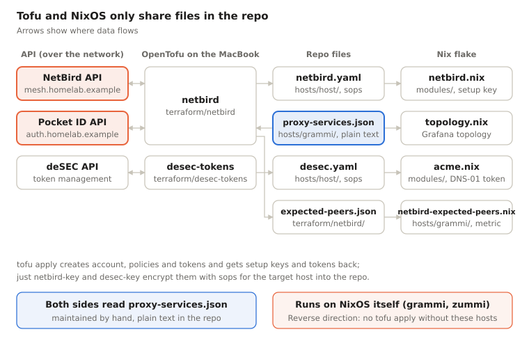

# nixlab – Project documentation

As of: 2026-10-19 · [Deutsch](README.de.md) · [PDF](nixlab-documentation.en.pdf) · [Website](https://tioan.github.io/nixlab-docs/)

> This documentation describes a private repo. The domain and internal addresses are replaced with example values: the domain with `homelab.example` ([RFC 2606](https://www.rfc-editor.org/rfc/rfc2606)), IPv4 per [RFC 5737](https://www.rfc-editor.org/rfc/rfc5737) (`192.0.2.0/24`, `198.51.100.0/24`, `203.0.113.0/24`), IPv6 per [RFC 3849](https://www.rfc-editor.org/rfc/rfc3849) (`2001:db8::/32`), the tailnet name with `example-tailnet.ts.net`. The real mesh range is a /22 out of RFC 1918. Modules, documentation and build tooling were written together with Claude (Anthropic). License: [MIT](LICENSE).


## Overview

nixlab is the flake monorepo for the **homelab.example** homelab: five NixOS hosts, a Mac mini running nix-darwin and the admin workstation gusto (a MacBook, nix-darwin + home-manager), plus three OpenTofu modules for the NetBird account, the deSEC API tokens and the GitHub repositories with their deploy keys. Everything is operated through a `justfile` from gusto; the hosts pull their own configuration from the private GitHub repo and update themselves overnight.

Short answer to the question *"Did you wire NixOS and OpenTofu together somehow?"*: **Yes, but deliberately loosely – through files in the repo, not through a shared tool.** OpenTofu writes sops-encrypted files into `hosts/<host>/` that the NixOS modules read at build time, and both sides read the same service list `hosts/grammi/proxy-services.json`. No terranix, no Tofu run from within Nix. Details in [NixOS & OpenTofu](#nixos--opentofu).

Audience: people who can read NixOS flakes, sops-nix and Terraform/OpenTofu.

## NixOS & OpenTofu

Yes, the two are wired together – with the repo as the shared interface. OpenTofu manages what exists outside the machines behind an API (NetBird account, deSEC tokens, Pocket ID groups); NixOS manages the machines. The two never talk to each other directly: Tofu only runs on the MacBook through `just`, Nix never evaluates Tofu state.



Tofu never writes to a host directly: every result ends up as a file in the repo and reaches the host only with the next deploy.

### The touch points

| Direction | File | Created by | Read by | Contents |
| --- | --- | --- | --- | --- |
| Tofu → NixOS | `hosts/<host>/netbird.yaml` | `just netbird-key <host>` (`tofu output setup_keys` → `sops encrypt`) | `modules/netbird.nix` (`sopsFile`) | One-time setup key, valid for 24 h |
| Tofu → NixOS | `hosts/<host>/desec.yaml` | `just desec-key <host>` (`tofu output acme_tokens` → `sops encrypt`) | `modules/acme.nix` (`sopsFile`) | deSEC token for TXT records only, VMs pinned to their IP |
| Tofu → NixOS | `terraform/netbird/expected-peers.json` | `just netbird-apply` (`tofu output expected_peers`, computed from the policies in `expected-peers.tf`) | `hosts/grammi/netbird-expected-peers.nix` (`builtins.readFile`) | Expected NetBird peers per host as metric `netbird_expected_peers`, next to the real network map in the NetBird dashboard (e.g. aldrin 6, grammi 8) |
| Tofu → NixOS | `terraform/netbird/admin-peers.json` | `just netbird-apply` (`tofu output admin_peers`, from the group `admin-workstations`, `admin-peers.tf`) | `flake.nix` (`builtins.readFile`, option `services.docsSite.allow`) | Mesh addresses of the admins' devices – who may read the private docs |
| shared | `hosts/grammi/proxy-services.json` | by hand | `terraform/netbird/reverse-proxy.tf` (`jsondecode(file(...))`) and `topology.nix` | Name → app, port, groups of the reverse proxy services |
| repo → both | `hosts/<host>/github.yaml` + `github-deploy.pub` | `just github-key <host>` (`ssh-keygen` → `sops encrypt`) | private half: `modules/deploy.nix` (`sopsFile`); public half: `terraform/github` (`file(...)`) | Deploy key for `/etc/nixos`; Tofu only ever sees the public half |
| NixOS → Tofu | NetBird server on grammi | `hosts/grammi/netbird.nix` | provider via `https://mesh.homelab.example` | The API Tofu runs against in the first place |
| NixOS → Tofu | Bootstrap tokens | `just netbird-setup-owner`, `netbird-proxy-token` (SSH to grammi, server API) | `terraform/netbird/secrets.yaml` and `hosts/grammi/netbird-proxy.yaml` | Owner PAT, proxy token |

The flow for a new host: Tofu creates the setup key, `just netbird-key` writes it encrypted for exactly that host (age key derived from its SSH host key) to `hosts/<host>/netbird.yaml`, commit, deploy within 24 h. The host registers itself on start; Tofu does not manage peers, it looks them up by name via `data "netbird_peer"`.

### What is deliberately not wired

- **No shared host list.** Hosts are listed three times: `nixosConfigurations` in `flake.nix`, `local.hosts` in the Tofu modules and `hosts :=` in the `justfile`. A new host has to be added in all three places.
- **No terranix / no Tofu in the Nix build.** Tofu state is local (gitignored, in the main checkout, also from worktrees) because it holds setup keys and tokens in plain text.
- **No provisioning of the machines.** The VMs are created by hand at the provider, ursalia/cuckoosegg following `docs/install-*.md`.
- **Public DNS** lives in DNSControl (its own repo, only linked in via symlink), not in Tofu.

So the line is: whatever Nix can build deterministically from the repo, Nix does. Whatever is created once through an API and returns a secret, Tofu does – and hands it over encrypted as a file.

## Secrets, network & access

### Secrets (sops-nix, age)

Every host file is encrypted for exactly two recipients: the age key derived from the host's SSH host key and the offline recovery key `admin`. So the MacBook cannot read host secrets – `just secrets <host>` edits them on the host and fetches the result back. Encrypting for a host, on the other hand, works anywhere (only the public key is needed); that is exactly what `netbird-key` and `desec-key` use.

| File | Recipients | Contents |
| --- | --- | --- |
| `hosts/<host>/secrets.yaml` | host + admin | Deploy key, app passwords, OIDC clients, restic |
| `hosts/<host>/netbird.yaml` | host + admin | NetBird setup key (from Tofu) |
| `hosts/<host>/desec.yaml` | host + admin | deSEC token (from Tofu) |
| `hosts/<host>/github.yaml` | host + admin | GitHub deploy key (from `just github-key`) |
| `terraform/*/secrets.yaml` | workstation + admin | API tokens for the providers |

The workstation key lives in 1Password and is read via `SOPS_AGE_KEY_CMD`, never as a file. `env.sh` in each Tofu module decrypts the tokens only into the shell of the respective recipe.

### Network

- **NetBird mesh** (`192.0.2.0/24`, peer names under `peer.homelab.example`): control plane on grammi, login via Pocket ID. Private range (RFC 1918) instead of CGNAT, because tailscaled drops packets from 100.64/10 while both clients run in parallel.
- **Groups:** `servers` (all hosts except cuckoosegg), `subraum-devices`, `admin-workstations` (MacBook), plus person groups from Pocket ID.
- **Home LAN** (`198.51.100.0/24`): routed through ursalia (metric 100), with the two Apple TVs as fallback (group `home-routers`, metric 200, own setup key via `just netbird-router-key`, owned by nobody, in no policy); for group `home-lan`, not for devices that are already at home (posture check `not-at-home`). The Apple TVs should have "Quantum-Resistance" on in the app; since 2026-10-21 the mesh runs Rosenpass permissive, so it works without, just not quantum-resistant.
- **ursalia's uplink:** WLAN into the home LAN's main network (Intel BE200, `hosts/ursalia/wifi.nix`): wpa_supplicant, WPA3 with WPA2 fallback, country DE, all bands, passphrase via sops. Its final spot has no cable; eno1 keeps DHCP as a fallback with a worse route metric, so the WLAN stays the primary link when both are up.
- **zorlock's uplink:** WLAN as well (`en1`, Broadcom); `hosts/zorlock/wifi.nix` makes sure `homelab` is a preferred network (`networksetup`, only ever adds it, passphrase via sops in `hosts/zorlock/wifi.yaml`). nix-darwin has no Wi-Fi module; band choice stays with macOS.
- **Subraum:** routed through cuckoosegg for `subraum-access`. cuckoosegg itself may only reach grammi's ingest (TCP 8428/9428) and may only be reached from the MacBook via SSH.
- **Tailscale** still runs in parallel during the migration and serves as break-glass: `NIXLAB_DOMAIN=example-tailnet.ts.net just deploy zummi`.

### Access

Only 22/80/443 are open to the public. `modules/ssh.nix` allows root SSH only from mesh or Tailscale addresses; every host has its own login keypair. The mesh is IPv4 only for now; dual stack is listed as an open item.

#### Apps on grammi: only through Traefik `:8090`

Mealie, Grist, logchef and Grafana listen on `127.0.0.1` only on grammi. The reverse proxy reaches them through Traefik's `apps` entrypoint (port 8090), which puts the maintenance switch and error pages in front of every app ([maintenance mode](#maintenance-mode)). VictoriaMetrics (8428) and VictoriaLogs (9428) still listen on all addresses, because the other hosts push their metrics and logs into them over the mesh.

**Deliberate gap:** `:8090` itself is open to every mesh peer (`nb-mesh` is trusted), without the proxy's SSO. Anyone in the mesh reaches every app directly with the matching `Host` header, VictoriaMetrics/-Logs even without a login, since they have none of their own. This is intended (2026-10-23): the NetBird policies decide who reaches grammi, and Mealie, Grist, logchef and Grafana ask for their own login. Revisit when peers that deserve less trust join the mesh, or once the proxy can reach loopback via `direct_upstream` ([open item](#open-items)).

#### Private docs: admin devices only

The private version of this documentation (`doku.homelab.example`, on aldrin and ursalia) contains every internal address and describes how the lab is run. That is more than every device in the mesh needs to see. So nginx serves it only to the mesh addresses of the admins' devices; everyone else gets 403 – with a page of its own that says why, which address the request came from and how a device gets in (without the navigation, so the page titles stay hidden). The name itself resolves for all peers.

**From outside** the same name leads to the public, anonymised docs (GitHub Pages): publicly `doku` is a CNAME to the reverse proxy, whose service `doku` hands it on without a login to a listener on aldrin (port 8091, mesh only) that knows nothing but a redirect. Whoever is in the mesh gets to aldrin and ursalia directly through the NetBird zone.

| Who | Path | Result |
| --- | --- | --- |
| Outside, or NetBird off | reverse proxy (grammi) → aldrin:8091 | 301 to the public docs |
| In the mesh, device in `admin-workstations` | straight to aldrin/ursalia | private docs |
| In the mesh, any other device | straight to aldrin/ursalia | 403 page |

**Why through the proxy:** this way `doku` is listed with the other public names in the NetBird dashboard instead of being a public vhost of its own on aldrin. The proxy cannot redirect by itself, only forward – hence the redirect listener. It has a port of its own rather than the docs vhost recognising the proxy by its address: the proxy is a peer of its own whose mesh address Tofu does not know. Linking `homelab.example` to the public docs is accepted on purpose; the real addresses stay replaced there.

**What counts as an admin device:** the devices in the group `admin-workstations` (`terraform/netbird/subraum.tf`), today the MacBook – the same device that may also SSH to the Subraum devices. Deliberately not the person group `homelab_admins`: that one is filled from Pocket ID with *all* devices of an admin user. Today that would be none (Calla has no devices of its own), and a phone signing in under an admin user would be in at once. An admin here is a device named in Tofu, not a login. A further device in `admin-workstations` therefore also gets SSH to the Subraum devices – the same trust. Tofu reads the members on every `just netbird-apply` and writes name → address to `terraform/netbird/admin-peers.json`; `flake.nix` hands the addresses to `services.docsSite.allow`. A new admin device therefore gets in after `just netbird-apply`, a commit and a deploy of aldrin and ursalia.

**Why nginx and not a NetBird policy:** `to-servers` lets the devices of all persons (`homelab` and `homelab_admins`) reach all ports on all servers. NetBird policies can only allow, never deny – a narrower rule for the docs would change nothing as long as `to-servers` stays as it is. Narrowing `to-servers` to a port list per service would work, but touches every service on every server for one static site. Moving the docs to a port of their own fails at the same point. So the policy still decides which hosts a device reaches, and nginx decides who gets the docs.

**Why no login (Pocket ID):** you read the docs when something is broken. A login would tie them to zummi (Pocket ID) and, through the reverse proxy, to grammi – exactly the hosts they are meant to be independent of. An address list needs nothing at runtime but nginx on the host itself.

**What this deliberately accepts:**

- The list is as current as the last `just netbird-apply` followed by a deploy. Until then a new admin device sees 403, and a removed device still gets in.
- The address stands for the device, not the person: whoever uses an admin device reads the docs.
- The list must never be empty – `just netbird-admin-peers` refuses an empty output, and the module fails the build with an assertion instead of quietly giving everyone 403.
- IPv4 only, like the mesh. With the IPv6 overlay the v6 addresses go into the same list.

#### Paperless: from outside, share links (PIN) and the app (SSO)

In the mesh `dokumente.homelab.example` resolves straight to ursalia through the NetBird zone (full app, Pocket ID login).

**From outside** `dokumente` is a CNAME to the reverse proxy. Its service `dokumente` offers two logins and hands both on to a listener on ursalia (port 8092, mesh only, HTTP through the tunnel):

- **PIN**, for third parties with a share link: `share/<slug>` only (documents and bundles, both paperless' `SharedLinkView`), 404 otherwise. An expired or unknown link makes paperless redirect to its login page; the listener answers that with a short note.
- **SSO** via Pocket ID (groups `paperless-users`/`paperless-admins`): the full app including paperless-gpt, as in the mesh. Paperless' own Pocket ID login still follows, usually without a prompt.

| Who | Path | Result |
| --- | --- | --- |
| Outside with PIN | reverse proxy (grammi) → ursalia:8092 | `/share/<slug>` only, 404 otherwise |
| Outside with SSO | reverse proxy (grammi) → ursalia:8092 | full app |
| In the mesh | straight to ursalia:443 | full app, share links without PIN |

**How the listener recognises SSO:** by the header `X-NetBird-User`. The proxy deletes whatever the client sends under that name on every request and sets it to the email address for SSO sessions only (`stampNetBirdIdentity` in NetBird, checked with 0.81.0 – check again on NetBird updates). The header only picks the paths, it logs nobody in: paperless still asks for its own login. A mesh peer sending the header straight to port 8092 gets nothing it would not get on 443 anyway.

**Why the same name:** paperless builds a share link from the origin of the UI. A link `https://dokumente.homelab.example/share/<slug>` therefore works for third parties without rewriting – whether created in the mesh or via SSO. A name of its own for either login would mean editing links by hand.

**Why the listener filters, not the PIN:** the PIN is a second hurdle in front of the unguessable slug, not a replacement for it. That PIN visitors do not see the app rests on nginx on ursalia alone. The proxy service has no path filter (target `path`), otherwise the redirect to `/accounts/login/` for expired links would no longer reach the listener.

**PIN:** exactly 6 digits (the NetBird API accepts nothing else), one for all shares. New one: `just dokumente-share-pin` (random, into `terraform/netbird/secrets.yaml`), then `just netbird-apply`; show it: `just dokumente-share-pin-show`. The proxy blocks a client address for 15 minutes after 5 wrong PINs within 5 minutes.

**What this deliberately accepts:**

- A still-valid PIN session (the proxy's cookie) skips the login page. Whoever then wants the app via SSO lands on a note page and has to clear the site data or use a private window first.
- Whoever knows the PIN gets every link whose slug they know – no others. So create shares in paperless with an expiry date.
- Telling PIN from SSO rests on a behaviour of the proxy, not on a documented interface.
- CrowdSec sees neither PIN attempts nor requests to the app (TCP passthrough, no HTTP log on grammi), as with every proxy name; the proxy's own block and paperless' login remain.
- ursalia's nginx logs the proxy's mesh address as the client, not the visitor's (no `realip`: it would rewrite the address before `allow`/`deny`).

#### Grafana: public dashboards through `dash`

Since 2026-10-23 dashboards can be shared outside ("Share externally", "public dashboards" in Grafana). Only the Grafana role Admin may do that; the SSO login grants it to the Pocket ID group `grafana_admins` (a group just for this, `terraform/netbird/people.tf`; members are kept in Pocket ID and count from the next Grafana login), everyone else stays Editor.

**The path:** `dash.homelab.example` is a reverse proxy service of its own **without a login**. It targets the same Traefik entrypoint `apps` on grammi as `metrics`, but for this name Traefik lets only `/public-dashboards/`, `/api/public/` and `/public/` (assets) through to Grafana; everything else gets a 404 from Traefik. That router is what keeps the app from anonymous visitors, not the proxy.

| Who | Path | Result |
| --- | --- | --- |
| Anyone with the link | reverse proxy → Traefik `apps` (host `dash`) → Grafana | the shared dashboard only, read-only |
| SSO | `metrics.homelab.example` | full app |

**Passing a link on:** Grafana builds it from `root_url`, so it reads `https://metrics.homelab.example/public-dashboards/<token>` – under `metrics` a guest lands at the SSO login. The link for guests is on the dashboard "Homelab / Shared dashboards": a timer on grammi asks Grafana's API every minute and writes each share with its `dash` address as the metric `grafana_public_dashboard_info` (`hosts/grammi/grafana-shares.nix`). Every dashboard links there at the top right ("Nach außen teilen"). The tokens thereby sit in VictoriaMetrics, visible to everyone who can open Grafana.

**Accepted on purpose:**

- The token in the link is the only secret, no PIN in front. A public dashboard is read-only and can be paused or deleted in Grafana at any time.
- Grafana cannot share dashboards with template variables publicly (e.g. dashboards with `$job`); those need a copy without variables. Every panel also needs its datasource's uid, which is why the uids are pinned in provisioning and named in every dashboard (`hosts/grammi/configuration.nix`).
- As with every proxy name, CrowdSec on grammi only sees what Traefik logs on the `apps` entrypoint, not the TLS part in front of it.

#### MQTT from outside: TLS passthrough to Home Assistant

`mqtt.homelab.example:8883` is the Mosquitto add-on on Home Assistant, for MQTT devices that are also used away from home (AWTRIX NG on an Ulanzi TC002). Same name, port and certificate everywhere, so a device is configured once:

| Where | Path |
| --- | --- |
| At home | the home router (OPNsense) answers `mqtt.homelab.example` with HA's LAN address (local DNS entry) → HA:8883 directly, also without internet |
| Outside | public CNAME to the reverse proxy → `netbird-proxy` on grammi, port 8883 → through the mesh to HA:8883 |

**HA is a NetBird peer** (NetBird add-on, `terraform/netbird/home-assistant.tf`), in a group of its own `home-assistant` – not in `servers`, so it reaches exactly two things and nothing reaches it but the proxy. NetBird's DNS management is off for that group: HA keeps resolving through the home router (OPNsense), also when the internet is gone.

**TLS ends in Mosquitto, not at the proxy.** The service `mqtt` (`terraform/netbird/reverse-proxy.tf`) runs in L4 mode `tls` with the peer HA as its target: the proxy reads only the SNI and passes the connection through untouched. For an L4 service with a port of its own the proxy binds that port itself on all addresses (only 127.0.0.1 has to send a PROXY header there); grammi's firewall opens 8883 in `hosts/grammi/netbird-proxy.nix`.

**The certificate** covers `homeassistant.homelab.example` and `mqtt.homelab.example`. HA's Let's Encrypt add-on gets it via DNS-01 – but without a deSEC token of its own (it could not be pinned to an address, the home address changes). It asks dns01proxy on grammi instead (`hosts/grammi/dns01proxy.nix`, provider `dns-httpreq`), at `https://acme.homelab.example:8446`:

- The port is open only on the mesh, and the policy `home-assistant-acme` lets only HA reach it. HA resolves the name through the home router (OPNsense) (local entry to grammi's mesh address, `tofu output acme_proxy_address`), every other peer through the NetBird zone.
- The proxy writes the TXT records with grammi's address-pinned token. HA's account (password in the add-on, bcrypt hash in `hosts/grammi/dns01proxy.yaml`, `just dns01proxy-key-homeassistant`) may only answer challenges for the two names above.
- dns01proxy serves HTTPS itself and fetches its own certificate for `acme.homelab.example` the same way.

**The two local DNS entries** are host overrides in Unbound on the OPNsense (Services → Unbound DNS → Overrides), set by hand – the API key `inventory-ro` is read-only:

| Name | Address | Why |
| --- | --- | --- |
| `mqtt.homelab.example` | 198.51.100.168 (HA's LAN address) | MQTT stays in the home network and works without internet |
| `acme.homelab.example` | 192.0.2.122 (grammi's mesh address, `tofu output acme_proxy_address`) | HA reaches dns01proxy; NetBird does not manage HA's DNS |

If HA's address or grammi's mesh address changes (new lease, NetBird re-registration), the override has to follow by hand.

The add-on does not renew by itself: an HA automation starts it daily and restarts Mosquitto weekly, so the renewed certificate gets loaded.

**What this deliberately accepts:**

- No login at the proxy – L4 has none. Mosquitto's own users are the only gate, and that includes every login the add-on accepts (its own list and Home Assistant users).
- Mosquitto sees the proxy's mesh address as the sender of every outside connection (the add-on cannot take a PROXY header), so neither HA nor CrowdSec can block a single client by address. The proxy can filter by country or address range (`access_restrictions`), not set for now.
- Certificate renewal needs grammi and the mesh – with 30 days of slack before expiry.
- A device that restarts while the internet is down needs the time from somewhere other than the internet to check the certificate.

## Deployment & operations

The pull hosts (zummi, aldrin, grammi, ursalia) keep `/etc/nixos` as a checkout of the private GitHub repo and build themselves. cuckoosegg is pushed to, zorlock and gusto are switched on the Mac itself with `darwin-rebuild` ([macOS hosts](#macos-hosts)).

| Host | Manual deploy | Automatic |
| --- | --- | --- |
| zummi, aldrin, grammi, ursalia | `just ship <host> "<message>"` = commit, push, `git pull` + `nixos-rebuild switch` on the host | nightly auto-upgrade, reboot window 04:00–06:00 |
| cuckoosegg | `just deploy-push cuckoosegg` (built on ursalia, copied to the target) | ursalia pushes daily at 06:30 |
| zorlock | `just mac-switch zorlock` (= `deploy-zorlock`: `git pull` + `darwin-rebuild switch` with sudo, with a summary) | none |
| gusto | `just mac-switch` on gusto, from the working copy | none – `just mac-upgrade` for the Homebrew pins |

### Nightly upgrade

`modules/auto-upgrade-git.nix` updates `nixpkgs`, `nixpkgs-unstable` and `sops-nix`, builds, switches and pushes the new `flake.lock` back to GitHub with the host's deploy key. The GitHub host key is pinned because nobody is watching. A configuration error that only shows up on a cold boot therefore takes the host down at 04:00 – for the VMs there is the provider's console for that.

## Monitoring

Everything ends up on grammi: **vmagent** on every host sends metrics to VictoriaMetrics (`:8428`), **Vector** sends journald and nginx logs to VictoriaLogs (`:9428`), both over the mesh. Grafana (`metrics`) and logchef (`logs`) sit behind the reverse proxy with SSO. Exporters per host come from `modules/metrics.nix`; whatever has no endpoint of its own goes through node_exporter's textfile collector (`/var/lib/prometheus-node-exporter-text-files`), written by small timers or services:

| Textfile metric | Host | Source |
| --- | --- | --- |
| `tailscale_*` | hosts with Tailscale | `tailscale metrics write`, every 30 s |
| `fwupd_updates_*` | ursalia | `fwupdmgr get-updates` after each metadata refresh |
| `wifi_link_*` | ursalia | `iw dev wlp2s0f0 link` (PHY mode, width, MCS, NSS), every 30 s |
| `node_wifi_*`, `wifi_link_*` | zorlock | `system_profiler SPAirPortDataType -json` every 60 s, same names as on ursalia (no receive rate, retries or separate receive PHY mode on macOS; macOS redacts SSID/BSSID without Location Services even for root, shown as "n/a" in the dashboard), plus `wifi_link_noise_dbm` |
| `unit_cgroup_*` | all Linux hosts | CPU time and memory per systemd service from its cgroup, every 15 s (`unit-metrics` in `modules/metrics.nix`); counts every process of the unit, containers with `--cgroups=split` included |
| `esphome_builder_data_bytes` | ursalia | Size of `/var/lib/esphome-builder` (toolchain cache), hourly |
| `grafana_public_dashboard_info` | grammi | public dashboards from Grafana's API with their `dash` link, every minute |
| `netbird_expected_peers` | grammi | `terraform/netbird/expected-peers.json`, baked into the system at build time |

The dashboards are JSON in `hosts/grammi/dashboards/`, provisioned from the repo (changes only via commit + deploy of grammi). `topology.json` is generated by `just topology`. "Export as image" is rendered by the Grafana image renderer on grammi (headless Chromium, loopback only `127.0.0.1:8082`); sharing outside see [access](#grafana-public-dashboards-through-dash).

| Dashboard | Shows |
| --- | --- |
| Hosts Overview | Scrape targets, CPU/memory/disk/network per host, failed units, certificates, backups (btrbk, restic), pending firmware, WLAN band/signal |
| Topology | Hosts, exporters and data flows as a Graphviz diagram |
| NetBird | Control plane reachable per host; peers per host as expected (Tofu) / known (network map) / connected P2P / connected relay, plus deviations; connection history, P2P latency, sync and setup times; netbird-server (signal, relay, gRPC, API) |
| WLAN | ursalia's and zorlock's band (2.4 / 5 / 6 GHz) over time, channel, signal, PHY mode, link rate, traffic, MCS, retries, time associated |
| Disk Health | SMART/NVMe of ursalia: status, critical warnings, wear, spare, temperature, data written |
| Paperless | Health (Celery, Redis, DB, index, classifier), documents, inbox, failed tasks, storage, log warnings |
| paperless-gpt | OCR and suggestion backlog, OCR time per page, LLM requests, durations, tokens, errors; zorlock's GPU and memory |
| ESPHome builds | The build server on ursalia: health, ESPHome version, builds and success rate, duration per build and device, CPU and memory next to Paperless, toolchain cache size, warnings. Builds and durations come from the log lines "Starting job …" / "Job … completed/failed" via LogsQL; device-builder has no metrics endpoint |
| Shared dashboards | Every public dashboard with the link for guests (`dash.homelab.example`) and whether it is paused; every dashboard links here at the top right |
| Web & Security | nginx and Traefik requests, status codes, durations; CrowdSec bans, alerts, parser hits |
| Garage (S3 storage) | aldrin's Garage: cluster health, disk, S3 requests/errors/duration, resync and GC queues |
| VictoriaMetrics & VictoriaLogs | Ingest rate, disk usage, query duration, active series |
| zorlock (Mac mini) | mactop: thermal state, CPU/GPU, power, temperatures, memory, fan; Ollama requests, speed, model load times |

**Expected vs. known peers (NetBird):** "expected" is computed by OpenTofu from the policies with the group membership at the last `just netbird-apply` (example: aldrin 6, grammi 8, cuckoosegg 4). "known" is what the management server really distributes. A device that joins later raises known at once, expected only after the next apply + deploy of grammi – on purpose, so a new peer is visible. The model ignores posture checks; see the header of `expected-peers.tf`.

**Log level:** Vector turns journald's `PRIORITY` into the `level` field. Python services log to stderr, so journald files every line as an error. Lines in the format `<date> <time> INFO|WARNING|ERROR …` therefore take their level from the text, minus the colour codes (`modules/log-shipping.nix`).

**Grafana pitfall:** state timelines with `mergeValues` and colour mode "thresholds" turn numbers into threshold buckets ("1+", "< 1") before value mappings are applied. Use colour mode "fixed" and put text and colour into the mappings.

## macOS hosts

Two machines in this repo run macOS with nix-darwin instead of NixOS: **zorlock**, the Mac mini serving Ollama, and **gusto**, the MacBook that is the admin workstation. Both are `darwinConfigurations` in the same flake and use the same darwin-tested nixpkgs (`nixpkgs-darwin`). Apart from that they are opposites – one is a server nobody sits at, the other a laptop that is only ever used by a person – and several things are therefore solved differently on purpose. This page explains what the two share, where they differ, and why.

| | zorlock | gusto |
| --- | --- | --- |
| Role | LLM server (Ollama for paperless-gpt) | Admin workstation: deploys, secrets, Tofu, docs |
| Configuration | `hosts/zorlock/` | `hosts/gusto/` (system) + `home.nix`, `ssh.nix` (home-manager) |
| Built and switched | on zorlock, from `/etc/nixos` (`just mac-switch zorlock`) | on gusto, from the working copy (`just mac-switch`) |
| Homebrew | off | on – the apps are casks |
| Software list | in `configuration.nix` | `hosts/gusto/apps.json` – `apps`, `apps-rm` |
| home-manager | no | yes, for admin's dotfiles |
| NetBird client | nix-darwin `services.netbird`, client from `nixpkgs-netbird` | Homebrew cask `netbird-ui` from NetBird's tap |
| NetBird login | setup key from sops, unattended | SSO (Pocket ID) in the app |
| SSH into it | yes, as admin, keys only | no – Remote Login stays off |
| sops secrets | yes (deploy key, deSEC token, NetBird key, Wi-Fi) | none |
| Monitoring, logs | vmagent, Vector → grammi | none – not in the topology |
| Availability | always on (`criticality: service`) | intermittent (`kind: laptop`) |

None of `modules/*.nix` applies to either Mac – those modules are written for NixOS (systemd, ifstate, nginx). What does carry over is restated in each host's `configuration.nix` in nix-darwin's terms. The one module the two share is `modules/darwin/homebrew.nix`.

### Homebrew: one policy for both Macs

Some macOS software exists only as a Homebrew cask, or should come signed by its vendor: 1Password, Vivaldi, Arq, Ghostty, the NetBird app. `modules/darwin/homebrew.nix` is imported by every `darwinConfiguration` and sets one policy (decided on 2026-10-21). It only takes effect where a host sets `homebrew.enable = true` – today that is gusto; on zorlock the module changes nothing, its system closure is identical with and without it.

**Homebrew and its taps are pinned in `flake.lock`.** Homebrew itself is not installed with the `curl | bash` script but by the `nix-homebrew` input. `homebrew-core`, `homebrew-cask` and every third-party tap are flake inputs (`flake = false`), with `mutableTaps = false`. There is no git checkout for `brew update` to move: which version of a cask a switch installs depends on `flake.lock` alone – the same logic as for nixpkgs. A host adds a tap with one line,

```nix
nix-homebrew.taps."netbirdio/homebrew-tap" = inputs.netbirdio-tap;
```

and `homebrew.taps` (the list nix-darwin writes into the Brewfile) is derived from that set automatically.

**A switch does what the configuration says – and nothing else.**

- `onActivation.autoUpdate = false`: no `brew update` during a switch.
- `onActivation.upgrade = false`: no `brew upgrade` during a switch either; an installed cask stays at its version until it is upgraded on purpose.
- `onActivation.cleanup = "zap"`: whatever is installed but not declared is removed, casks including their application data (`brew uninstall --zap`). Deleting a cask from the configuration (`apps.json`) therefore really uninstalls the app with its settings. `just mac-diff` shows this before it happens.
- `global.autoUpdate = false` and `global.brewfile = true`: the same for `brew` typed by hand, and `HOMEBREW_BUNDLE_FILE` points at the generated Brewfile, so a plain `brew bundle check` compares against the configuration.

Apps with their own updater, and Mac App Store apps, keep updating themselves; the policy only concerns what Homebrew does.

**No `brew shellenv`.** Neither nix-darwin's nor nix-homebrew's shell integration is used – both would run `brew shellenv` in every new shell and put Homebrew *in front of* Nix in `PATH`. Instead `/opt/homebrew/bin` and `sbin` are added to the system `PATH` directly, after the Nix profiles and before macOS' own directories:

```text
~/.nix-profile/bin : /etc/profiles/per-user/$USER/bin : /run/current-system/sw/bin : /nix/var/nix/profiles/default/bin : /opt/homebrew/bin : /opt/homebrew/sbin : /usr/local/bin : /usr/bin : …
```

A tool from Nix always wins over the same tool from Homebrew, Homebrew wins over Apple's stubs, and opening a shell starts no `brew` at all.

#### The mac-* recipes

| Recipe | What it does |
| --- | --- |
| `just mac-diff [host]` | Builds the configuration and shows what a switch would change: the Nix closure (`nvd diff`), the casks and formulae that would be **removed** (`brew bundle cleanup --zap` without `--force`) and those that would be **installed**. Changes nothing. |
| `just mac-switch [host]` | Builds, switches, and ends with a compact summary: Nix packages added/removed/updated (nvd) and Homebrew `- removed` / `+ new`. |
| `just mac-upgrade` | Updates only the Homebrew pins (`nix-homebrew`, `homebrew-core`, `homebrew-cask`, `netbirdio-tap`), switches, runs `brew upgrade` and prints `old -> new` per upgraded item, plus the NetBird client version on gusto next to the mesh's pin. The result is a `flake.lock` change to commit. |

The host defaults to `gusto`, which is built from the working copy (uncommitted changes included – but nix only sees files git knows, so `git add` new files first). `zorlock` is reached over SSH: `git pull` in `/etc/nixos`, then the same script under sudo. `deploy-zorlock` and `check-zorlock` are now short forms of `mac-switch zorlock` and `mac-diff zorlock`. The work itself is done by `modules/darwin/rebuild.sh` on the Mac.

`mac-upgrade` exists only for gusto: it changes `flake.lock`, which is committed on the workstation; zorlock has no Homebrew.

#### Software as data: apps.json

What a Mac runs – casks, Homebrew formulae, Mac App Store apps and nixpkgs packages – is not written into its `configuration.nix` but listed in `hosts/<host>/apps.json` (decided 2026-10-22; gusto today, zorlock does not opt in). `modules/darwin/apps.nix` turns the file into `homebrew.casks`, `homebrew.brews`, `homebrew.masApps`, `environment.systemPackages`, the user's `home.packages` and `fonts.packages`. Each entry is keyed by its name in its source and carries a `note` (why it is there) and the day it was `added`; nixpkgs entries also a `scope` (`system`, `user`, `font`). Taps stay Nix, in the host's configuration – they are flake inputs.

The file is data on purpose: a tool can add and remove entries without parsing Nix, and the configuration checks it on every evaluation – unknown sources or fields, a nixpkgs attribute that does not exist, an entry from a tap the host does not pin – and lists every problem at once (`checks.darwin-apps`). `modules/darwin/apps.schema.json` gives the editor completion and hover help.

`apps` is that tool (`pkgs/nixlab-apps`): one round of searching, adding and removing, then one switch and one commit. It searches nixpkgs, Homebrew and the Mac App Store online, groups the hits that are the same software and marks the recommended source – for a GUI app cask before App Store before nixpkgs (signed, in `/Applications`, updates itself), for a command line tool nixpkgs before a formula. The pick is then checked against the **pin**, because a switch installs what `flake.lock` says, not what the search showed: a nixpkgs package must evaluate in `nixpkgs-darwin` (available, not unfree), a cask or formula must be in the pinned tap. A missing cask or formula can bump `homebrew-cask` / `homebrew-core` in a commit of its own – harmless, `upgrade = false` leaves installed casks alone. `nixpkgs-darwin` is never bumped there: it is the whole system of both Macs. Steps: [Software on the Macs](#software-on-the-macs).

### NetBird on the two Macs

Both Macs are peers in the NetBird mesh, but they get their client in two different ways. This is deliberate.

#### zorlock: nix-darwin module, client from the mesh pin

`hosts/zorlock/netbird.nix` turns on nix-darwin's `services.netbird`. That module runs only the daemon – `netbird service run` as a launchd daemon, as root, state in `/var/lib/netbird` – and leaves login and settings to the user. The rest is done by a second launchd job, `netbird-login`, the same pattern as on the Linux hosts:

- The **client binary** comes from the `nixpkgs-netbird` input, the pin the NetBird server on grammi and every NixOS client use. The whole mesh moves together with `nix flake update nixpkgs-netbird` – server first, then the clients.
- **Login** is unattended: `netbird-login` registers once with a single-use setup key from `hosts/zorlock/netbird.yaml` (sops, `just netbird-key zorlock`). After that the key is spent and the peer's identity lives in `/var/lib/netbird/config.json`.
- **Rosenpass** (permissive, like everywhere) and the client's local Prometheus endpoint (`127.0.0.1:9191`, scraped by vmagent) are turned on by the same job – nix-darwin's module has no `config.d` like the NixOS one.
- After a reboot zorlock joins the mesh only once FileVault has been unlocked (over SSH from the home LAN), because the daemon lives on the data volume.

That is what a server needs: no GUI session (zorlock should stay logged out, Ollama counts free RAM), coming back by itself, the same client version as the rest of the mesh, and metrics.

#### gusto: the official app as Homebrew cask

gusto installs `netbirdio/homebrew-tap/netbird-ui`, the cask from NetBird's own tap, pinned as the flake input `netbirdio-tap` (decided on 2026-10-21). The cask is the signed menu-bar app; it depends on the formula `netbird` from the same tap (the CLI and daemon), and its installer registers the daemon as `/Library/LaunchDaemons/netbird.plist`. That is the same software the official `.pkg` installer puts on a Mac, only installed and removed through the configuration. The formula is also listed on its own (`homebrew.brews`), so `cleanup = "zap"` can never treat the daemon as an orphan and remove it from under the app.

- **Login** is interactive: in the app, with SSO through Pocket ID – the peer then belongs to the admin's user and its groups, the way a person's device should. There is no setup key and no sops file for gusto.
- **Rosenpass** is set once in the app's settings (Quantum-Resistance); the daemon keeps it in its own config. Since 2026-10-21 it is **off** on the workstation – a test against tunnels that stayed "Connected" without a WireGuard handshake after the Rosenpass key expired (upstream #3107, #3121); every other peer stays permissive so it still accepts the workstation. gusto starts the same way, off. If the dead tunnels persist, Rosenpass goes off everywhere; if they are gone, the setting stays as it is until upstream fixes the re-keying.
- **Version**: whatever the pinned tap holds. It changes only with `just mac-upgrade`, which prints gusto's client version next to `nixpkgs-netbird`'s so the two do not drift far apart. The usual rule still applies: the server (grammi) is updated first, clients follow.
- **Updates from elsewhere**: the app's own update notice and NetBird's dashboard-driven auto-update must not move the version behind the configuration's back; this is checked on the first switch and switched off if the app offers it.
- No metrics endpoint and no log shipping – gusto is not monitored.

#### Why not the same on both?

| Question | Answer |
| --- | --- |
| Why does gusto not use the nix-darwin module like zorlock? | That module has no menu-bar app; everything would be CLI. On a laptop that changes networks all the time, the app is how one sees at a glance whether the mesh is up, switches profiles and signs in again. Login on gusto is SSO anyway, which needs a browser and a person – the unattended setup-key job that makes zorlock's variant worthwhile does not apply. |
| Why does zorlock not use the cask? | A server must come back on its own after a reboot, without anybody signing in, with the same client version as the mesh and with metrics. The cask's app needs a GUI session, and its version follows the tap, not the mesh pin. |
| Why not `netbird-ui` from nixpkgs on gusto? | nixpkgs packages the UI for Linux first; whether it builds and runs properly on macOS (signing, the menu-bar integration) is not verified, and it would not be the signed binary NetBird ships. |
| Mac App Store? | NetBird offers no Mac App Store version (only iOS). |
| What is the price? | gusto's client version is pinned separately from the mesh's (`netbirdio-tap` instead of `nixpkgs-netbird`). `just mac-upgrade` makes the gap visible; it is closed by hand. |

#### The peer in Tofu

`terraform/netbird/subraum.tf` looks up the admin workstation by peer name (`data "netbird_peer"`) for the group `admin-workstations` – the group that may reach the Subraum devices and the docs site. Changing the workstation (old MacBook → gusto) is done with both peers in the group for a short while: add a second data source `gusto`, `just netbird-apply`, deploy aldrin and ursalia (docs site allow-list), test, and only then remove the old peer.

### gusto in detail

The reasons behind gusto's setup; the complete list of what is on it, every setting and the day-to-day tasks are on [gusto – the admin workstation](#gusto--the-admin-workstation).

#### Starting from scratch

gusto was set up deliberately bare (2026-10-21): no app list taken over from the old installation, only a small base. Everything else is added the moment it is needed – `apps` (into `hosts/gusto/apps.json`, switch, commit), and, if there is data, it comes back from the backup.

| Where | What |
| --- | --- |
| Casks | 1Password + `1password-cli`, Vivaldi, Arq, Claude, Ghostty, NetBird |
| System (`environment.systemPackages`) | git, gh, just, jq, neovim (`EDITOR`), curl, wget, rsync |
| admin (home-manager) | zsh, atuin, fzf, zoxide, direnv + nix-direnv, bat, eza, ripgrep, fd, tree, lazygit, btop, yazi, tmux, nvd, nix-output-monitor, uv, typst |
| Font | Maple Mono NF (Nerd Font) for Ghostty and the TUIs |
| Repo tools | sops, age, ssh-to-age, opentofu, nvd – from the flake's devShell; dnscontrol from a separate one for the DNSControl repo, see below |

`op` comes as a cask and not from nixpkgs because the CLI unlocks through the 1Password app with Touch ID, which only works with the vendor's signed binary.

#### XDG and home-manager

Project rule: configuration lives under `~/.config/<tool>` wherever the tool supports it – zsh (`ZDOTDIR=~/.config/zsh`), git (`~/.config/git/config`), Ghostty, tmux, direnv. A tool without XDG support keeps its real file in the classic place and gets a link `~/.config/<tool>` pointing at it, e.g. `~/.config/ssh → ~/.ssh`. Data goes to `~/.local/share`, state (zsh history) to `~/.local/state`.

`PATH` gets exactly one personal directory, `~/.local/bin`: `GOBIN` points there, `CARGO_INSTALL_ROOT` is `~/.local`, and `uv tool install` uses it by default. `GOPATH` and `CARGO_HOME` live under `~/.local/share`. No `~/go/bin`, `~/.cargo/bin` or pnpm path any more.

git: name `admin`, default address `mail@admin.org`; for everything below `~/Projects/homelab/` an `includeIf gitdir:` switches to `admin@homelab.example`.

#### SSH: 1Password only

The private keys exist only in 1Password; its agent offers them. Two links make the agent reachable under a path without spaces: `~/.1password/agent.sock` (home-manager) and `SSH_AUTH_SOCK` – in every shell (home-manager) and for GUI apps through `launchd.user.envVariables`.

`~/.ssh/config` is generated by home-manager (`hosts/gusto/ssh.nix`):

- **Global lines first**, before any `Host` block (`extraOptionOverrides`): `IdentityAgent`, `IdentitiesOnly`, `Compression`, `SendEnv`. The first value ssh finds wins, so no later block – and no included file – can point the agent elsewhere. Exactly that had broken the old config: an included file's `Host *` sent IdentityAgent to another user's agent.
- **One key per target**: `IdentityFile` names the *public* half (`hosts/gusto/ssh/*.pub`, linked to `~/.ssh/pub/`). That tells the agent which key to offer; the private half never touches the disk.
- **Lab hosts are generated** from `inventory.json` – every managed host except gusto: `<host>` / `<host>.peer.homelab.example` over the mesh as root (zorlock as admin); `<host>.example-tailnet.ts.net` while Tailscale still runs; and for hosts with a public address (aldrin, grammi, zummi) `<host>.homelab.example` as admin – root is refused on public addresses (`modules/ssh.nix`), so this fallback works when the mesh is down. The alternative names use `HostKeyAlias <host>.peer.homelab.example`, so all of them are checked against the one host key from the inventory.
- **Host keys** come from the inventory (`/etc/ssh/ssh_known_hosts`, like on every host); GitHub's key is pinned in `configuration.nix`. `just known-hosts` is not needed on gusto.
- By hand: `zorlock-lan` (FileVault unlock), `opnsense`, `arkkvm`/`arkkvm01`, the Subraum router as jump host (with its port forwards), vogon, amnesia, unifi, git.c3pb.de, edi, a block for old switches that only *adds* legacy algorithms (`+…`), and GitHub (with a 60 s ControlMaster).

#### devShell and direnv

The repo's own tools are not installed globally. `flake.nix` has `devShells.aarch64-darwin.default` with sops, age, ssh-to-age, opentofu and nvd from the flake's pins; `.envrc` (`use flake`) makes direnv load it whenever a shell enters the checkout – once per checkout `direnv allow`. nix-direnv caches the shell and protects it from garbage collection. The docs tools are not in it: `just docs` and `just docs-serve` fetch their own through `nix shell`.

sops on gusto takes the workstation's age key straight from 1Password: home-manager sets `SOPS_AGE_KEY_CMD='op read "op://<vault>/<item>/password"'`, `op` unlocks with Touch ID through the app – no `op signin`, no key file.

#### DNSControl

The public DNS records live in the repo next door, `~/Projects/homelab/DNSControl` (local, no remote; linked in here as the `dnsconfig.js` symlink). dnscontrol comes from a second, slim devShell `devShells.aarch64-darwin.dns` that holds nothing but dnscontrol and sops; the `.envrc` there loads it with `use flake ../nixlab#dns`. DNSControl gets no `flake.nix` of its own – that keeps dnscontrol on this flake's pins, with no second `flake.lock`.

The providers' credentials (deSEC, OVH, hosting.de) live sops-encrypted in `creds.sops.json` in the repo, never in plaintext on disk. The `.sops.yaml` there names the same recipients as the Tofu modules: the workstation key and the `admin` recovery key – so they stay readable without 1Password. A wrapper does the rest:

- `bin/dnscontrol` sits in front of the real binary through the `.envrc` (`PATH_add bin`), which stores the real one's path in `DNSCONTROL_BIN`.
- For the commands that talk to providers – `preview`, `push`, `ppreview`, `ppush`, `check-creds`, `get-zones`, `get-certs` – it adds `--creds '!sops -d …/creds.sops.json --output-type json'`, unless `--creds` is on the line already. Everything else it passes through unchanged. `--output-type` comes last on purpose: dnscontrol takes a `--creds` value ending in `.json` for a file name, even after the `!`.
- sops decrypts with the workstation key (`SOPS_AGE_KEY_CMD`, Touch ID), dnscontrol reads the JSON from its output. None of it touches the disk.

The commands stay `dnscontrol preview` and `dnscontrol push`. Changing a token means `sops creds.sops.json` and a commit. The repo's `.gitignore` blocks a `creds.json`, so plaintext never gets in again. An executable `creds.json` instead of the wrapper does not work: dnscontrol does not check the executable bit for names ending in `.json`.

## Add a new host

A host appears in several places in the repo, because NixOS and OpenTofu deliberately share no host list (see [What is deliberately not wired](#what-is-deliberately-not-wired)). This guide walks through them in order.

### 1. Provide the machine

Rented VMs are created by hand at the provider; bare metal and the Subraum VM follow the installation guides in `docs/install-*.md`. The result is a NixOS install with an SSH host key – the host's age key is derived from it next.

### 2. Create the configuration

- Create `hosts/<host>/configuration.nix` and `hardware-configuration.nix`.
- Add it to `nixosConfigurations` in `flake.nix` with an explicit module list. Whatever is left out on purpose gets a comment saying why.

### 3. Add it wherever hosts are listed

| File | Entry |
| --- | --- |
| `flake.nix` | `nixosConfigurations.<host>` |
| `inventory.json` | `hosts.<host>` with `"managed": true` – kind, site, owner, unlock (see [Inventory](#inventory)) |
| `justfile` | `hosts := "…"` (pull hosts only, for `ship-all`) |
| `terraform/netbird/main.tf` | `local.hosts`: host → setup key group (`servers` or similar) |
| `terraform/desec-tokens/main.tf` | `local.hosts`: allowed source addresses, `acme_names` |
| `terraform/github/main.tf` | `local.hosts`: deploy key read-only or with write access |

### 4. sops recipient

Derive the age key from the new host's SSH host key (`ssh-to-age` on `/etc/ssh/ssh_host_ed25519_key.pub`) and add it to `.sops.yaml`: an anchor under `keys` and a `creation_rule` for `hosts/<host>/(secrets|netbird|desec|github)\.yaml$` with the host and `admin` as recipients. The public host key itself goes into `inventory.json` (`sshHostKeys`, or later via `just inventory-collect`); `checks.inventory-sops` compares the two.

### 5. Mint keys and tokens

| Recipe | Result | Note |
| --- | --- | --- |
| `just netbird-key <host>` | `hosts/<host>/netbird.yaml` | one-off setup key, **valid for 24 h** – deploy right after |
| `just desec-key <host>` | `hosts/<host>/desec.yaml` | only for hosts with their own certificates |
| `just github-key <host>` | `hosts/<host>/github.yaml` + `github-deploy.pub` | pull hosts only |

Recipes that need sops take the workstation key from 1Password (on gusto set up by home-manager, see [just recipes](#just-recipes)).

### 6. Deploy and check

- First deploy within 24 h of `netbird-key`. The host registers itself in the mesh at startup; Tofu finds it by name through `data "netbird_peer"`.
- Run `just topology` and commit the result – otherwise `nix flake check` fails.
- `just inventory-collect` (host key, interfaces), set `network`/`ipv4` by hand, then `just inventory-test`; `just mac-switch` on gusto (its known_hosts comes from the inventory) – a new managed host also gets its SSH block there automatically, with `hosts/gusto/ssh/<host>.homelab.example.pub`.
- Add app secrets once the host is running: [Add secrets](#add-secrets).
- Update the docs: [Hosts & roles](#hosts--roles), [Services](#services-2).

## Publish a new service

Services are named by function (`rezepte`, not `mealie`); new web services on grammi use PostgreSQL. First decide how the service should be reachable – that decides which files change.

| Reachability | For | Examples |
| --- | --- | --- |
| Mesh only | admin UIs, services for your own devices | `s3-admin`, `llm` |
| Public behind the reverse proxy with SSO | web apps that should work on the road without the NetBird app | `rezepte`, `grist`, `metrics`, `dokumente` |
| Directly public | services with their own login, for machines or everyone | `auth`, `s3.aldrin` |

### Mesh only

1. One line under `local.mesh_services` in `terraform/netbird/mesh-services.tf`: name → host(s). This creates a NetBird DNS zone of its own with A record(s) on the mesh address(es); public DNS does not know the name.
2. `just netbird-apply` – since NetBird 0.81 new zones reach the clients without a restart.
3. On the host an nginx vhost with `enableACME`, `acmeRoot = null` (DNS-01 via deSEC) and `allow 192.0.2.0/24; deny all;`.
4. If the service runs on ursalia or zorlock: add the name to the host's `acme_names` in `terraform/desec-tokens/main.tf` and run `just desec-apply` – their tokens may only write exactly those TXT records.
5. Deploy the host, `just topology` (new vhost).

### Public behind the reverse proxy

For services on grammi:

1. An entry in `hosts/grammi/proxy-services.json`: name → app, port, Pocket ID groups, optionally `start` (where `/` redirects to). Tofu (`reverse-proxy.tf`), Traefik and `topology.nix` read the same file; the proxy reaches every app through Traefik `:8090`.
2. The service listens on `127.0.0.1` only – Traefik connects over loopback, nothing more is needed ([apps on grammi](#apps-on-grammi-only-through-traefik-8090)).
3. Push a CNAME `<name>` → `proxy.homelab.example` in DNSControl – a few minutes before the apply, otherwise the resolver caches NXDOMAIN.
4. Deploy grammi first, then `just netbird-apply`. At the end it runs `just netbird-proxy-certs`: it requests every new name once from outside so the proxy fetches its certificate, then restarts `netbird-proxy` once – otherwise the dashboard hangs at "Issuing certificate…" (NetBird discussion #7118).

Services on other hosts get a resource of their own in `terraform/netbird/reverse-proxy.tf` with the host as peer target (examples: `dokumente` on ursalia – SSO for the app, a PIN for share links only –, `doku` on aldrin). Here too: push the CNAME first, `just netbird-apply` takes care of the certificates.

### Directly public

nginx vhost on the host (ACME via DNS-01), A/AAAA records in DNSControl, CrowdSec reads the nginx logs. Only for services that have a login of their own anyway.

### Afterwards

- Docs: [Services](#services-2), and [Contents of hosts/&lt;host&gt;/](#contents-of-hostshost) if new files appear there.
- Dual stack wherever possible (A and AAAA).
- Maintenance switch and error pages: [maintenance mode](#adding-a-service) – automatic on grammi, one entry in the host elsewhere.

## Maintenance mode

A service can be closed for maintenance without stopping it: whoever opens it gets a page with status 503, the reason and `Retry-After`; the service itself keeps running and stays reachable for tests. The same page appears with 502 or 504 when the service does not answer – during a `switch`, say. Module: `modules/maintenance.nix`.

### How it works

Every HTTP path to a service ends at nginx or Traefik on the host the service runs on – the path through the NetBird reverse proxy too, which only passes requests on. That is where the maintenance switch and the error pages sit; which software it is, is a detail per host.

<figure class="nx-diagram">
<svg viewBox="0 0 680 530" role="img" aria-label="Paths to the services: every HTTP path ends at nginx or Traefik on the target host, where the maintenance switch and the error pages sit" xmlns="http://www.w3.org/2000/svg">
<style>.nx-t{font-family:'DejaVu Sans',sans-serif;font-size:14px;font-weight:bold;fill:#2c2c2a}.nx-s{font-family:'DejaVu Sans',sans-serif;font-size:11px;fill:#5f5e5a}.nx-line{fill:none;stroke:#888780;stroke-width:1.4}.nx-gray rect{fill:#f1efe8;stroke:#888780}.nx-gray .nx-t{fill:#2c2c2a}.nx-gray .nx-s{fill:#5f5e5a}.nx-teal rect{fill:#e1f5ee;stroke:#0f6e56}.nx-teal .nx-t{fill:#04342c}.nx-teal .nx-s{fill:#0f6e56}</style>
<text class="nx-s" x="62" y="30" text-anchor="middle">Source</text>
<text class="nx-s" x="172" y="30" text-anchor="middle">grammi entry</text>
<text class="nx-s" x="298" y="30" text-anchor="middle">Proxy</text>
<text class="nx-s" x="432" y="30" text-anchor="middle">Front at target</text>
<text class="nx-s" x="584" y="30" text-anchor="middle">Services</text>
<g class="nx-gray"><rect x="20" y="48" width="84" height="50" rx="8" stroke-width="1"/><text class="nx-t" x="62" y="78" text-anchor="middle">Internet</text></g>
<path class="nx-line" d="M104 73 H368"/><path class="nx-line" d="M362 69 L368 73 L362 77"/>
<a data-target="nginx" tabindex="0" role="link" class="nx-teal"><rect x="370" y="48" width="124" height="50" rx="8" stroke-width="1"/><text class="nx-t" x="432" y="70" text-anchor="middle">nginx</text><text class="nx-s" x="432" y="87" text-anchor="middle">aldrin, zummi</text></a>
<path class="nx-line" d="M494 73 H506"/><path class="nx-line" d="M500 69 L506 73 L500 77"/>
<g class="nx-gray"><rect x="508" y="48" width="152" height="50" rx="8" stroke-width="1"/><text class="nx-s" x="584" y="69" text-anchor="middle">s3.aldrin, cloud,</text><text class="nx-s" x="584" y="85" text-anchor="middle">auth</text></g>
<g class="nx-gray"><rect x="20" y="110" width="84" height="50" rx="8" stroke-width="1"/><text class="nx-t" x="62" y="140" text-anchor="middle">Internet</text></g>
<path class="nx-line" d="M104 135 H116"/><path class="nx-line" d="M110 131 L116 135 L110 139"/>
<g class="nx-gray"><rect x="118" y="110" width="108" height="50" rx="8" stroke-width="1"/><text class="nx-t" x="172" y="140" text-anchor="middle">Traefik :443</text></g>
<path class="nx-line" d="M226 135 H238"/><path class="nx-line" d="M232 131 L238 135 L232 139"/>
<g class="nx-gray"><rect x="240" y="110" width="116" height="50" rx="8" stroke-width="1"/><text class="nx-t" x="298" y="140" text-anchor="middle">netbird-proxy</text></g>
<path class="nx-line" d="M356 135 H368"/><path class="nx-line" d="M362 131 L368 135 L362 139"/>
<a data-target="nginx" tabindex="0" role="link" class="nx-teal"><rect x="370" y="110" width="124" height="50" rx="8" stroke-width="1"/><text class="nx-t" x="432" y="132" text-anchor="middle">nginx</text><text class="nx-s" x="432" y="149" text-anchor="middle">ursalia :8092</text></a>
<path class="nx-line" d="M494 135 H506"/><path class="nx-line" d="M500 131 L506 135 L500 139"/>
<g class="nx-gray"><rect x="508" y="110" width="152" height="50" rx="8" stroke-width="1"/><text class="nx-s" x="584" y="140" text-anchor="middle">dokumente</text></g>
<g class="nx-gray"><rect x="20" y="172" width="84" height="50" rx="8" stroke-width="1"/><text class="nx-t" x="62" y="202" text-anchor="middle">Internet</text></g>
<path class="nx-line" d="M104 197 H116"/><path class="nx-line" d="M110 193 L116 197 L110 201"/>
<g class="nx-gray"><rect x="118" y="172" width="108" height="50" rx="8" stroke-width="1"/><text class="nx-t" x="172" y="202" text-anchor="middle">Traefik :443</text></g>
<path class="nx-line" d="M226 197 H238"/><path class="nx-line" d="M232 193 L238 197 L232 201"/>
<g class="nx-gray"><rect x="240" y="172" width="116" height="50" rx="8" stroke-width="1"/><text class="nx-t" x="298" y="202" text-anchor="middle">netbird-proxy</text></g>
<path class="nx-line" d="M356 197 H368"/><path class="nx-line" d="M362 193 L368 197 L362 201"/>
<a data-target="traefik" tabindex="0" role="link" class="nx-teal"><rect x="370" y="172" width="124" height="50" rx="8" stroke-width="1"/><text class="nx-t" x="432" y="194" text-anchor="middle">Traefik :8090</text><text class="nx-s" x="432" y="211" text-anchor="middle">all grammi apps</text></a>
<path class="nx-line" d="M494 197 H506"/><path class="nx-line" d="M500 193 L506 197 L500 201"/>
<g class="nx-gray"><rect x="508" y="172" width="152" height="50" rx="8" stroke-width="1"/><text class="nx-s" x="584" y="193" text-anchor="middle">vm, vl, rezepte,</text><text class="nx-s" x="584" y="209" text-anchor="middle">grist, logs, metrics</text></g>
<g class="nx-gray"><rect x="20" y="234" width="84" height="50" rx="8" stroke-width="1"/><text class="nx-t" x="62" y="264" text-anchor="middle">Mesh</text></g>
<path class="nx-line" d="M104 259 H368"/><path class="nx-line" d="M362 255 L368 259 L362 263"/>
<a data-target="nginx" tabindex="0" role="link" class="nx-teal"><rect x="370" y="234" width="124" height="50" rx="8" stroke-width="1"/><text class="nx-t" x="432" y="256" text-anchor="middle">nginx</text><text class="nx-s" x="432" y="273" text-anchor="middle">ursalia :443</text></a>
<path class="nx-line" d="M494 259 H506"/><path class="nx-line" d="M500 255 L506 259 L500 263"/>
<g class="nx-gray"><rect x="508" y="234" width="152" height="50" rx="8" stroke-width="1"/><text class="nx-s" x="584" y="264" text-anchor="middle">dokumente</text></g>
<g class="nx-gray"><rect x="20" y="296" width="84" height="50" rx="8" stroke-width="1"/><text class="nx-t" x="62" y="326" text-anchor="middle">Internet</text></g>
<path class="nx-line" d="M104 321 H238"/><path class="nx-line" d="M232 317 L238 321 L232 325"/>
<g class="nx-gray"><rect x="240" y="296" width="116" height="50" rx="8" stroke-width="1"/><text class="nx-t" x="298" y="318" text-anchor="middle">netbird-proxy</text><text class="nx-s" x="298" y="335" text-anchor="middle">:8883, TCP only</text></g>
<path class="nx-line" d="M356 321 H368"/><path class="nx-line" d="M362 317 L368 321 L362 325"/>
<g class="nx-gray"><rect x="370" y="296" width="124" height="50" rx="8" stroke-width="1" stroke-dasharray="5 4"/><text class="nx-t" x="432" y="326" text-anchor="middle">none</text></g>
<path class="nx-line" d="M494 321 H506"/><path class="nx-line" d="M500 317 L506 321 L500 325"/>
<g class="nx-gray"><rect x="508" y="296" width="152" height="50" rx="8" stroke-width="1"/><text class="nx-s" x="584" y="326" text-anchor="middle">mqtt (Home Assistant)</text></g>
<g class="nx-gray"><rect x="20" y="358" width="84" height="50" rx="8" stroke-width="1"/><text class="nx-t" x="62" y="388" text-anchor="middle">Internet</text></g>
<path class="nx-line" d="M104 383 H116"/><path class="nx-line" d="M110 379 L116 383 L110 387"/>
<g class="nx-gray"><rect x="118" y="358" width="108" height="50" rx="8" stroke-width="1"/><text class="nx-t" x="172" y="388" text-anchor="middle">Traefik :443</text></g>
<path class="nx-line" d="M226 383 H238"/><path class="nx-line" d="M232 379 L238 383 L232 387"/>
<g class="nx-gray"><rect x="240" y="358" width="116" height="50" rx="8" stroke-width="1"/><text class="nx-t" x="298" y="380" text-anchor="middle">netbird-proxy</text><text class="nx-s" x="298" y="397" text-anchor="middle">target switched</text></g>
<path class="nx-line" d="M356 383 H368" stroke-dasharray="5 4"/><path class="nx-line" d="M362 379 L368 383 L362 387"/>
<a data-target="proxy-maintenance" tabindex="0" role="link" class="nx-teal"><rect x="370" y="358" width="124" height="50" rx="8" stroke-width="1" stroke-dasharray="5 4"/><text class="nx-t" x="432" y="380" text-anchor="middle">Maintenance page</text><text class="nx-s" x="432" y="397" text-anchor="middle">grammi :8090</text></a>
<g class="nx-gray"><rect x="508" y="358" width="152" height="50" rx="8" stroke-width="1"/><text class="nx-s" x="584" y="379" text-anchor="middle">when the target host</text><text class="nx-s" x="584" y="395" text-anchor="middle">is down entirely</text></g>
<a data-target="switching" tabindex="0" role="link" class="nx-teal"><rect x="20" y="430" width="640" height="56" rx="8" stroke-width="1"/><text class="nx-t" x="340" y="453" text-anchor="middle">Shared on every host with a front</text><text class="nx-s" x="340" y="472" text-anchor="middle">Flag in /var/lib/maintenance · page 503/502/504 · bypass cookie</text></a>
<g class="nx-teal"><rect x="20" y="504" width="14" height="14" rx="3" stroke-width="1"/></g><text class="nx-s" x="42" y="515">maintenance check and error pages</text>
<g class="nx-gray"><rect x="340" y="504" width="14" height="14" rx="3" stroke-width="1" stroke-dasharray="3 2"/></g><text class="nx-s" x="362" y="515">dashed: proxy maintenance, only when needed</text>
</svg>
</figure>

- **Flag**: `/var/lib/maintenance/<fqdn>` (or `all` for the whole host). The file's content is the reason on the page. Flags survive a reboot – maintenance stays on until someone ends it.
- **Page**: a small program on every host (`maintenance-responder`, 127.0.0.1:8089 only, started on demand by systemd). It decides between maintenance (503) and failure (502/504) the same way for nginx and Traefik.
- **Bypass**: one cookie for every name under `homelab.example` that keeps the service reachable in the browser despite maintenance.

### Switching on and off

From the workstation; the host is looked up in `inventory.json`:

```bash
just maintenance dokumente on "Paperless upgrade, until about 10 pm"
```

```bash
just maintenance dokumente off
```

```bash
just maintenance-list
```

A name without a dot gets `.homelab.example` appended. A whole host (every name with a maintenance switch there):

```bash
just maintenance all on "Moving to new hardware" aldrin
```

```bash
just maintenance all off "" aldrin
```

On the host itself the same works with `maintenance on|off|status`. Neither nginx nor Traefik needs a reload; nginx checks the flag on every request, Traefik picks the change up after two to four seconds.

Which names have a maintenance switch:

| Host | Names | Front |
| --- | --- | --- |
| aldrin | `s3.aldrin`, `cloud` | nginx |
| zummi | `auth` | nginx |
| ursalia | `dokumente` (443 and the proxy listener 8092) | nginx |
| grammi | every name in `hosts/grammi/proxy-services.json` | Traefik `:8090` |

Side effects: `s3.aldrin` in maintenance means every host's nightly restic backup fails; `auth` in maintenance means nobody can log in anew through Pocket ID. `s3-admin` (garage-ui) only has the error pages: its 443 is open publicly, and the maintenance check would run before its mesh-only `allow`/`deny`.

### Seeing the service anyway

1. Copy the token to the clipboard (it is never shown):

    ```bash
    just maintenance-key
    ```

2. Open `https://<name>/_maintenance/bypass`, e.g. `https://dokumente.homelab.example/_maintenance/bypass`, and paste the token.

The cookie holds for 12 hours for every name under `homelab.example`, including the way back after logging in at Pocket ID. To remove it: `https://<name>/_maintenance/clear`. The bypass is a convenience, not a security boundary – login, the proxy's SSO and mesh-only restrictions still apply. The token is in `hosts/<host>/maintenance.yaml` (sops, the same token on all four hosts); to rotate it: delete all four files, run `just maintenance-token`, commit, deploy the four hosts.

The key is sent through a form, not as `?key=` in the address: addresses end up in the access logs, and those are shipped to VictoriaLogs.

### Testing behind maintenance with ssh -L

For checks without a browser – health check, API, version – a tunnel straight to the service, past nginx and Traefik, is enough:

```bash
ssh -L 8000:127.0.0.1:8000 root@ursalia.peer.homelab.example
```

```bash
curl -sI http://localhost:8000/api/
```

More examples: Grafana `ssh -L 3000:127.0.0.1:3000 root@grammi.peer.homelab.example`, Garage S3 `ssh -L 3900:127.0.0.1:3900 root@aldrin.peer.homelab.example` (then an S3 client against `http://localhost:3900`).

For a test in the browser this rarely works: services that check their own address refuse `localhost`. paperless compares the `Origin` with `PAPERLESS_URL` on login (CSRF), OpenCloud and everything with OIDC send you back to their real address after the login – which is in maintenance. The [bypass](#seeing-the-service-anyway) is what the browser needs.

### When the host is down entirely

When the target host itself is down (reboot, migration), its maintenance page is gone with it and the NetBird proxy shows its own error. For the services outside grammi (`dokumente`, `doku`) the proxy's target can therefore be switched to grammi, where Traefik answers every name it does not serve itself with the maintenance page:

```bash
just proxy-maintenance dokumente on "ursalia is being reinstalled"
```

```bash
just proxy-maintenance dokumente off
```

This writes `terraform/netbird/proxy-maintenance.json`, runs `just netbird-apply` and sets or removes the flag on grammi. Commit `proxy-maintenance.json` and `expected-peers.json` afterwards (while switched over, the host drops out of the proxy's targets). The login (SSO, PIN) stays in front; straight from the mesh the host is of course still unreachable.

### Error pages for 502 and 504

No switch involved: when the service does not answer (502) or too slowly (504), the front shows the same page with "currently unreachable" and the real status code.

#### nginx

nginx replaces only its own errors (`error_page`). The service's own error responses pass unchanged – `proxy_intercept_errors` stays off, so S3 clients get their XML and OIDC clients their JSON.

#### Traefik

Traefik also replaces the service's responses with its `errors` middleware, hence 502 and 504 only, not 503. The maintenance routers are written by `maintenance-traefik-sync` from the flags into `/run/traefik-dynamic/`, which Traefik watches. The control plane `mesh.homelab.example` never gets a maintenance switch.

### Adding a service

- **nginx**: add the vhost (attribute name) to the host's `services.maintenance.nginx.vhosts`, or to `nginx.errorPagesOnly` for the error pages only. Not for vhosts with `allow`/`deny` whose port refused clients can reach too – the maintenance check runs before `allow`/`deny`.
- **grammi**: every entry in `hosts/grammi/proxy-services.json` is in automatically.
- **New host**: import `./modules/maintenance.nix` in `flake.nix`, set `services.maintenance.enable = true`, add the host to `.sops.yaml` (`maintenance`) and to `just maintenance-token`, and create the token anew.

## Add secrets

App passwords, OIDC clients and the like live in `hosts/<host>/secrets.yaml`, encrypted for the host and the recovery key `admin`. The MacBook cannot decrypt these files – that is why they are edited on the host (background: [Secrets, network & access](#secrets-network--access)).

### Steps

1. `just sync <host>` – otherwise the host has an outdated `secrets.yaml`, and `pull-secrets` brings it back into the repo.
2. `just secrets <host>` – opens sops on the host (with its host key, no 1Password sign-in) and afterwards fetches the result into the repo via `pull-secrets`.
3. Always quote values: `key: "value"`, single quotes if the value contains `"` or `\`. An unquoted value may be read by YAML as a number or bool; sops-nix then aborts `setupSecrets` and **no** secret of that generation gets installed.
4. Add the NixOS side (`sops.secrets."<name>"`) in the host module, commit, deploy: `just ship <host> "<message>"`.

### What is not edited by hand

| File | Written by |
| --- | --- |
| `hosts/<host>/netbird.yaml` | `just netbird-key <host>` |
| `hosts/<host>/desec.yaml` | `just desec-key <host>` |
| `hosts/<host>/github.yaml` | `just github-key <host>` |
| `terraform/*/secrets.yaml` | sops on the MacBook with the workstation key from 1Password |

Everything that needs sops on the MacBook runs with the sign-in in front – see [just recipes](#just-recipes).

## Rotate keys

What can be renewed how, and what to do afterwards. The recipes replace the old key at once – so commit and deploy right after.

| Key | Recipe | Afterwards | When |
| --- | --- | --- | --- |
| A host's NetBird setup key | `just netbird-key <host>` | deploy within 24 h | after a reinstall or lost client state |
| A host's deSEC token | `just desec-key <host>` | deploy at once, then `just desec-verify` | on suspicion, otherwise never |
| A host's GitHub deploy key | `just github-key <host>` | commit + deploy | on suspicion |
| Tofu token for NetBird (service user `terraform`) | `just netbird-renew-token` | – | yearly |
| App secrets | `just secrets <host>` (see [Add secrets](#add-secrets)) | deploy | on suspicion |

### SSH host key (= sops recipient)

A host's age key is derived from its SSH host key. A new host key therefore also means:

1. Derive the new age key with `ssh-to-age` and replace it in `.sops.yaml`.
2. Re-encrypt the host's files with `sops updatekeys` – this needs a key that can still read them (the old host key or `admin`).
3. Put the new public key into `inventory.json`: `just inventory-collect --force <host>`. `nix flake check` (`checks.inventory-sops`) fails until the inventory and `.sops.yaml` agree.
4. Commit and deploy before the old key is gone – every host's known_hosts comes from the inventory. On gusto: `just mac-switch`.

### After a rotation

- Delete old keys at the other end (GitHub, deSEC and NetBird are handled by the recipe through Tofu).
- `just docs` if names or procedures changed.

## Software on the Macs

Everything installed on gusto – casks, Homebrew formulae, Mac App Store apps, nixpkgs packages and fonts – is listed in `hosts/gusto/apps.json`. Three commands manage it – `apps`, `apps-list` and `apps-rm`, installed on gusto and usable from any directory; inside the checkout `just apps`, `just apps-list` and `just apps-rm` do the same. The background (why a data file, why the pin check) is in [macOS hosts](#software-as-data-appsjson).

### One round: add and remove

```bash
apps obsidian
```

The start term is optional (`apps` alone starts with an empty search). One round is any number of changes and ends with one switch and one commit:

```
╭──────────── search: obsidian  filter: export ─╮   ← both fields
│ filter> export                                 │   ← the active one
╰────────────────────────────────────────────────╯
  this round:  + ripgrep (nixpkgs, user)   − shottr (cask) ZAP
  enter: add / remove   tab: search ⇄ filter   ctrl-s: done   esc: cancel
  nixpkgs ✓ 12  Homebrew ✓ 2  App Store ✓ 10
   nixpkgs  obsidian-export   25.3.0   CLI  Rust library and CLI to export …
…
  [ Done · ctrl-s ]  [ Cancel · esc ]     shift-tab: buttons
```

- **Two fields, `tab` switches between them.** `search>` searches online; `filter>` (optional) narrows the results of that search in fzf, fuzzy, without searching again (`'word` for an exact match). A new search term empties the filter – it was for the old results. The border above shows both.
- **The search** runs as you type (from 2 characters, after a short pause) against nixpkgs (search.nixos.org, release of `nixpkgs-darwin`), Homebrew (formulae.brew.sh) and the Mac App Store. If search.nixos.org is down, `nix search` against the pin takes over – slower, but always there. The line above the list says what each source returned.
- **★** marks the recommended source where the same software exists more than once: for a GUI app cask before App Store before nixpkgs, for a command line tool nixpkgs before a Homebrew formula. The preview below shows description, version, licence, homepage – and for a declared entry its note.
- **Enter on a new hit adds it.** The list closes for the questions:
    1. The pin check –

        | Source | Check | If it fails |
        | --- | --- | --- |
        | nixpkgs | evaluates in the pinned `nixpkgs-darwin`, available on aarch64-darwin, not unfree | not added – it comes with the next system update; unfree: take the cask |
        | cask / formula | the `.rb` file is in the pinned tap | offers to bump `homebrew-cask` / `homebrew-core` (own commit) |
        | App Store | – (no pin, the store installs the current version) | – |

    2. for nixpkgs the scope: `user` (admin's `home.packages`, the default), `system` (root and every shell) or `font`;
    3. a note – why it is there, in English, like a comment in the configuration; Enter leaves it out.

    Then the list is back with the same search and filter, in the field you were in, ready for the next one. Ctrl-C during the questions skips that hit.
- **Enter on a declared entry (✓) marks it for removal** (red, struck through, `−`). Nothing is deleted yet.
- **Enter on something added or marked this round undoes it.**
- The header line lists the round: `+` green, `−` red, **ZAP** for a cask – removing a cask deletes the app *and its data* (settings, caches, containers) on the switch.

**Done** – `ctrl-s`, or `shift-tab` to the *Done* button and Enter (a click works too):

1. the round once more, then the configuration is evaluated; if that fails, the error is shown and you are back in the list;
2. casks to zap: `just mac-diff` shows them, then *Continue? [y/N]* – no takes you back to the list;
3. on gusto itself: switch? (default yes, no if something is zapped);
4. the commit follows a successful switch – or a declined one; a failed switch leaves everything uncommitted.

One commit per round, `apps.json` only: `gusto: add obsidian (cask), remove shottr (cask)`, with a list in the body; a longer round is counted in the subject (`gusto: add 3 and remove 1 apps`). A tap bump is a commit of its own before it (`flake.lock: bump homebrew-cask for …`).

**Cancel** – `esc`, or the *Cancel* button: with changes in the round it asks *Discard N change(s)?*, then `apps.json` (and `flake.lock`) are back as they were. If `apps.json` already has uncommitted changes when `apps` starts, it stops before changing anything.

### Remove one thing directly

```bash
apps-rm shottr
```

For a single removal without the search. A cask wants its name typed to confirm, then `just mac-diff`, switch (default no), commit. A **Mac App Store** app stays installed when its entry goes – remove it by hand if wanted. If a name is declared from two sources, choose with `--source`, e.g. `apps-rm obsidian --source nixpkgs`.

### List

```bash
apps-list
```

By source, with the date it came in and the note.

### By hand

`apps.json` can be edited directly (the editor completes fields through `modules/darwin/apps.schema.json`), then `just mac-diff` and `just mac-switch`. Mistakes show up on evaluation with the complete list of problems; `nix build .#checks.aarch64-darwin.darwin-apps` checks the file alone.

Not in `apps.json`:

- **A new third-party tap** – it is a flake input: add the input in `flake.nix` and `nix-homebrew.taps."<owner>/homebrew-<tap>" = inputs.<input>;` in `hosts/gusto/configuration.nix`. Its casks and formulae are then `"<owner>/homebrew-<tap>/<name>"` in `apps.json`.
- **A tool with configuration** – `programs.<tool>` in `hosts/gusto/home.nix` (zsh, git, tmux, …).

### Which checkout, which Mac

The commands change the nixlab checkout (or worktree) the current directory is in; anywhere else the one in `NIXLAB_REPO` (`~/Projects/homelab/nixlab`, set in `home.nix`), or `--repo <path>`. They are the package `nixlab-apps` from this flake, installed through `home.nix` – a change to the tool itself arrives with the next `just mac-switch`; `just apps*` always runs the working copy's version.

The host defaults to gusto; `--host zorlock` works provided the host has `nixlab.apps.file` set – zorlock does not today. For a Mac other than the one you are on, the round commits without switching; then `just push` and `just mac-switch <host>`.

## Repository layout

One flake, `nixosConfigurations` for five hosts plus `darwinConfigurations` for the two Macs (zorlock, gusto) and two `devShells`: one for working on the repo, one with dnscontrol for the DNSControl repo. Every host gets an explicit module list in `flake.nix`; whatever is missing is missing with the reason in a comment next to it.

| Path | Contents |
| --- | --- |
| `flake.nix` / `flake.lock` | Inputs, host definitions, packages, `lib.topology`, `lib.inventory`, `checks` |
| `modules/` | 17 shared modules: base, nix, ssh, firewall, networking (ifstate), acme, crowdsec, tailscale, netbird, metrics/metrics-shipping, logging/log-shipping, qemu-guest, deploy, auto-upgrade-git, docs-site |
| `modules/darwin/` | For the Macs: `homebrew.nix` (one Homebrew policy for every darwin host) and `rebuild.sh` (the engine behind the `mac-*` recipes) |
| `hosts/gusto/` | The workstation: `configuration.nix` (system, casks, macOS settings), `home.nix` and `ssh.nix` (home-manager), `ssh/*.pub` (public halves of the 1Password SSH keys) |
| `.envrc` | direnv: loads the flake's devShell (sops, age, tofu, …) in the checkout |
| `hosts/<host>/` | `configuration.nix`, hardware, service modules, sops files (`secrets.yaml`, `netbird.yaml`, `desec.yaml`) |
| `pkgs/` | Own packages: garage-ui, logchef, paperless-gpt, prometheus-paperless-exporter, ollama-metrics-proxy |
| `terraform/netbird/` | OpenTofu: NetBird account, policies, DNS zones, reverse proxy services, people/groups (incl. Pocket ID) |
| `terraform/desec-tokens/` | OpenTofu: narrowly scoped deSEC tokens per host for DNS-01 |
| `terraform/github/` | OpenTofu: the repositories `nixlab` (private) and `nixlab-docs` (public), deploy keys per host |
| `topology.nix` | Generates the Grafana topology dashboard from the host configs |
| `inventory.json` / `inventory.nix` | Lab inventory (every machine: kind, site, uplink, relations, unlock) and its validation, see [Inventory](#inventory) |
| `inventory.schema.json` | JSON Schema for editing `inventory.json`, generated |
| `tests/` | Tests evaluated by `nix flake check` (`inventory.nix`) |
| `justfile` | All operational workflows: deploy, secrets, netbird-\*, desec-\* |
| `docs/` | This project documentation: pages under `site/{de,en}/`, Zensical config, build (`build.sh`, `site-src.sh`, `assemble.py`, `gen-reference.py`), the private site's package (`package.nix`) and what it would otherwise load from third parties – fonts, glightbox (`assets.nix`), install guides (ursalia, cuckoosegg, gusto), drafts of upstream issues |
| `dnsconfig.js` | Symlink into the separate DNSControl repo – public DNS records live there |
| `.sops.yaml` | age recipients per host, `admin` (offline recovery) and `workstation` (1Password) |

## Where do I change what?

Which file is responsible for which change, how often that happens, and what to do afterwards.

| What | Where | How often | Afterwards |
| --- | --- | --- | --- |
| A service, package or option on one host | `hosts/<host>/*.nix` | often | `just ship <host> "…"` |
| Something for all hosts | `modules/*.nix` | now and then | `just ship-all "…"`; new module: public or in `docs/modules-private.txt`? |
| A name behind the reverse proxy (grammi) | `hosts/grammi/proxy-services.json` | rarely | CNAME in DNSControl, deploy grammi, `just netbird-apply` |
| A mesh-only name | `terraform/netbird/mesh-services.tf` | rarely | `just netbird-apply` |
| Who may read the private docs | group `admin-workstations` (`terraform/netbird/subraum.tf`, peer names) | rarely | `just netbird-apply`, commit `admin-peers.json`, deploy aldrin and ursalia |
| NetBird policies, groups, people, routes | `terraform/netbird/*.tf` | rarely | `just netbird-plan`, `just netbird-apply` |
| Public DNS records | DNSControl repo (`dnsconfig.js`) | rarely | `dnscontrol preview`, `dnscontrol push` there, commit |
| What a deSEC token may do | `terraform/desec-tokens/main.tf` | rarely | `just desec-apply` |
| Repositories, deploy keys | `terraform/github/` | rarely | `just github-plan`, `just github-apply` |
| Version of an automatically updated input | `flake.lock` | nightly, automatic | – |
| Version of a separately pinned input | `flake.lock` (`nix flake update <input>`) | by hand | deploy the hosts that use it |
| Grafana dashboard | `hosts/grammi/dashboards/*.json` | now and then | deploy grammi |
| Topology (new host, exporter, vhost) | generated by `topology.nix` | when needed | `just topology`, commit |
| Machine data: kind, hardware, site, uplink, power, unlock, networks, interfaces, host keys | `inventory.json` | with every new device | `just inventory-collect`, `just inventory-test` ([Inventory](#inventory)) |
| An app or CLI tool on the workstation | `hosts/gusto/configuration.nix` (cask) or `hosts/gusto/home.nix` (CLI) | when needed | `just mac-diff`, `just mac-switch` |
| Homebrew policy of the Macs | `modules/darwin/homebrew.nix` | rarely | `just mac-switch` on every Mac with Homebrew |
| Versions of the casks | `flake.lock` (Homebrew inputs) | by hand | `just mac-upgrade`, commit |
| Inventory format (fields, kinds) | `spec` in `inventory.nix` | rarely | `just inventory-schema`, test case, docs |
| A host's secrets | `hosts/<host>/secrets.yaml` | rarely | [Add secrets](#add-secrets) |
| This documentation | `docs/site/{de,en}/` | with every change | `just docs` |

## Contents of hosts/&lt;host&gt;/

What a host directory contains and who writes it. Not every host has every file.

| File | Content | Written by |
| --- | --- | --- |
| `configuration.nix` | host configuration: network, services, vhosts | by hand |
| `hardware-configuration.nix` | hardware, file systems | `nixos-generate-config`, then by hand |
| `disk-config.nix` | partitioning (disko, ursalia only) | by hand |
| further `*.nix` | one service per file, e.g. `backup.nix`, `samba.nix`, `netbird.nix`, `traefik.nix` | by hand |
| `secrets.yaml` | app secrets, encrypted for host + admin | `just secrets <host>` |
| `netbird.yaml` | NetBird setup key | `just netbird-key <host>` (Tofu) |
| `desec.yaml` | deSEC token for DNS-01 | `just desec-key <host>` (Tofu) |
| `maintenance.yaml` | bypass token of the [maintenance mode](#seeing-the-service-anyway), the same on aldrin, zummi, grammi, ursalia | `just maintenance-token` |
| `github.yaml` | private half of the deploy key | `just github-key <host>` |
| `github-deploy.pub` | public half, read by `terraform/github` | `just github-key <host>` |
| further `*.yaml` | sops files of single services, e.g. `netbird-server.yaml`, `netbird-proxy.yaml` (grammi), `push-cuckoosegg.yaml` (ursalia) | their recipes, e.g. `just netbird-server-secrets`, `just netbird-proxy-token` |
| `push-key.pub` | public key for the push deploy (cuckoosegg only) | `just cuckoosegg-push-key` |
| `dashboards/*.json` | Grafana dashboards (grammi only) | by hand, `topology.json` via `just topology` |
| `proxy-services.json` | services behind the reverse proxy (grammi only) | by hand, read by Tofu and `topology.nix` |

## Inputs and their pins

Only `nixpkgs`, `nixpkgs-unstable` and `sops-nix` move with the nightly auto-upgrade (`updateInputs` in `modules/deploy.nix`). Anything that would lock the whole lab out on a broken release is pinned separately and bumped by hand.

| Input | Branch / tag | Used by | Nightly? |
| --- | --- | --- | --- |
| `nixpkgs` | nixos-26.05 | all NixOS hosts | yes |
| `nixpkgs-unstable` | nixos-unstable | grammi (Grist), ursalia (Paperless 3.x), zorlock (mactop) | yes |
| `sops-nix` | main | all | yes |
| `nixpkgs-netbird` | nixos-unstable | NetBird server and all clients | no – server first, then clients |
| `nixpkgs-pocketid` | nixos-26.05 | zummi (pocket-id package) | no |
| `disko` | main | ursalia (all mounts) | no |
| `lanzaboote` | v1.1.0 | ursalia (Secure Boot) | no |
| `nixpkgs-darwin`, `nix-darwin` | 26.05-darwin | zorlock, gusto | no (no auto-upgrade) |
| `home-manager` | release-26.05 | gusto (dotfiles) | no – together with `nix-darwin` |
| `nix-homebrew` | main | Macs with Homebrew (gusto): Homebrew itself | no – `just mac-upgrade` |
| `homebrew-core`, `homebrew-cask` | main (`flake = false`) | Macs with Homebrew: the pinned taps | no – `just mac-upgrade` |
| `netbirdio-tap` | main (`flake = false`) | gusto: NetBird app (cask `netbird-ui`) | no – `just mac-upgrade` |

The Homebrew inputs are the reason a cask has a fixed version: with `mutableTaps = false` Homebrew cannot update its taps itself, see [macOS hosts](#macos-hosts).

`nix flake check` additionally verifies that `hosts/grammi/dashboards/topology.json` matches what `topology.nix` currently generates – a new exporter without `just topology` fails the check.

## Hosts & roles

Three rented VMs carry the public services, ursalia and zorlock sit at home, cuckoosegg in the Subraum hackerspace; gusto is the admin workstation (a MacBook). All servers are reachable in the NetBird mesh as `<host>.peer.homelab.example`; root SSH exists only there. Kind, site, uplink and disk unlock of every machine – including the routers, KVM and appliances – are in the [inventory](#inventory).

| Host | Platform | Role | Notes |
| --- | --- | --- | --- |
| grammi | NixOS, rented VM | NetBird server (`mesh.homelab.example`) + reverse proxy, Traefik, monitoring (VictoriaMetrics/-Logs, Grafana, logchef), Mealie, Grist, PostgreSQL | Central sink for metrics and logs of all hosts |
| zummi | NixOS, rented VM | Pocket ID (`auth.homelab.example`) – login for all services and NetBird | pocket-id pinned separately |
| aldrin | NixOS, rented VM | Garage S3 (`s3.aldrin.homelab.example`), garage-ui (`s3-admin`), backup target for restic, docs site (`doku`) | Forked garage-ui package with subpath support |
| ursalia | NixOS, bare metal (ThinkCentre M720q) | Paperless-ngx 3 + paperless-gpt (`dokumente`), docs site (`doku`), Samba for the scanner, routing peer into the home LAN, build host for cuckoosegg, ESPHome build server for Home Assistant (home LAN only, port 6055), Claude Code bridge to the NanoKVM Go+ (on demand) | LUKS + btrfs via disko, TPM unlock, Secure Boot (lanzaboote), WLAN (Intel BE200), no CrowdSec |
| cuckoosegg | NixOS, VM on the Subraum Proxmox | NetBird routing peer into the Subraum networks | Group `subraum-devices` instead of `servers`, no repo/deploy key, deployed by push |
| zorlock | macOS + nix-darwin, Mac mini M4 | Ollama on the Apple GPU (`llm`), used by paperless-gpt | None of the `modules/*.nix`; FileVault unlock after reboot via LAN SSH |
| gusto | macOS + nix-darwin + home-manager, MacBook Pro | Admin workstation: deploys, secrets, Tofu, docs | Laptop, no sshd, no secrets, not monitored; apps as Homebrew casks, NetBird as the official app – see [gusto](#gusto--the-admin-workstation) and [macOS hosts](#macos-hosts) |

## gusto – the admin workstation

gusto is the MacBook Pro everything in this repo is run from: deploys, secrets, Tofu, the docs. It is the second nix-darwin host next to zorlock, and the only machine in the lab a person sits at. This page is the complete reference for it – what is on it, where each part is configured, how it is used day to day and what to check when something does not work. *Why* it is built this way (Homebrew policy, NetBird as an app, the differences to zorlock) is on [macOS hosts](#macos-hosts).

### At a glance

| | |
| --- | --- |
| Hardware | Apple MacBook Pro (Apple silicon), `kind: laptop`, `availability: intermittent` in the inventory |
| System | macOS (English, region Germany), FileVault on |
| Configuration | `darwinConfigurations.gusto` in `flake.nix`: nix-darwin + home-manager (user `admin`) |
| Built and switched | on gusto itself, from the working copy `~/Projects/homelab/nixlab` – `just mac-switch` |
| Apps | Homebrew casks, Homebrew and its taps pinned in `flake.lock` (`modules/darwin/homebrew.nix`); all software listed in `hosts/gusto/apps.json` |
| Repo tools | from the flake's devShell, loaded by direnv in the checkout |
| SSH | client only, keys only in 1Password; no Remote Login (no sshd) |
| Mesh | NetBird peer `gusto` (cask `netbird-ui`), group `admin-workstations` |
| Secrets | none of its own – sops on gusto *uses* the workstation age key from 1Password |
| Monitoring | none; not in the topology, nothing in the lab depends on it (`criticality: lab`) |
| Backup | Arq 7 to Garage on aldrin, plus Time Machine |

### Files

| File | Content |
| --- | --- |
| `hosts/gusto/configuration.nix` | System: host name, Nix settings, Touch ID for sudo, taps, SSH known hosts, `SSH_AUTH_SOCK` for GUI apps, macOS settings, home-manager wiring |
| `hosts/gusto/home.nix` | admin's home: environment, links, zsh and its helpers, CLI/TUI tools, Ghostty, git |
| `hosts/gusto/ssh.nix` | `~/.ssh/config` and `~/.ssh/pub/` |
| `hosts/gusto/ssh/*.pub` | Public halves of the SSH keys (one per target), linked to `~/.ssh/pub/` |
| `hosts/gusto/apps.json` | All software: casks, formulae, Mac App Store, nixpkgs (system, user, font), each with a note – `apps-list` |
| `modules/darwin/apps.nix`, `apps.schema.json` | Turns `apps.json` into the options and checks it; editor schema |
| `pkgs/nixlab-apps/` | The tool behind `apps`, `apps-list`, `apps-rm` |
| `modules/darwin/homebrew.nix` | Homebrew policy shared with zorlock |
| `modules/darwin/rebuild.sh` | The engine of the `mac-*` recipes |
| `.envrc` | `use flake` – direnv loads the devShell in the checkout |
| `docs/install-gusto.md` | Setting gusto up from scratch (private docs only) |

Flake inputs used only by gusto: `home-manager`, `nix-homebrew`, `homebrew-core`, `homebrew-cask`, `netbirdio-tap` – see [Flake inputs](#inputs-and-their-pins).

### What is installed

gusto was set up deliberately bare on 2026-10-21: no app list taken over from the previous installation, only the base below. Anything else is added when it is needed (see [Day to day](#day-to-day)). The tables describe it; the complete, current list is `hosts/gusto/apps.json` – `apps-list`.

#### Apps (Homebrew casks)

| Cask | What for |
| --- | --- |
| `1password`, `1password-cli` | Passwords, the SSH agent with all SSH keys, `op` for scripts (sops' age key). The CLI as a cask, not from nixpkgs: it unlocks through the app with Touch ID, which only works with the vendor's signed binary. |
| `vivaldi` | Browser |
| `arq` | Backup to Garage on aldrin |
| `claude` | Claude desktop app, incl. the local MCP servers (Feedbin, arkkvm, MoneyMoney, Home Assistant) |
| `ghostty` | Terminal |
| `netbirdio/homebrew-tap/netbird-ui` (+ formula `netbird`) | NetBird menu-bar app and daemon – see [NetBird](#netbird) |
| `shottr` | Screenshots |
| `telegram`, `whatsapp` | Messengers |
| `spotify` | Music |
| `visual-studio-code` | Editor (Microsoft's build, for Remote-SSH and Pylance); telemetry off, `settings.json` comes from home-manager and is read-only |

From the Mac App Store (`homebrew.masApps`, through `mas`; needs the App Store sign-in): **TestFlight**. `zap` does not remove App Store apps – a deleted line leaves the app installed.

#### System-wide (nix-darwin)

`git`, `gh`, `just`, `jq`, `neovim` (`EDITOR`/`VISUAL`, kept across sudo), `curl`, `wget`, `rsync`; zsh as the system shell (`programs.zsh`); the font **Maple Mono NF** (Nerd Font) for Ghostty and the TUIs.

#### admin (home-manager)

| Tool | Notes |
| --- | --- |
| zsh | config in `~/.config/zsh`, autosuggestions, syntax highlighting, history in `~/.local/state/zsh/history` |
| atuin | shell history in SQLite, Ctrl-R / ↑ search; update check off |
| fzf | Ctrl-T (files), Alt-C (cd) |
| zoxide | `z <part of a path>` |
| direnv + nix-direnv | per-directory environments; caches flake shells and protects them from GC |
| bat, eza, ripgrep, fd, tree | `cat`/`ls`/`grep`/`find` replacements; eza brings `ls`, `ll`, `la`, `lt` |
| lazygit, btop, yazi, tmux | TUIs; yazi as `y` (changes into the last directory on exit), tmux with mouse, `tmux-256color` |
| nvd, nix-output-monitor | closure diffs, readable build output (`nom`) |
| uv | Python tools (`uv tool install` → `~/.local/bin`) |
| typst | documents (real-fast-document) |

#### Repo tools (devShell)

`sops`, `age`, `ssh-to-age`, `opentofu`, `nvd` – from `devShells.aarch64-darwin.default`, at the versions in `flake.lock`. They are there in every shell inside the checkout (direnv), not elsewhere. `dnscontrol` comes from `devShells.aarch64-darwin.dns` and is only there in the DNSControl folder, behind a wrapper that decrypts the credentials with sops – see [macOS hosts](#dnscontrol). The docs tools (pandoc, WeasyPrint, Zensical) are not in it; `just docs` and `just docs-serve` fetch their own.

### Environment

| Variable / path | Value | Why |
| --- | --- | --- |
| `PATH` | Nix profiles, then `/opt/homebrew/bin:sbin`, then macOS' directories; `~/.local/bin` in front for admin | Nix wins over Homebrew, Homebrew over Apple's stubs; no `brew shellenv` anywhere |
| `SSH_AUTH_SOCK` | `~/.1password/agent.sock` | every SSH client talks to 1Password – in shells (home-manager) and GUI apps (`launchd.user.envVariables`) |
| `SOPS_AGE_KEY_CMD` | `op read "op://<vault>/<item>/password"` | sops gets the workstation key from 1Password when it needs it; never on disk |
| `EDITOR`, `VISUAL` | `nvim` | |
| `GOPATH` / `GOBIN` | `~/.local/share/go` / `~/.local/bin` | XDG; binaries into the one personal PATH directory |
| `CARGO_HOME` / `CARGO_INSTALL_ROOT` | `~/.local/share/cargo` / `~/.local` | same; `cargo install` writes to `<root>/bin` |
| `ZDOTDIR` | `~/.config/zsh` | set by the stub `~/.zshenv` home-manager writes |

#### Files and links home-manager manages

| Path | |
| --- | --- |
| `~/.zshenv` → `~/.config/zsh/.zshenv`, `.zshrc` | zsh |
| `~/.config/git/config` | git |
| `~/.config/ghostty/config` | Ghostty |
| `~/.config/tmux/tmux.conf`, `~/.config/atuin/config.toml`, `~/.config/direnv/…`, `~/.config/lazygit/config.yml` | the tools |
| `~/.ssh/config`, `~/.ssh/pub/` | SSH |
| `~/.1password/agent.sock` → `~/Library/Group Containers/2BUA8C4S2C.com.1password/t/agent.sock` | path without spaces for the agent; 1Password does not create it |
| `~/.config/ssh` → `~/.ssh` | XDG rule: tools without XDG support get a link under `~/.config` |

A file home-manager wants to write but finds already there (first switch on a fresh macOS) is renamed to `<name>.before-hm` instead of failing the switch.

### macOS settings

Decided one by one on 2026-10-21; everything not listed is macOS' default.

| Area | Setting | nix-darwin option |
| --- | --- | --- |
| Menu bar clock | 24 h, weekday, no date | `menuExtraClock.Show24Hour`, `ShowDayOfWeek`, `ShowDate = 2` |
| Dock | always visible, no magnification, icon size 66 | `dock.autohide`, `magnification`, `tilesize` |
| | no launch animation, no bouncing | `dock.launchanim`, `CustomUserPreferences."com.apple.dock"."no-bouncing"` |
| | minimise into the app icon, effect "scale", no recent apps | `minimize-to-application`, `mineffect`, `show-recents` |
| | hot corner bottom right: Quick Note | `dock.wvous-br-corner = 14` |
| | Dock content | not managed (yet) |
| Finder | path bar on, status bar off, icons on the desktop, list view, folders first (windows and desktop) | `finder.ShowPathbar`, `ShowStatusBar`, `CreateDesktop`, `FXPreferredViewStyle = "Nlsv"`, `_FXSortFoldersFirst`, `_FXSortFoldersFirstOnDesktop` |
| General | dark appearance, all file extensions, auto-capitalisation, period on double space | `NSGlobalDomain.AppleInterfaceStyle`, `AppleShowAllExtensions`, `NSAutomaticCapitalizationEnabled`, `NSAutomaticPeriodSubstitutionEnabled` |
| Trackpad | Force Click on, tracking speed 1 | `NSGlobalDomain."com.apple.trackpad.forceClick"`, `"com.apple.trackpad.scaling"` |
| Keyboard | German (main) and U.S. input sources | `CustomUserPreferences."com.apple.HIToolbox".AppleEnabledInputSources` – U.S. for KVM sessions (NanoKVM Go+, ArkKVM type PC scancodes); effective after logging out once |
| Network names | `gusto` as computer, local host and SMB NetBIOS name | `networking.*Name`, `smb.NetBIOSName` |
| Language, region | English, Germany | not in Nix – set during macOS setup |

After each switch `activateSettings -u` runs as admin, so most settings apply without logging out.

### Nix

Experimental features `nix-command flakes`; `admin` is a trusted user; no channels; `min-free` 5 GiB / `max-free` 20 GiB; store optimisation on; garbage collection Sundays 12:15, everything older than 30 days. No extra binary caches – every input follows nixpkgs, a community cache would have no hits.

### Security

- **FileVault** on (macOS setup).
- **sudo with Touch ID** (`/etc/pam.d/sudo_local`, which macOS updates leave alone), working inside tmux too (`pam_reattach`).
- **No Remote Login**: gusto runs no sshd and accepts no SSH connections. Nothing in the inventory or in `.sops.yaml` has a key for it, so no secret is ever encrypted to it.
- **Keys and secrets only in 1Password**: SSH keys (agent), the sops age key (`op read`), the Arq credentials. Nothing private under `~/.ssh`.

### SSH

`~/.ssh/config` is generated (`hosts/gusto/ssh.nix`). At the very top, before any `Host` block: `IdentityAgent ~/.1password/agent.sock`, `IdentitiesOnly yes`, `Compression yes`, `SendEnv LANG LC_*` – first value wins in ssh_config, so nothing below can change them. Every `IdentityFile` names a **public** key in `~/.ssh/pub/`; that is how the agent knows which single key to offer.

Host keys: lab hosts from `inventory.json` (`/etc/ssh/ssh_known_hosts`), GitHub pinned; the rest goes to `~/.ssh/known_hosts` on first use.

| `ssh …` | Goes to | User | Key (`~/.ssh/pub/`) | Notes |
| --- | --- | --- | --- | --- |
| `aldrin`, `grammi`, `zummi`, `ursalia`, `cuckoosegg` (also `<host>.peer.homelab.example`) | `<host>.peer.homelab.example` (NetBird) | root | `<host>.homelab.example.pub` | generated from the inventory: every managed host except gusto |
| `zorlock` | `zorlock.peer.homelab.example` | admin | `zorlock.homelab.example.pub` | no root on macOS |
| `<host>.example-tailnet.ts.net` | Tailscale | as above | as above | break-glass while Tailscale still runs; not for cuckoosegg. Goes away with Tailscale. |
| `aldrin.homelab.example`, `grammi.homelab.example`, `zummi.homelab.example` | public address | admin | as above | fallback when the mesh is down – root is refused on public addresses (`modules/ssh.nix`) |
| `zorlock-lan` | 198.51.100.86 | admin | `zorlock.homelab.example.pub` | FileVault unlock after a reboot, from the home LAN |
| `opnsense` | 198.51.100.1 | root | `opnsense.pub` | |
| `arkkvm`, `arkkvm01` | `arkkvm01` (DHCP name) | root | `arkkvm.pub` | |
| `subraum-router` | hackspace.c3pb.de | admin | `c3pb.de.pub` | jump host; forwards 8006 → Proxmox, 8080/8081 → Home Assistant |
| `vogon`, `amnesia`, `unifi` | `<name>.subraum.c3pb.de` via `subraum-router` | root | `<name>.subraum.c3pb.de.pub` | |
| `git.c3pb.de` | | git | `git.c3pb.de.pub` | |
| `edi` | | admin | – | `HostKeyAlgorithms +ssh-rsa` |
| `switch-*`, `172.31.64.*`, `172.31.65.*` | | bernd (switches) | – | old switches: *adds* SHA-1 KEX, `ssh-rsa`, CBC ciphers |
| `github.com` | | git | `github.com.pub` | ControlMaster, 60 s |
| `github-443` | ssh.github.com:443 | git | `github.com.pub` | for networks that block port 22 |

The alternative names (tailnet, public) carry `HostKeyAlias <host>.peer.homelab.example`, so all of them are checked against the one host key in the inventory. A new managed host appears here by itself after `just mac-switch` – only its public key file has to be added to `hosts/gusto/ssh/`.

### git

`~/.config/git/config`: name `admin`, address `mail@admin.org`; below `~/Projects/homelab/` (`includeIf gitdir:`) `admin@homelab.example`. `init.defaultBranch = main`, `pull.rebase = true`, alias `lg = log --oneline`. GitHub over SSH with the key `github.com SSH (admin)` from 1Password; `gh` for the API.

### NetBird

The official app from NetBird's tap (cask `netbird-ui`, formula `netbird` for the daemon), pinned as the input `netbirdio-tap`. Sign-in by SSO (Pocket ID) in the app, peer name `gusto`, group `admin-workstations` (Subraum devices, docs site). Rosenpass is **off** on the workstation for now (test since 2026-10-21). The version follows the tap, not `nixpkgs-netbird`; `just mac-upgrade` prints both. Details and the comparison with zorlock: [macOS hosts](#netbird-on-the-two-macs).

### Backup

- **Arq 7** backs up the whole disk to the Garage bucket on aldrin, with its own backup plan for gusto (the previous MacBook's plan is kept for restores only). Encryption password and Garage credentials are in 1Password.
- **Time Machine** in addition.
- Nothing on gusto needs a backup to be rebuilt: the system and the dotfiles are this repo, the keys are in 1Password. A backup is for data.

### Day to day

| Task | How |
| --- | --- |
| Add or remove apps and CLI tools | `apps [term]` (any directory; `just apps` in the checkout) – one round: search, pick, change the search, pick again …, then one switch and one commit ([how-to](#software-on-the-macs)); a tool with configuration: `programs.<tool>` in `hosts/gusto/home.nix` |
| Remove one thing directly | `apps-rm <name>`; casks go with their data (`zap`) – `mac-diff` comes first |
| See what is declared | `apps-list` |
| Update apps (Homebrew) | `just mac-upgrade` – bumps only the tap inputs, switches, `brew upgrade`, summary; then commit `flake.lock` |
| Update the system (Nix) | `nix flake update nixpkgs-darwin nix-darwin home-manager` → `just mac-switch` → also `just mac-switch zorlock` (same inputs) |
| Deploy a NixOS host | `just ship <host> "<message>"` or `just deploy <host>` – over the mesh as root |
| Edit secrets | `just secrets <host>` (Touch ID for `op`) |
| Docs | `just docs-serve` (preview), `just docs` (PDFs + public repo) |
| New checkout or worktree | `direnv allow` once inside it |

All `mac-*` recipes take the host as an optional parameter (default `gusto`; `zorlock` runs over SSH after a `git pull` there). New files must be known to git (`git add`) before a switch sees them.

### Troubleshooting

| Symptom | Check |
| --- | --- |
| `ssh-add -L`: "The agent has no identities" / "Could not open a connection" | 1Password running and unlocked, Settings → Developer → *Use the SSH agent*; `ls -l ~/.1password/agent.sock`; `echo $SSH_AUTH_SOCK` |
| ssh offers the wrong key / "Too many authentication failures" | `ssh -G <host> \| grep -E 'identityfile\|identityagent'` – exactly one `.pub` from `~/.ssh/pub/` |
| Host key mismatch for a lab host | host reinstalled or key rotated: inventory updated? Then `just mac-switch` (known hosts are part of the system) |
| `sops`, `tofu` not found | not in the checkout, or `direnv allow` missing |
| sops: "failed to get the data key" | `op read "op://<vault>/<item>/password" \| age-keygen -y` must print the workstation's `age1…` |
| `brew` installs nothing / tap missing | taps come only from `flake.lock` (`mutableTaps = false`); `brew tap` and `brew update` are not the way – add an input, `just mac-switch` |
| A setting did not apply | log out and in once (input sources, some Dock/Finder keys) |
| `.before-hm` files in the home directory | left by the first switch; compare and delete |
| NetBird disconnected | menu-bar app → Connect; `netbird status -d`; daemon: `sudo launchctl print system/netbird` |

## Inventory

`inventory.json` lists every machine of the lab, whether this flake configures it or not: what kind of device it is (vendor, model, serial), where it stands, how that place reaches the internet, what it runs on or is built into, where its power comes from, how its disk gets unlocked after a reboot, its networks, interfaces and addresses, and its SSH host keys. On top of the machines: the services they run and the ones bought from outside, what each service needs, where its data is backed up to, and the providers and contracts behind hosts, lines and services. These are the facts a NixOS config does not hold. Today the host keys are used: every host's known_hosts comes from here, and `nix flake check` ties them to the age keys in `.sops.yaml`. Later the rest is meant for grouping in the topology and for alert dependencies (an uplink is down, so don't page for every host behind it).

| File | Role |
| --- | --- |
| `inventory.json` | The data. JSON, so Nix (`builtins.fromJSON`) and OpenTofu (`jsondecode`) can both read it without help. |
| `inventory.nix` | Format (`spec`), validation, derived view, JSON Schema generator. Exposed as `lib.inventory` in `flake.nix`. |
| `inventory.schema.json` | JSON Schema for the editor (completion, hover help, inline errors). Generated, never edited. |
| `tests/inventory.nix` | Tests for the validator: a complete example inventory and one case per rule. |
| `software.nix` | What the services run, read from the host configurations (`lib.software`, `just services`). |
| `flake.nix` | `lib.inventory`, the checks, and `programs.ssh.knownHosts` for every host (NixOS and nix-darwin). |

Rule of thumb for what goes in: **only what cannot be derived from a config.** OS, architecture, CPU/RAM, mesh address and exporters stay out; `topology.nix` reads those from `nixosConfigurations`. A service's version, license and language are read from its package, not written down. What a service *needs* and where its data *should* go is intent, not config – that is in here (`dependsOn`, `backup`). Every relation is stored in **one direction only**; the reverse is derived, so the two cannot disagree.

### Structure

Eight sections, each an object of entries keyed by id. Ids are lower-case letters, digits and dashes (usable unchanged as Graphviz node or label values).

```
owners    ◄──────── hosts.owner
providers ◄──────── uplinks.provider, sites.provider, services.provider, contracts.provider
contracts ◄──────── hosts.contracts[], uplinks.contracts[], services.contracts[]
uplinks   ◄──────── sites.uplinks[]
sites     ◄──────── hosts.site, networks.site
networks  ◄──────── hosts.interfaces.<name>.network
hosts     ◄──────── hosts.runsOn / inside / power / manages[] / unlock.tang[], networks.dhcpServer, services.hosts[]
services  ◄──────── services.dependsOn[] / uses[] / endpoints[].via / backup[].to
```

A `"$schema": "./inventory.schema.json"` key at the top is allowed and ignored; it tells the editor where the schema is.

#### owners

Who administers a device: it decides whom to call and what may be changed.

All fields with type, default and meaning: [Inventory schema → owners](#owners-1).

#### uplinks

An internet line. Several sites may share one (rarely), one site may have several (primary and backup).

All fields with type, default and meaning: [Inventory schema → uplinks](#uplinks-1).

All fields are optional, so a line can be entered before its details are known.

#### sites

A place where devices stand.

All fields with type, default and meaning: [Inventory schema → sites](#sites-1).

#### hosts

Every device with an address that matters: servers, VMs, routers, APs, KVMs, PDUs, appliances.

All fields with type, default and meaning: [Inventory schema → hosts](#hosts-1).

##### Kinds

| Kind | For |
| --- | --- |
| `server` | Physical machine running services |
| `hypervisor` | Physical machine running VMs/containers for others |
| `vm`, `container` | Virtual; the only kinds that may have `runsOn` |
| `router`, `switch`, `ap` | Network (`ap` = WLAN access point) |
| `pdu`, `ups` | Power |
| `kvm` | IP-KVM, external or as a card inside its host; the only kind that may have `manages` |
| `nas`, `workstation`, `laptop` | As named |
| `appliance` | Anything else with an address: Apple TV, printer, … |

Whether a host is virtual follows from `kind` (`vm`, `container`) – not from `runsOn`. A rented VM is a `vm` without `runsOn`: the provider's hypervisor is not in the inventory.

#### networks

A layer-2 network with its IPv4 prefix: the home LAN, a VLAN in the hackerspace.

All fields with type, default and meaning: [Inventory schema → networks](#networks-1).

A network without any interface is allowed – it can be entered before its devices are.

#### providers

A company or club the lab depends on: an ISP, a hoster, a service bought from outside, the hackerspace.

All fields with type, default and meaning: [Inventory schema → providers](#providers-1).

#### contracts

What is paid to a provider. One provider may have several – two VMs and an extra IPv4 at one hoster are three contracts. Hosts, lines and services name their contracts (`contracts: [...]`); what a contract covers is derived.

All fields with type, default and meaning: [Inventory schema → contracts](#contracts-1). The cost is in whole cents per month, per year – with the month it is charged in – or once, in its own currency; totals are kept per currency and never converted.

Customer and contract numbers do **not** go into `inventory.json`: they are in `inventory.secrets.yaml` (sops, workstation and admin key), keyed by contract id. Nothing reads that file automatically.

```yaml
realtox-grammi:
  customer: "…"
  contract: "…"
```

#### services

What the hosts run, and what is bought from outside. Per-host plumbing (sshd, exporters, vmagent, Vector, CrowdSec, the mesh client) is not a service here – it is the same on every host and lives in the modules.

All fields with type, default and meaning: [Inventory schema → services](#services-1).

**Dependencies.** `dependsOn` and every `via` are the hard ones: together they must be free of cycles, and a service may not hard-depend on a less critical one (a `core` service on a `lab` one) – raise the other or move it to `uses`. `uses` is not part of the chain: when Pocket ID is gone, NetBird keeps its tunnels and only refuses new logins.

**Backups.** A copy counts as *off-host* when its target runs on none of the service's own hosts, or is a service from outside. A `stateful` service on hosts without an off-host copy is not an error but is listed in `gaps` – local snapshots on the same disk are no backup.

### Interfaces

`hosts.<id>.interfaces` maps interface names to their data. The name is what the OS calls it (`eno1`, `wlp2s0f0`, `en0`); for an appliance any label (`lan`, `wan`). A VLAN interface on a trunk (`eno1.20`) is an entry of its own; its VLAN id comes from its network.

```json
"interfaces": {
  "eno1":    { "mac": "52:54:00:12:34:56", "medium": "ethernet", "linkLocal": "eui64",
               "network": "lan", "ipv4": { "mode": "reserved", "address": "192.0.2.10" } },
  "eno1.20": { "network": "iot", "linkLocal": "fe80::1234", "ipv4": { "mode": "dhcp" } }
}
```

All fields with type, default and meaning: [Inventory schema → hosts](#hosts-1).

**Link-local.** Only with EUI-64 does the address follow from the MAC (`fe80::` + MAC with the U/L bit flipped and `ff:fe` in the middle); the derived `ipv6LinkLocal` is computed then. Many systems use `stable-privacy` instead (RFC 7217: stable, but not computable), macOS and tvOS do not derive it from the MAC either. When the address is stable and known, enter it directly (`"fe80::…"`); `just inventory-collect` does exactly that when it does not match EUI-64. `eui64` needs a `mac`; with a *locally administered* Wi-Fi MAC (private Wi-Fi address) it is an error, because that MAC – and with it the address – is usually random. A locally administered Ethernet MAC is fine (QEMU's `52:54:00:…` is one).

**IPv4 – `ipv4.mode`:**

| Mode | Meaning | Rules |
| --- | --- | --- |
| `reserved` | Fixed DHCP lease by MAC (reservation on `dhcpServer`) | `address` and `mac` required; the network needs a `dhcpServer`. MAC not looked up yet: the placeholder `aa:bb:cc:dd:ee:ff` - never passed on (`mac` null in the derived view, not in `reservations`), listed under `pending` |
| `static` | Configured on the device itself | `address` required; outside `dhcpPool` |
| `dhcp` | Dynamic | no `address` |

Every `address` lies inside the network's `ipv4` prefix, is neither network nor broadcast address (except /31, /32) and occurs once per network. A network without `ipv4` cannot take addresses.

**IPv6** is in here only as link-local and as a fixed prefix per network: DHCPv6 reservations hang on the DUID, not the MAC, and an ISP prefix (SLAAC) changes.

### SSH host keys

`sshHostKeys` holds a device's public host keys – for managed and unmanaged devices alike – as `"<type> <base64>"` without the comment: `ssh-ed25519`, `ecdsa-sha2-nistp256/384/521` or `ssh-rsa`. One ed25519 key is enough; others only when the device has no ed25519 (Dropbear, KVMs). Checked: the format, that the key data matches its type (the base64 starts with the encoded type name), and that no key occurs twice – a cloned VM that kept its host key would show up that way.

Where they go:

| Consumer | How |
| --- | --- |
| Every NixOS host and zorlock | `programs.ssh.knownHosts` from `lib.inventory.knownHosts` (in `flake.nix`, the module `inventoryKnownHosts` in every host's list). Deploys and ursalia's unattended push to cuckoosegg need no trust-on-first-use |
| gusto (workstation) | `programs.ssh.knownHosts` like every host – `/etc/ssh/ssh_known_hosts` after the next `just mac-switch` |
| A workstation outside this repo | `just known-hosts` writes `~/.ssh/known_hosts.nixlab`; ssh reads it with `UserKnownHostsFile ~/.ssh/known_hosts ~/.ssh/known_hosts.nixlab` under `Host *` in `~/.ssh/config` |
| `.sops.yaml` | `checks.inventory-sops`: for every managed host, `ssh-to-age` of its ed25519 key must give the age recipient `&<host>` in `.sops.yaml`. Catches a host key that changed (reinstall, rotation) without `sops updatekeys`, and a mistyped key. Hosts without a key yet are skipped |

Names per key: the host's id, for managed hosts `<host>.peer.homelab.example` (the mesh name), and every fixed IPv4 address of its interfaces (`static`/`reserved`). One entry per key, named `<host>` or `<host>-<n>` with several keys.

### Collecting from the devices

`just inventory-collect` fetches what is tedious to type:

- **Managed hosts**, over the mesh (root, zorlock as `admin`):
    - host keys via `ssh-keyscan` (only the ed25519 one when there is one);
    - per interface name, MAC, `ethernet`/`wifi` and link-local – `eui64` when the address matches the MAC, otherwise the address itself. On Linux every interface with a device behind it (hardware or virtio; no `lo`, mesh, tunnels, bridges, veths), on macOS the hardware ports without Thunderbolt;
    - for hardware that is not virtual: `vendor`, `model`, `productId`, `serial`. On Linux from `/sys/class/dmi/id` (Lenovo: model from `product_version`, machine type from `product_name`; everybody else: model from `product_name`), on macOS from `system_profiler` (model as "Mac mini (M4, 16 GB)", the model identifier as `productId`). Placeholders like "To be filled by O.E.M." are dropped.
- **Unmanaged devices**: only host keys, at their first fixed IPv4 address – enter `network`/`ipv4` first.

| Call | Effect |
| --- | --- |
| `just inventory-collect` | All devices; **adds** only what is missing, a differing value is printed and kept |
| `just inventory-collect ursalia beryl` | Only these devices |
| `just inventory-collect --force ursalia` | Takes the device's value where it differs, and prints each value it overwrote |

A changed host key should be a decision, hence `--force` – best with the host named. Even `--force` never touches what the device does not report: `network`, `ipv4`, notes, and interfaces it no longer has (remove those by hand).

### Relations

| Field | Meaning | May point at | Derived reverse |
| --- | --- | --- | --- |
| `runsOn` | Virtualisation | `vm` → `hypervisor`; `container` → `hypervisor`, `server`, `nas`, `vm` | `guests` |
| `inside` | Physical installation (PCIe card, module) | any host | `contains` |
| `power` | Power supply | any host | `powers` |
| `manages` | Out-of-band access (on the KVM) | any host but itself | `managedBy` |
| `unlock.tang` | Tang server for NBDE | any host but itself | `tangClients` |
| `interfaces.*.network` | Network membership | a network at the host's site | `networks.<id>.interfaces` |
| `networks.dhcpServer` | DHCP for a network | a host with an interface in it | – |

`runsOn`, `inside` and `power` together form the dependency graph: what a host cannot work without. It must be free of cycles; the derived `upstream` of a host is its transitive closure. `runsOn` and `inside` exclude each other.

`inside` says nothing about power: whether a PCIe KVM card lives off its host's slot (standby power) or off PoE/USB is what `power` says. A card that only draws from the slot gets `"power"` set to its host. Then "host and KVM both gone" points at power or network, "host gone, KVM still there" at the OS – and the KVM is the way in.

### Disk unlock

```json
"unlock": { "methods": ["tpm", "nbde"], "threshold": 1, "tang": ["nas"], "fallback": "remote-ssh" }
```

All fields with type, default and meaning: [Inventory schema → hosts](#hosts-1).

| Case | `unlock` |
| --- | --- |
| Unencrypted | leave out |
| TPM, passphrase at the console as fallback | `{"methods": ["tpm"], "fallback": "console"}` |
| Only a human, over SSH (e.g. FileVault) | `{"methods": [], "fallback": "remote-ssh"}` |
| TPM **or** Tang | `{"methods": ["tpm", "nbde"], "tang": ["a"]}` |
| TPM **and** Tang (disk only unlocks in its own network) | `{"methods": ["tpm", "nbde"], "threshold": 2, "tang": ["a"]}` |
| Only Tang, two servers | `{"methods": ["nbde"], "tang": ["a", "b"], "fallback": "console"}` |

NBDE is a dependency of its own: a host that **needs** Tang (`nbde` without `tpm`, or `threshold` 2) only comes back once one of its Tang servers is up unattended itself. The validator follows these chains. Is there a host that would never come up without a human – two hosts that are each other's only Tang server, or a Tang server that itself waits at a passphrase prompt – that is an error. The derived `unattendedBoot` says per host whether it comes back after a reboot or power cut on its own.

Not checked: whether a Tang server actually runs Tang. That lives in its config, not here.

### Validation

`nix flake check` (or just the inventory part: `just inventory-test`) validates in three stages. Each stage only runs when the one before found nothing, so a typo does not turn into twenty follow-up errors. Every error names the path:

**1. Structure** – top level first, on its own, then every entry:

- only `$schema` and the eight sections at the top, all of them present
- valid ids and interface names, no unknown fields (catches typos), required fields present
- types, enums, minimums/maximums, formats (MAC, IPv4 address and prefix, IPv6 prefix, link-local, SSH key), no duplicates in lists
- references point at an existing entry of the right section

```
hosts.vps.critcality: unknown field (known: availability, contracts, criticality, inside, interfaces, kind, managed, manages, model, note, owner, power, productId, runsOn, serial, site, sshHostKeys, unlock, vendor)
hosts.nas.interfaces.eno1.mac: "52-54-00-12-34-56" is not a lower-case MAC address like aa:bb:cc:dd:ee:ff
hosts.app.runsOn: "pve2" is not in hosts
uplinks.fiber-home.asn: expected a whole number, got "AS64496"
```

**2. Rules between entries:**

- `runsOn` only for `vm`/`container` and only on an allowed kind; not together with `inside`
- `manages` only for `kvm`; nothing points at itself
- `runsOn`/`inside`/`power` without cycles
- `site` present or inheritable; an explicit `site` matches the inherited one
- every site has an uplink; no uplink, site or owner without use; IPv6 details of an uplink only with `ipv6`
- `unlock`: at least a method or a fallback; `threshold` ≤ number of methods; `tang` exactly when `nbde`
- `managed` agrees with `flake.nix`: every `nixosConfigurations`/`darwinConfigurations` entry is in here as managed, and every managed entry has a configuration
- hardware: `vendor`/`productId`/`serial` not on `vm`/`container`; no serial twice
- SSH keys: key data matches the type, no key on two devices
- interfaces: network at the host's site; `ipv4` needs a network, `address` according to the mode, inside the prefix, not network/broadcast, static outside the pool, unique per network; `reserved` needs `mac` and a `dhcpServer`; MAC unique and not multicast; `eui64` needs a MAC and no private Wi-Fi MAC
- networks: prefix without host bits; pool inside the prefix, start ≤ end, only with `ipv4` and `dhcpServer`; `dhcpServer` at the site and with an interface in the network; VLAN id unique per site
- services: exactly one of `hosts`/`provider`; `package` only on managed hosts and not with `version`; no `core`/`service` service on an `intermittent` host; no reference to itself, nothing in both `dependsOn` and `uses`, no hard dependency on a less critical service; `dependsOn`/`via` without cycles; `via` with `proxy`, not with `loopback`; every `fqdn` once; `backup` only for `stateful`, `to` exactly with `restic`/`arq` and at a `stateful` target; `contracts` only with `provider`
- contracts: `dueMonth` exactly with `year`; `renews` not before `since`; a contract named by a host, line or service is with that one's provider (a host: the provider of its site); no provider nothing refers to

```
hosts.app.runsOn: a vm cannot run on nas (kind nas; allowed: hypervisor)
hosts: runsOn/inside/power form a cycle through pve, ups1
hosts.laptop.managed: true, but flake.nix has no configuration of that name
hosts.router.interfaces.lan.ipv4.address: 192.0.2.150 is static but inside the DHCP pool of network lan
networks.lan.vlan: 20 is also used by networks.iot at site home
hosts.router.sshHostKeys[0]: same key as hosts.nas.sshHostKeys[0] - a cloned machine that kept its host key?
services.auth.dependsOn: docs is lab, less critical than this core service - raise it or move it to uses
services.proxy: a core service cannot run on laptop (availability intermittent) - make it lab or move it
services: dependsOn/via form a cycle through notes, proxy
hosts.vps.contracts: isp-fiber is with isp, the site dc with hoster
contracts.vps-plan.cost.dueMonth: required with period year - the month it is charged in
```

**3. Unlock chains** – see [Disk unlock](#disk-unlock):

```
hosts.nas.unlock: never unlocks unattended - none of its Tang servers (vps) comes up without a human
```

**Separately**, as its own check because it needs `ssh-to-age`: `checks.inventory-sops` (see [SSH host keys](#ssh-host-keys)).

```
hosts.cuckoosegg: host key gives age1z9rt…, .sops.yaml has age1z8uz… - host key changed without sops updatekeys, or a wrong key in inventory.json
```

The schema in `inventory.schema.json` only covers stage 1 (without references) and is there for the editor; the validation in `inventory.nix` is what counts.

### Derived view

`lib.inventory.inventory` (on the console: `just inventory`) is the validated inventory with everything derived. Every section gets its `id`; additionally:

| Section | Derived |
| --- | --- |
| `owners.<id>` | `hosts` – the hosts it administers |
| `uplinks.<id>` | `sites` – the sites on this line |
| `sites.<id>` | `hosts` – everything there, inherited sites included |
| `hosts.<id>` | `site` (effective, inherited along `runsOn`/`inside`), `virtual`, `uplinks` (of its site, primary first), `guests`, `contains`, `powers`, `managedBy`, `tangClients`, `upstream` (transitive, nearest first), `unattendedBoot`, `services` (running on it) |
| `hosts.<id>.interfaces.<name>` | `name`, `vlan` (from its network), `ipv6LinkLocal` (computed for `eui64`, as given for a fixed address, otherwise `null`) |
| `pending` | every placeholder MAC still to replace, every contract without `cost`; `just inventory-test` prints the list |
| `gaps` | allowed, but worth a look: `stateful` services without an off-host backup, contracts nothing refers to; printed by `just inventory-test` |
| `services.<id>` | `external` (has a `provider`), `sites` (of its hosts), `requires` (`dependsOn` + `via`), `upstream` (transitive over `requires`, nearest first), `upstreamHosts` (its hosts, those of its upstream, and what all of them run on / sit in / draw power from – the input for alert dependencies), `neededBy`, `usedBy`, `backup[].offsite`, `offsiteBackup` |
| `providers.<id>` | `services`, `contracts`, `sites`, `uplinks`, `affects` (what stops with it: services on hosts at a site it runs or behind lines that are all its, and everything that hard-depends on those or on its own services), `degrades` (services that only `use` them or what needs them), `monthly` (per currency) |
| `contracts.<id>` | `monthly` (a yearly amount divided by 12, rounded down to the cent; `null` for `once` or without cost), `covers` (`hosts`, `uplinks`, `services` naming it) |
| `costs` | `monthly` – the lab per month, per currency; `byMonth` – twelve entries, what is charged in each calendar month (monthly amounts every month, yearly ones in their `dueMonth`). One-off payments are left out |
| `networks.<id>` | `interfaces` – every interface in it (`host`, `interface`, `mac`, `address`, `mode`); `reservations` – what `dhcpServer` has to hand out by MAC (`host`, `interface`, `mac`, `address`), sorted by address |

Besides `inventory`: `lib.inventory.knownHosts` (the `programs.ssh.knownHosts` value) and `lib.inventory.knownHostsFile` (the same as known_hosts text).

Optional fields are always present in the derived view: defaults filled in (`criticality`, `availability`, `unlock.threshold`), otherwise `null` or `[]`. A consumer never has to write `or`.

If the inventory is invalid, `inventory` throws with **all** errors at once; `lib.inventory.errors` is the list itself (empty when valid).

### Software view

`lib.software.services` (on the console: `just services`, everything with `just services --json`) follows every service's `package` path into the configurations of its hosts and reports what is there – nothing is written down, nothing is built:

| Field | Meaning |
| --- | --- |
| `name`, `version` | Of the package (the first host's; `perHost` has each host's) |
| `license` | SPDX ids from `meta.license` |
| `language` | Guessed from how it was built: `goModules` → Go, `cargoDeps` → Rust, the JS builders' caches → JavaScript, a `dist` output → Python, a C compiler in its stdenv → C/C++ (`languageGuessed` true), otherwise `null` (a static site) |
| `dependencies` | Direct dependencies as the package declares them (`name`, `version`): Python packages of a Python application, libraries of a C/C++ program. Go and Rust modules are fetched in one piece and do not show up – the SBOM per host has the full closure |
| `perHost` | The same per host, without dependencies – hosts on different pins differ here |

`checks.inventory-packages` fails when a `package` path leads to no package on one of the service's hosts (a renamed option, a host that lost the service). Unlike the other inventory checks it evaluates the hosts, so it is not part of `just inventory-test`.

**SBOM per host.** `just sbom [host …]` (without hosts: every managed host) writes the full runtime closure of what a host runs – `/run/current-system` – as CycloneDX (`sbom/<host>.cdx.json`), SPDX and CSV, made by sbomnix. It runs where the system is: on gusto itself, on the others over the mesh, pinned to the host's own nixpkgs (the first run fetches it there, about 180 MB, until the next GC); a Linux system cannot be read on the Mac. `sbom/` is ignored by git – the files change with every upgrade. Not in it: nixpkgs metadata such as licenses (sbomnix only has that for a flake reference, not for a running system – the services' licenses are in the software view) and the Go and Rust modules inside a package.

### Examples

The examples are the test inventory from `tests/inventory.nix`, written as JSON. It covers every field and relation.

**Rented VM** – virtual, the provider's hypervisor is not in the inventory:

```json
"vps": { "kind": "vm", "site": "dc", "owner": "lab", "managed": true, "criticality": "core" }
```

**VM on a hypervisor of others, which hangs on a UPS** – `site` is inherited from `pve`:

```json
"pve":  { "kind": "hypervisor", "site": "home", "owner": "club", "managed": false, "power": "ups1" },
"ups1": { "kind": "ups", "site": "home", "owner": "lab", "managed": false },
"app":  { "kind": "vm", "runsOn": "pve", "owner": "lab", "managed": true,
          "unlock": { "methods": ["nbde"], "tang": ["nas"] } }
```

Derived for `app`: `site` = `home`, `upstream` = `["pve", "ups1"]`, `unattendedBoot` = `true` (via the chain app → nas → vps).

**NAS with TPM and Tang required together, plus a PCIe KVM card inside it:**

```json
"nas": { "kind": "nas", "vendor": "Example Corp", "model": "Example NAS", "productId": "EX-1000",
         "serial": "NAS0001", "site": "home", "owner": "lab", "managed": true,
         "unlock": { "methods": ["tpm", "nbde"], "threshold": 2, "tang": ["vps"] } },
"kvmcard": { "kind": "kvm", "inside": "nas", "power": "nas", "manages": ["nas"],
             "owner": "lab", "managed": false }
```

Derived for `nas`: `contains`, `powers` and `managedBy` = `["kvmcard"]`, `tangClients` = `["app"]`.

**Laptop** – offline is normal, only a human unlocks it:

```json
"laptop": { "kind": "laptop", "site": "home", "owner": "lab", "managed": true,
            "availability": "intermittent", "unlock": { "methods": [], "fallback": "console" } }
```

**Networks, a reservation and a router** – the router hands out `nas`'s address by MAC; its own address is static, outside the pool:

```json
"networks": {
  "lan": { "name": "Home LAN", "site": "home", "ipv4": "192.0.2.0/24", "ipv6": "2001:db8:1::/64",
           "dhcpServer": "router", "dhcpPool": { "start": "192.0.2.100", "end": "192.0.2.199" } },
  "iot": { "name": "IoT", "site": "home", "vlan": 20, "ipv4": "198.51.100.0/24" }
},
"router": { "kind": "router", "site": "home", "owner": "lab", "managed": false,
            "sshHostKeys": ["ssh-ed25519 AAAAC3NzaC1lZDI1NTE5AAAAI…"],
            "interfaces": { "lan": { "network": "lan", "ipv4": { "mode": "static", "address": "192.0.2.1" } } } }
```

Derived: `networks.lan.reservations` = `nas/eno1` (192.0.2.10) and `app/ens18` (192.0.2.11); `nas.interfaces.eno1.ipv6LinkLocal` = `fe80::5054:ff:fe12:3456`; known_hosts names for `nas` = `nas`, `nas.peer.example`, `192.0.2.10`.

**Site with primary line and LTE backup:**

```json
"uplinks": {
  "fiber-home": { "provider": "isp", "contracts": ["isp-fiber"], "asn": 64496, "medium": "fiber",
                  "bandwidth": { "down": 1000, "up": 500 }, "ipv4": "cgnat", "ipv6": true },
  "lte-backup": { "medium": "lte" }
},
"sites": {
  "home": { "city": "Exampletown", "kind": "residential", "uplinks": ["fiber-home", "lte-backup"] }
}
```

**A provider with two contracts on one VM, a yearly one charged in March:**

```json
"providers": { "hoster": { "name": "Example Hosting", "url": "https://hosting.example" } },
"contracts": {
  "vps-plan": { "provider": "hoster", "product": "VPS M", "since": "2025-03-01", "renews": "2027-03-01",
                "cost": { "amount": 12000, "currency": "EUR", "period": "year", "dueMonth": 3 } },
  "vps-ipv4": { "provider": "hoster", "cost": { "amount": 150, "currency": "EUR", "period": "month" } }
},
"vps": { "kind": "vm", "site": "dc", "contracts": ["vps-plan", "vps-ipv4"], … }
```

Derived: `contracts.vps-plan.monthly` = `1000`, `providers.hoster.monthly` = `{"EUR": 1150}`; in `costs.byMonth` March carries the 120.00.

**Services: a login, a reverse proxy, something behind it, a backup target and mail from outside:**

```json
"auth":    { "name": "Login", "hosts": ["vps"], "criticality": "core", "package": "services.auth.package",
             "endpoints": [{ "fqdn": "auth.example.org", "exposure": "public" }], "uses": ["mail"],
             "data": "stateful", "backup": [{ "method": "restic", "to": "storage" }] },
"proxy":   { "name": "Reverse proxy", "hosts": ["vps"], "criticality": "core", "data": "stateless", … },
"docs":    { "name": "Docs", "hosts": ["app", "nas"], "criticality": "lab", "uses": ["auth"], "data": "stateless",
             "endpoints": [{ "fqdn": "docs.example.org", "exposure": "proxy", "via": "proxy" }] },
"notes":   { "name": "Notes", "hosts": ["app"], "dependsOn": ["auth"], "data": "stateful",
             "backup": [{ "method": "pgdump" }, { "method": "restic", "to": "storage" }] },
"storage": { "name": "S3", "hosts": ["nas"], "version": "2.1", "data": "stateful", "backup": [{ "method": "btrbk" }] },
"mail":    { "name": "Mail", "provider": "mail", "contracts": ["mail-plan"], "data": "stateful" }
```

Derived: `docs.upstreamHosts` = `app, nas, pve, ups1, vps`; `auth.neededBy` = `notes`, `auth.usedBy` = `docs`; `providers.mail.degrades` = `auth`; `gaps` lists `storage` (only btrbk on its own disk).

**Reading it elsewhere.** In Nix (another flake output, a module via `specialArgs`):

```nix
self.lib.inventory.inventory.hosts.app.upstream   # [ "pve" "ups1" ]
```

In OpenTofu – the raw data, without derived values and without validation (that stays with `nix flake check`):

```hcl
locals {
  inventory = jsondecode(file("${path.module}/../../inventory.json"))
  servers   = [for id, h in local.inventory.hosts : id if h.managed]
}
```

### Tests

`tests/inventory.nix` holds a complete, fictional inventory (the examples above) and 94 cases. Each case changes exactly one thing and states the expected errors – exact wording and order – or, for valid variants, values of the derived view. A case also fails if a broken inventory does not make `.inventory` throw.

| Group | Covers |
| --- | --- |
| valid | Base inventory with all derived values; container on a VM; Tang loop broken by `threshold` 1; flake check switched off |
| uplinks | IPv6 prefix length out of range, IPv6 details without IPv6 |
| structure | Unknown/missing top-level key, typo in a field, enum, required field, type, minimum, dangling and wrong-section references, invalid id, duplicates |
| rules | `runsOn` on non-virtual and on a wrong kind, `runsOn` + `inside`, `manages` outside a KVM and on itself, self reference, cycle, missing/non-inheritable/contradicting `site`, site without uplink, unused entries, inventory ≠ flake |
| unlock | No way to unlock, `threshold` too high or without methods, `nbde` without `tang` and the reverse, own Tang server, Tang loop, Tang server waiting for a human |
| hardware | `vendor`/`serial` on a VM, `model` on a VM allowed, serial twice; derived hardware fields and defaults |
| SSH keys | Wrong format, with comment, key data of another type, same key on two hosts; derived known_hosts entries and file |
| interfaces | MAC format, interface name, link-local value, MAC twice, multicast MAC, `eui64` from a private Wi-Fi MAC and without MAC, network at another site, `ipv4` without network, address per mode, reserved without MAC or DHCP server, address outside/broadcast/in pool/without prefix/twice; derived link-local (EUI-64 of a QEMU MAC, fixed, random) and VLAN |
| networks | Prefix format, VLAN range and duplicate per site (same id at another site allowed), host bits, pool outside/backwards/without server, DHCP server without interface or at another site; derived reservations |
| services | Neither/both of `hosts` and `provider`, empty `hosts`, `package` with `version`/without hosts/on an unmanaged host, critical service on an intermittent host (a `lab` one allowed), self references, `uses` doubling `dependsOn`, weaker hard dependency, cycles over `dependsOn` and `via`, endpoint rules and duplicate names, domain format, every backup rule; derived dependencies, upstream hosts, off-host backups, `gaps` |
| providers, contracts | Contract with the wrong provider on a host, line and service, on a line without provider, on a service on hosts; `dueMonth`, `renews` before `since`, amount not in whole cents, date format; unused and unknown provider; derived totals per currency and per month, `pending` for a missing cost |

```
just inventory-test
```

builds `checks.<system>.inventory` (the real file is valid), `inventory-tests` (all cases pass), `inventory-schema` (schema fresh), `inventory-diagram` (the [schema diagram](#all-fields-at-a-glance) fresh) and `inventory-sops` (host keys ↔ `.sops.yaml`). On failure the message lists each failing case with "want" and "got".

**A new rule** gets a case in the same commit: change one thing in `base` with `set`/`del`, paste the exact message. **Changed wording** of an error fails the tests – adjust case and this page together.

### Workflows

| What | Steps |
| --- | --- |
| New host / device | Add an entry to `inventory.json` (for a flake host `"managed": true` – otherwise `nix flake check` fails anyway), `just inventory-collect`, `network`/`ipv4` by hand, `just inventory-test` |
| Host key changed (reinstall) | `just inventory-collect --force <host>`, `.sops.yaml` + `sops updatekeys` (see [Rotate keys](#rotate-keys)), deploy, `just known-hosts` |
| New DHCP reservation | Interface with `mac`, `network`, `ipv4.mode: reserved` + `address`; the list for the router: `networks.<id>.reservations` in `just inventory` |
| Fill in a line's details | Fields in `uplinks.<id>`, nothing else to do |
| New service | Entry in `services` with `hosts` (and `package` on a managed host) or `provider`, `endpoints`, `dependsOn`/`uses`, `data`, `backup`; `just inventory-test` – a missing off-host backup shows up under "worth a look" |
| New contract | Entry in `contracts`, the id into `contracts` of the host, line or service it pays for; customer/contract number into `inventory.secrets.yaml` (`sops inventory.secrets.yaml`) |
| New field or kind | `spec` in `inventory.nix`, then `just inventory-schema` and `just inventory-diagram`, a test case in `tests/inventory.nix`, this page (de/en); `docs/inventory-example.json` if the [schema page](#inventory-schema)'s example should show it |
| Look at it | `just inventory` |

## Inventory schema

`inventory.json` follows a fixed format: eight sections, each an object of entries keyed by id, every field with a type, some of them references into another section. This page is the complete reference of that format – every field with its type, whether it is required, its default and its meaning, an example per section and a whole example inventory. *What* the inventory is for, how it is validated and what is derived from it is on [Inventory](#inventory).

The format is defined once, in `spec` in `inventory.nix`. Everything on this page that describes a field is generated from it, so it cannot drift from what the validator checks:

| Generated | From | Kept fresh by |
| --- | --- | --- |
| `inventory.schema.json` – JSON Schema for the editor | `spec` | `just inventory-schema`, `checks.inventory-schema` |
| The field tables below | `inventory.schema.json` | the docs build (`docs/gen-reference.py`) |
| The diagram of all fields | `spec` | `just inventory-diagram`, `checks.inventory-diagram` |
| The examples below | `docs/inventory-example.json` | the docs build; a test (`tests/inventory.nix`) keeps the file valid |

### Overview

The arrows point from the field that holds the reference to the section it names. A section's references into itself are noted in its box (↺). Each box leads to its section below.

<figure class="nx-diagram">
<svg viewBox="0 0 680 416" role="img" aria-label="The eight sections of inventory.json and the fields that refer from one to another" xmlns="http://www.w3.org/2000/svg">
<style>.nx-t{font-family:'DejaVu Sans',sans-serif;font-size:14px;font-weight:bold;fill:#2c2c2a}.nx-s{font-family:'DejaVu Sans',sans-serif;font-size:11px;fill:#5f5e5a}.nx-line{fill:none;stroke:#888780;stroke-width:1.4}.nx-gray rect{fill:#f1efe8;stroke:#888780}.nx-gray .nx-t{fill:#2c2c2a}.nx-gray .nx-s{fill:#5f5e5a}.nx-purple rect{fill:#eeedfe;stroke:#534ab7}.nx-purple .nx-t{fill:#26215c}.nx-purple .nx-s{fill:#534ab7}.nx-coral rect{fill:#faece7;stroke:#993c1d}.nx-coral .nx-t{fill:#4a1b0c}.nx-coral .nx-s{fill:#993c1d}</style>
<path class="nx-line" d="M260 48 H180"/><path class="nx-line" d="M186 44 L180 48 L186 52"/>
<text class="nx-s" x="220" y="42" text-anchor="middle">owner</text>
<path class="nx-line" d="M500 40 H420"/><path class="nx-line" d="M426 36 L420 40 L426 44"/>
<text class="nx-s" x="460" y="34" text-anchor="middle">hosts[]</text>
<path class="nx-line" d="M420 66 H450 V198 H500"/><path class="nx-line" d="M494 194 L500 198 L494 202"/>
<text class="nx-s" x="456" y="130" text-anchor="start">contracts[]</text>
<path class="nx-line" d="M340 76 V170"/><path class="nx-line" d="M336 164 L340 170 L344 164"/>
<text class="nx-s" x="346" y="128" text-anchor="start">site</text>
<path class="nx-line" d="M290 76 V130 H120 V170"/><path class="nx-line" d="M116 164 L120 170 L124 164"/>
<text class="nx-s" x="205" y="147" text-anchor="middle">interfaces.*.network</text>
<path class="nx-line" d="M80 170 V110 H275 V76"/><path class="nx-line" d="M271 82 L275 76 L279 82"/>
<text class="nx-s" x="178" y="104" text-anchor="middle">dhcpServer</text>
<path class="nx-line" d="M180 198 H260"/><path class="nx-line" d="M254 194 L260 198 L254 202"/>
<text class="nx-s" x="220" y="192" text-anchor="middle">site</text>
<path class="nx-line" d="M300 226 V270 H100 V320"/><path class="nx-line" d="M96 314 L100 320 L104 314"/>
<text class="nx-s" x="200" y="264" text-anchor="middle">uplinks[]</text>
<path class="nx-line" d="M340 226 V320"/><path class="nx-line" d="M336 314 L340 320 L344 314"/>
<text class="nx-s" x="346" y="290" text-anchor="start">provider</text>
<path class="nx-line" d="M180 348 H260"/><path class="nx-line" d="M254 344 L260 348 L254 352"/>
<text class="nx-s" x="220" y="342" text-anchor="middle">provider</text>
<path class="nx-line" d="M580 226 V348 H420"/><path class="nx-line" d="M426 344 L420 348 L426 352"/>
<text class="nx-s" x="574" y="290" text-anchor="end">provider</text>
<path class="nx-line" d="M560 76 V170"/><path class="nx-line" d="M556 164 L560 170 L564 164"/>
<text class="nx-s" x="566" y="128" text-anchor="start">contracts[]</text>
<path class="nx-line" d="M660 48 H670 V364 H420"/><path class="nx-line" d="M426 360 L420 364 L426 368"/>
<text class="nx-s" x="540" y="380" text-anchor="middle">provider</text>
<path class="nx-line" d="M100 376 V400 H610 V226"/><path class="nx-line" d="M606 232 L610 226 L614 232"/>
<text class="nx-s" x="360" y="395" text-anchor="middle">contracts[]</text>
<a data-target="owners" tabindex="0" role="link" class="nx-gray"><rect x="20" y="20" width="160" height="56" rx="8" stroke-width="1"/><text class="nx-t" x="100" y="44" text-anchor="middle">owners</text><text class="nx-s" x="100" y="62" text-anchor="middle">who administers</text></a>
<a data-target="hosts" tabindex="0" role="link" class="nx-gray"><rect x="260" y="20" width="160" height="56" rx="8" stroke-width="1"/><text class="nx-t" x="340" y="44" text-anchor="middle">hosts</text><text class="nx-s" x="340" y="62" text-anchor="middle">↺ runsOn, power …</text></a>
<a data-target="services" tabindex="0" role="link" class="nx-purple"><rect x="500" y="20" width="160" height="56" rx="8" stroke-width="1"/><text class="nx-t" x="580" y="44" text-anchor="middle">services</text><text class="nx-s" x="580" y="62" text-anchor="middle">↺ dependsOn, uses …</text></a>
<a data-target="networks" tabindex="0" role="link" class="nx-gray"><rect x="20" y="170" width="160" height="56" rx="8" stroke-width="1"/><text class="nx-t" x="100" y="194" text-anchor="middle">networks</text><text class="nx-s" x="100" y="212" text-anchor="middle">layer 2 + prefix</text></a>
<a data-target="sites" tabindex="0" role="link" class="nx-gray"><rect x="260" y="170" width="160" height="56" rx="8" stroke-width="1"/><text class="nx-t" x="340" y="194" text-anchor="middle">sites</text><text class="nx-s" x="340" y="212" text-anchor="middle">where things stand</text></a>
<a data-target="contracts" tabindex="0" role="link" class="nx-coral"><rect x="500" y="170" width="160" height="56" rx="8" stroke-width="1"/><text class="nx-t" x="580" y="194" text-anchor="middle">contracts</text><text class="nx-s" x="580" y="212" text-anchor="middle">what is paid</text></a>
<a data-target="uplinks" tabindex="0" role="link" class="nx-gray"><rect x="20" y="320" width="160" height="56" rx="8" stroke-width="1"/><text class="nx-t" x="100" y="344" text-anchor="middle">uplinks</text><text class="nx-s" x="100" y="362" text-anchor="middle">internet lines</text></a>
<a data-target="providers" tabindex="0" role="link" class="nx-coral"><rect x="260" y="320" width="160" height="56" rx="8" stroke-width="1"/><text class="nx-t" x="340" y="344" text-anchor="middle">providers</text><text class="nx-s" x="340" y="362" text-anchor="middle">companies, clubs</text></a>
</svg>
</figure>

### All fields at a glance

Every section with all its fields – **bold** ones are required, nested objects are spelled out (`unlock.methods`, `endpoints[].fqdn`, `interfaces.<name>.mac`), and every reference field has its arrow (references inside a section only in the type column: `→ hosts`).

<figure class="nx-diagram nx-diagram-wide">
<svg
 viewBox="0.00 0.00 1371.75 844.44" xmlns="http://www.w3.org/2000/svg" xmlns:xlink="http://www.w3.org/1999/xlink">
<g id="graph0" class="graph" transform="scale(1 1) rotate(0) translate(4 840.44)">
<title>inventory</title>
<g id="node1" class="node">
<title>contracts</title>
<polygon fill="#f1efe8" stroke="none" points="1226.5,-645.06 1093.5,-645.06 1093.5,-412.56 1226.5,-412.56 1226.5,-645.06"/>
<polygon fill="#f1efe8" stroke="none" points="1093.5,-412.56 1093.5,-645.06 1226.5,-645.06 1226.5,-412.56 1093.5,-412.56"/>
<g id="a_node1_0"><a data-target="contracts" tabindex="0" role="link"><title>contracts</title>
<polygon fill="#d3d1c7" stroke="none" points="1093.5,-625.81 1093.5,-645.06 1226.5,-645.06 1226.5,-625.81 1093.5,-625.81"/>
<polygon fill="none" stroke="#b4b2a9" points="1093.5,-625.81 1093.5,-645.06 1226.5,-645.06 1226.5,-625.81 1093.5,-625.81"/>
<text text-anchor="start" x="1138.62" y="-632.56" font-family="Liberation Sans,Helvetica,Arial,sans-serif" font-weight="bold" font-size="10.00" fill="#2c2c2a">contracts</text>
</a>
</g>
<g id="a_node1_1"><a data-target="contracts-cost" tabindex="0" role="link"><title>contracts.cost</title>
<polygon fill="none" stroke="#b4b2a9" points="1093.5,-606.56 1093.5,-625.81 1166,-625.81 1166,-606.56 1093.5,-606.56"/>
<text text-anchor="start" x="1097.5" y="-612.31" font-family="Liberation Sans,Helvetica,Arial,sans-serif" font-size="10.00" fill="#2c2c2a">cost</text>
</a>
</g>
<g id="a_node1_2"><a data-target="contracts-cost" tabindex="0" role="link"><title>contracts.cost</title>
<polygon fill="none" stroke="#b4b2a9" points="1166,-606.56 1166,-625.81 1226.5,-625.81 1226.5,-606.56 1166,-606.56"/>
<text text-anchor="start" x="1170" y="-612.31" font-family="Liberation Sans,Helvetica,Arial,sans-serif" font-size="10.00" fill="#5f5e5a">object</text>
</a>
</g>
<g id="a_node1_3"><a data-target="contracts-cost-amount" tabindex="0" role="link"><title>contracts.cost.amount</title>
<polygon fill="none" stroke="#b4b2a9" points="1093.5,-587.31 1093.5,-606.56 1166,-606.56 1166,-587.31 1093.5,-587.31"/>
<text text-anchor="start" x="1097.5" y="-594.06" font-family="Liberation Sans,Helvetica,Arial,sans-serif" font-weight="bold" font-size="10.00" fill="#2c2c2a">cost.amount</text>
</a>
</g>
<g id="a_node1_4"><a data-target="contracts-cost-amount" tabindex="0" role="link"><title>contracts.cost.amount</title>
<polygon fill="none" stroke="#b4b2a9" points="1166,-587.31 1166,-606.56 1226.5,-606.56 1226.5,-587.31 1166,-587.31"/>
<text text-anchor="start" x="1170" y="-593.06" font-family="Liberation Sans,Helvetica,Arial,sans-serif" font-size="10.00" fill="#5f5e5a">integer</text>
</a>
</g>
<g id="a_node1_5"><a data-target="contracts-cost-currency" tabindex="0" role="link"><title>contracts.cost.currency</title>
<polygon fill="none" stroke="#b4b2a9" points="1093.5,-568.06 1093.5,-587.31 1166,-587.31 1166,-568.06 1093.5,-568.06"/>
<text text-anchor="start" x="1097.5" y="-574.81" font-family="Liberation Sans,Helvetica,Arial,sans-serif" font-weight="bold" font-size="10.00" fill="#2c2c2a">cost.currency</text>
</a>
</g>
<g id="a_node1_6"><a data-target="contracts-cost-currency" tabindex="0" role="link"><title>contracts.cost.currency</title>
<polygon fill="none" stroke="#b4b2a9" points="1166,-568.06 1166,-587.31 1226.5,-587.31 1226.5,-568.06 1166,-568.06"/>
<text text-anchor="start" x="1170" y="-573.81" font-family="Liberation Sans,Helvetica,Arial,sans-serif" font-size="10.00" fill="#5f5e5a">enum</text>
</a>
</g>
<g id="a_node1_7"><a data-target="contracts-cost-duemonth" tabindex="0" role="link"><title>contracts.cost.dueMonth</title>
<polygon fill="none" stroke="#b4b2a9" points="1093.5,-548.81 1093.5,-568.06 1166,-568.06 1166,-548.81 1093.5,-548.81"/>
<text text-anchor="start" x="1097.5" y="-554.56" font-family="Liberation Sans,Helvetica,Arial,sans-serif" font-size="10.00" fill="#2c2c2a">cost.dueMonth</text>
</a>
</g>
<g id="a_node1_8"><a data-target="contracts-cost-duemonth" tabindex="0" role="link"><title>contracts.cost.dueMonth</title>
<polygon fill="none" stroke="#b4b2a9" points="1166,-548.81 1166,-568.06 1226.5,-568.06 1226.5,-548.81 1166,-548.81"/>
<text text-anchor="start" x="1170" y="-554.56" font-family="Liberation Sans,Helvetica,Arial,sans-serif" font-size="10.00" fill="#5f5e5a">integer</text>
</a>
</g>
<g id="a_node1_9"><a data-target="contracts-cost-period" tabindex="0" role="link"><title>contracts.cost.period</title>
<polygon fill="none" stroke="#b4b2a9" points="1093.5,-529.56 1093.5,-548.81 1166,-548.81 1166,-529.56 1093.5,-529.56"/>
<text text-anchor="start" x="1097.5" y="-536.31" font-family="Liberation Sans,Helvetica,Arial,sans-serif" font-weight="bold" font-size="10.00" fill="#2c2c2a">cost.period</text>
</a>
</g>
<g id="a_node1_10"><a data-target="contracts-cost-period" tabindex="0" role="link"><title>contracts.cost.period</title>
<polygon fill="none" stroke="#b4b2a9" points="1166,-529.56 1166,-548.81 1226.5,-548.81 1226.5,-529.56 1166,-529.56"/>
<text text-anchor="start" x="1170" y="-535.31" font-family="Liberation Sans,Helvetica,Arial,sans-serif" font-size="10.00" fill="#5f5e5a">enum</text>
</a>
</g>
<g id="a_node1_11"><a data-target="contracts-note" tabindex="0" role="link"><title>contracts.note</title>
<polygon fill="none" stroke="#b4b2a9" points="1093.5,-510.31 1093.5,-529.56 1166,-529.56 1166,-510.31 1093.5,-510.31"/>
<text text-anchor="start" x="1097.5" y="-516.06" font-family="Liberation Sans,Helvetica,Arial,sans-serif" font-size="10.00" fill="#2c2c2a">note</text>
</a>
</g>
<g id="a_node1_12"><a data-target="contracts-note" tabindex="0" role="link"><title>contracts.note</title>
<polygon fill="none" stroke="#b4b2a9" points="1166,-510.31 1166,-529.56 1226.5,-529.56 1226.5,-510.31 1166,-510.31"/>
<text text-anchor="start" x="1170" y="-516.06" font-family="Liberation Sans,Helvetica,Arial,sans-serif" font-size="10.00" fill="#5f5e5a">string</text>
</a>
</g>
<g id="a_node1_13"><a data-target="contracts-notice" tabindex="0" role="link"><title>contracts.notice</title>
<polygon fill="none" stroke="#b4b2a9" points="1093.5,-491.06 1093.5,-510.31 1166,-510.31 1166,-491.06 1093.5,-491.06"/>
<text text-anchor="start" x="1097.5" y="-496.81" font-family="Liberation Sans,Helvetica,Arial,sans-serif" font-size="10.00" fill="#2c2c2a">notice</text>
</a>
</g>
<g id="a_node1_14"><a data-target="contracts-notice" tabindex="0" role="link"><title>contracts.notice</title>
<polygon fill="none" stroke="#b4b2a9" points="1166,-491.06 1166,-510.31 1226.5,-510.31 1226.5,-491.06 1166,-491.06"/>
<text text-anchor="start" x="1170" y="-496.81" font-family="Liberation Sans,Helvetica,Arial,sans-serif" font-size="10.00" fill="#5f5e5a">string</text>
</a>
</g>
<g id="a_node1_15"><a data-target="contracts-product" tabindex="0" role="link"><title>contracts.product</title>
<polygon fill="none" stroke="#b4b2a9" points="1093.5,-471.81 1093.5,-491.06 1166,-491.06 1166,-471.81 1093.5,-471.81"/>
<text text-anchor="start" x="1097.5" y="-477.56" font-family="Liberation Sans,Helvetica,Arial,sans-serif" font-size="10.00" fill="#2c2c2a">product</text>
</a>
</g>
<g id="a_node1_16"><a data-target="contracts-product" tabindex="0" role="link"><title>contracts.product</title>
<polygon fill="none" stroke="#b4b2a9" points="1166,-471.81 1166,-491.06 1226.5,-491.06 1226.5,-471.81 1166,-471.81"/>
<text text-anchor="start" x="1170" y="-477.56" font-family="Liberation Sans,Helvetica,Arial,sans-serif" font-size="10.00" fill="#5f5e5a">string</text>
</a>
</g>
<g id="a_node1_17"><a data-target="contracts-provider" tabindex="0" role="link"><title>contracts.provider</title>
<polygon fill="none" stroke="#b4b2a9" points="1093.5,-451.06 1093.5,-471.81 1166,-471.81 1166,-451.06 1093.5,-451.06"/>
<text text-anchor="start" x="1097.5" y="-458.56" font-family="Liberation Sans,Helvetica,Arial,sans-serif" font-weight="bold" font-size="10.00" fill="#2c2c2a">provider</text>
</a>
</g>
<g id="a_node1_18"><a data-target="contracts-provider" tabindex="0" role="link"><title>contracts.provider</title>
<polygon fill="none" stroke="#b4b2a9" points="1166,-451.06 1166,-471.81 1226.5,-471.81 1226.5,-451.06 1166,-451.06"/>
<text text-anchor="start" x="1170" y="-458.31" font-family="Liberation Sans,Helvetica,Arial,sans-serif" font-size="10.00" fill="#5f5e5a">→ providers</text>
</a>
</g>
<g id="a_node1_19"><a data-target="contracts-renews" tabindex="0" role="link"><title>contracts.renews</title>
<polygon fill="none" stroke="#b4b2a9" points="1093.5,-431.81 1093.5,-451.06 1166,-451.06 1166,-431.81 1093.5,-431.81"/>
<text text-anchor="start" x="1097.5" y="-437.56" font-family="Liberation Sans,Helvetica,Arial,sans-serif" font-size="10.00" fill="#2c2c2a">renews</text>
</a>
</g>
<g id="a_node1_20"><a data-target="contracts-renews" tabindex="0" role="link"><title>contracts.renews</title>
<polygon fill="none" stroke="#b4b2a9" points="1166,-431.81 1166,-451.06 1226.5,-451.06 1226.5,-431.81 1166,-431.81"/>
<text text-anchor="start" x="1170" y="-437.56" font-family="Liberation Sans,Helvetica,Arial,sans-serif" font-size="10.00" fill="#5f5e5a">string</text>
</a>
</g>
<g id="a_node1_21"><a data-target="contracts-since" tabindex="0" role="link"><title>contracts.since</title>
<polygon fill="none" stroke="#b4b2a9" points="1093.5,-412.56 1093.5,-431.81 1166,-431.81 1166,-412.56 1093.5,-412.56"/>
<text text-anchor="start" x="1097.5" y="-418.31" font-family="Liberation Sans,Helvetica,Arial,sans-serif" font-size="10.00" fill="#2c2c2a">since</text>
</a>
</g>
<g id="a_node1_22"><a data-target="contracts-since" tabindex="0" role="link"><title>contracts.since</title>
<polygon fill="none" stroke="#b4b2a9" points="1166,-412.56 1166,-431.81 1226.5,-431.81 1226.5,-412.56 1166,-412.56"/>
<text text-anchor="start" x="1170" y="-418.31" font-family="Liberation Sans,Helvetica,Arial,sans-serif" font-size="10.00" fill="#5f5e5a">string</text>
</a>
</g>
</g>
<g id="node5" class="node">
<title>providers</title>
<polygon fill="#f1efe8" stroke="none" points="1363.75,-305.94 1291.5,-305.94 1291.5,-209.69 1363.75,-209.69 1363.75,-305.94"/>
<polygon fill="#f1efe8" stroke="none" points="1291.5,-209.69 1291.5,-305.94 1363.75,-305.94 1363.75,-209.69 1291.5,-209.69"/>
<g id="a_node5_23"><a data-target="providers" tabindex="0" role="link"><title>providers</title>
<polygon fill="#d3d1c7" stroke="none" points="1291.5,-286.69 1291.5,-305.94 1363.75,-305.94 1363.75,-286.69 1291.5,-286.69"/>
<polygon fill="none" stroke="#b4b2a9" points="1291.5,-286.69 1291.5,-305.94 1363.75,-305.94 1363.75,-286.69 1291.5,-286.69"/>
<text text-anchor="start" x="1305.5" y="-293.44" font-family="Liberation Sans,Helvetica,Arial,sans-serif" font-weight="bold" font-size="10.00" fill="#2c2c2a">providers</text>
</a>
</g>
<g id="a_node5_24"><a data-target="providers-contact" tabindex="0" role="link"><title>providers.contact</title>
<polygon fill="none" stroke="#b4b2a9" points="1291.5,-267.44 1291.5,-286.69 1331.75,-286.69 1331.75,-267.44 1291.5,-267.44"/>
<text text-anchor="start" x="1295.5" y="-273.19" font-family="Liberation Sans,Helvetica,Arial,sans-serif" font-size="10.00" fill="#2c2c2a">contact</text>
</a>
</g>
<g id="a_node5_25"><a data-target="providers-contact" tabindex="0" role="link"><title>providers.contact</title>
<polygon fill="none" stroke="#b4b2a9" points="1331.75,-267.44 1331.75,-286.69 1363.75,-286.69 1363.75,-267.44 1331.75,-267.44"/>
<text text-anchor="start" x="1335.75" y="-273.19" font-family="Liberation Sans,Helvetica,Arial,sans-serif" font-size="10.00" fill="#5f5e5a">string</text>
</a>
</g>
<g id="a_node5_26"><a data-target="providers-name" tabindex="0" role="link"><title>providers.name</title>
<polygon fill="none" stroke="#b4b2a9" points="1291.5,-248.19 1291.5,-267.44 1331.75,-267.44 1331.75,-248.19 1291.5,-248.19"/>
<text text-anchor="start" x="1295.5" y="-254.94" font-family="Liberation Sans,Helvetica,Arial,sans-serif" font-weight="bold" font-size="10.00" fill="#2c2c2a">name</text>
</a>
</g>
<g id="a_node5_27"><a data-target="providers-name" tabindex="0" role="link"><title>providers.name</title>
<polygon fill="none" stroke="#b4b2a9" points="1331.75,-248.19 1331.75,-267.44 1363.75,-267.44 1363.75,-248.19 1331.75,-248.19"/>
<text text-anchor="start" x="1335.75" y="-253.94" font-family="Liberation Sans,Helvetica,Arial,sans-serif" font-size="10.00" fill="#5f5e5a">string</text>
</a>
</g>
<g id="a_node5_28"><a data-target="providers-note" tabindex="0" role="link"><title>providers.note</title>
<polygon fill="none" stroke="#b4b2a9" points="1291.5,-228.94 1291.5,-248.19 1331.75,-248.19 1331.75,-228.94 1291.5,-228.94"/>
<text text-anchor="start" x="1295.5" y="-234.69" font-family="Liberation Sans,Helvetica,Arial,sans-serif" font-size="10.00" fill="#2c2c2a">note</text>
</a>
</g>
<g id="a_node5_29"><a data-target="providers-note" tabindex="0" role="link"><title>providers.note</title>
<polygon fill="none" stroke="#b4b2a9" points="1331.75,-228.94 1331.75,-248.19 1363.75,-248.19 1363.75,-228.94 1331.75,-228.94"/>
<text text-anchor="start" x="1335.75" y="-234.69" font-family="Liberation Sans,Helvetica,Arial,sans-serif" font-size="10.00" fill="#5f5e5a">string</text>
</a>
</g>
<g id="a_node5_30"><a data-target="providers-url" tabindex="0" role="link"><title>providers.url</title>
<polygon fill="none" stroke="#b4b2a9" points="1291.5,-209.69 1291.5,-228.94 1331.75,-228.94 1331.75,-209.69 1291.5,-209.69"/>
<text text-anchor="start" x="1295.5" y="-215.44" font-family="Liberation Sans,Helvetica,Arial,sans-serif" font-size="10.00" fill="#2c2c2a">url</text>
</a>
</g>
<g id="a_node5_31"><a data-target="providers-url" tabindex="0" role="link"><title>providers.url</title>
<polygon fill="none" stroke="#b4b2a9" points="1331.75,-209.69 1331.75,-228.94 1363.75,-228.94 1363.75,-209.69 1331.75,-209.69"/>
<text text-anchor="start" x="1335.75" y="-215.44" font-family="Liberation Sans,Helvetica,Arial,sans-serif" font-size="10.00" fill="#5f5e5a">string</text>
</a>
</g>
</g>
<g id="edge1" class="edge">
<title>contracts:e&#45;&gt;providers:h</title>
<path fill="none" stroke="#888780" stroke-width="1.1" d="M1226.5,-461.44C1302.75,-461.44 1218.6,-307.09 1284.2,-296.85"/>
<polygon fill="#888780" stroke="#888780" stroke-width="1.1" points="1284.01,-298.96 1289.84,-296.43 1283.7,-294.78 1284.01,-298.96"/>
</g>
<g id="node2" class="node">
<title>hosts</title>
<polygon fill="#f1efe8" stroke="none" points="457,-693.56 238.5,-693.56 238.5,-64.06 457,-64.06 457,-693.56"/>
<polygon fill="#f1efe8" stroke="none" points="238.5,-64.06 238.5,-693.56 457,-693.56 457,-64.06 238.5,-64.06"/>
<g id="a_node2_32"><a data-target="hosts" tabindex="0" role="link"><title>hosts</title>
<polygon fill="#d3d1c7" stroke="none" points="238.5,-674.31 238.5,-693.56 457,-693.56 457,-674.31 238.5,-674.31"/>
<polygon fill="none" stroke="#b4b2a9" points="238.5,-674.31 238.5,-693.56 457,-693.56 457,-674.31 238.5,-674.31"/>
<text text-anchor="start" x="335" y="-681.06" font-family="Liberation Sans,Helvetica,Arial,sans-serif" font-weight="bold" font-size="10.00" fill="#2c2c2a">hosts</text>
</a>
</g>
<g id="a_node2_33"><a data-target="hosts-availability" tabindex="0" role="link"><title>hosts.availability</title>
<polygon fill="none" stroke="#b4b2a9" points="238.5,-655.06 238.5,-674.31 386.75,-674.31 386.75,-655.06 238.5,-655.06"/>
<text text-anchor="start" x="242.5" y="-660.81" font-family="Liberation Sans,Helvetica,Arial,sans-serif" font-size="10.00" fill="#2c2c2a">availability</text>
</a>
</g>
<g id="a_node2_34"><a data-target="hosts-availability" tabindex="0" role="link"><title>hosts.availability</title>
<polygon fill="none" stroke="#b4b2a9" points="386.75,-655.06 386.75,-674.31 457,-674.31 457,-655.06 386.75,-655.06"/>
<text text-anchor="start" x="390.75" y="-660.81" font-family="Liberation Sans,Helvetica,Arial,sans-serif" font-size="10.00" fill="#5f5e5a">enum</text>
</a>
</g>
<g id="a_node2_35"><a data-target="hosts-contracts" tabindex="0" role="link"><title>hosts.contracts</title>
<polygon fill="none" stroke="#b4b2a9" points="238.5,-634.31 238.5,-655.06 386.75,-655.06 386.75,-634.31 238.5,-634.31"/>
<text text-anchor="start" x="242.5" y="-640.81" font-family="Liberation Sans,Helvetica,Arial,sans-serif" font-size="10.00" fill="#2c2c2a">contracts</text>
</a>
</g>
<g id="a_node2_36"><a data-target="hosts-contracts" tabindex="0" role="link"><title>hosts.contracts</title>
<polygon fill="none" stroke="#b4b2a9" points="386.75,-634.31 386.75,-655.06 457,-655.06 457,-634.31 386.75,-634.31"/>
<text text-anchor="start" x="390.75" y="-641.56" font-family="Liberation Sans,Helvetica,Arial,sans-serif" font-size="10.00" fill="#5f5e5a">[→ contracts]</text>
</a>
</g>
<g id="a_node2_37"><a data-target="hosts-criticality" tabindex="0" role="link"><title>hosts.criticality</title>
<polygon fill="none" stroke="#b4b2a9" points="238.5,-615.06 238.5,-634.31 386.75,-634.31 386.75,-615.06 238.5,-615.06"/>
<text text-anchor="start" x="242.5" y="-620.81" font-family="Liberation Sans,Helvetica,Arial,sans-serif" font-size="10.00" fill="#2c2c2a">criticality</text>
</a>
</g>
<g id="a_node2_38"><a data-target="hosts-criticality" tabindex="0" role="link"><title>hosts.criticality</title>
<polygon fill="none" stroke="#b4b2a9" points="386.75,-615.06 386.75,-634.31 457,-634.31 457,-615.06 386.75,-615.06"/>
<text text-anchor="start" x="390.75" y="-620.81" font-family="Liberation Sans,Helvetica,Arial,sans-serif" font-size="10.00" fill="#5f5e5a">enum</text>
</a>
</g>
<g id="a_node2_39"><a data-target="hosts-inside" tabindex="0" role="link"><title>hosts.inside</title>
<polygon fill="none" stroke="#b4b2a9" points="238.5,-594.31 238.5,-615.06 386.75,-615.06 386.75,-594.31 238.5,-594.31"/>
<text text-anchor="start" x="242.5" y="-600.81" font-family="Liberation Sans,Helvetica,Arial,sans-serif" font-size="10.00" fill="#2c2c2a">inside</text>
</a>
</g>
<g id="a_node2_40"><a data-target="hosts-inside" tabindex="0" role="link"><title>hosts.inside</title>
<polygon fill="none" stroke="#b4b2a9" points="386.75,-594.31 386.75,-615.06 457,-615.06 457,-594.31 386.75,-594.31"/>
<text text-anchor="start" x="390.75" y="-601.56" font-family="Liberation Sans,Helvetica,Arial,sans-serif" font-size="10.00" fill="#5f5e5a">→ hosts</text>
</a>
</g>
<g id="a_node2_41"><a data-target="hosts-interfaces" tabindex="0" role="link"><title>hosts.interfaces</title>
<polygon fill="none" stroke="#b4b2a9" points="238.5,-575.06 238.5,-594.31 386.75,-594.31 386.75,-575.06 238.5,-575.06"/>
<text text-anchor="start" x="242.5" y="-580.81" font-family="Liberation Sans,Helvetica,Arial,sans-serif" font-size="10.00" fill="#2c2c2a">interfaces</text>
</a>
</g>
<g id="a_node2_42"><a data-target="hosts-interfaces" tabindex="0" role="link"><title>hosts.interfaces</title>
<polygon fill="none" stroke="#b4b2a9" points="386.75,-575.06 386.75,-594.31 457,-594.31 457,-575.06 386.75,-575.06"/>
<text text-anchor="start" x="390.75" y="-580.81" font-family="Liberation Sans,Helvetica,Arial,sans-serif" font-size="10.00" fill="#5f5e5a">{name: object}</text>
</a>
</g>
<g id="a_node2_43"><a data-target="hosts-interfaces-name-ipv4" tabindex="0" role="link"><title>hosts.interfaces.&lt;name&gt;.ipv4</title>
<polygon fill="none" stroke="#b4b2a9" points="238.5,-555.81 238.5,-575.06 386.75,-575.06 386.75,-555.81 238.5,-555.81"/>
<text text-anchor="start" x="242.5" y="-561.56" font-family="Liberation Sans,Helvetica,Arial,sans-serif" font-size="10.00" fill="#2c2c2a">interfaces.&lt;name&gt;.ipv4</text>
</a>
</g>
<g id="a_node2_44"><a data-target="hosts-interfaces-name-ipv4" tabindex="0" role="link"><title>hosts.interfaces.&lt;name&gt;.ipv4</title>
<polygon fill="none" stroke="#b4b2a9" points="386.75,-555.81 386.75,-575.06 457,-575.06 457,-555.81 386.75,-555.81"/>
<text text-anchor="start" x="390.75" y="-561.56" font-family="Liberation Sans,Helvetica,Arial,sans-serif" font-size="10.00" fill="#5f5e5a">object</text>
</a>
</g>
<g id="a_node2_45"><a data-target="hosts-interfaces-name-ipv4-address" tabindex="0" role="link"><title>hosts.interfaces.&lt;name&gt;.ipv4.address</title>
<polygon fill="none" stroke="#b4b2a9" points="238.5,-536.56 238.5,-555.81 386.75,-555.81 386.75,-536.56 238.5,-536.56"/>
<text text-anchor="start" x="242.5" y="-542.31" font-family="Liberation Sans,Helvetica,Arial,sans-serif" font-size="10.00" fill="#2c2c2a">interfaces.&lt;name&gt;.ipv4.address</text>
</a>
</g>
<g id="a_node2_46"><a data-target="hosts-interfaces-name-ipv4-address" tabindex="0" role="link"><title>hosts.interfaces.&lt;name&gt;.ipv4.address</title>
<polygon fill="none" stroke="#b4b2a9" points="386.75,-536.56 386.75,-555.81 457,-555.81 457,-536.56 386.75,-536.56"/>
<text text-anchor="start" x="390.75" y="-542.31" font-family="Liberation Sans,Helvetica,Arial,sans-serif" font-size="10.00" fill="#5f5e5a">string</text>
</a>
</g>
<g id="a_node2_47"><a data-target="hosts-interfaces-name-ipv4-mode" tabindex="0" role="link"><title>hosts.interfaces.&lt;name&gt;.ipv4.mode</title>
<polygon fill="none" stroke="#b4b2a9" points="238.5,-517.31 238.5,-536.56 386.75,-536.56 386.75,-517.31 238.5,-517.31"/>
<text text-anchor="start" x="242.5" y="-524.06" font-family="Liberation Sans,Helvetica,Arial,sans-serif" font-weight="bold" font-size="10.00" fill="#2c2c2a">interfaces.&lt;name&gt;.ipv4.mode</text>
</a>
</g>
<g id="a_node2_48"><a data-target="hosts-interfaces-name-ipv4-mode" tabindex="0" role="link"><title>hosts.interfaces.&lt;name&gt;.ipv4.mode</title>
<polygon fill="none" stroke="#b4b2a9" points="386.75,-517.31 386.75,-536.56 457,-536.56 457,-517.31 386.75,-517.31"/>
<text text-anchor="start" x="390.75" y="-523.06" font-family="Liberation Sans,Helvetica,Arial,sans-serif" font-size="10.00" fill="#5f5e5a">enum</text>
</a>
</g>
<g id="a_node2_49"><a data-target="hosts-interfaces-name-linklocal" tabindex="0" role="link"><title>hosts.interfaces.&lt;name&gt;.linkLocal</title>
<polygon fill="none" stroke="#b4b2a9" points="238.5,-498.06 238.5,-517.31 386.75,-517.31 386.75,-498.06 238.5,-498.06"/>
<text text-anchor="start" x="242.5" y="-503.81" font-family="Liberation Sans,Helvetica,Arial,sans-serif" font-size="10.00" fill="#2c2c2a">interfaces.&lt;name&gt;.linkLocal</text>
</a>
</g>
<g id="a_node2_50"><a data-target="hosts-interfaces-name-linklocal" tabindex="0" role="link"><title>hosts.interfaces.&lt;name&gt;.linkLocal</title>
<polygon fill="none" stroke="#b4b2a9" points="386.75,-498.06 386.75,-517.31 457,-517.31 457,-498.06 386.75,-498.06"/>
<text text-anchor="start" x="390.75" y="-503.81" font-family="Liberation Sans,Helvetica,Arial,sans-serif" font-size="10.00" fill="#5f5e5a">string</text>
</a>
</g>
<g id="a_node2_51"><a data-target="hosts-interfaces-name-mac" tabindex="0" role="link"><title>hosts.interfaces.&lt;name&gt;.mac</title>
<polygon fill="none" stroke="#b4b2a9" points="238.5,-478.81 238.5,-498.06 386.75,-498.06 386.75,-478.81 238.5,-478.81"/>
<text text-anchor="start" x="242.5" y="-484.56" font-family="Liberation Sans,Helvetica,Arial,sans-serif" font-size="10.00" fill="#2c2c2a">interfaces.&lt;name&gt;.mac</text>
</a>
</g>
<g id="a_node2_52"><a data-target="hosts-interfaces-name-mac" tabindex="0" role="link"><title>hosts.interfaces.&lt;name&gt;.mac</title>
<polygon fill="none" stroke="#b4b2a9" points="386.75,-478.81 386.75,-498.06 457,-498.06 457,-478.81 386.75,-478.81"/>
<text text-anchor="start" x="390.75" y="-484.56" font-family="Liberation Sans,Helvetica,Arial,sans-serif" font-size="10.00" fill="#5f5e5a">string</text>
</a>
</g>
<g id="a_node2_53"><a data-target="hosts-interfaces-name-medium" tabindex="0" role="link"><title>hosts.interfaces.&lt;name&gt;.medium</title>
<polygon fill="none" stroke="#b4b2a9" points="238.5,-459.56 238.5,-478.81 386.75,-478.81 386.75,-459.56 238.5,-459.56"/>
<text text-anchor="start" x="242.5" y="-465.31" font-family="Liberation Sans,Helvetica,Arial,sans-serif" font-size="10.00" fill="#2c2c2a">interfaces.&lt;name&gt;.medium</text>
</a>
</g>
<g id="a_node2_54"><a data-target="hosts-interfaces-name-medium" tabindex="0" role="link"><title>hosts.interfaces.&lt;name&gt;.medium</title>
<polygon fill="none" stroke="#b4b2a9" points="386.75,-459.56 386.75,-478.81 457,-478.81 457,-459.56 386.75,-459.56"/>
<text text-anchor="start" x="390.75" y="-465.31" font-family="Liberation Sans,Helvetica,Arial,sans-serif" font-size="10.00" fill="#5f5e5a">enum</text>
</a>
</g>
<g id="a_node2_55"><a data-target="hosts-interfaces-name-network" tabindex="0" role="link"><title>hosts.interfaces.&lt;name&gt;.network</title>
<polygon fill="none" stroke="#b4b2a9" points="238.5,-438.81 238.5,-459.56 386.75,-459.56 386.75,-438.81 238.5,-438.81"/>
<text text-anchor="start" x="242.5" y="-445.31" font-family="Liberation Sans,Helvetica,Arial,sans-serif" font-size="10.00" fill="#2c2c2a">interfaces.&lt;name&gt;.network</text>
</a>
</g>
<g id="a_node2_56"><a data-target="hosts-interfaces-name-network" tabindex="0" role="link"><title>hosts.interfaces.&lt;name&gt;.network</title>
<polygon fill="none" stroke="#b4b2a9" points="386.75,-438.81 386.75,-459.56 457,-459.56 457,-438.81 386.75,-438.81"/>
<text text-anchor="start" x="390.75" y="-446.06" font-family="Liberation Sans,Helvetica,Arial,sans-serif" font-size="10.00" fill="#5f5e5a">→ networks</text>
</a>
</g>
<g id="a_node2_57"><a data-target="hosts-interfaces-name-note" tabindex="0" role="link"><title>hosts.interfaces.&lt;name&gt;.note</title>
<polygon fill="none" stroke="#b4b2a9" points="238.5,-419.56 238.5,-438.81 386.75,-438.81 386.75,-419.56 238.5,-419.56"/>
<text text-anchor="start" x="242.5" y="-425.31" font-family="Liberation Sans,Helvetica,Arial,sans-serif" font-size="10.00" fill="#2c2c2a">interfaces.&lt;name&gt;.note</text>
</a>
</g>
<g id="a_node2_58"><a data-target="hosts-interfaces-name-note" tabindex="0" role="link"><title>hosts.interfaces.&lt;name&gt;.note</title>
<polygon fill="none" stroke="#b4b2a9" points="386.75,-419.56 386.75,-438.81 457,-438.81 457,-419.56 386.75,-419.56"/>
<text text-anchor="start" x="390.75" y="-425.31" font-family="Liberation Sans,Helvetica,Arial,sans-serif" font-size="10.00" fill="#5f5e5a">string</text>
</a>
</g>
<g id="a_node2_59"><a data-target="hosts-kind" tabindex="0" role="link"><title>hosts.kind</title>
<polygon fill="none" stroke="#b4b2a9" points="238.5,-400.31 238.5,-419.56 386.75,-419.56 386.75,-400.31 238.5,-400.31"/>
<text text-anchor="start" x="242.5" y="-407.06" font-family="Liberation Sans,Helvetica,Arial,sans-serif" font-weight="bold" font-size="10.00" fill="#2c2c2a">kind</text>
</a>
</g>
<g id="a_node2_60"><a data-target="hosts-kind" tabindex="0" role="link"><title>hosts.kind</title>
<polygon fill="none" stroke="#b4b2a9" points="386.75,-400.31 386.75,-419.56 457,-419.56 457,-400.31 386.75,-400.31"/>
<text text-anchor="start" x="390.75" y="-406.06" font-family="Liberation Sans,Helvetica,Arial,sans-serif" font-size="10.00" fill="#5f5e5a">enum</text>
</a>
</g>
<g id="a_node2_61"><a data-target="hosts-managed" tabindex="0" role="link"><title>hosts.managed</title>
<polygon fill="none" stroke="#b4b2a9" points="238.5,-381.06 238.5,-400.31 386.75,-400.31 386.75,-381.06 238.5,-381.06"/>
<text text-anchor="start" x="242.5" y="-387.81" font-family="Liberation Sans,Helvetica,Arial,sans-serif" font-weight="bold" font-size="10.00" fill="#2c2c2a">managed</text>
</a>
</g>
<g id="a_node2_62"><a data-target="hosts-managed" tabindex="0" role="link"><title>hosts.managed</title>
<polygon fill="none" stroke="#b4b2a9" points="386.75,-381.06 386.75,-400.31 457,-400.31 457,-381.06 386.75,-381.06"/>
<text text-anchor="start" x="390.75" y="-386.81" font-family="Liberation Sans,Helvetica,Arial,sans-serif" font-size="10.00" fill="#5f5e5a">boolean</text>
</a>
</g>
<g id="a_node2_63"><a data-target="hosts-manages" tabindex="0" role="link"><title>hosts.manages</title>
<polygon fill="none" stroke="#b4b2a9" points="238.5,-360.31 238.5,-381.06 386.75,-381.06 386.75,-360.31 238.5,-360.31"/>
<text text-anchor="start" x="242.5" y="-366.81" font-family="Liberation Sans,Helvetica,Arial,sans-serif" font-size="10.00" fill="#2c2c2a">manages</text>
</a>
</g>
<g id="a_node2_64"><a data-target="hosts-manages" tabindex="0" role="link"><title>hosts.manages</title>
<polygon fill="none" stroke="#b4b2a9" points="386.75,-360.31 386.75,-381.06 457,-381.06 457,-360.31 386.75,-360.31"/>
<text text-anchor="start" x="390.75" y="-367.56" font-family="Liberation Sans,Helvetica,Arial,sans-serif" font-size="10.00" fill="#5f5e5a">[→ hosts]</text>
</a>
</g>
<g id="a_node2_65"><a data-target="hosts-model" tabindex="0" role="link"><title>hosts.model</title>
<polygon fill="none" stroke="#b4b2a9" points="238.5,-341.06 238.5,-360.31 386.75,-360.31 386.75,-341.06 238.5,-341.06"/>
<text text-anchor="start" x="242.5" y="-346.81" font-family="Liberation Sans,Helvetica,Arial,sans-serif" font-size="10.00" fill="#2c2c2a">model</text>
</a>
</g>
<g id="a_node2_66"><a data-target="hosts-model" tabindex="0" role="link"><title>hosts.model</title>
<polygon fill="none" stroke="#b4b2a9" points="386.75,-341.06 386.75,-360.31 457,-360.31 457,-341.06 386.75,-341.06"/>
<text text-anchor="start" x="390.75" y="-346.81" font-family="Liberation Sans,Helvetica,Arial,sans-serif" font-size="10.00" fill="#5f5e5a">string</text>
</a>
</g>
<g id="a_node2_67"><a data-target="hosts-note" tabindex="0" role="link"><title>hosts.note</title>
<polygon fill="none" stroke="#b4b2a9" points="238.5,-321.81 238.5,-341.06 386.75,-341.06 386.75,-321.81 238.5,-321.81"/>
<text text-anchor="start" x="242.5" y="-327.56" font-family="Liberation Sans,Helvetica,Arial,sans-serif" font-size="10.00" fill="#2c2c2a">note</text>
</a>
</g>
<g id="a_node2_68"><a data-target="hosts-note" tabindex="0" role="link"><title>hosts.note</title>
<polygon fill="none" stroke="#b4b2a9" points="386.75,-321.81 386.75,-341.06 457,-341.06 457,-321.81 386.75,-321.81"/>
<text text-anchor="start" x="390.75" y="-327.56" font-family="Liberation Sans,Helvetica,Arial,sans-serif" font-size="10.00" fill="#5f5e5a">string</text>
</a>
</g>
<g id="a_node2_69"><a data-target="hosts-owner" tabindex="0" role="link"><title>hosts.owner</title>
<polygon fill="none" stroke="#b4b2a9" points="238.5,-301.06 238.5,-321.81 386.75,-321.81 386.75,-301.06 238.5,-301.06"/>
<text text-anchor="start" x="242.5" y="-308.56" font-family="Liberation Sans,Helvetica,Arial,sans-serif" font-weight="bold" font-size="10.00" fill="#2c2c2a">owner</text>
</a>
</g>
<g id="a_node2_70"><a data-target="hosts-owner" tabindex="0" role="link"><title>hosts.owner</title>
<polygon fill="none" stroke="#b4b2a9" points="386.75,-301.06 386.75,-321.81 457,-321.81 457,-301.06 386.75,-301.06"/>
<text text-anchor="start" x="390.75" y="-308.31" font-family="Liberation Sans,Helvetica,Arial,sans-serif" font-size="10.00" fill="#5f5e5a">→ owners</text>
</a>
</g>
<g id="a_node2_71"><a data-target="hosts-power" tabindex="0" role="link"><title>hosts.power</title>
<polygon fill="none" stroke="#b4b2a9" points="238.5,-280.31 238.5,-301.06 386.75,-301.06 386.75,-280.31 238.5,-280.31"/>
<text text-anchor="start" x="242.5" y="-286.81" font-family="Liberation Sans,Helvetica,Arial,sans-serif" font-size="10.00" fill="#2c2c2a">power</text>
</a>
</g>
<g id="a_node2_72"><a data-target="hosts-power" tabindex="0" role="link"><title>hosts.power</title>
<polygon fill="none" stroke="#b4b2a9" points="386.75,-280.31 386.75,-301.06 457,-301.06 457,-280.31 386.75,-280.31"/>
<text text-anchor="start" x="390.75" y="-287.56" font-family="Liberation Sans,Helvetica,Arial,sans-serif" font-size="10.00" fill="#5f5e5a">→ hosts</text>
</a>
</g>
<g id="a_node2_73"><a data-target="hosts-productid" tabindex="0" role="link"><title>hosts.productId</title>
<polygon fill="none" stroke="#b4b2a9" points="238.5,-261.06 238.5,-280.31 386.75,-280.31 386.75,-261.06 238.5,-261.06"/>
<text text-anchor="start" x="242.5" y="-266.81" font-family="Liberation Sans,Helvetica,Arial,sans-serif" font-size="10.00" fill="#2c2c2a">productId</text>
</a>
</g>
<g id="a_node2_74"><a data-target="hosts-productid" tabindex="0" role="link"><title>hosts.productId</title>
<polygon fill="none" stroke="#b4b2a9" points="386.75,-261.06 386.75,-280.31 457,-280.31 457,-261.06 386.75,-261.06"/>
<text text-anchor="start" x="390.75" y="-266.81" font-family="Liberation Sans,Helvetica,Arial,sans-serif" font-size="10.00" fill="#5f5e5a">string</text>
</a>
</g>
<g id="a_node2_75"><a data-target="hosts-runson" tabindex="0" role="link"><title>hosts.runsOn</title>
<polygon fill="none" stroke="#b4b2a9" points="238.5,-240.31 238.5,-261.06 386.75,-261.06 386.75,-240.31 238.5,-240.31"/>
<text text-anchor="start" x="242.5" y="-246.81" font-family="Liberation Sans,Helvetica,Arial,sans-serif" font-size="10.00" fill="#2c2c2a">runsOn</text>
</a>
</g>
<g id="a_node2_76"><a data-target="hosts-runson" tabindex="0" role="link"><title>hosts.runsOn</title>
<polygon fill="none" stroke="#b4b2a9" points="386.75,-240.31 386.75,-261.06 457,-261.06 457,-240.31 386.75,-240.31"/>
<text text-anchor="start" x="390.75" y="-247.56" font-family="Liberation Sans,Helvetica,Arial,sans-serif" font-size="10.00" fill="#5f5e5a">→ hosts</text>
</a>
</g>
<g id="a_node2_77"><a data-target="hosts-serial" tabindex="0" role="link"><title>hosts.serial</title>
<polygon fill="none" stroke="#b4b2a9" points="238.5,-221.06 238.5,-240.31 386.75,-240.31 386.75,-221.06 238.5,-221.06"/>
<text text-anchor="start" x="242.5" y="-226.81" font-family="Liberation Sans,Helvetica,Arial,sans-serif" font-size="10.00" fill="#2c2c2a">serial</text>
</a>
</g>
<g id="a_node2_78"><a data-target="hosts-serial" tabindex="0" role="link"><title>hosts.serial</title>
<polygon fill="none" stroke="#b4b2a9" points="386.75,-221.06 386.75,-240.31 457,-240.31 457,-221.06 386.75,-221.06"/>
<text text-anchor="start" x="390.75" y="-226.81" font-family="Liberation Sans,Helvetica,Arial,sans-serif" font-size="10.00" fill="#5f5e5a">string</text>
</a>
</g>
<g id="a_node2_79"><a data-target="hosts-site" tabindex="0" role="link"><title>hosts.site</title>
<polygon fill="none" stroke="#b4b2a9" points="238.5,-200.31 238.5,-221.06 386.75,-221.06 386.75,-200.31 238.5,-200.31"/>
<text text-anchor="start" x="242.5" y="-206.81" font-family="Liberation Sans,Helvetica,Arial,sans-serif" font-size="10.00" fill="#2c2c2a">site</text>
</a>
</g>
<g id="a_node2_80"><a data-target="hosts-site" tabindex="0" role="link"><title>hosts.site</title>
<polygon fill="none" stroke="#b4b2a9" points="386.75,-200.31 386.75,-221.06 457,-221.06 457,-200.31 386.75,-200.31"/>
<text text-anchor="start" x="390.75" y="-207.56" font-family="Liberation Sans,Helvetica,Arial,sans-serif" font-size="10.00" fill="#5f5e5a">→ sites</text>
</a>
</g>
<g id="a_node2_81"><a data-target="hosts-sshhostkeys" tabindex="0" role="link"><title>hosts.sshHostKeys</title>
<polygon fill="none" stroke="#b4b2a9" points="238.5,-181.06 238.5,-200.31 386.75,-200.31 386.75,-181.06 238.5,-181.06"/>
<text text-anchor="start" x="242.5" y="-186.81" font-family="Liberation Sans,Helvetica,Arial,sans-serif" font-size="10.00" fill="#2c2c2a">sshHostKeys</text>
</a>
</g>
<g id="a_node2_82"><a data-target="hosts-sshhostkeys" tabindex="0" role="link"><title>hosts.sshHostKeys</title>
<polygon fill="none" stroke="#b4b2a9" points="386.75,-181.06 386.75,-200.31 457,-200.31 457,-181.06 386.75,-181.06"/>
<text text-anchor="start" x="390.75" y="-186.81" font-family="Liberation Sans,Helvetica,Arial,sans-serif" font-size="10.00" fill="#5f5e5a">[string]</text>
</a>
</g>
<g id="a_node2_83"><a data-target="hosts-unlock" tabindex="0" role="link"><title>hosts.unlock</title>
<polygon fill="none" stroke="#b4b2a9" points="238.5,-161.81 238.5,-181.06 386.75,-181.06 386.75,-161.81 238.5,-161.81"/>
<text text-anchor="start" x="242.5" y="-167.56" font-family="Liberation Sans,Helvetica,Arial,sans-serif" font-size="10.00" fill="#2c2c2a">unlock</text>
</a>
</g>
<g id="a_node2_84"><a data-target="hosts-unlock" tabindex="0" role="link"><title>hosts.unlock</title>
<polygon fill="none" stroke="#b4b2a9" points="386.75,-161.81 386.75,-181.06 457,-181.06 457,-161.81 386.75,-161.81"/>
<text text-anchor="start" x="390.75" y="-167.56" font-family="Liberation Sans,Helvetica,Arial,sans-serif" font-size="10.00" fill="#5f5e5a">object</text>
</a>
</g>
<g id="a_node2_85"><a data-target="hosts-unlock-fallback" tabindex="0" role="link"><title>hosts.unlock.fallback</title>
<polygon fill="none" stroke="#b4b2a9" points="238.5,-142.56 238.5,-161.81 386.75,-161.81 386.75,-142.56 238.5,-142.56"/>
<text text-anchor="start" x="242.5" y="-148.31" font-family="Liberation Sans,Helvetica,Arial,sans-serif" font-size="10.00" fill="#2c2c2a">unlock.fallback</text>
</a>
</g>
<g id="a_node2_86"><a data-target="hosts-unlock-fallback" tabindex="0" role="link"><title>hosts.unlock.fallback</title>
<polygon fill="none" stroke="#b4b2a9" points="386.75,-142.56 386.75,-161.81 457,-161.81 457,-142.56 386.75,-142.56"/>
<text text-anchor="start" x="390.75" y="-148.31" font-family="Liberation Sans,Helvetica,Arial,sans-serif" font-size="10.00" fill="#5f5e5a">enum</text>
</a>
</g>
<g id="a_node2_87"><a data-target="hosts-unlock-methods" tabindex="0" role="link"><title>hosts.unlock.methods</title>
<polygon fill="none" stroke="#b4b2a9" points="238.5,-123.31 238.5,-142.56 386.75,-142.56 386.75,-123.31 238.5,-123.31"/>
<text text-anchor="start" x="242.5" y="-130.06" font-family="Liberation Sans,Helvetica,Arial,sans-serif" font-weight="bold" font-size="10.00" fill="#2c2c2a">unlock.methods</text>
</a>
</g>
<g id="a_node2_88"><a data-target="hosts-unlock-methods" tabindex="0" role="link"><title>hosts.unlock.methods</title>
<polygon fill="none" stroke="#b4b2a9" points="386.75,-123.31 386.75,-142.56 457,-142.56 457,-123.31 386.75,-123.31"/>
<text text-anchor="start" x="390.75" y="-129.06" font-family="Liberation Sans,Helvetica,Arial,sans-serif" font-size="10.00" fill="#5f5e5a">[enum]</text>
</a>
</g>
<g id="a_node2_89"><a data-target="hosts-unlock-tang" tabindex="0" role="link"><title>hosts.unlock.tang</title>
<polygon fill="none" stroke="#b4b2a9" points="238.5,-102.56 238.5,-123.31 386.75,-123.31 386.75,-102.56 238.5,-102.56"/>
<text text-anchor="start" x="242.5" y="-109.06" font-family="Liberation Sans,Helvetica,Arial,sans-serif" font-size="10.00" fill="#2c2c2a">unlock.tang</text>
</a>
</g>
<g id="a_node2_90"><a data-target="hosts-unlock-tang" tabindex="0" role="link"><title>hosts.unlock.tang</title>
<polygon fill="none" stroke="#b4b2a9" points="386.75,-102.56 386.75,-123.31 457,-123.31 457,-102.56 386.75,-102.56"/>
<text text-anchor="start" x="390.75" y="-109.81" font-family="Liberation Sans,Helvetica,Arial,sans-serif" font-size="10.00" fill="#5f5e5a">[→ hosts]</text>
</a>
</g>
<g id="a_node2_91"><a data-target="hosts-unlock-threshold" tabindex="0" role="link"><title>hosts.unlock.threshold</title>
<polygon fill="none" stroke="#b4b2a9" points="238.5,-83.31 238.5,-102.56 386.75,-102.56 386.75,-83.31 238.5,-83.31"/>
<text text-anchor="start" x="242.5" y="-89.06" font-family="Liberation Sans,Helvetica,Arial,sans-serif" font-size="10.00" fill="#2c2c2a">unlock.threshold</text>
</a>
</g>
<g id="a_node2_92"><a data-target="hosts-unlock-threshold" tabindex="0" role="link"><title>hosts.unlock.threshold</title>
<polygon fill="none" stroke="#b4b2a9" points="386.75,-83.31 386.75,-102.56 457,-102.56 457,-83.31 386.75,-83.31"/>
<text text-anchor="start" x="390.75" y="-89.06" font-family="Liberation Sans,Helvetica,Arial,sans-serif" font-size="10.00" fill="#5f5e5a">integer</text>
</a>
</g>
<g id="a_node2_93"><a data-target="hosts-vendor" tabindex="0" role="link"><title>hosts.vendor</title>
<polygon fill="none" stroke="#b4b2a9" points="238.5,-64.06 238.5,-83.31 386.75,-83.31 386.75,-64.06 238.5,-64.06"/>
<text text-anchor="start" x="242.5" y="-69.81" font-family="Liberation Sans,Helvetica,Arial,sans-serif" font-size="10.00" fill="#2c2c2a">vendor</text>
</a>
</g>
<g id="a_node2_94"><a data-target="hosts-vendor" tabindex="0" role="link"><title>hosts.vendor</title>
<polygon fill="none" stroke="#b4b2a9" points="386.75,-64.06 386.75,-83.31 457,-83.31 457,-64.06 386.75,-64.06"/>
<text text-anchor="start" x="390.75" y="-69.81" font-family="Liberation Sans,Helvetica,Arial,sans-serif" font-size="10.00" fill="#5f5e5a">string</text>
</a>
</g>
</g>
<g id="edge2" class="edge">
<title>hosts:e&#45;&gt;contracts:h</title>
<path fill="none" stroke="#888780" stroke-width="1.1" d="M457,-644.69C737.43,-644.69 809.32,-635.6 1086.09,-635.44"/>
<polygon fill="#888780" stroke="#888780" stroke-width="1.1" points="1085.84,-637.54 1091.84,-635.44 1085.83,-633.34 1085.84,-637.54"/>
</g>
<g id="node3" class="node">
<title>networks</title>
<polygon fill="#f1efe8" stroke="none" points="643,-609.19 522,-609.19 522,-394.44 643,-394.44 643,-609.19"/>
<polygon fill="#f1efe8" stroke="none" points="522,-394.44 522,-609.19 643,-609.19 643,-394.44 522,-394.44"/>
<g id="a_node3_95"><a data-target="networks" tabindex="0" role="link"><title>networks</title>
<polygon fill="#d3d1c7" stroke="none" points="522,-589.94 522,-609.19 643,-609.19 643,-589.94 522,-589.94"/>
<polygon fill="none" stroke="#b4b2a9" points="522,-589.94 522,-609.19 643,-609.19 643,-589.94 522,-589.94"/>
<text text-anchor="start" x="561.5" y="-596.69" font-family="Liberation Sans,Helvetica,Arial,sans-serif" font-weight="bold" font-size="10.00" fill="#2c2c2a">networks</text>
</a>
</g>
<g id="a_node3_96"><a data-target="networks-dhcppool" tabindex="0" role="link"><title>networks.dhcpPool</title>
<polygon fill="none" stroke="#b4b2a9" points="522,-570.69 522,-589.94 598.25,-589.94 598.25,-570.69 522,-570.69"/>
<text text-anchor="start" x="526" y="-576.44" font-family="Liberation Sans,Helvetica,Arial,sans-serif" font-size="10.00" fill="#2c2c2a">dhcpPool</text>
</a>
</g>
<g id="a_node3_97"><a data-target="networks-dhcppool" tabindex="0" role="link"><title>networks.dhcpPool</title>
<polygon fill="none" stroke="#b4b2a9" points="598.25,-570.69 598.25,-589.94 643,-589.94 643,-570.69 598.25,-570.69"/>
<text text-anchor="start" x="602.25" y="-576.44" font-family="Liberation Sans,Helvetica,Arial,sans-serif" font-size="10.00" fill="#5f5e5a">object</text>
</a>
</g>
<g id="a_node3_98"><a data-target="networks-dhcppool-end" tabindex="0" role="link"><title>networks.dhcpPool.end</title>
<polygon fill="none" stroke="#b4b2a9" points="522,-551.44 522,-570.69 598.25,-570.69 598.25,-551.44 522,-551.44"/>
<text text-anchor="start" x="526" y="-558.19" font-family="Liberation Sans,Helvetica,Arial,sans-serif" font-weight="bold" font-size="10.00" fill="#2c2c2a">dhcpPool.end</text>
</a>
</g>
<g id="a_node3_99"><a data-target="networks-dhcppool-end" tabindex="0" role="link"><title>networks.dhcpPool.end</title>
<polygon fill="none" stroke="#b4b2a9" points="598.25,-551.44 598.25,-570.69 643,-570.69 643,-551.44 598.25,-551.44"/>
<text text-anchor="start" x="602.25" y="-557.19" font-family="Liberation Sans,Helvetica,Arial,sans-serif" font-size="10.00" fill="#5f5e5a">string</text>
</a>
</g>
<g id="a_node3_100"><a data-target="networks-dhcppool-start" tabindex="0" role="link"><title>networks.dhcpPool.start</title>
<polygon fill="none" stroke="#b4b2a9" points="522,-532.19 522,-551.44 598.25,-551.44 598.25,-532.19 522,-532.19"/>
<text text-anchor="start" x="526" y="-538.94" font-family="Liberation Sans,Helvetica,Arial,sans-serif" font-weight="bold" font-size="10.00" fill="#2c2c2a">dhcpPool.start</text>
</a>
</g>
<g id="a_node3_101"><a data-target="networks-dhcppool-start" tabindex="0" role="link"><title>networks.dhcpPool.start</title>
<polygon fill="none" stroke="#b4b2a9" points="598.25,-532.19 598.25,-551.44 643,-551.44 643,-532.19 598.25,-532.19"/>
<text text-anchor="start" x="602.25" y="-537.94" font-family="Liberation Sans,Helvetica,Arial,sans-serif" font-size="10.00" fill="#5f5e5a">string</text>
</a>
</g>
<g id="a_node3_102"><a data-target="networks-dhcpserver" tabindex="0" role="link"><title>networks.dhcpServer</title>
<polygon fill="none" stroke="#b4b2a9" points="522,-511.44 522,-532.19 598.25,-532.19 598.25,-511.44 522,-511.44"/>
<text text-anchor="start" x="526" y="-517.94" font-family="Liberation Sans,Helvetica,Arial,sans-serif" font-size="10.00" fill="#2c2c2a">dhcpServer</text>
</a>
</g>
<g id="a_node3_103"><a data-target="networks-dhcpserver" tabindex="0" role="link"><title>networks.dhcpServer</title>
<polygon fill="none" stroke="#b4b2a9" points="598.25,-511.44 598.25,-532.19 643,-532.19 643,-511.44 598.25,-511.44"/>
<text text-anchor="start" x="602.25" y="-518.69" font-family="Liberation Sans,Helvetica,Arial,sans-serif" font-size="10.00" fill="#5f5e5a">→ hosts</text>
</a>
</g>
<g id="a_node3_104"><a data-target="networks-ipv4" tabindex="0" role="link"><title>networks.ipv4</title>
<polygon fill="none" stroke="#b4b2a9" points="522,-492.19 522,-511.44 598.25,-511.44 598.25,-492.19 522,-492.19"/>
<text text-anchor="start" x="526" y="-497.94" font-family="Liberation Sans,Helvetica,Arial,sans-serif" font-size="10.00" fill="#2c2c2a">ipv4</text>
</a>
</g>
<g id="a_node3_105"><a data-target="networks-ipv4" tabindex="0" role="link"><title>networks.ipv4</title>
<polygon fill="none" stroke="#b4b2a9" points="598.25,-492.19 598.25,-511.44 643,-511.44 643,-492.19 598.25,-492.19"/>
<text text-anchor="start" x="602.25" y="-497.94" font-family="Liberation Sans,Helvetica,Arial,sans-serif" font-size="10.00" fill="#5f5e5a">string</text>
</a>
</g>
<g id="a_node3_106"><a data-target="networks-ipv6" tabindex="0" role="link"><title>networks.ipv6</title>
<polygon fill="none" stroke="#b4b2a9" points="522,-472.94 522,-492.19 598.25,-492.19 598.25,-472.94 522,-472.94"/>
<text text-anchor="start" x="526" y="-478.69" font-family="Liberation Sans,Helvetica,Arial,sans-serif" font-size="10.00" fill="#2c2c2a">ipv6</text>
</a>
</g>
<g id="a_node3_107"><a data-target="networks-ipv6" tabindex="0" role="link"><title>networks.ipv6</title>
<polygon fill="none" stroke="#b4b2a9" points="598.25,-472.94 598.25,-492.19 643,-492.19 643,-472.94 598.25,-472.94"/>
<text text-anchor="start" x="602.25" y="-478.69" font-family="Liberation Sans,Helvetica,Arial,sans-serif" font-size="10.00" fill="#5f5e5a">string</text>
</a>
</g>
<g id="a_node3_108"><a data-target="networks-name" tabindex="0" role="link"><title>networks.name</title>
<polygon fill="none" stroke="#b4b2a9" points="522,-453.69 522,-472.94 598.25,-472.94 598.25,-453.69 522,-453.69"/>
<text text-anchor="start" x="526" y="-460.44" font-family="Liberation Sans,Helvetica,Arial,sans-serif" font-weight="bold" font-size="10.00" fill="#2c2c2a">name</text>
</a>
</g>
<g id="a_node3_109"><a data-target="networks-name" tabindex="0" role="link"><title>networks.name</title>
<polygon fill="none" stroke="#b4b2a9" points="598.25,-453.69 598.25,-472.94 643,-472.94 643,-453.69 598.25,-453.69"/>
<text text-anchor="start" x="602.25" y="-459.44" font-family="Liberation Sans,Helvetica,Arial,sans-serif" font-size="10.00" fill="#5f5e5a">string</text>
</a>
</g>
<g id="a_node3_110"><a data-target="networks-note" tabindex="0" role="link"><title>networks.note</title>
<polygon fill="none" stroke="#b4b2a9" points="522,-434.44 522,-453.69 598.25,-453.69 598.25,-434.44 522,-434.44"/>
<text text-anchor="start" x="526" y="-440.19" font-family="Liberation Sans,Helvetica,Arial,sans-serif" font-size="10.00" fill="#2c2c2a">note</text>
</a>
</g>
<g id="a_node3_111"><a data-target="networks-note" tabindex="0" role="link"><title>networks.note</title>
<polygon fill="none" stroke="#b4b2a9" points="598.25,-434.44 598.25,-453.69 643,-453.69 643,-434.44 598.25,-434.44"/>
<text text-anchor="start" x="602.25" y="-440.19" font-family="Liberation Sans,Helvetica,Arial,sans-serif" font-size="10.00" fill="#5f5e5a">string</text>
</a>
</g>
<g id="a_node3_112"><a data-target="networks-site" tabindex="0" role="link"><title>networks.site</title>
<polygon fill="none" stroke="#b4b2a9" points="522,-413.69 522,-434.44 598.25,-434.44 598.25,-413.69 522,-413.69"/>
<text text-anchor="start" x="526" y="-421.19" font-family="Liberation Sans,Helvetica,Arial,sans-serif" font-weight="bold" font-size="10.00" fill="#2c2c2a">site</text>
</a>
</g>
<g id="a_node3_113"><a data-target="networks-site" tabindex="0" role="link"><title>networks.site</title>
<polygon fill="none" stroke="#b4b2a9" points="598.25,-413.69 598.25,-434.44 643,-434.44 643,-413.69 598.25,-413.69"/>
<text text-anchor="start" x="602.25" y="-420.94" font-family="Liberation Sans,Helvetica,Arial,sans-serif" font-size="10.00" fill="#5f5e5a">→ sites</text>
</a>
</g>
<g id="a_node3_114"><a data-target="networks-vlan" tabindex="0" role="link"><title>networks.vlan</title>
<polygon fill="none" stroke="#b4b2a9" points="522,-394.44 522,-413.69 598.25,-413.69 598.25,-394.44 522,-394.44"/>
<text text-anchor="start" x="526" y="-400.19" font-family="Liberation Sans,Helvetica,Arial,sans-serif" font-size="10.00" fill="#2c2c2a">vlan</text>
</a>
</g>
<g id="a_node3_115"><a data-target="networks-vlan" tabindex="0" role="link"><title>networks.vlan</title>
<polygon fill="none" stroke="#b4b2a9" points="598.25,-394.44 598.25,-413.69 643,-413.69 643,-394.44 598.25,-394.44"/>
<text text-anchor="start" x="602.25" y="-400.19" font-family="Liberation Sans,Helvetica,Arial,sans-serif" font-size="10.00" fill="#5f5e5a">integer</text>
</a>
</g>
</g>
<g id="edge3" class="edge">
<title>hosts:e&#45;&gt;networks:h</title>
<path fill="none" stroke="#888780" stroke-width="1.1" d="M457,-449.19C527.11,-449.19 454.96,-588.61 514.51,-598.96"/>
<polygon fill="#888780" stroke="#888780" stroke-width="1.1" points="514.19,-601.04 520.34,-599.43 514.53,-596.85 514.19,-601.04"/>
</g>
<g id="node4" class="node">
<title>owners</title>
<polygon fill="#f1efe8" stroke="none" points="618.62,-322.31 546.38,-322.31 546.38,-245.31 618.62,-245.31 618.62,-322.31"/>
<polygon fill="#f1efe8" stroke="none" points="546.38,-245.31 546.38,-322.31 618.62,-322.31 618.62,-245.31 546.38,-245.31"/>
<g id="a_node4_116"><a data-target="owners" tabindex="0" role="link"><title>owners</title>
<polygon fill="#d3d1c7" stroke="none" points="546.38,-303.06 546.38,-322.31 618.62,-322.31 618.62,-303.06 546.38,-303.06"/>
<polygon fill="none" stroke="#b4b2a9" points="546.38,-303.06 546.38,-322.31 618.62,-322.31 618.62,-303.06 546.38,-303.06"/>
<text text-anchor="start" x="565.62" y="-309.81" font-family="Liberation Sans,Helvetica,Arial,sans-serif" font-weight="bold" font-size="10.00" fill="#2c2c2a">owners</text>
</a>
</g>
<g id="a_node4_117"><a data-target="owners-contact" tabindex="0" role="link"><title>owners.contact</title>
<polygon fill="none" stroke="#b4b2a9" points="546.38,-283.81 546.38,-303.06 586.62,-303.06 586.62,-283.81 546.38,-283.81"/>
<text text-anchor="start" x="550.38" y="-289.56" font-family="Liberation Sans,Helvetica,Arial,sans-serif" font-size="10.00" fill="#2c2c2a">contact</text>
</a>
</g>
<g id="a_node4_118"><a data-target="owners-contact" tabindex="0" role="link"><title>owners.contact</title>
<polygon fill="none" stroke="#b4b2a9" points="586.62,-283.81 586.62,-303.06 618.62,-303.06 618.62,-283.81 586.62,-283.81"/>
<text text-anchor="start" x="590.62" y="-289.56" font-family="Liberation Sans,Helvetica,Arial,sans-serif" font-size="10.00" fill="#5f5e5a">string</text>
</a>
</g>
<g id="a_node4_119"><a data-target="owners-name" tabindex="0" role="link"><title>owners.name</title>
<polygon fill="none" stroke="#b4b2a9" points="546.38,-264.56 546.38,-283.81 586.62,-283.81 586.62,-264.56 546.38,-264.56"/>
<text text-anchor="start" x="550.38" y="-271.31" font-family="Liberation Sans,Helvetica,Arial,sans-serif" font-weight="bold" font-size="10.00" fill="#2c2c2a">name</text>
</a>
</g>
<g id="a_node4_120"><a data-target="owners-name" tabindex="0" role="link"><title>owners.name</title>
<polygon fill="none" stroke="#b4b2a9" points="586.62,-264.56 586.62,-283.81 618.62,-283.81 618.62,-264.56 586.62,-264.56"/>
<text text-anchor="start" x="590.62" y="-270.31" font-family="Liberation Sans,Helvetica,Arial,sans-serif" font-size="10.00" fill="#5f5e5a">string</text>
</a>
</g>
<g id="a_node4_121"><a data-target="owners-note" tabindex="0" role="link"><title>owners.note</title>
<polygon fill="none" stroke="#b4b2a9" points="546.38,-245.31 546.38,-264.56 586.62,-264.56 586.62,-245.31 546.38,-245.31"/>
<text text-anchor="start" x="550.38" y="-251.06" font-family="Liberation Sans,Helvetica,Arial,sans-serif" font-size="10.00" fill="#2c2c2a">note</text>
</a>
</g>
<g id="a_node4_122"><a data-target="owners-note" tabindex="0" role="link"><title>owners.note</title>
<polygon fill="none" stroke="#b4b2a9" points="586.62,-245.31 586.62,-264.56 618.62,-264.56 618.62,-245.31 586.62,-245.31"/>
<text text-anchor="start" x="590.62" y="-251.06" font-family="Liberation Sans,Helvetica,Arial,sans-serif" font-size="10.00" fill="#5f5e5a">string</text>
</a>
</g>
</g>
<g id="edge4" class="edge">
<title>hosts:e&#45;&gt;owners:h</title>
<path fill="none" stroke="#888780" stroke-width="1.1" d="M457,-311.44C493.67,-311.44 504.66,-312.53 537.92,-312.67"/>
<polygon fill="#888780" stroke="#888780" stroke-width="1.1" points="537.71,-314.77 543.71,-312.68 537.71,-310.57 537.71,-314.77"/>
</g>
<g id="node7" class="node">
<title>sites</title>
<polygon fill="#f1efe8" stroke="none" points="811,-434.06 708,-434.06 708,-315.56 811,-315.56 811,-434.06"/>
<polygon fill="#f1efe8" stroke="none" points="708,-315.56 708,-434.06 811,-434.06 811,-315.56 708,-315.56"/>
<g id="a_node7_123"><a data-target="sites" tabindex="0" role="link"><title>sites</title>
<polygon fill="#d3d1c7" stroke="none" points="708,-414.81 708,-434.06 811,-434.06 811,-414.81 708,-414.81"/>
<polygon fill="none" stroke="#b4b2a9" points="708,-414.81 708,-434.06 811,-434.06 811,-414.81 708,-414.81"/>
<text text-anchor="start" x="748.62" y="-421.56" font-family="Liberation Sans,Helvetica,Arial,sans-serif" font-weight="bold" font-size="10.00" fill="#2c2c2a">sites</text>
</a>
</g>
<g id="a_node7_124"><a data-target="sites-city" tabindex="0" role="link"><title>sites.city</title>
<polygon fill="none" stroke="#b4b2a9" points="708,-395.56 708,-414.81 750.5,-414.81 750.5,-395.56 708,-395.56"/>
<text text-anchor="start" x="712" y="-402.31" font-family="Liberation Sans,Helvetica,Arial,sans-serif" font-weight="bold" font-size="10.00" fill="#2c2c2a">city</text>
</a>
</g>
<g id="a_node7_125"><a data-target="sites-city" tabindex="0" role="link"><title>sites.city</title>
<polygon fill="none" stroke="#b4b2a9" points="750.5,-395.56 750.5,-414.81 811,-414.81 811,-395.56 750.5,-395.56"/>
<text text-anchor="start" x="754.5" y="-401.31" font-family="Liberation Sans,Helvetica,Arial,sans-serif" font-size="10.00" fill="#5f5e5a">string</text>
</a>
</g>
<g id="a_node7_126"><a data-target="sites-kind" tabindex="0" role="link"><title>sites.kind</title>
<polygon fill="none" stroke="#b4b2a9" points="708,-376.31 708,-395.56 750.5,-395.56 750.5,-376.31 708,-376.31"/>
<text text-anchor="start" x="712" y="-383.06" font-family="Liberation Sans,Helvetica,Arial,sans-serif" font-weight="bold" font-size="10.00" fill="#2c2c2a">kind</text>
</a>
</g>
<g id="a_node7_127"><a data-target="sites-kind" tabindex="0" role="link"><title>sites.kind</title>
<polygon fill="none" stroke="#b4b2a9" points="750.5,-376.31 750.5,-395.56 811,-395.56 811,-376.31 750.5,-376.31"/>
<text text-anchor="start" x="754.5" y="-382.06" font-family="Liberation Sans,Helvetica,Arial,sans-serif" font-size="10.00" fill="#5f5e5a">enum</text>
</a>
</g>
<g id="a_node7_128"><a data-target="sites-note" tabindex="0" role="link"><title>sites.note</title>
<polygon fill="none" stroke="#b4b2a9" points="708,-357.06 708,-376.31 750.5,-376.31 750.5,-357.06 708,-357.06"/>
<text text-anchor="start" x="712" y="-362.81" font-family="Liberation Sans,Helvetica,Arial,sans-serif" font-size="10.00" fill="#2c2c2a">note</text>
</a>
</g>
<g id="a_node7_129"><a data-target="sites-note" tabindex="0" role="link"><title>sites.note</title>
<polygon fill="none" stroke="#b4b2a9" points="750.5,-357.06 750.5,-376.31 811,-376.31 811,-357.06 750.5,-357.06"/>
<text text-anchor="start" x="754.5" y="-362.81" font-family="Liberation Sans,Helvetica,Arial,sans-serif" font-size="10.00" fill="#5f5e5a">string</text>
</a>
</g>
<g id="a_node7_130"><a data-target="sites-provider" tabindex="0" role="link"><title>sites.provider</title>
<polygon fill="none" stroke="#b4b2a9" points="708,-336.31 708,-357.06 750.5,-357.06 750.5,-336.31 708,-336.31"/>
<text text-anchor="start" x="712" y="-342.81" font-family="Liberation Sans,Helvetica,Arial,sans-serif" font-size="10.00" fill="#2c2c2a">provider</text>
</a>
</g>
<g id="a_node7_131"><a data-target="sites-provider" tabindex="0" role="link"><title>sites.provider</title>
<polygon fill="none" stroke="#b4b2a9" points="750.5,-336.31 750.5,-357.06 811,-357.06 811,-336.31 750.5,-336.31"/>
<text text-anchor="start" x="754.5" y="-343.56" font-family="Liberation Sans,Helvetica,Arial,sans-serif" font-size="10.00" fill="#5f5e5a">→ providers</text>
</a>
</g>
<g id="a_node7_132"><a data-target="sites-uplinks" tabindex="0" role="link"><title>sites.uplinks</title>
<polygon fill="none" stroke="#b4b2a9" points="708,-315.56 708,-336.31 750.5,-336.31 750.5,-315.56 708,-315.56"/>
<text text-anchor="start" x="712" y="-323.06" font-family="Liberation Sans,Helvetica,Arial,sans-serif" font-weight="bold" font-size="10.00" fill="#2c2c2a">uplinks</text>
</a>
</g>
<g id="a_node7_133"><a data-target="sites-uplinks" tabindex="0" role="link"><title>sites.uplinks</title>
<polygon fill="none" stroke="#b4b2a9" points="750.5,-315.56 750.5,-336.31 811,-336.31 811,-315.56 750.5,-315.56"/>
<text text-anchor="start" x="754.5" y="-322.81" font-family="Liberation Sans,Helvetica,Arial,sans-serif" font-size="10.00" fill="#5f5e5a">[→ uplinks]</text>
</a>
</g>
</g>
<g id="edge5" class="edge">
<title>hosts:e&#45;&gt;sites:h</title>
<path fill="none" stroke="#888780" stroke-width="1.1" d="M457,-210.69C540.36,-210.69 578.43,-182.09 643,-234.81 709.99,-289.51 624.22,-416.69 700.63,-424.1"/>
<polygon fill="#888780" stroke="#888780" stroke-width="1.1" points="700.25,-426.18 706.34,-424.36 700.44,-421.99 700.25,-426.18"/>
</g>
<g id="edge6" class="edge">
<title>networks:e&#45;&gt;hosts:h</title>
<path fill="none" stroke="#888780" stroke-width="1.1" d="M644,-521.81C682.84,-521.81 668.45,-579.86 643,-609.19 607.34,-650.28 571.4,-605.01 522,-627.81 489.78,-642.68 494.28,-678.41 464.4,-683.36"/>
<polygon fill="#888780" stroke="#888780" stroke-width="1.1" points="464.48,-681.25 458.66,-683.81 464.8,-685.44 464.48,-681.25"/>
</g>
<g id="edge7" class="edge">
<title>networks:e&#45;&gt;sites:h</title>
<path fill="none" stroke="#888780" stroke-width="1.1" d="M643,-424.06C669.18,-424.06 677.57,-424.37 700.41,-424.43"/>
<polygon fill="#888780" stroke="#888780" stroke-width="1.1" points="700.33,-426.53 706.34,-424.43 700.34,-422.33 700.33,-426.53"/>
</g>
<g id="node6" class="node">
<title>services</title>
<polygon fill="#f1efe8" stroke="none" points="173.5,-836.44 0,-836.44 0,-383.19 173.5,-383.19 173.5,-836.44"/>
<polygon fill="#f1efe8" stroke="none" points="0,-383.19 0,-836.44 173.5,-836.44 173.5,-383.19 0,-383.19"/>
<g id="a_node6_134"><a data-target="services" tabindex="0" role="link"><title>services</title>
<polygon fill="#d3d1c7" stroke="none" points="0,-817.19 0,-836.44 173.5,-836.44 173.5,-817.19 0,-817.19"/>
<polygon fill="none" stroke="#b4b2a9" points="0,-817.19 0,-836.44 173.5,-836.44 173.5,-817.19 0,-817.19"/>
<text text-anchor="start" x="67.62" y="-823.94" font-family="Liberation Sans,Helvetica,Arial,sans-serif" font-weight="bold" font-size="10.00" fill="#2c2c2a">services</text>
</a>
</g>
<g id="a_node6_135"><a data-target="services-backup" tabindex="0" role="link"><title>services.backup</title>
<polygon fill="none" stroke="#b4b2a9" points="0,-797.94 0,-817.19 106.25,-817.19 106.25,-797.94 0,-797.94"/>
<text text-anchor="start" x="4" y="-803.69" font-family="Liberation Sans,Helvetica,Arial,sans-serif" font-size="10.00" fill="#2c2c2a">backup</text>
</a>
</g>
<g id="a_node6_136"><a data-target="services-backup" tabindex="0" role="link"><title>services.backup</title>
<polygon fill="none" stroke="#b4b2a9" points="106.25,-797.94 106.25,-817.19 173.5,-817.19 173.5,-797.94 106.25,-797.94"/>
<text text-anchor="start" x="110.25" y="-803.69" font-family="Liberation Sans,Helvetica,Arial,sans-serif" font-size="10.00" fill="#5f5e5a">[object]</text>
</a>
</g>
<g id="a_node6_137"><a data-target="services-backup-method" tabindex="0" role="link"><title>services.backup[].method</title>
<polygon fill="none" stroke="#b4b2a9" points="0,-778.69 0,-797.94 106.25,-797.94 106.25,-778.69 0,-778.69"/>
<text text-anchor="start" x="4" y="-785.44" font-family="Liberation Sans,Helvetica,Arial,sans-serif" font-weight="bold" font-size="10.00" fill="#2c2c2a">backup[].method</text>
</a>
</g>
<g id="a_node6_138"><a data-target="services-backup-method" tabindex="0" role="link"><title>services.backup[].method</title>
<polygon fill="none" stroke="#b4b2a9" points="106.25,-778.69 106.25,-797.94 173.5,-797.94 173.5,-778.69 106.25,-778.69"/>
<text text-anchor="start" x="110.25" y="-784.44" font-family="Liberation Sans,Helvetica,Arial,sans-serif" font-size="10.00" fill="#5f5e5a">enum</text>
</a>
</g>
<g id="a_node6_139"><a data-target="services-backup-note" tabindex="0" role="link"><title>services.backup[].note</title>
<polygon fill="none" stroke="#b4b2a9" points="0,-759.44 0,-778.69 106.25,-778.69 106.25,-759.44 0,-759.44"/>
<text text-anchor="start" x="4" y="-765.19" font-family="Liberation Sans,Helvetica,Arial,sans-serif" font-size="10.00" fill="#2c2c2a">backup[].note</text>
</a>
</g>
<g id="a_node6_140"><a data-target="services-backup-note" tabindex="0" role="link"><title>services.backup[].note</title>
<polygon fill="none" stroke="#b4b2a9" points="106.25,-759.44 106.25,-778.69 173.5,-778.69 173.5,-759.44 106.25,-759.44"/>
<text text-anchor="start" x="110.25" y="-765.19" font-family="Liberation Sans,Helvetica,Arial,sans-serif" font-size="10.00" fill="#5f5e5a">string</text>
</a>
</g>
<g id="a_node6_141"><a data-target="services-backup-to" tabindex="0" role="link"><title>services.backup[].to</title>
<polygon fill="none" stroke="#b4b2a9" points="0,-738.69 0,-759.44 106.25,-759.44 106.25,-738.69 0,-738.69"/>
<text text-anchor="start" x="4" y="-745.19" font-family="Liberation Sans,Helvetica,Arial,sans-serif" font-size="10.00" fill="#2c2c2a">backup[].to</text>
</a>
</g>
<g id="a_node6_142"><a data-target="services-backup-to" tabindex="0" role="link"><title>services.backup[].to</title>
<polygon fill="none" stroke="#b4b2a9" points="106.25,-738.69 106.25,-759.44 173.5,-759.44 173.5,-738.69 106.25,-738.69"/>
<text text-anchor="start" x="110.25" y="-745.94" font-family="Liberation Sans,Helvetica,Arial,sans-serif" font-size="10.00" fill="#5f5e5a">→ services</text>
</a>
</g>
<g id="a_node6_143"><a data-target="services-contracts" tabindex="0" role="link"><title>services.contracts</title>
<polygon fill="none" stroke="#b4b2a9" points="0,-717.94 0,-738.69 106.25,-738.69 106.25,-717.94 0,-717.94"/>
<text text-anchor="start" x="4" y="-724.44" font-family="Liberation Sans,Helvetica,Arial,sans-serif" font-size="10.00" fill="#2c2c2a">contracts</text>
</a>
</g>
<g id="a_node6_144"><a data-target="services-contracts" tabindex="0" role="link"><title>services.contracts</title>
<polygon fill="none" stroke="#b4b2a9" points="106.25,-717.94 106.25,-738.69 173.5,-738.69 173.5,-717.94 106.25,-717.94"/>
<text text-anchor="start" x="110.25" y="-725.19" font-family="Liberation Sans,Helvetica,Arial,sans-serif" font-size="10.00" fill="#5f5e5a">[→ contracts]</text>
</a>
</g>
<g id="a_node6_145"><a data-target="services-criticality" tabindex="0" role="link"><title>services.criticality</title>
<polygon fill="none" stroke="#b4b2a9" points="0,-698.69 0,-717.94 106.25,-717.94 106.25,-698.69 0,-698.69"/>
<text text-anchor="start" x="4" y="-704.44" font-family="Liberation Sans,Helvetica,Arial,sans-serif" font-size="10.00" fill="#2c2c2a">criticality</text>
</a>
</g>
<g id="a_node6_146"><a data-target="services-criticality" tabindex="0" role="link"><title>services.criticality</title>
<polygon fill="none" stroke="#b4b2a9" points="106.25,-698.69 106.25,-717.94 173.5,-717.94 173.5,-698.69 106.25,-698.69"/>
<text text-anchor="start" x="110.25" y="-704.44" font-family="Liberation Sans,Helvetica,Arial,sans-serif" font-size="10.00" fill="#5f5e5a">enum</text>
</a>
</g>
<g id="a_node6_147"><a data-target="services-data" tabindex="0" role="link"><title>services.data</title>
<polygon fill="none" stroke="#b4b2a9" points="0,-679.44 0,-698.69 106.25,-698.69 106.25,-679.44 0,-679.44"/>
<text text-anchor="start" x="4" y="-686.19" font-family="Liberation Sans,Helvetica,Arial,sans-serif" font-weight="bold" font-size="10.00" fill="#2c2c2a">data</text>
</a>
</g>
<g id="a_node6_148"><a data-target="services-data" tabindex="0" role="link"><title>services.data</title>
<polygon fill="none" stroke="#b4b2a9" points="106.25,-679.44 106.25,-698.69 173.5,-698.69 173.5,-679.44 106.25,-679.44"/>
<text text-anchor="start" x="110.25" y="-685.19" font-family="Liberation Sans,Helvetica,Arial,sans-serif" font-size="10.00" fill="#5f5e5a">enum</text>
</a>
</g>
<g id="a_node6_149"><a data-target="services-dependson" tabindex="0" role="link"><title>services.dependsOn</title>
<polygon fill="none" stroke="#b4b2a9" points="0,-658.69 0,-679.44 106.25,-679.44 106.25,-658.69 0,-658.69"/>
<text text-anchor="start" x="4" y="-665.19" font-family="Liberation Sans,Helvetica,Arial,sans-serif" font-size="10.00" fill="#2c2c2a">dependsOn</text>
</a>
</g>
<g id="a_node6_150"><a data-target="services-dependson" tabindex="0" role="link"><title>services.dependsOn</title>
<polygon fill="none" stroke="#b4b2a9" points="106.25,-658.69 106.25,-679.44 173.5,-679.44 173.5,-658.69 106.25,-658.69"/>
<text text-anchor="start" x="110.25" y="-665.94" font-family="Liberation Sans,Helvetica,Arial,sans-serif" font-size="10.00" fill="#5f5e5a">[→ services]</text>
</a>
</g>
<g id="a_node6_151"><a data-target="services-endpoints" tabindex="0" role="link"><title>services.endpoints</title>
<polygon fill="none" stroke="#b4b2a9" points="0,-639.44 0,-658.69 106.25,-658.69 106.25,-639.44 0,-639.44"/>
<text text-anchor="start" x="4" y="-645.19" font-family="Liberation Sans,Helvetica,Arial,sans-serif" font-size="10.00" fill="#2c2c2a">endpoints</text>
</a>
</g>
<g id="a_node6_152"><a data-target="services-endpoints" tabindex="0" role="link"><title>services.endpoints</title>
<polygon fill="none" stroke="#b4b2a9" points="106.25,-639.44 106.25,-658.69 173.5,-658.69 173.5,-639.44 106.25,-639.44"/>
<text text-anchor="start" x="110.25" y="-645.19" font-family="Liberation Sans,Helvetica,Arial,sans-serif" font-size="10.00" fill="#5f5e5a">[object]</text>
</a>
</g>
<g id="a_node6_153"><a data-target="services-endpoints-exposure" tabindex="0" role="link"><title>services.endpoints[].exposure</title>
<polygon fill="none" stroke="#b4b2a9" points="0,-620.19 0,-639.44 106.25,-639.44 106.25,-620.19 0,-620.19"/>
<text text-anchor="start" x="4" y="-626.94" font-family="Liberation Sans,Helvetica,Arial,sans-serif" font-weight="bold" font-size="10.00" fill="#2c2c2a">endpoints[].exposure</text>
</a>
</g>
<g id="a_node6_154"><a data-target="services-endpoints-exposure" tabindex="0" role="link"><title>services.endpoints[].exposure</title>
<polygon fill="none" stroke="#b4b2a9" points="106.25,-620.19 106.25,-639.44 173.5,-639.44 173.5,-620.19 106.25,-620.19"/>
<text text-anchor="start" x="110.25" y="-625.94" font-family="Liberation Sans,Helvetica,Arial,sans-serif" font-size="10.00" fill="#5f5e5a">enum</text>
</a>
</g>
<g id="a_node6_155"><a data-target="services-endpoints-fqdn" tabindex="0" role="link"><title>services.endpoints[].fqdn</title>
<polygon fill="none" stroke="#b4b2a9" points="0,-600.94 0,-620.19 106.25,-620.19 106.25,-600.94 0,-600.94"/>
<text text-anchor="start" x="4" y="-607.69" font-family="Liberation Sans,Helvetica,Arial,sans-serif" font-weight="bold" font-size="10.00" fill="#2c2c2a">endpoints[].fqdn</text>
</a>
</g>
<g id="a_node6_156"><a data-target="services-endpoints-fqdn" tabindex="0" role="link"><title>services.endpoints[].fqdn</title>
<polygon fill="none" stroke="#b4b2a9" points="106.25,-600.94 106.25,-620.19 173.5,-620.19 173.5,-600.94 106.25,-600.94"/>
<text text-anchor="start" x="110.25" y="-606.69" font-family="Liberation Sans,Helvetica,Arial,sans-serif" font-size="10.00" fill="#5f5e5a">string</text>
</a>
</g>
<g id="a_node6_157"><a data-target="services-endpoints-note" tabindex="0" role="link"><title>services.endpoints[].note</title>
<polygon fill="none" stroke="#b4b2a9" points="0,-581.69 0,-600.94 106.25,-600.94 106.25,-581.69 0,-581.69"/>
<text text-anchor="start" x="4" y="-587.44" font-family="Liberation Sans,Helvetica,Arial,sans-serif" font-size="10.00" fill="#2c2c2a">endpoints[].note</text>
</a>
</g>
<g id="a_node6_158"><a data-target="services-endpoints-note" tabindex="0" role="link"><title>services.endpoints[].note</title>
<polygon fill="none" stroke="#b4b2a9" points="106.25,-581.69 106.25,-600.94 173.5,-600.94 173.5,-581.69 106.25,-581.69"/>
<text text-anchor="start" x="110.25" y="-587.44" font-family="Liberation Sans,Helvetica,Arial,sans-serif" font-size="10.00" fill="#5f5e5a">string</text>
</a>
</g>
<g id="a_node6_159"><a data-target="services-endpoints-port" tabindex="0" role="link"><title>services.endpoints[].port</title>
<polygon fill="none" stroke="#b4b2a9" points="0,-562.44 0,-581.69 106.25,-581.69 106.25,-562.44 0,-562.44"/>
<text text-anchor="start" x="4" y="-568.19" font-family="Liberation Sans,Helvetica,Arial,sans-serif" font-size="10.00" fill="#2c2c2a">endpoints[].port</text>
</a>
</g>
<g id="a_node6_160"><a data-target="services-endpoints-port" tabindex="0" role="link"><title>services.endpoints[].port</title>
<polygon fill="none" stroke="#b4b2a9" points="106.25,-562.44 106.25,-581.69 173.5,-581.69 173.5,-562.44 106.25,-562.44"/>
<text text-anchor="start" x="110.25" y="-568.19" font-family="Liberation Sans,Helvetica,Arial,sans-serif" font-size="10.00" fill="#5f5e5a">integer</text>
</a>
</g>
<g id="a_node6_161"><a data-target="services-endpoints-via" tabindex="0" role="link"><title>services.endpoints[].via</title>
<polygon fill="none" stroke="#b4b2a9" points="0,-541.69 0,-562.44 106.25,-562.44 106.25,-541.69 0,-541.69"/>
<text text-anchor="start" x="4" y="-548.19" font-family="Liberation Sans,Helvetica,Arial,sans-serif" font-size="10.00" fill="#2c2c2a">endpoints[].via</text>
</a>
</g>
<g id="a_node6_162"><a data-target="services-endpoints-via" tabindex="0" role="link"><title>services.endpoints[].via</title>
<polygon fill="none" stroke="#b4b2a9" points="106.25,-541.69 106.25,-562.44 173.5,-562.44 173.5,-541.69 106.25,-541.69"/>
<text text-anchor="start" x="110.25" y="-548.94" font-family="Liberation Sans,Helvetica,Arial,sans-serif" font-size="10.00" fill="#5f5e5a">→ services</text>
</a>
</g>
<g id="a_node6_163"><a data-target="services-hosts" tabindex="0" role="link"><title>services.hosts</title>
<polygon fill="none" stroke="#b4b2a9" points="0,-520.94 0,-541.69 106.25,-541.69 106.25,-520.94 0,-520.94"/>
<text text-anchor="start" x="4" y="-527.44" font-family="Liberation Sans,Helvetica,Arial,sans-serif" font-size="10.00" fill="#2c2c2a">hosts</text>
</a>
</g>
<g id="a_node6_164"><a data-target="services-hosts" tabindex="0" role="link"><title>services.hosts</title>
<polygon fill="none" stroke="#b4b2a9" points="106.25,-520.94 106.25,-541.69 173.5,-541.69 173.5,-520.94 106.25,-520.94"/>
<text text-anchor="start" x="110.25" y="-528.19" font-family="Liberation Sans,Helvetica,Arial,sans-serif" font-size="10.00" fill="#5f5e5a">[→ hosts]</text>
</a>
</g>
<g id="a_node6_165"><a data-target="services-name" tabindex="0" role="link"><title>services.name</title>
<polygon fill="none" stroke="#b4b2a9" points="0,-501.69 0,-520.94 106.25,-520.94 106.25,-501.69 0,-501.69"/>
<text text-anchor="start" x="4" y="-508.44" font-family="Liberation Sans,Helvetica,Arial,sans-serif" font-weight="bold" font-size="10.00" fill="#2c2c2a">name</text>
</a>
</g>
<g id="a_node6_166"><a data-target="services-name" tabindex="0" role="link"><title>services.name</title>
<polygon fill="none" stroke="#b4b2a9" points="106.25,-501.69 106.25,-520.94 173.5,-520.94 173.5,-501.69 106.25,-501.69"/>
<text text-anchor="start" x="110.25" y="-507.44" font-family="Liberation Sans,Helvetica,Arial,sans-serif" font-size="10.00" fill="#5f5e5a">string</text>
</a>
</g>
<g id="a_node6_167"><a data-target="services-note" tabindex="0" role="link"><title>services.note</title>
<polygon fill="none" stroke="#b4b2a9" points="0,-482.44 0,-501.69 106.25,-501.69 106.25,-482.44 0,-482.44"/>
<text text-anchor="start" x="4" y="-488.19" font-family="Liberation Sans,Helvetica,Arial,sans-serif" font-size="10.00" fill="#2c2c2a">note</text>
</a>
</g>
<g id="a_node6_168"><a data-target="services-note" tabindex="0" role="link"><title>services.note</title>
<polygon fill="none" stroke="#b4b2a9" points="106.25,-482.44 106.25,-501.69 173.5,-501.69 173.5,-482.44 106.25,-482.44"/>
<text text-anchor="start" x="110.25" y="-488.19" font-family="Liberation Sans,Helvetica,Arial,sans-serif" font-size="10.00" fill="#5f5e5a">string</text>
</a>
</g>
<g id="a_node6_169"><a data-target="services-package" tabindex="0" role="link"><title>services.package</title>
<polygon fill="none" stroke="#b4b2a9" points="0,-463.19 0,-482.44 106.25,-482.44 106.25,-463.19 0,-463.19"/>
<text text-anchor="start" x="4" y="-468.94" font-family="Liberation Sans,Helvetica,Arial,sans-serif" font-size="10.00" fill="#2c2c2a">package</text>
</a>
</g>
<g id="a_node6_170"><a data-target="services-package" tabindex="0" role="link"><title>services.package</title>
<polygon fill="none" stroke="#b4b2a9" points="106.25,-463.19 106.25,-482.44 173.5,-482.44 173.5,-463.19 106.25,-463.19"/>
<text text-anchor="start" x="110.25" y="-468.94" font-family="Liberation Sans,Helvetica,Arial,sans-serif" font-size="10.00" fill="#5f5e5a">string</text>
</a>
</g>
<g id="a_node6_171"><a data-target="services-provider" tabindex="0" role="link"><title>services.provider</title>
<polygon fill="none" stroke="#b4b2a9" points="0,-442.44 0,-463.19 106.25,-463.19 106.25,-442.44 0,-442.44"/>
<text text-anchor="start" x="4" y="-448.94" font-family="Liberation Sans,Helvetica,Arial,sans-serif" font-size="10.00" fill="#2c2c2a">provider</text>
</a>
</g>
<g id="a_node6_172"><a data-target="services-provider" tabindex="0" role="link"><title>services.provider</title>
<polygon fill="none" stroke="#b4b2a9" points="106.25,-442.44 106.25,-463.19 173.5,-463.19 173.5,-442.44 106.25,-442.44"/>
<text text-anchor="start" x="110.25" y="-449.69" font-family="Liberation Sans,Helvetica,Arial,sans-serif" font-size="10.00" fill="#5f5e5a">→ providers</text>
</a>
</g>
<g id="a_node6_173"><a data-target="services-software" tabindex="0" role="link"><title>services.software</title>
<polygon fill="none" stroke="#b4b2a9" points="0,-423.19 0,-442.44 106.25,-442.44 106.25,-423.19 0,-423.19"/>
<text text-anchor="start" x="4" y="-428.94" font-family="Liberation Sans,Helvetica,Arial,sans-serif" font-size="10.00" fill="#2c2c2a">software</text>
</a>
</g>
<g id="a_node6_174"><a data-target="services-software" tabindex="0" role="link"><title>services.software</title>
<polygon fill="none" stroke="#b4b2a9" points="106.25,-423.19 106.25,-442.44 173.5,-442.44 173.5,-423.19 106.25,-423.19"/>
<text text-anchor="start" x="110.25" y="-428.94" font-family="Liberation Sans,Helvetica,Arial,sans-serif" font-size="10.00" fill="#5f5e5a">string</text>
</a>
</g>
<g id="a_node6_175"><a data-target="services-uses" tabindex="0" role="link"><title>services.uses</title>
<polygon fill="none" stroke="#b4b2a9" points="0,-402.44 0,-423.19 106.25,-423.19 106.25,-402.44 0,-402.44"/>
<text text-anchor="start" x="4" y="-408.94" font-family="Liberation Sans,Helvetica,Arial,sans-serif" font-size="10.00" fill="#2c2c2a">uses</text>
</a>
</g>
<g id="a_node6_176"><a data-target="services-uses" tabindex="0" role="link"><title>services.uses</title>
<polygon fill="none" stroke="#b4b2a9" points="106.25,-402.44 106.25,-423.19 173.5,-423.19 173.5,-402.44 106.25,-402.44"/>
<text text-anchor="start" x="110.25" y="-409.69" font-family="Liberation Sans,Helvetica,Arial,sans-serif" font-size="10.00" fill="#5f5e5a">[→ services]</text>
</a>
</g>
<g id="a_node6_177"><a data-target="services-version" tabindex="0" role="link"><title>services.version</title>
<polygon fill="none" stroke="#b4b2a9" points="0,-383.19 0,-402.44 106.25,-402.44 106.25,-383.19 0,-383.19"/>
<text text-anchor="start" x="4" y="-388.94" font-family="Liberation Sans,Helvetica,Arial,sans-serif" font-size="10.00" fill="#2c2c2a">version</text>
</a>
</g>
<g id="a_node6_178"><a data-target="services-version" tabindex="0" role="link"><title>services.version</title>
<polygon fill="none" stroke="#b4b2a9" points="106.25,-383.19 106.25,-402.44 173.5,-402.44 173.5,-383.19 106.25,-383.19"/>
<text text-anchor="start" x="110.25" y="-388.94" font-family="Liberation Sans,Helvetica,Arial,sans-serif" font-size="10.00" fill="#5f5e5a">string</text>
</a>
</g>
</g>
<g id="edge8" class="edge">
<title>services:e&#45;&gt;contracts:h</title>
<path fill="none" stroke="#888780" stroke-width="1.1" d="M173.5,-728.31C354.83,-728.31 400.17,-727.81 581.5,-727.81 581.5,-727.81 581.5,-727.81 760.5,-727.81 884.07,-727.81 909.49,-687.06 1028.5,-653.81 1054.82,-646.46 1062.2,-637.27 1085.95,-635.68"/>
<polygon fill="#888780" stroke="#888780" stroke-width="1.1" points="1085.91,-637.78 1091.84,-635.49 1085.77,-633.58 1085.91,-637.78"/>
</g>
<g id="edge9" class="edge">
<title>services:e&#45;&gt;hosts:h</title>
<path fill="none" stroke="#888780" stroke-width="1.1" d="M173.5,-531.31C244.49,-531.31 170.68,-672.82 230.92,-683.32"/>
<polygon fill="#888780" stroke="#888780" stroke-width="1.1" points="230.69,-685.41 236.84,-683.8 231.03,-681.22 230.69,-685.41"/>
</g>
<g id="edge10" class="edge">
<title>services:e&#45;&gt;providers:h</title>
<path fill="none" stroke="#888780" stroke-width="1.1" d="M173.5,-452.81C263.55,-452.81 171.9,-113.42 238.5,-52.81 351.5,50.02 428.71,-29.81 581.5,-29.81 581.5,-29.81 581.5,-29.81 953.25,-29.81 1077.4,-29.81 1134.72,-4.2 1226.5,-87.81 1296.29,-151.39 1199.98,-288.54 1283.98,-295.99"/>
<polygon fill="#888780" stroke="#888780" stroke-width="1.1" points="1283.75,-298.09 1289.84,-296.24 1283.93,-293.89 1283.75,-298.09"/>
</g>
<g id="edge11" class="edge">
<title>sites:e&#45;&gt;providers:h</title>
<path fill="none" stroke="#888780" stroke-width="1.1" d="M811,-346.69C839.89,-346.69 847.11,-346.78 876,-346.81 943.78,-346.88 961.03,-353.23 1028.5,-346.81 1144.44,-335.78 1171.34,-297.98 1283.96,-296.37"/>
<polygon fill="#888780" stroke="#888780" stroke-width="1.1" points="1283.85,-298.47 1289.84,-296.32 1283.82,-294.27 1283.85,-298.47"/>
</g>
<g id="node8" class="node">
<title>uplinks</title>
<polygon fill="#f1efe8" stroke="none" points="1028.5,-336.06 876,-336.06 876,-63.56 1028.5,-63.56 1028.5,-336.06"/>
<polygon fill="#f1efe8" stroke="none" points="876,-63.56 876,-336.06 1028.5,-336.06 1028.5,-63.56 876,-63.56"/>
<g id="a_node8_179"><a data-target="uplinks" tabindex="0" role="link"><title>uplinks</title>
<polygon fill="#d3d1c7" stroke="none" points="876,-316.81 876,-336.06 1028.5,-336.06 1028.5,-316.81 876,-316.81"/>
<polygon fill="none" stroke="#b4b2a9" points="876,-316.81 876,-336.06 1028.5,-336.06 1028.5,-316.81 876,-316.81"/>
<text text-anchor="start" x="935" y="-323.56" font-family="Liberation Sans,Helvetica,Arial,sans-serif" font-weight="bold" font-size="10.00" fill="#2c2c2a">uplinks</text>
</a>
</g>
<g id="a_node8_180"><a data-target="uplinks-asn" tabindex="0" role="link"><title>uplinks.asn</title>
<polygon fill="none" stroke="#b4b2a9" points="876,-297.56 876,-316.81 961.25,-316.81 961.25,-297.56 876,-297.56"/>
<text text-anchor="start" x="880" y="-303.31" font-family="Liberation Sans,Helvetica,Arial,sans-serif" font-size="10.00" fill="#2c2c2a">asn</text>
</a>
</g>
<g id="a_node8_181"><a data-target="uplinks-asn" tabindex="0" role="link"><title>uplinks.asn</title>
<polygon fill="none" stroke="#b4b2a9" points="961.25,-297.56 961.25,-316.81 1028.5,-316.81 1028.5,-297.56 961.25,-297.56"/>
<text text-anchor="start" x="965.25" y="-303.31" font-family="Liberation Sans,Helvetica,Arial,sans-serif" font-size="10.00" fill="#5f5e5a">integer</text>
</a>
</g>
<g id="a_node8_182"><a data-target="uplinks-bandwidth" tabindex="0" role="link"><title>uplinks.bandwidth</title>
<polygon fill="none" stroke="#b4b2a9" points="876,-278.31 876,-297.56 961.25,-297.56 961.25,-278.31 876,-278.31"/>
<text text-anchor="start" x="880" y="-284.06" font-family="Liberation Sans,Helvetica,Arial,sans-serif" font-size="10.00" fill="#2c2c2a">bandwidth</text>
</a>
</g>
<g id="a_node8_183"><a data-target="uplinks-bandwidth" tabindex="0" role="link"><title>uplinks.bandwidth</title>
<polygon fill="none" stroke="#b4b2a9" points="961.25,-278.31 961.25,-297.56 1028.5,-297.56 1028.5,-278.31 961.25,-278.31"/>
<text text-anchor="start" x="965.25" y="-284.06" font-family="Liberation Sans,Helvetica,Arial,sans-serif" font-size="10.00" fill="#5f5e5a">object</text>
</a>
</g>
<g id="a_node8_184"><a data-target="uplinks-bandwidth-down" tabindex="0" role="link"><title>uplinks.bandwidth.down</title>
<polygon fill="none" stroke="#b4b2a9" points="876,-259.06 876,-278.31 961.25,-278.31 961.25,-259.06 876,-259.06"/>
<text text-anchor="start" x="880" y="-265.81" font-family="Liberation Sans,Helvetica,Arial,sans-serif" font-weight="bold" font-size="10.00" fill="#2c2c2a">bandwidth.down</text>
</a>
</g>
<g id="a_node8_185"><a data-target="uplinks-bandwidth-down" tabindex="0" role="link"><title>uplinks.bandwidth.down</title>
<polygon fill="none" stroke="#b4b2a9" points="961.25,-259.06 961.25,-278.31 1028.5,-278.31 1028.5,-259.06 961.25,-259.06"/>
<text text-anchor="start" x="965.25" y="-264.81" font-family="Liberation Sans,Helvetica,Arial,sans-serif" font-size="10.00" fill="#5f5e5a">integer</text>
</a>
</g>
<g id="a_node8_186"><a data-target="uplinks-bandwidth-up" tabindex="0" role="link"><title>uplinks.bandwidth.up</title>
<polygon fill="none" stroke="#b4b2a9" points="876,-239.81 876,-259.06 961.25,-259.06 961.25,-239.81 876,-239.81"/>
<text text-anchor="start" x="880" y="-246.56" font-family="Liberation Sans,Helvetica,Arial,sans-serif" font-weight="bold" font-size="10.00" fill="#2c2c2a">bandwidth.up</text>
</a>
</g>
<g id="a_node8_187"><a data-target="uplinks-bandwidth-up" tabindex="0" role="link"><title>uplinks.bandwidth.up</title>
<polygon fill="none" stroke="#b4b2a9" points="961.25,-239.81 961.25,-259.06 1028.5,-259.06 1028.5,-239.81 961.25,-239.81"/>
<text text-anchor="start" x="965.25" y="-245.56" font-family="Liberation Sans,Helvetica,Arial,sans-serif" font-size="10.00" fill="#5f5e5a">integer</text>
</a>
</g>
<g id="a_node8_188"><a data-target="uplinks-contracts" tabindex="0" role="link"><title>uplinks.contracts</title>
<polygon fill="none" stroke="#b4b2a9" points="876,-219.06 876,-239.81 961.25,-239.81 961.25,-219.06 876,-219.06"/>
<text text-anchor="start" x="880" y="-225.56" font-family="Liberation Sans,Helvetica,Arial,sans-serif" font-size="10.00" fill="#2c2c2a">contracts</text>
</a>
</g>
<g id="a_node8_189"><a data-target="uplinks-contracts" tabindex="0" role="link"><title>uplinks.contracts</title>
<polygon fill="none" stroke="#b4b2a9" points="961.25,-219.06 961.25,-239.81 1028.5,-239.81 1028.5,-219.06 961.25,-219.06"/>
<text text-anchor="start" x="965.25" y="-226.31" font-family="Liberation Sans,Helvetica,Arial,sans-serif" font-size="10.00" fill="#5f5e5a">[→ contracts]</text>
</a>
</g>
<g id="a_node8_190"><a data-target="uplinks-ipv4" tabindex="0" role="link"><title>uplinks.ipv4</title>
<polygon fill="none" stroke="#b4b2a9" points="876,-199.81 876,-219.06 961.25,-219.06 961.25,-199.81 876,-199.81"/>
<text text-anchor="start" x="880" y="-205.56" font-family="Liberation Sans,Helvetica,Arial,sans-serif" font-size="10.00" fill="#2c2c2a">ipv4</text>
</a>
</g>
<g id="a_node8_191"><a data-target="uplinks-ipv4" tabindex="0" role="link"><title>uplinks.ipv4</title>
<polygon fill="none" stroke="#b4b2a9" points="961.25,-199.81 961.25,-219.06 1028.5,-219.06 1028.5,-199.81 961.25,-199.81"/>
<text text-anchor="start" x="965.25" y="-205.56" font-family="Liberation Sans,Helvetica,Arial,sans-serif" font-size="10.00" fill="#5f5e5a">enum</text>
</a>
</g>
<g id="a_node8_192"><a data-target="uplinks-ipv4static" tabindex="0" role="link"><title>uplinks.ipv4Static</title>
<polygon fill="none" stroke="#b4b2a9" points="876,-180.56 876,-199.81 961.25,-199.81 961.25,-180.56 876,-180.56"/>
<text text-anchor="start" x="880" y="-186.31" font-family="Liberation Sans,Helvetica,Arial,sans-serif" font-size="10.00" fill="#2c2c2a">ipv4Static</text>
</a>
</g>
<g id="a_node8_193"><a data-target="uplinks-ipv4static" tabindex="0" role="link"><title>uplinks.ipv4Static</title>
<polygon fill="none" stroke="#b4b2a9" points="961.25,-180.56 961.25,-199.81 1028.5,-199.81 1028.5,-180.56 961.25,-180.56"/>
<text text-anchor="start" x="965.25" y="-186.31" font-family="Liberation Sans,Helvetica,Arial,sans-serif" font-size="10.00" fill="#5f5e5a">boolean</text>
</a>
</g>
<g id="a_node8_194"><a data-target="uplinks-ipv6" tabindex="0" role="link"><title>uplinks.ipv6</title>
<polygon fill="none" stroke="#b4b2a9" points="876,-161.31 876,-180.56 961.25,-180.56 961.25,-161.31 876,-161.31"/>
<text text-anchor="start" x="880" y="-167.06" font-family="Liberation Sans,Helvetica,Arial,sans-serif" font-size="10.00" fill="#2c2c2a">ipv6</text>
</a>
</g>
<g id="a_node8_195"><a data-target="uplinks-ipv6" tabindex="0" role="link"><title>uplinks.ipv6</title>
<polygon fill="none" stroke="#b4b2a9" points="961.25,-161.31 961.25,-180.56 1028.5,-180.56 1028.5,-161.31 961.25,-161.31"/>
<text text-anchor="start" x="965.25" y="-167.06" font-family="Liberation Sans,Helvetica,Arial,sans-serif" font-size="10.00" fill="#5f5e5a">boolean</text>
</a>
</g>
<g id="a_node8_196"><a data-target="uplinks-ipv6prefixlength" tabindex="0" role="link"><title>uplinks.ipv6PrefixLength</title>
<polygon fill="none" stroke="#b4b2a9" points="876,-142.06 876,-161.31 961.25,-161.31 961.25,-142.06 876,-142.06"/>
<text text-anchor="start" x="880" y="-147.81" font-family="Liberation Sans,Helvetica,Arial,sans-serif" font-size="10.00" fill="#2c2c2a">ipv6PrefixLength</text>
</a>
</g>
<g id="a_node8_197"><a data-target="uplinks-ipv6prefixlength" tabindex="0" role="link"><title>uplinks.ipv6PrefixLength</title>
<polygon fill="none" stroke="#b4b2a9" points="961.25,-142.06 961.25,-161.31 1028.5,-161.31 1028.5,-142.06 961.25,-142.06"/>
<text text-anchor="start" x="965.25" y="-147.81" font-family="Liberation Sans,Helvetica,Arial,sans-serif" font-size="10.00" fill="#5f5e5a">integer</text>
</a>
</g>
<g id="a_node8_198"><a data-target="uplinks-ipv6static" tabindex="0" role="link"><title>uplinks.ipv6Static</title>
<polygon fill="none" stroke="#b4b2a9" points="876,-122.81 876,-142.06 961.25,-142.06 961.25,-122.81 876,-122.81"/>
<text text-anchor="start" x="880" y="-128.56" font-family="Liberation Sans,Helvetica,Arial,sans-serif" font-size="10.00" fill="#2c2c2a">ipv6Static</text>
</a>
</g>
<g id="a_node8_199"><a data-target="uplinks-ipv6static" tabindex="0" role="link"><title>uplinks.ipv6Static</title>
<polygon fill="none" stroke="#b4b2a9" points="961.25,-122.81 961.25,-142.06 1028.5,-142.06 1028.5,-122.81 961.25,-122.81"/>
<text text-anchor="start" x="965.25" y="-128.56" font-family="Liberation Sans,Helvetica,Arial,sans-serif" font-size="10.00" fill="#5f5e5a">boolean</text>
</a>
</g>
<g id="a_node8_200"><a data-target="uplinks-medium" tabindex="0" role="link"><title>uplinks.medium</title>
<polygon fill="none" stroke="#b4b2a9" points="876,-103.56 876,-122.81 961.25,-122.81 961.25,-103.56 876,-103.56"/>
<text text-anchor="start" x="880" y="-109.31" font-family="Liberation Sans,Helvetica,Arial,sans-serif" font-size="10.00" fill="#2c2c2a">medium</text>
</a>
</g>
<g id="a_node8_201"><a data-target="uplinks-medium" tabindex="0" role="link"><title>uplinks.medium</title>
<polygon fill="none" stroke="#b4b2a9" points="961.25,-103.56 961.25,-122.81 1028.5,-122.81 1028.5,-103.56 961.25,-103.56"/>
<text text-anchor="start" x="965.25" y="-109.31" font-family="Liberation Sans,Helvetica,Arial,sans-serif" font-size="10.00" fill="#5f5e5a">enum</text>
</a>
</g>
<g id="a_node8_202"><a data-target="uplinks-note" tabindex="0" role="link"><title>uplinks.note</title>
<polygon fill="none" stroke="#b4b2a9" points="876,-84.31 876,-103.56 961.25,-103.56 961.25,-84.31 876,-84.31"/>
<text text-anchor="start" x="880" y="-90.06" font-family="Liberation Sans,Helvetica,Arial,sans-serif" font-size="10.00" fill="#2c2c2a">note</text>
</a>
</g>
<g id="a_node8_203"><a data-target="uplinks-note" tabindex="0" role="link"><title>uplinks.note</title>
<polygon fill="none" stroke="#b4b2a9" points="961.25,-84.31 961.25,-103.56 1028.5,-103.56 1028.5,-84.31 961.25,-84.31"/>
<text text-anchor="start" x="965.25" y="-90.06" font-family="Liberation Sans,Helvetica,Arial,sans-serif" font-size="10.00" fill="#5f5e5a">string</text>
</a>
</g>
<g id="a_node8_204"><a data-target="uplinks-provider" tabindex="0" role="link"><title>uplinks.provider</title>
<polygon fill="none" stroke="#b4b2a9" points="876,-63.56 876,-84.31 961.25,-84.31 961.25,-63.56 876,-63.56"/>
<text text-anchor="start" x="880" y="-70.06" font-family="Liberation Sans,Helvetica,Arial,sans-serif" font-size="10.00" fill="#2c2c2a">provider</text>
</a>
</g>
<g id="a_node8_205"><a data-target="uplinks-provider" tabindex="0" role="link"><title>uplinks.provider</title>
<polygon fill="none" stroke="#b4b2a9" points="961.25,-63.56 961.25,-84.31 1028.5,-84.31 1028.5,-63.56 961.25,-63.56"/>
<text text-anchor="start" x="965.25" y="-70.81" font-family="Liberation Sans,Helvetica,Arial,sans-serif" font-size="10.00" fill="#5f5e5a">→ providers</text>
</a>
</g>
</g>
<g id="edge12" class="edge">
<title>sites:e&#45;&gt;uplinks:h</title>
<path fill="none" stroke="#888780" stroke-width="1.1" d="M811,-325.94C837.18,-325.94 845.57,-326.35 868.41,-326.42"/>
<polygon fill="#888780" stroke="#888780" stroke-width="1.1" points="868.33,-328.52 874.34,-326.43 868.34,-324.32 868.33,-328.52"/>
</g>
<g id="edge13" class="edge">
<title>uplinks:e&#45;&gt;contracts:h</title>
<path fill="none" stroke="#888780" stroke-width="1.1" d="M1028.5,-229.44C1208.74,-229.44 918.88,-624.41 1086.27,-635.21"/>
<polygon fill="#888780" stroke="#888780" stroke-width="1.1" points="1085.77,-637.3 1091.84,-635.38 1085.9,-633.1 1085.77,-637.3"/>
</g>
<g id="edge14" class="edge">
<title>uplinks:e&#45;&gt;providers:h</title>
<path fill="none" stroke="#888780" stroke-width="1.1" d="M1028.5,-73.94C1179.03,-73.94 1139.81,-288.99 1284.04,-296.13"/>
<polygon fill="#888780" stroke="#888780" stroke-width="1.1" points="1283.79,-298.22 1289.84,-296.27 1283.89,-294.03 1283.79,-298.22"/>
</g>
</g>
</svg>
</figure>

A click on a section's head leads to its section below, a click on a field to its row in the field table; anywhere else the diagram opens enlarged. On its own: [inventory-schema.svg](site/en/assets/diagrams/inventory-schema.svg).

### Conventions

**Ids.** Entries are keyed by id: lower-case letters, digits and dashes, starting with a letter or digit (`grammi`, `realtox-dus`, `home-main`). A reference field holds such an id and must name an existing entry of the right section.

**Required and optional.** A field is optional unless the table says *required*. Optional fields left out are filled in by the derived view – with the default the table gives, otherwise `null` or `[]` – so a consumer never has to write `or`.

**Unknown fields are errors.** A typo (`critcality`) is reported with the list of the known fields, in the editor right away and in `nix flake check`.

**One direction.** Every relation is stored where it starts (`hosts.runsOn`, `services.dependsOn`, `hosts.contracts`); the reverse (`guests`, `neededBy`, `covers`) is derived.

**Formats.** Strings with a format are checked against it:

| Format | Example | Used by |
| --- | --- | --- |
| IPv4 address | `192.0.2.10` | `interfaces.<name>.ipv4.address`, `dhcpPool` |
| IPv4 prefix (no host bits) | `192.0.2.0/24` | `networks.ipv4` |
| IPv6 prefix | `2001:db8:1::/64` | `networks.ipv6` |
| MAC address, lower case | `52:54:00:12:34:56` | `interfaces.<name>.mac` |
| Link-local | `eui64`, `stable-privacy`, `random` or `fe80::1234` | `interfaces.<name>.linkLocal` |
| SSH public key without comment | `ssh-ed25519 AAAAC3Nz…` | `hosts.sshHostKeys` |
| Date | `2026-10-22` | `contracts.since`, `contracts.renews` |
| Domain name, lower case | `cloud.example.org` | `services.endpoints[].fqdn` |
| Interface name | `eno1`, `eno1.20`, `wlp2s0f0` | keys of `hosts.interfaces` |

**Money** is in whole cents (`899` = 8.99) – no floating point, no rounding.

**What the schema cannot say.** A JSON Schema checks one entry at a time. Everything between entries – references, cycles, addresses inside a prefix, a contract with the right provider – is checked by `inventory.nix` only; each section below lists those rules briefly, [Validation](#validation) has them all.

### owners

Who administers a device – whom to call and what may be changed.

| Field | Type | | Meaning (from the schema) |
| --- | --- | --- | --- |
| <span id="owners-contact"></span>`contact` | string |  | Who to talk to when this owner's devices are affected. |
| <span id="owners-name"></span>`name` | string | required | Display name. |
| <span id="owners-note"></span>`note` | string |  | Free text: anything worth knowing that has no field of its own. |

```json
{
  "owners": {
    "lab": {
      "name": "Example lab",
      "contact": "admin@example.org"
    },
    "club": {
      "name": "Example hackerspace",
      "note": "Root on their hypervisor is root on our VM there."
    }
  }
}
```

Rule beyond the schema: every owner owns at least one host.

### providers

A company or club the lab depends on: an ISP, a hoster, a service bought from outside, the hackerspace.

| Field | Type | | Meaning (from the schema) |
| --- | --- | --- | --- |
| <span id="providers-contact"></span>`contact` | string |  | How to reach them (support address, phone, ticket system). |
| <span id="providers-name"></span>`name` | string | required | Display name of the company or club. |
| <span id="providers-note"></span>`note` | string |  | Free text: anything worth knowing that has no field of its own. |
| <span id="providers-url"></span>`url` | string |  | Website or customer portal. |

```json
{
  "providers": {
    "isp": {
      "name": "Example ISP",
      "url": "https://isp.example"
    },
    "hoster": {
      "name": "Example Hosting",
      "url": "https://hosting.example",
      "contact": "support@hosting.example"
    },
    "club": {
      "name": "Example hackerspace"
    },
    "mailco": {
      "name": "Example Mail"
    }
  }
}
```

Rule beyond the schema: something refers to every provider – a site, a line, a service or a contract.

### contracts

What is paid to a provider. A provider can have several; a host, line or service names the ones it is paid by.

| Field | Type | | Meaning (from the schema) |
| --- | --- | --- | --- |
| <span id="contracts-cost"></span>`cost` | object |  | What it costs. Leave it out until known - the contract is then listed in pending. |
| <span id="contracts-cost-amount"></span>`cost.amount` | integer ≥ 0 | required | Amount per period in cents (899 = 8.99) - whole numbers only. |
| <span id="contracts-cost-currency"></span>`cost.currency` | one of `EUR` `USD` `CHF` `GBP` | required | Currency of amount. Totals are kept per currency, never converted. |
| <span id="contracts-cost-duemonth"></span>`cost.dueMonth` | integer 1–12 |  | Only with period year, and required there: the month (1-12) the yearly amount is charged in. |
| <span id="contracts-cost-period"></span>`cost.period` | one of `month` `year` `once` | required | How often amount is charged. |
| <span id="contracts-note"></span>`note` | string |  | Free text: anything worth knowing that has no field of its own. |
| <span id="contracts-notice"></span>`notice` | string |  | Notice period, as the contract words it. |
| <span id="contracts-product"></span>`product` | string |  | Product or plan name as the provider calls it. |
| <span id="contracts-provider"></span>`provider` | id from [providers](#providers-1) | required | Who the contract is with. |
| <span id="contracts-renews"></span>`renews` | string: a date like 2026-10-22 |  | Next date the contract renews or ends unless cancelled. |
| <span id="contracts-since"></span>`since` | string: a date like 2026-10-22 |  | Start of the contract. |

```json
{
  "contracts": {
    "fiber": {
      "provider": "isp",
      "product": "Fiber 600",
      "cost": {
        "amount": 4995,
        "currency": "EUR",
        "period": "month"
      },
      "since": "2024-05-01",
      "notice": "1 month"
    },
    "vps": {
      "provider": "hoster",
      "product": "VPS M",
      "cost": {
        "amount": 12000,
        "currency": "EUR",
        "period": "year",
        "dueMonth": 3
      },
      "since": "2025-03-01",
      "renews": "2027-03-01"
    },
    "vps-ipv4": {
      "provider": "hoster",
      "product": "Additional IPv4",
      "cost": {
        "amount": 150,
        "currency": "EUR",
        "period": "month"
      }
    },
    "mail": {
      "provider": "mailco",
      "cost": {
        "amount": 3000,
        "currency": "USD",
        "period": "year",
        "dueMonth": 11
      }
    }
  }
}
```

Rules beyond the schema: `cost.dueMonth` exactly with `period` `year`; `renews` not before `since`; a contract named by a host, line or service is with that one's provider (for a host: the provider of its site). A contract without `cost` is listed under `pending`, one nothing names under `gaps`.

### uplinks

An internet line. All fields are optional, so a line can be entered before its details are known.

| Field | Type | | Meaning (from the schema) |
| --- | --- | --- | --- |
| <span id="uplinks-asn"></span>`asn` | integer ≥ 1 |  | Autonomous system number of the provider's network, without the AS prefix. |
| <span id="uplinks-bandwidth"></span>`bandwidth` | object |  | Booked bandwidth in Mbit/s. |
| <span id="uplinks-bandwidth-down"></span>`bandwidth.down` | integer ≥ 1 | required | Downstream in Mbit/s. |
| <span id="uplinks-bandwidth-up"></span>`bandwidth.up` | integer ≥ 1 | required | Upstream in Mbit/s. |
| <span id="uplinks-contracts"></span>`contracts` | list of id from [contracts](#contracts-1), no duplicates |  | The contracts this is paid for by (a rented VM, its extra IPv4, a line, a plan). |
| <span id="uplinks-ipv4"></span>`ipv4` | one of `public` `cgnat` `none` |  | What the line gives for IPv4. |
| <span id="uplinks-ipv4static"></span>`ipv4Static` | boolean |  | Whether the public IPv4 address is fixed. Only meaningful with ipv4 = public. |
| <span id="uplinks-ipv6"></span>`ipv6` | boolean |  | Whether the line has native IPv6. |
| <span id="uplinks-ipv6prefixlength"></span>`ipv6PrefixLength` | integer 1–128 |  | Size of the IPv6 prefix the provider delegates (e.g. 56 for a /56). Only with ipv6. |
| <span id="uplinks-ipv6static"></span>`ipv6Static` | boolean |  | Whether the delegated IPv6 prefix is fixed. Only with ipv6. |
| <span id="uplinks-medium"></span>`medium` | one of `fiber` `dsl` `cable` `lte` `satellite` `datacenter` |  | Kind of line. |
| <span id="uplinks-note"></span>`note` | string |  | Free text: anything worth knowing that has no field of its own. |
| <span id="uplinks-provider"></span>`provider` | id from [providers](#providers-1) |  | Internet provider (for a data centre: the hoster). |

```json
{
  "uplinks": {
    "home-fiber": {
      "provider": "isp",
      "contracts": [
        "fiber"
      ],
      "asn": 64496,
      "medium": "fiber",
      "bandwidth": {
        "down": 600,
        "up": 300
      },
      "ipv4": "public",
      "ipv4Static": false,
      "ipv6": true,
      "ipv6PrefixLength": 56,
      "ipv6Static": false
    },
    "home-lte": {
      "medium": "lte",
      "ipv4": "cgnat",
      "note": "Backup line, USB stick on the router."
    },
    "club-line": {
      "medium": "cable",
      "ipv4": "public",
      "ipv4Static": true,
      "ipv6": true
    },
    "dc": {
      "provider": "hoster",
      "asn": 64497,
      "medium": "datacenter",
      "ipv4": "public",
      "ipv4Static": true,
      "ipv6": true
    }
  }
}
```

Rules beyond the schema: `ipv6PrefixLength` and `ipv6Static` only with `ipv6`; every line is used by a site; `contracts` are with the line's `provider`.

### sites

A place where devices stand.

| Field | Type | | Meaning (from the schema) |
| --- | --- | --- | --- |
| <span id="sites-city"></span>`city` | string | required | City the site is in. |
| <span id="sites-kind"></span>`kind` | one of `residential` `hackerspace` `datacenter` | required | Kind of place. |
| <span id="sites-note"></span>`note` | string |  | Free text: anything worth knowing that has no field of its own. |
| <span id="sites-provider"></span>`provider` | id from [providers](#providers-1) |  | Who runs the place (hoster, club); empty for a home. |
| <span id="sites-uplinks"></span>`uplinks` | list of id from [uplinks](#uplinks-1), no duplicates | required | Internet lines of the site, the primary one first, backups after it. |

```json
{
  "sites": {
    "home": {
      "city": "Exampletown",
      "kind": "residential",
      "uplinks": [
        "home-fiber",
        "home-lte"
      ]
    },
    "club": {
      "city": "Exampletown",
      "kind": "hackerspace",
      "provider": "club",
      "uplinks": [
        "club-line"
      ]
    },
    "dc": {
      "city": "Exampleburg",
      "kind": "datacenter",
      "provider": "hoster",
      "uplinks": [
        "dc"
      ]
    }
  }
}
```

Rules beyond the schema: at least one uplink, the primary first; something stands at every site.

### networks

A layer-2 network with its IPv4 prefix.

| Field | Type | | Meaning (from the schema) |
| --- | --- | --- | --- |
| <span id="networks-dhcppool"></span>`dhcpPool` | object |  | Range the DHCP server hands out dynamically; static addresses must lie outside it. |
| <span id="networks-dhcppool-end"></span>`dhcpPool.end` | string: an IPv4 address | required | Last address of the pool. |
| <span id="networks-dhcppool-start"></span>`dhcpPool.start` | string: an IPv4 address | required | First address of the pool. |
| <span id="networks-dhcpserver"></span>`dhcpServer` | id from [hosts](#hosts-1) |  | The host serving DHCP for IPv4 here; it needs an interface in this network. |
| <span id="networks-ipv4"></span>`ipv4` | string: an IPv4 prefix like 192.0.2.0/24 |  | IPv4 prefix. |
| <span id="networks-ipv6"></span>`ipv6` | string: an IPv6 prefix like 2001:db8::/64 |  | IPv6 prefix, when it is fixed (ULA or static GUA). |
| <span id="networks-name"></span>`name` | string | required | Display name. |
| <span id="networks-note"></span>`note` | string |  | Free text: anything worth knowing that has no field of its own. |
| <span id="networks-site"></span>`site` | id from [sites](#sites-1) | required | Where the network is. |
| <span id="networks-vlan"></span>`vlan` | integer 1–4094 |  | 802.1Q VLAN id. Leave out for an untagged network. |

```json
{
  "networks": {
    "lan": {
      "name": "Home LAN",
      "site": "home",
      "ipv4": "192.0.2.0/24",
      "ipv6": "2001:db8:1::/64",
      "dhcpServer": "router",
      "dhcpPool": {
        "start": "192.0.2.100",
        "end": "192.0.2.199"
      }
    },
    "club-v10": {
      "name": "Hackerspace LAN",
      "site": "club",
      "vlan": 10,
      "ipv4": "198.51.100.0/24"
    }
  }
}
```

Rules beyond the schema: the prefix has no host bits; the pool lies inside it, start before end, and needs `ipv4` and `dhcpServer`; the DHCP server is at the site and has an interface in the network; a VLAN id once per site.

### hosts

Every device with an address that matters – managed by this flake or not.

| Field | Type | | Meaning (from the schema) |
| --- | --- | --- | --- |
| <span id="hosts-availability"></span>`availability` | one of `always-on` `intermittent` | default `"always-on"` | intermittent: being offline is normal (a laptop) and is not an incident. |
| <span id="hosts-contracts"></span>`contracts` | list of id from [contracts](#contracts-1), no duplicates |  | The contracts this is paid for by (a rented VM, its extra IPv4, a line, a plan). |
| <span id="hosts-criticality"></span>`criticality` | one of `core` `service` `lab` | default `"service"` | core: the lab stops working without it; service: a service is down; lab: nothing depends on it. |
| <span id="hosts-inside"></span>`inside` | id from [hosts](#hosts-1) |  | Physically built into another device, e.g. a PCIe KVM card in its host. |
| <span id="hosts-interfaces"></span>`interfaces` | object: name → object |  | Network interfaces by name (as the OS calls them; for an appliance any label like lan/wan). A VLAN interface (eno1.10) is an entry of its own. |
| <span id="hosts-interfaces-name-ipv4"></span>`interfaces.<name>.ipv4` | object |  | IPv4 addressing of this interface in its network. |
| <span id="hosts-interfaces-name-ipv4-address"></span>`interfaces.<name>.ipv4.address` | string: an IPv4 address |  | The address - required for reserved and static. |
| <span id="hosts-interfaces-name-ipv4-mode"></span>`interfaces.<name>.ipv4.mode` | one of `reserved` `static` `dhcp` | required | reserved: fixed DHCP lease by MAC; static: configured on the device; dhcp: dynamic. |
| <span id="hosts-interfaces-name-linklocal"></span>`interfaces.<name>.linkLocal` | string: eui64, stable-privacy, random or an fe80:: address |  | How the IPv6 link-local address is formed: eui64 (computed from mac), stable-privacy (RFC 7217), random - or the fixed fe80:: address itself. |
| <span id="hosts-interfaces-name-mac"></span>`interfaces.<name>.mac` | string: a lower-case MAC address like aa:bb:cc:dd:ee:ff |  | Hardware address, lower case. |
| <span id="hosts-interfaces-name-medium"></span>`interfaces.<name>.medium` | one of `ethernet` `wifi` |  | Physical medium. |
| <span id="hosts-interfaces-name-network"></span>`interfaces.<name>.network` | id from [networks](#networks-1) |  | The network this interface is in. |
| <span id="hosts-interfaces-name-note"></span>`interfaces.<name>.note` | string |  | Free text: anything worth knowing that has no field of its own. |
| <span id="hosts-kind"></span>`kind` | one of `server` `hypervisor` `vm` `container` `router` `switch` `ap` `pdu` `ups` `kvm` `nas` `workstation` `laptop` `appliance` | required | What the device is. |
| <span id="hosts-managed"></span>`managed` | boolean | required | Configured by this flake (nixosConfigurations/darwinConfigurations). Must match the flake. |
| <span id="hosts-manages"></span>`manages` | list of id from [hosts](#hosts-1), no duplicates |  | Only kvm: the machines this KVM gives out-of-band access to. |
| <span id="hosts-model"></span>`model` | string |  | Hardware model without the vendor (ThinkCentre M720q), or for a VM the provider's product or plan name. |
| <span id="hosts-note"></span>`note` | string |  | Free text: anything worth knowing that has no field of its own. |
| <span id="hosts-owner"></span>`owner` | id from [owners](#owners-1) | required | Who administers the device. |
| <span id="hosts-power"></span>`power` | id from [hosts](#hosts-1) |  | Where the power comes from: a PDU/UPS, a PoE switch, or the host a card sits in. |
| <span id="hosts-productid"></span>`productId` | string |  | The vendor's product id for drivers and firmware: Lenovo machine type (10T7...), Apple model identifier (Mac16,10). Not for vm/container. |
| <span id="hosts-runson"></span>`runsOn` | id from [hosts](#hosts-1) |  | Only vm/container: the machine it runs on. Optional - a rented VM's host is not in the inventory. |
| <span id="hosts-serial"></span>`serial` | string |  | Serial number. Unique lab-wide. Not for vm/container. |
| <span id="hosts-site"></span>`site` | id from [sites](#sites-1) |  | Where the device is. Optional for entries with runsOn or inside - they inherit it. |
| <span id="hosts-sshhostkeys"></span>`sshHostKeys` | list of string: an OpenSSH public key "<type> <base64>" without comment, no duplicates |  | The device's SSH host public keys (/etc/ssh/ssh_host_*_key.pub without the comment). Feeds known_hosts and the sops check. |
| <span id="hosts-unlock"></span>`unlock` | object |  | Disk unlock after a reboot. Leave it out for an unencrypted disk. |
| <span id="hosts-unlock-fallback"></span>`unlock.fallback` | one of `remote-ssh` `console` |  | How a human unlocks when the methods fail: over SSH (initrd, FileVault) or at the console/KVM. |
| <span id="hosts-unlock-methods"></span>`unlock.methods` | list of one of `tpm` `nbde`, no duplicates | required | Automatic unlock methods. Empty when only a human can unlock. |
| <span id="hosts-unlock-tang"></span>`unlock.tang` | list of id from [hosts](#hosts-1), no duplicates |  | Tang servers for nbde; any one of them is enough. |
| <span id="hosts-unlock-threshold"></span>`unlock.threshold` | integer ≥ 1 | default `1` | How many of the methods must succeed (Clevis sss threshold). Defaults to 1. |
| <span id="hosts-vendor"></span>`vendor` | string |  | Hardware manufacturer (Lenovo, Apple, GL.iNet). Not for vm/container. |

```json
{
  "hosts": {
    "router": {
      "kind": "router",
      "vendor": "Example Networks",
      "model": "R1",
      "site": "home",
      "owner": "lab",
      "managed": false,
      "criticality": "core",
      "interfaces": {
        "lan": {
          "network": "lan",
          "ipv4": {
            "mode": "static",
            "address": "192.0.2.1"
          }
        }
      }
    },
    "nas": {
      "kind": "nas",
      "vendor": "Example Corp",
      "model": "NAS 4",
      "productId": "EX-1000",
      "serial": "NAS0001",
      "site": "home",
      "owner": "lab",
      "managed": true,
      "unlock": {
        "methods": [
          "tpm"
        ],
        "fallback": "console"
      },
      "sshHostKeys": [
        "ssh-ed25519 AAAAC3NzaC1lZDI1NTE5AAAAINasNasNasNasNasNasNasNasNasNasNasNasNas"
      ],
      "interfaces": {
        "eno1": {
          "mac": "52:54:00:12:34:56",
          "medium": "ethernet",
          "linkLocal": "eui64",
          "network": "lan",
          "ipv4": {
            "mode": "reserved",
            "address": "192.0.2.10"
          }
        }
      }
    },
    "kvm": {
      "kind": "kvm",
      "inside": "nas",
      "power": "nas",
      "manages": [
        "nas"
      ],
      "owner": "lab",
      "managed": false,
      "criticality": "lab"
    },
    "laptop": {
      "kind": "laptop",
      "vendor": "Example Corp",
      "model": "Book 14",
      "site": "home",
      "owner": "lab",
      "managed": true,
      "criticality": "lab",
      "availability": "intermittent",
      "unlock": {
        "methods": [],
        "fallback": "console"
      },
      "interfaces": {
        "wlan0": {
          "mac": "aa:bb:cc:dd:ee:02",
          "medium": "wifi",
          "linkLocal": "stable-privacy",
          "network": "lan",
          "ipv4": {
            "mode": "dhcp"
          }
        }
      }
    },
    "pve": {
      "kind": "hypervisor",
      "site": "club",
      "owner": "club",
      "managed": false,
      "interfaces": {
        "vmbr0": {
          "network": "club-v10",
          "ipv4": {
            "mode": "static",
            "address": "198.51.100.2"
          }
        }
      }
    },
    "club-vm": {
      "kind": "vm",
      "model": "Proxmox VM",
      "runsOn": "pve",
      "owner": "lab",
      "managed": true,
      "unlock": {
        "methods": [
          "nbde"
        ],
        "tang": [
          "nas"
        ],
        "fallback": "remote-ssh"
      },
      "interfaces": {
        "ens18": {
          "mac": "bc:24:11:aa:bb:cc",
          "medium": "ethernet",
          "network": "club-v10",
          "ipv4": {
            "mode": "dhcp"
          }
        }
      }
    },
    "vps": {
      "kind": "vm",
      "model": "VPS M",
      "site": "dc",
      "owner": "lab",
      "managed": true,
      "criticality": "core",
      "contracts": [
        "vps",
        "vps-ipv4"
      ],
      "sshHostKeys": [
        "ssh-ed25519 AAAAC3NzaC1lZDI1NTE5AAAAIVpsVpsVpsVpsVpsVpsVpsVpsVpsVpsVpsVpsVps"
      ]
    }
  }
}
```

Rules beyond the schema (the most important ones – [Validation](#validation) has all):

- `site` is required unless it can be inherited along `runsOn` or `inside`, and an explicit one matches the inherited one.
- `runsOn` only for `vm`/`container`, on an allowed kind; `manages` only for `kvm`; `vendor`/`productId`/`serial` not on a `vm`/`container`.
- `runsOn`, `inside` and `power` free of cycles; every host with `nbde` reaches a Tang server that comes up without a human.
- `managed` matches `flake.nix` in both directions.
- Addresses: inside the network's prefix, by mode (`reserved` needs `mac` and a DHCP server, `static` outside the pool), each once per network; MACs and host keys once lab-wide.

### services

What the hosts run, and what is bought from outside.

| Field | Type | | Meaning (from the schema) |
| --- | --- | --- | --- |
| <span id="services-backup"></span>`backup` | list of object, no duplicates |  | How its data is backed up. Only for stateful. |
| <span id="services-backup-method"></span>`backup[].method` | one of `restic` `arq` `btrbk` `pgdump` `provider-snapshot` | required | restic/arq copy to another service (to); btrbk, pgdump and provider-snapshot stay on the same machine or provider. |
| <span id="services-backup-note"></span>`backup[].note` | string |  | Free text: anything worth knowing that has no field of its own. |
| <span id="services-backup-to"></span>`backup[].to` | id from [services](#services-1) |  | Only restic/arq, required there: the service the copy goes to. |
| <span id="services-contracts"></span>`contracts` | list of id from [contracts](#contracts-1), no duplicates |  | The contracts this is paid for by (a rented VM, its extra IPv4, a line, a plan). |
| <span id="services-criticality"></span>`criticality` | one of `core` `service` `lab` | default `"service"` | core: the lab stops working without it; service: a service is down; lab: nothing depends on it. |
| <span id="services-data"></span>`data` | one of `stateful` `stateless` | required | stateful: it keeps data that is lost with it; stateless: it can be rebuilt from the repository. |
| <span id="services-dependson"></span>`dependsOn` | list of id from [services](#services-1), no duplicates |  | Services it cannot work without. |
| <span id="services-endpoints"></span>`endpoints` | list of object, no duplicates |  | How the service is reached. |
| <span id="services-endpoints-exposure"></span>`endpoints[].exposure` | one of `public` `proxy` `mesh` `lan` `loopback` | required | public: open on the internet from its own host; proxy: through a reverse proxy (name it in via); mesh: only inside the overlay network; lan: only in a local network; loopback: only on the host itself. |
| <span id="services-endpoints-fqdn"></span>`endpoints[].fqdn` | string: a lower-case domain name like cloud.example.org | required | Name it is reached by. |
| <span id="services-endpoints-note"></span>`endpoints[].note` | string |  | Free text: anything worth knowing that has no field of its own. |
| <span id="services-endpoints-port"></span>`endpoints[].port` | integer 1–65535 |  | Port, when it is not the protocol's default. |
| <span id="services-endpoints-via"></span>`endpoints[].via` | id from [services](#services-1) |  | The service it is reached through - the reverse proxy for exposure proxy (required there). Counts as a dependency. |
| <span id="services-hosts"></span>`hosts` | list of id from [hosts](#hosts-1), no duplicates |  | The machines it runs on. Exactly one of hosts and provider. |
| <span id="services-name"></span>`name` | string | required | Display name. |
| <span id="services-note"></span>`note` | string |  | Free text: anything worth knowing that has no field of its own. |
| <span id="services-package"></span>`package` | string |  | Only on managed hosts: option path of the package in the host's configuration (services.paperless.package) - version, license and language are read from there. |
| <span id="services-provider"></span>`provider` | id from [providers](#providers-1) |  | For a service bought from outside: who runs it. Exactly one of hosts and provider. |
| <span id="services-software"></span>`software` | string |  | The software it is (Paperless-ngx, Garage) - the version comes from package or version. |
| <span id="services-uses"></span>`uses` | list of id from [services](#services-1), no duplicates |  | Services it works without, but degraded (new logins fail, one feature is missing). |
| <span id="services-version"></span>`version` | string |  | Version, by hand - only where there is no package to read it from. |

```json
{
  "services": {
    "login": {
      "name": "Login",
      "software": "Example IdP",
      "hosts": [
        "vps"
      ],
      "package": "services.example-idp.package",
      "criticality": "core",
      "endpoints": [
        {
          "fqdn": "auth.example.org",
          "exposure": "public"
        }
      ],
      "uses": [
        "mail"
      ],
      "data": "stateful",
      "backup": [
        {
          "method": "restic",
          "to": "storage",
          "note": "Bucket vps-backups."
        }
      ]
    },
    "proxy": {
      "name": "Reverse proxy",
      "hosts": [
        "vps"
      ],
      "criticality": "core",
      "endpoints": [
        {
          "fqdn": "proxy.example.org",
          "exposure": "public"
        }
      ],
      "data": "stateless"
    },
    "storage": {
      "name": "S3 storage",
      "software": "Example S3",
      "hosts": [
        "nas"
      ],
      "endpoints": [
        {
          "fqdn": "s3.example.org",
          "exposure": "lan",
          "port": 3900
        }
      ],
      "data": "stateful",
      "backup": [
        {
          "method": "btrbk",
          "note": "Hourly snapshots on the same disk."
        }
      ]
    },
    "docs": {
      "name": "Documents",
      "hosts": [
        "club-vm"
      ],
      "dependsOn": [
        "login"
      ],
      "endpoints": [
        {
          "fqdn": "docs.example.org",
          "exposure": "proxy",
          "via": "proxy"
        }
      ],
      "data": "stateful",
      "backup": [
        {
          "method": "pgdump"
        },
        {
          "method": "restic",
          "to": "storage"
        }
      ]
    },
    "route": {
      "name": "Route into the hackerspace",
      "software": "Overlay routing peer",
      "hosts": [
        "club-vm"
      ],
      "data": "stateless"
    },
    "mail": {
      "name": "Mail",
      "provider": "mailco",
      "contracts": [
        "mail"
      ],
      "data": "stateful"
    }
  }
}
```

Rules beyond the schema: exactly one of `hosts` and `provider`; `package` only on managed hosts and not together with `version`; no `core`/`service` service on an `intermittent` host; no hard dependency (`dependsOn`, `via`) on a less critical service, and none in a cycle; `via` required with `exposure` `proxy`; every `fqdn` once; `backup` only for `stateful`, `to` exactly with `restic`/`arq`. A `stateful` service whose backups all stay on its own hosts – `storage` above – is listed under `gaps`.

### A complete example

A valid inventory with every section – the source of the examples above, `docs/inventory-example.json`. Copy it as a start; `"$schema": "./inventory.schema.json"` at the top gives the editor its completion.

```json
{
  "owners": {
    "lab": {
      "name": "Example lab",
      "contact": "admin@example.org"
    },
    "club": {
      "name": "Example hackerspace",
      "note": "Root on their hypervisor is root on our VM there."
    }
  },
  "providers": {
    "isp": {
      "name": "Example ISP",
      "url": "https://isp.example"
    },
    "hoster": {
      "name": "Example Hosting",
      "url": "https://hosting.example",
      "contact": "support@hosting.example"
    },
    "club": {
      "name": "Example hackerspace"
    },
    "mailco": {
      "name": "Example Mail"
    }
  },
  "contracts": {
    "fiber": {
      "provider": "isp",
      "product": "Fiber 600",
      "cost": {
        "amount": 4995,
        "currency": "EUR",
        "period": "month"
      },
      "since": "2024-05-01",
      "notice": "1 month"
    },
    "vps": {
      "provider": "hoster",
      "product": "VPS M",
      "cost": {
        "amount": 12000,
        "currency": "EUR",
        "period": "year",
        "dueMonth": 3
      },
      "since": "2025-03-01",
      "renews": "2027-03-01"
    },
    "vps-ipv4": {
      "provider": "hoster",
      "product": "Additional IPv4",
      "cost": {
        "amount": 150,
        "currency": "EUR",
        "period": "month"
      }
    },
    "mail": {
      "provider": "mailco",
      "cost": {
        "amount": 3000,
        "currency": "USD",
        "period": "year",
        "dueMonth": 11
      }
    }
  },
  "uplinks": {
    "home-fiber": {
      "provider": "isp",
      "contracts": [
        "fiber"
      ],
      "asn": 64496,
      "medium": "fiber",
      "bandwidth": {
        "down": 600,
        "up": 300
      },
      "ipv4": "public",
      "ipv4Static": false,
      "ipv6": true,
      "ipv6PrefixLength": 56,
      "ipv6Static": false
    },
    "home-lte": {
      "medium": "lte",
      "ipv4": "cgnat",
      "note": "Backup line, USB stick on the router."
    },
    "club-line": {
      "medium": "cable",
      "ipv4": "public",
      "ipv4Static": true,
      "ipv6": true
    },
    "dc": {
      "provider": "hoster",
      "asn": 64497,
      "medium": "datacenter",
      "ipv4": "public",
      "ipv4Static": true,
      "ipv6": true
    }
  },
  "sites": {
    "home": {
      "city": "Exampletown",
      "kind": "residential",
      "uplinks": [
        "home-fiber",
        "home-lte"
      ]
    },
    "club": {
      "city": "Exampletown",
      "kind": "hackerspace",
      "provider": "club",
      "uplinks": [
        "club-line"
      ]
    },
    "dc": {
      "city": "Exampleburg",
      "kind": "datacenter",
      "provider": "hoster",
      "uplinks": [
        "dc"
      ]
    }
  },
  "networks": {
    "lan": {
      "name": "Home LAN",
      "site": "home",
      "ipv4": "192.0.2.0/24",
      "ipv6": "2001:db8:1::/64",
      "dhcpServer": "router",
      "dhcpPool": {
        "start": "192.0.2.100",
        "end": "192.0.2.199"
      }
    },
    "club-v10": {
      "name": "Hackerspace LAN",
      "site": "club",
      "vlan": 10,
      "ipv4": "198.51.100.0/24"
    }
  },
  "hosts": {
    "router": {
      "kind": "router",
      "vendor": "Example Networks",
      "model": "R1",
      "site": "home",
      "owner": "lab",
      "managed": false,
      "criticality": "core",
      "interfaces": {
        "lan": {
          "network": "lan",
          "ipv4": {
            "mode": "static",
            "address": "192.0.2.1"
          }
        }
      }
    },
    "nas": {
      "kind": "nas",
      "vendor": "Example Corp",
      "model": "NAS 4",
      "productId": "EX-1000",
      "serial": "NAS0001",
      "site": "home",
      "owner": "lab",
      "managed": true,
      "unlock": {
        "methods": [
          "tpm"
        ],
        "fallback": "console"
      },
      "sshHostKeys": [
        "ssh-ed25519 AAAAC3NzaC1lZDI1NTE5AAAAINasNasNasNasNasNasNasNasNasNasNasNasNas"
      ],
      "interfaces": {
        "eno1": {
          "mac": "52:54:00:12:34:56",
          "medium": "ethernet",
          "linkLocal": "eui64",
          "network": "lan",
          "ipv4": {
            "mode": "reserved",
            "address": "192.0.2.10"
          }
        }
      }
    },
    "kvm": {
      "kind": "kvm",
      "inside": "nas",
      "power": "nas",
      "manages": [
        "nas"
      ],
      "owner": "lab",
      "managed": false,
      "criticality": "lab"
    },
    "laptop": {
      "kind": "laptop",
      "vendor": "Example Corp",
      "model": "Book 14",
      "site": "home",
      "owner": "lab",
      "managed": true,
      "criticality": "lab",
      "availability": "intermittent",
      "unlock": {
        "methods": [],
        "fallback": "console"
      },
      "interfaces": {
        "wlan0": {
          "mac": "aa:bb:cc:dd:ee:02",
          "medium": "wifi",
          "linkLocal": "stable-privacy",
          "network": "lan",
          "ipv4": {
            "mode": "dhcp"
          }
        }
      }
    },
    "pve": {
      "kind": "hypervisor",
      "site": "club",
      "owner": "club",
      "managed": false,
      "interfaces": {
        "vmbr0": {
          "network": "club-v10",
          "ipv4": {
            "mode": "static",
            "address": "198.51.100.2"
          }
        }
      }
    },
    "club-vm": {
      "kind": "vm",
      "model": "Proxmox VM",
      "runsOn": "pve",
      "owner": "lab",
      "managed": true,
      "unlock": {
        "methods": [
          "nbde"
        ],
        "tang": [
          "nas"
        ],
        "fallback": "remote-ssh"
      },
      "interfaces": {
        "ens18": {
          "mac": "bc:24:11:aa:bb:cc",
          "medium": "ethernet",
          "network": "club-v10",
          "ipv4": {
            "mode": "dhcp"
          }
        }
      }
    },
    "vps": {
      "kind": "vm",
      "model": "VPS M",
      "site": "dc",
      "owner": "lab",
      "managed": true,
      "criticality": "core",
      "contracts": [
        "vps",
        "vps-ipv4"
      ],
      "sshHostKeys": [
        "ssh-ed25519 AAAAC3NzaC1lZDI1NTE5AAAAIVpsVpsVpsVpsVpsVpsVpsVpsVpsVpsVpsVpsVps"
      ]
    }
  },
  "services": {
    "login": {
      "name": "Login",
      "software": "Example IdP",
      "hosts": [
        "vps"
      ],
      "package": "services.example-idp.package",
      "criticality": "core",
      "endpoints": [
        {
          "fqdn": "auth.example.org",
          "exposure": "public"
        }
      ],
      "uses": [
        "mail"
      ],
      "data": "stateful",
      "backup": [
        {
          "method": "restic",
          "to": "storage",
          "note": "Bucket vps-backups."
        }
      ]
    },
    "proxy": {
      "name": "Reverse proxy",
      "hosts": [
        "vps"
      ],
      "criticality": "core",
      "endpoints": [
        {
          "fqdn": "proxy.example.org",
          "exposure": "public"
        }
      ],
      "data": "stateless"
    },
    "storage": {
      "name": "S3 storage",
      "software": "Example S3",
      "hosts": [
        "nas"
      ],
      "endpoints": [
        {
          "fqdn": "s3.example.org",
          "exposure": "lan",
          "port": 3900
        }
      ],
      "data": "stateful",
      "backup": [
        {
          "method": "btrbk",
          "note": "Hourly snapshots on the same disk."
        }
      ]
    },
    "docs": {
      "name": "Documents",
      "hosts": [
        "club-vm"
      ],
      "dependsOn": [
        "login"
      ],
      "endpoints": [
        {
          "fqdn": "docs.example.org",
          "exposure": "proxy",
          "via": "proxy"
        }
      ],
      "data": "stateful",
      "backup": [
        {
          "method": "pgdump"
        },
        {
          "method": "restic",
          "to": "storage"
        }
      ]
    },
    "route": {
      "name": "Route into the hackerspace",
      "software": "Overlay routing peer",
      "hosts": [
        "club-vm"
      ],
      "data": "stateless"
    },
    "mail": {
      "name": "Mail",
      "provider": "mailco",
      "contracts": [
        "mail"
      ],
      "data": "stateful"
    }
  }
}
```

What `just inventory` derives from it, for instance: `hosts.club-vm.site` is `club` (inherited from `pve`); `services.docs.upstreamHosts` is `club-vm`, `pve`, `vps`; `providers.hoster.affects` is `docs`, `login`, `proxy`; `costs.monthly` is `{"EUR": 6145, "USD": 250}`, and November carries the 30.00 USD of the mail contract in `costs.byMonth`.

### In the editor

`inventory.json` starts with `"$schema": "./inventory.schema.json"`. Editors that read JSON Schema (VS Code, Zed, IntelliJ, Neovim with a JSON language server) then offer the fields as completion, show the descriptions of the tables above on hover, and underline wrong types, unknown fields and malformed values while typing. References and every rule between entries are only checked by `nix flake check` (or `just inventory-test`).

After changing `spec` in `inventory.nix`: `just inventory-schema` and `just inventory-diagram`, a test case in `tests/inventory.nix`, and – if the example should show the new field – `docs/inventory-example.json`. The checks fail until all of it is in step.

## Services

Services are named by function, not by product. There are three kinds of reachability: public directly, public behind the NetBird reverse proxy with SSO, or mesh only.

| Name (`.homelab.example`) | App | Host | Reachable |
| --- | --- | --- | --- |
| `auth` | Pocket ID | zummi | public (nginx) |
| `mesh` | NetBird management/dashboard | grammi | public (Traefik terminates TLS) |
| `s3.aldrin` | Garage S3 API | aldrin | public (nginx) |
| `rezepte` | Mealie | grammi | reverse proxy + SSO |
| `grist` | Grist | grammi | reverse proxy + SSO |
| `logs` | logchef | grammi | reverse proxy + SSO |
| `metrics` | Grafana | grammi | reverse proxy + SSO |
| `dash` | Grafana, public dashboards only | grammi | reverse proxy without login, Traefik passes only the public-dashboard paths ([why](#grafana-public-dashboards-through-dash)) |
| `vm` / `vl` | VictoriaMetrics / VictoriaLogs UI | grammi | reverse proxy + SSO |
| `s3-admin` | garage-ui | aldrin | mesh only |
| `dokumente` | Paperless + paperless-gpt (`/paperless-gpt/`) | ursalia | in the mesh directly; from outside, through the reverse proxy, share links via PIN and the app via SSO ([why](#paperless-from-outside-share-links-pin-and-the-app-sso)) |
| `llm` | Ollama (behind Caddy) | zorlock | mesh only |
| `mqtt` | Mosquitto (Home Assistant add-on) | Home Assistant (home LAN, NetBird peer) | port 8883, MQTT over TLS: at home straight to HA (home router (OPNsense) answers the name locally), from outside through the reverse proxy as TLS passthrough to the peer, no SSO ([why](#mqtt-from-outside-tls-passthrough-to-home-assistant)) |
| `acme` | dns01proxy (DNS-01 for Home Assistant) | grammi | mesh only, port 8446; HA resolves it through the home router (OPNsense) ([why](#mqtt-from-outside-tls-passthrough-to-home-assistant)) |
| `doku` | This documentation (private version) | aldrin + ursalia | in the mesh admin devices only ([why](#private-docs-admin-devices-only)), one A record per host; from outside a redirect to the public docs through the reverse proxy |

**Reverse proxy:** Traefik on grammi owns port 443. It terminates `mesh.homelab.example` itself and hands everything else via TCP passthrough with PROXY protocol v2 to `netbird-proxy`, which does TLS and ACME (tls-alpn-01) on its own. Login at the proxy is SSO against Pocket ID, limited to the NetBird groups of the respective app; `dokumente` additionally with a PIN (share links only). The proxy reaches every service on grammi through the Traefik entrypoint `apps` (port 8090), which puts the maintenance switch and error pages in front ([maintenance mode](#maintenance-mode)).

**Mesh-only names:** Every name is its own NetBird DNS zone with one A record pointing at the mesh address (192.0.2.x). Public DNS does not know them; the certificate comes via DNS-01 through deSEC.

**Across all Linux hosts:** vmagent ships metrics, Vector ships journald and nginx logs to grammi. CrowdSec reads the nginx/Traefik logs on the public hosts. restic backups go to Garage buckets on aldrin, for Paperless additionally append-only to BorgBase.

## Modules

The 17 modules under `modules/` carry the configuration shared by all hosts; every file explains in its header comment why it is the way it is. The public version contains them anonymised under `modules/` – as a reference, not directly importable: some read `hosts/<host>/*.yaml` and assume sops-nix. Four have options of their own.

| Module | Purpose | Options / notes |
| --- | --- | --- |
| [auto-upgrade-git.nix](modules/auto-upgrade-git.nix) | Nightly `nixos-rebuild switch`, commits and pushes the new `flake.lock` back to the repo | `services.autoUpgradeGit`: `enable`, `flakeDir`, `flakeAttr`, `updateInputs`, `dates`, `allowReboot`, `rebootWindow`, `deployKeySecret`, `gitAuthorEmail` |
| [log-shipping.nix](modules/log-shipping.nix) | journald and nginx logs to VictoriaLogs via Vector | `services.logShipping`: `enable`, `victoriaLogsUrl` |
| [metrics-shipping.nix](modules/metrics-shipping.nix) | vmagent scrapes the local exporters and remote-writes to VictoriaMetrics | `services.metricsShipping`: `enable`, `remoteWriteUrl`, `exporterPorts` |
| [deploy.nix](modules/deploy.nix) | The lab's policy for auto-upgrade-git: GitHub deploy key, pinned host key, reboot window 04:00–06:00 | kept apart from the mechanism so that stays reusable |
| [acme.nix](modules/acme.nix) | ACME defaults for every TLS host: DNS-01 against deSEC | token from `hosts/<host>/desec.yaml` (from Tofu) |
| [netbird.nix](modules/netbird.nix) | NetBird client in the mesh, registration via setup key, local metrics | setup key from `hosts/<host>/netbird.yaml` (from Tofu) |
| [tailscale.nix](modules/tailscale.nix) | Shared Tailscale agent | `tailscale serve` stays in the host config |
| [ssh.nix](modules/ssh.nix) | Who may log in from where: root only via mesh or Tailscale | keys stay per host |
| [firewall.nix](modules/firewall.nix) | Only 22/80/443 public, tailnet as trusted interface | |
| [crowdsec.nix](modules/crowdsec.nix) | CrowdSec engine and firewall bouncer, whitelist for the lab hosts | workarounds for bugs in the nixpkgs modules, documented in the header |
| [networking.nix](modules/networking.nix) | ifstate skeleton, systemd-resolved with DNS over TLS, no fallback resolvers | addresses and routes stay in the host config |
| [metrics.nix](modules/metrics.nix) | Prometheus exporters per host | protected by the firewall instead of bind addresses |
| [logging.nix](modules/logging.nix) | Bounds journald, which otherwise grows up to 4 GB | |
| [qemu-guest.nix](modules/qemu-guest.nix) | QEMU guest agent with an RPC deny list: snapshots yes, shell and file access over the channel no | |
| [nix.nix](modules/nix.nix) | Nix daemon, garbage collection, store optimisation | |
| [docs-site.nix](modules/docs-site.nix) | The private docs site (flake package `docs-site`) under `doku` on the mesh | `services.docsSite`: `enable`, `package`, `fqdn`, `allow` (default: the whole mesh; in the lab only the admin devices from `admin-peers.json`); on aldrin and ursalia |
| [base.nix](modules/base.nix) | Locale, console, time and tools for debugging | |

## just recipes

| Recipe | Purpose |
| --- | --- |
| `just check <host>` | `git pull` + `nixos-rebuild dry-activate` |
| `just secrets <host>` / `pull-secrets <host>` | Edit host secrets on the host and fetch them back |
| `just topology` | Regenerate the topology dashboard (otherwise `nix flake check` fails) |
| `just inventory` | Show the validated inventory with everything derived ([Inventory](#inventory)) |
| `just inventory-test` | Check `inventory.json`, run the validator tests, check the schema is fresh |
| `just inventory-schema` | Regenerate `inventory.schema.json` after a format change |
| `just inventory-diagram` | Regenerate the diagram of all fields on [Inventory schema](#inventory-schema) after a format change |
| `just inventory-collect [--force] [host …]` | Fetch SSH host keys, interfaces (MAC, medium, link-local) and hardware (vendor, model, product id, serial) from the devices into `inventory.json` – fills gaps and reports differences; `--force` takes the device values |
| `just services [--json]` | What the inventory's services run, from the host configurations: version, license, language ([Software view](#software-view)) |
| `just sbom [host …]` | SBOM (CycloneDX, SPDX, CSV) of the running system of each host into `sbom/` ([Software view](#software-view)) |
| `just known-hosts` | Write `~/.ssh/known_hosts.nixlab` from the inventory – for a workstation outside this repo; gusto gets the keys system-wide |
| `just netbird-plan` / `netbird-apply` | Change the NetBird account; apply also rewrites `expected-peers.json` (commit it, deploy grammi) and `admin-peers.json` (commit it, deploy aldrin and ursalia) |
| `just netbird-proxy-certs` | Get proxy services without a certificate one and bring the dashboard up to date (NetBird #7118); runs at the end of `netbird-apply` |
| `just dokumente-share-pin` / `dokumente-share-pin-show` | New random PIN for Paperless share links from outside (then `netbird-apply`), or show the current one |
| `just netbird-key <host>` | New setup key for a host, 24 h to deploy |
| `just netbird-import` | Restore lost Tofu state from the account |
| `just netbird-renew-token` | Yearly renewal of the service user token |
| `just github-key <host>` | New GitHub deploy key for a host (key via sops, registration via Tofu) |
| `just github-plan` / `github-apply` | Change the repositories and deploy keys on GitHub |
| `just desec-key <host>` / `desec-verify` | Rotate a deSEC token, or check the scopes from every host |
| `just nanokvm-mcp-key` | Store the NanoKVM Go+ MCP API key encrypted for ursalia (then commit, deploy ursalia) |
| `just kvm-bridge setup\|start\|stop\|status\|log` | Claude Code bridge to the NanoKVM Go+ on ursalia: set up once, start, stop, state, log |
| `just mac-diff [host]` / `mac-switch [host]` | Macs (default gusto, or zorlock over SSH): show what a switch would change (nvd, Homebrew removals/installs), or switch with a summary – see [macOS hosts](#macos-hosts) |
| `just apps [term] [--host h]` / `apps-list [host]` / `apps-rm <name> [host]` | Software of a Mac (`hosts/<host>/apps.json`): a round of searching nixpkgs, Homebrew and the App Store, adding (after a pin check) and removing, then one switch and one commit; list; remove one entry – on gusto also as `apps`, `apps-list`, `apps-rm` from any directory, see [Software on the Macs](#software-on-the-macs) |
| `just mac-upgrade` | On gusto: update the Homebrew pins, switch, `brew upgrade`, NetBird version next to the mesh pin; commit `flake.lock` |
| `just gc <host>` | Delete store generations older than 7 days |
| `just docs` | Build this documentation: private PDFs (de/en) and the anonymised public version (README, PDFs, site sources, modules) in `public-docs/` (gitignored clone of `nixlab-docs`), committed and pushed there; GitHub builds the site from it |
| `just docs-serve` | Build the private site with real values locally and serve it at `http://127.0.0.1:8000` |

Recipes that need sops get the workstation's age key from 1Password through `SOPS_AGE_KEY_CMD`. On gusto home-manager sets it and `op` unlocks through the 1Password app (Touch ID); sops, tofu and age come from the devShell (direnv in the checkout). Without that setup:

```bash
eval $(op signin) && export SOPS_AGE_KEY_CMD='op read "op://<vault>/<item>/password"' && just netbird-plan
```

## Troubleshooting

- After a `nixos-rebuild`, `systemctl --failed` says nothing about the past – the switch clears failed states. Use `journalctl -u <unit>` instead.
- NetBird down, Tailscale still there: put `NIXLAB_DOMAIN=example-tailnet.ts.net` in front of the recipe.
- Tofu recipes refuse to run against an empty state, so no second `servers` group or set of tokens gets created.
- WLAN on ursalia: `iw dev wlp2s0f0 link` shows band, signal and PHY mode. The router's 5 GHz radio is on a DFS channel with a 300 TU beacon interval, so a single scan can miss it; band, signal, rates and PHY mode also go to VictoriaMetrics (node_exporter `wifi` collector plus `wifi_link_*`), Grafana dashboard "Homelab / WLAN".
- After a network change NetBird can keep a dead P2P path for minutes while still showing `Connected` (seen on ursalia, 2026-10-19). Fix: `systemctl restart netbird-mesh` on the host, via Tailscale if the mesh is down.
- A proxy service hangs at "Issuing certificate…" in the NetBird dashboard or fails the TLS handshake from outside ("internal error"): `just netbird-proxy-certs` – requests the names without a certificate from outside and restarts `netbird-proxy` on grammi (NetBird discussion #7118). Also runs at the end of `just netbird-apply`.

## Conventions

- One git worktree per topic (`.worktrees/<topic>`), removed and its branch deleted when done. Tofu state always stays in the main checkout.
- Plan first, implement after approval.
- Subdomains by function (`rezepte`, not `mealie`).
- New web services on grammi use PostgreSQL instead of SQLite.
- Dual stack wherever possible.
- Code comments explain the *why*, including the mistakes that led to a decision, with a date.
- Code comments, commit messages and changelogs in English; the project documentation exists in German and English.
- The docs site loads nothing from third parties: the fonts and glightbox ship with the site (`docs/assets.nix`) instead of coming from Google Fonts or unpkg.com. Why: GDPR, and private docs that work without internet access.
- Infrastructure that mainly fills a role at one place (gateways, access points, switches) is named `<role>-<site>`: `gw-hq`, `ap-flur`. The role comes first so devices of the same role sit next to each other in lists and dashboards; the site is in the inventory anyway. The lab's own servers keep their Gummi Bears names.
- Interface names are limited to 15 characters on Linux. For `tun-<site>-uplink<n>` (`tun-hq-uplink1`) that means a site code of at most three characters.
- Diagrams in the docs are inline SVG in `<figure class="nx-diagram">` (viewBox 680 wide, no `width`/`height`), so boxes can link to sections of the page and a click elsewhere on the diagram enlarges it (in the site's lightbox): `<a data-target="<heading id>" tabindex="0" role="link">` around the box, without `href` – the theme throws on SVG links with one, and `site/common/javascripts/diagrams.js` does the jump (click and Enter). No markers for arrowheads, but paths in the line's colour, since WeasyPrint cannot do `context-stroke` in the PDF. Light colours sit in the SVG's own `<style>`, the dark scheme in `site/common/stylesheets/diagrams.css`, which only the site loads. Check with `just docs-serve` (both colour schemes) and in the PDF.

## Open items

- [ ] Move the NetBird mesh to dual stack (IPv6 overlay)
- [ ] Upstream PRs to the NetBird provider (#247 `direct_upstream`/cluster targets, #248 `crowdsec_mode`); then switch the proxy targets on grammi to `localhost`
- [ ] Remove Tailscale from the servers once nothing depends on it any more
- [ ] Grafana alerting (contact point still missing) for SMART, fwupd, Paperless, NetBird expected ≠ known, ursalia's WLAN (not associated, stuck on 2.4 GHz, weak signal)
- [ ] Update notifications for the inputs pinned by hand (NetBird, Pocket ID)
- [ ] Declarative root passwords via sops
- [ ] Keep the host list in one place instead of `flake.nix`, the Tofu modules and `justfile`
- [ ] gusto: after the first switch check whether the NetBird app updates itself (or follows the dashboard's auto-update) and switch that off, so the version comes from `netbirdio-tap` only
- [ ] gusto: default git address `admin@homelab.example` instead of `mail@admin.org`, together with a new layout of `~/Projects`
- [ ] Inventory: a field for a device's DNS name (arkkvm answers as `arkkvm01`, today only in its note), and public addresses for the managed hosts – then `hosts/gusto/ssh.nix` derives its fallback names from them
