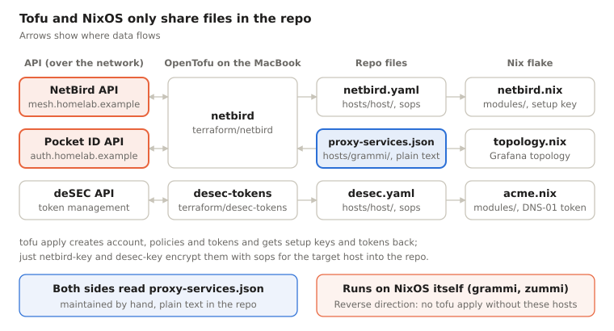

# nixlab – Project documentation

As of: 2026-10-19 · [Deutsch](README.de.md) · [PDF](nixlab-documentation.en.pdf)

> This documentation describes a private repo. The domain and internal addresses are replaced with example values: the domain with `homelab.example` ([RFC 2606](https://www.rfc-editor.org/rfc/rfc2606)), IPv4 per [RFC 5737](https://www.rfc-editor.org/rfc/rfc5737) (`192.0.2.0/24`, `198.51.100.0/24`, `203.0.113.0/24`), IPv6 per [RFC 3849](https://www.rfc-editor.org/rfc/rfc3849) (`2001:db8::/32`), the tailnet name with `example-tailnet.ts.net`. The real mesh range is a /22 out of RFC 1918. Modules, documentation and build tooling were written together with Claude (Anthropic). License: [MIT](LICENSE).


## Overview

nixlab is the flake monorepo for the **homelab.example** homelab: five NixOS hosts and a Mac mini running nix-darwin, plus three OpenTofu modules for the NetBird account, the deSEC API tokens and the GitHub repositories with their deploy keys. Everything is operated through a `justfile` from the MacBook; the hosts pull their own configuration from the private GitHub repo and update themselves overnight.

Short answer to the question *"Did you wire NixOS and OpenTofu together somehow?"*: **Yes, but deliberately loosely – through files in the repo, not through a shared tool.** OpenTofu writes sops-encrypted files into `hosts/<host>/` that the NixOS modules read at build time, and both sides read the same service list `hosts/grammi/proxy-services.json`. No terranix, no Tofu run from within Nix. Details in the section [NixOS & OpenTofu](#nixos--opentofu).

Audience: people who can read NixOS flakes, sops-nix and Terraform/OpenTofu.

## Repository layout

One flake, `nixosConfigurations` for five hosts plus `darwinConfigurations.zorlock`. Every host gets an explicit module list in `flake.nix`; whatever is missing is missing with the reason in a comment next to it.

| Path | Contents |
| --- | --- |
| `flake.nix` / `flake.lock` | Inputs, host definitions, packages, `lib.topology`, `checks` |
| `modules/` | 16 shared modules: base, nix, ssh, firewall, networking (ifstate), acme, crowdsec, tailscale, netbird, metrics/metrics-shipping, logging/log-shipping, qemu-guest, deploy, auto-upgrade-git |
| `hosts/<host>/` | `configuration.nix`, hardware, service modules, sops files (`secrets.yaml`, `netbird.yaml`, `desec.yaml`) |
| `pkgs/` | Own packages: garage-ui, logchef, paperless-gpt, prometheus-paperless-exporter, ollama-metrics-proxy |
| `terraform/netbird/` | OpenTofu: NetBird account, policies, DNS zones, reverse proxy services, people/groups (incl. Pocket ID) |
| `terraform/desec-tokens/` | OpenTofu: narrowly scoped deSEC tokens per host for DNS-01 |
| `terraform/github/` | OpenTofu: the repositories `nixlab` (private) and `nixlab-docs` (public), deploy keys per host |
| `topology.nix` | Generates the Grafana topology dashboard from the host configs |
| `justfile` | All operational workflows: deploy, secrets, netbird-\*, desec-\* |
| `docs/` | This project documentation (de/en) and its build, install guides (ursalia, cuckoosegg), drafts of upstream issues |
| `dnsconfig.js` | Symlink into the separate DNSControl repo – public DNS records live there |
| `.sops.yaml` | age recipients per host, `admin` (offline recovery) and `workstation` (1Password) |

### Inputs and their pins

Only `nixpkgs`, `nixpkgs-unstable` and `sops-nix` move with the nightly auto-upgrade (`updateInputs` in `modules/deploy.nix`). Anything that would lock the whole lab out on a broken release is pinned separately and bumped by hand.

| Input | Branch / tag | Used by | Nightly? |
| --- | --- | --- | --- |
| `nixpkgs` | nixos-26.05 | all NixOS hosts | yes |
| `nixpkgs-unstable` | nixos-unstable | grammi (Grist), ursalia (Paperless 3.x), zorlock (mactop) | yes |
| `sops-nix` | main | all | yes |
| `nixpkgs-netbird` | nixos-unstable | NetBird server and all clients | no – server first, then clients |
| `nixpkgs-pocketid` | nixos-26.05 | zummi (pocket-id package) | no |
| `disko` | main | ursalia (all mounts) | no |
| `lanzaboote` | v1.1.0 | ursalia (Secure Boot) | no |
| `nixpkgs-darwin`, `nix-darwin` | 26.05-darwin | zorlock | no (no auto-upgrade) |

`nix flake check` additionally verifies that `hosts/grammi/dashboards/topology.json` matches what `topology.nix` currently generates – a new exporter without `just topology` fails the check.

## Modules

The 16 modules under `modules/` carry the configuration shared by all hosts; every file explains in its header comment why it is the way it is. The public version contains them anonymised under `modules/` – as a reference, not directly importable: some read `hosts/<host>/*.yaml` and assume sops-nix. Three are deliberately generic and have options of their own.

| Module | Purpose | Options / notes |
| --- | --- | --- |
| [auto-upgrade-git.nix](modules/auto-upgrade-git.nix) | Nightly `nixos-rebuild switch`, commits and pushes the new `flake.lock` back to the repo | `services.autoUpgradeGit`: `enable`, `flakeDir`, `flakeAttr`, `updateInputs`, `dates`, `allowReboot`, `rebootWindow`, `deployKeySecret`, `gitAuthorEmail` |
| [log-shipping.nix](modules/log-shipping.nix) | journald and nginx logs to VictoriaLogs via Vector | `services.logShipping`: `enable`, `victoriaLogsUrl` |
| [metrics-shipping.nix](modules/metrics-shipping.nix) | vmagent scrapes the local exporters and remote-writes to VictoriaMetrics | `services.metricsShipping`: `enable`, `remoteWriteUrl`, `exporterPorts` |
| [deploy.nix](modules/deploy.nix) | The lab's policy for auto-upgrade-git: GitHub deploy key, pinned host key, reboot window 04:00–06:00 | kept apart from the mechanism so that stays reusable |
| [acme.nix](modules/acme.nix) | ACME defaults for every TLS host: DNS-01 against deSEC | token from `hosts/<host>/desec.yaml` (from Tofu) |
| [netbird.nix](modules/netbird.nix) | NetBird client in the mesh, registration via setup key, local metrics | setup key from `hosts/<host>/netbird.yaml` (from Tofu) |
| [tailscale.nix](modules/tailscale.nix) | Shared Tailscale agent | `tailscale serve` stays in the host config |
| [ssh.nix](modules/ssh.nix) | Who may log in from where: root only via mesh or Tailscale | keys stay per host |
| [firewall.nix](modules/firewall.nix) | Only 22/80/443 public, tailnet as trusted interface | |
| [crowdsec.nix](modules/crowdsec.nix) | CrowdSec engine and firewall bouncer, whitelist for the lab hosts | workarounds for bugs in the nixpkgs modules, documented in the header |
| [networking.nix](modules/networking.nix) | ifstate skeleton, systemd-resolved with DNS over TLS, no fallback resolvers | addresses and routes stay in the host config |
| [metrics.nix](modules/metrics.nix) | Prometheus exporters per host | protected by the firewall instead of bind addresses |
| [logging.nix](modules/logging.nix) | Bounds journald, which otherwise grows up to 4 GB | |
| [qemu-guest.nix](modules/qemu-guest.nix) | QEMU guest agent with an RPC deny list: snapshots yes, shell and file access over the channel no | |
| [nix.nix](modules/nix.nix) | Nix daemon, garbage collection, store optimisation | |
| [base.nix](modules/base.nix) | Locale, console, time and tools for debugging | |

## Hosts & roles

Three rented VMs carry the public services, ursalia and zorlock sit at home, cuckoosegg in the Subraum hackerspace. All of them are reachable in the NetBird mesh as `<host>.peer.homelab.example`; root SSH exists only there.

| Host | Platform | Role | Notes |
| --- | --- | --- | --- |
| grammi | NixOS, rented VM | NetBird server (`mesh.homelab.example`) + reverse proxy, Traefik, monitoring (VictoriaMetrics/-Logs, Grafana, logchef), Mealie, Grist, PostgreSQL | Central sink for metrics and logs of all hosts |
| zummi | NixOS, rented VM | Pocket ID (`auth.homelab.example`) – login for all services and NetBird | pocket-id pinned separately |
| aldrin | NixOS, rented VM | Garage S3 (`s3.aldrin.homelab.example`), garage-ui (`s3-admin`), backup target for restic | Forked garage-ui package with subpath support |
| ursalia | NixOS, bare metal (ThinkCentre M720q) | Paperless-ngx 3 + paperless-gpt (`dokumente`), Samba for the scanner, routing peer into the home LAN, build host for cuckoosegg | LUKS + btrfs via disko, TPM unlock, Secure Boot (lanzaboote), no CrowdSec |
| cuckoosegg | NixOS, VM on the Subraum Proxmox | NetBird routing peer into the Subraum networks | Group `subraum-devices` instead of `servers`, no repo/deploy key, deployed by push |
| zorlock | macOS + nix-darwin, Mac mini M4 | Ollama on the Apple GPU (`llm`), used by paperless-gpt | None of the `modules/*.nix`; FileVault unlock after reboot via LAN SSH |

## Services

Services are named by function, not by product. There are three kinds of reachability: public directly, public behind the NetBird reverse proxy with SSO, or mesh only.

| Name (`.homelab.example`) | App | Host | Reachable |
| --- | --- | --- | --- |
| `auth` | Pocket ID | zummi | public (nginx) |
| `mesh` | NetBird management/dashboard | grammi | public (Traefik terminates TLS) |
| `s3.aldrin` | Garage S3 API | aldrin | public (nginx) |
| `rezepte` | Mealie | grammi | reverse proxy + SSO |
| `grist` | Grist | grammi | reverse proxy + SSO |
| `logs` | logchef | grammi | reverse proxy + SSO |
| `metrics` | Grafana | grammi | reverse proxy + SSO |
| `vm` / `vl` | VictoriaMetrics / VictoriaLogs UI | grammi | reverse proxy + SSO (via Traefik entrypoint `apps`, port 8090) |
| `s3-admin` | garage-ui | aldrin | mesh only |
| `dokumente` | Paperless + paperless-gpt (`/paperless-gpt/`) | ursalia | mesh only; public access via the proxy in progress |
| `llm` | Ollama (behind Caddy) | zorlock | mesh only |

**Reverse proxy:** Traefik on grammi owns port 443. It terminates `mesh.homelab.example` itself and hands everything else via TCP passthrough with PROXY protocol v2 to `netbird-proxy`, which does TLS and ACME (tls-alpn-01) on its own. Login at the proxy is SSO against Pocket ID, limited to the NetBird groups of the respective app.

**Mesh-only names:** Every name is its own NetBird DNS zone with one A record pointing at the mesh address (192.0.2.x). Public DNS does not know them; the certificate comes via DNS-01 through deSEC.

**Across all Linux hosts:** vmagent ships metrics, Vector ships journald and nginx logs to grammi. CrowdSec reads the nginx/Traefik logs on the public hosts. restic backups go to Garage buckets on aldrin, for Paperless additionally append-only to BorgBase.

## NixOS & OpenTofu

Yes, the two are wired together – with the repo as the shared interface. OpenTofu manages what exists outside the machines behind an API (NetBird account, deSEC tokens, Pocket ID groups); NixOS manages the machines. The two never talk to each other directly: Tofu only runs on the MacBook through `just`, Nix never evaluates Tofu state.



Tofu never writes to a host directly: every result ends up as a file in the repo and reaches the host only with the next deploy.

### The touch points

| Direction | File | Created by | Read by | Contents |
| --- | --- | --- | --- | --- |
| Tofu → NixOS | `hosts/<host>/netbird.yaml` | `just netbird-key <host>` (`tofu output setup_keys` → `sops encrypt`) | `modules/netbird.nix` (`sopsFile`) | One-time setup key, valid for 24 h |
| Tofu → NixOS | `hosts/<host>/desec.yaml` | `just desec-key <host>` (`tofu output acme_tokens` → `sops encrypt`) | `modules/acme.nix` (`sopsFile`) | deSEC token for TXT records only, VMs pinned to their IP |
| shared | `hosts/grammi/proxy-services.json` | by hand | `terraform/netbird/reverse-proxy.tf` (`jsondecode(file(...))`) and `topology.nix` | Name → app, port, groups of the reverse proxy services |
| repo → both | `hosts/<host>/github.yaml` + `github-deploy.pub` | `just github-key <host>` (`ssh-keygen` → `sops encrypt`) | private half: `modules/deploy.nix` (`sopsFile`); public half: `terraform/github` (`file(...)`) | Deploy key for `/etc/nixos`; Tofu only ever sees the public half |
| NixOS → Tofu | NetBird server on grammi | `hosts/grammi/netbird.nix` | provider via `https://mesh.homelab.example` | The API Tofu runs against in the first place |
| NixOS → Tofu | Bootstrap tokens | `just netbird-setup-owner`, `netbird-proxy-token` (SSH to grammi, server API) | `terraform/netbird/secrets.yaml` and `hosts/grammi/netbird-proxy.yaml` | Owner PAT, proxy token |

The flow for a new host: Tofu creates the setup key, `just netbird-key` writes it encrypted for exactly that host (age key derived from its SSH host key) to `hosts/<host>/netbird.yaml`, commit, deploy within 24 h. The host registers itself on start; Tofu does not manage peers, it looks them up by name via `data "netbird_peer"`.

### What is deliberately not wired

- **No shared host list.** Hosts are listed three times: `nixosConfigurations` in `flake.nix`, `local.hosts` in the Tofu modules and `hosts :=` in the `justfile`. A new host has to be added in all three places.
- **No terranix / no Tofu in the Nix build.** Tofu state is local (gitignored, in the main checkout, also from worktrees) because it holds setup keys and tokens in plain text.
- **No provisioning of the machines.** The VMs are created by hand at the provider, ursalia/cuckoosegg following `docs/install-*.md`.
- **Public DNS** lives in DNSControl (its own repo, only linked in via symlink), not in Tofu.

So the line is: whatever Nix can build deterministically from the repo, Nix does. Whatever is created once through an API and returns a secret, Tofu does – and hands it over encrypted as a file.

## Secrets, network & access

### Secrets (sops-nix, age)

Every host file is encrypted for exactly two recipients: the age key derived from the host's SSH host key and the offline recovery key `admin`. So the MacBook cannot read host secrets – `just secrets <host>` edits them on the host and fetches the result back. Encrypting for a host, on the other hand, works anywhere (only the public key is needed); that is exactly what `netbird-key` and `desec-key` use.

| File | Recipients | Contents |
| --- | --- | --- |
| `hosts/<host>/secrets.yaml` | host + admin | Deploy key, app passwords, OIDC clients, restic |
| `hosts/<host>/netbird.yaml` | host + admin | NetBird setup key (from Tofu) |
| `hosts/<host>/desec.yaml` | host + admin | deSEC token (from Tofu) |
| `hosts/<host>/github.yaml` | host + admin | GitHub deploy key (from `just github-key`) |
| `terraform/*/secrets.yaml` | workstation + admin | API tokens for the providers |

The workstation key lives in 1Password and is read via `SOPS_AGE_KEY_CMD`, never as a file. `env.sh` in each Tofu module decrypts the tokens only into the shell of the respective recipe.

### Network

- **NetBird mesh** (`192.0.2.0/24`, peer names under `peer.homelab.example`): control plane on grammi, login via Pocket ID. Private range (RFC 1918) instead of CGNAT, because tailscaled drops packets from 100.64/10 while both clients run in parallel.
- **Groups:** `servers` (all hosts except cuckoosegg), `subraum-devices`, `admin-workstations` (MacBook), plus person groups from Pocket ID.
- **Home LAN** (`198.51.100.0/24`): routed through ursalia for group `home-lan`, not for devices that are already at home (posture check `not-at-home`).
- **Subraum:** routed through cuckoosegg for `subraum-access`. cuckoosegg itself may only reach grammi's ingest (TCP 8428/9428) and may only be reached from the MacBook via SSH.
- **Tailscale** still runs in parallel during the migration and serves as break-glass: `NIXLAB_DOMAIN=example-tailnet.ts.net just deploy zummi`.

### Access

Only 22/80/443 are open to the public. `modules/ssh.nix` allows root SSH only from mesh or Tailscale addresses; every host has its own login keypair. The mesh is IPv4 only for now; dual stack is listed as an open item.

## Deployment & operations

The pull hosts (zummi, aldrin, grammi, ursalia) keep `/etc/nixos` as a checkout of the private GitHub repo and build themselves. cuckoosegg is pushed to, zorlock is switched locally with `darwin-rebuild`.

| Host | Manual deploy | Automatic |
| --- | --- | --- |
| zummi, aldrin, grammi, ursalia | `just ship <host> "<message>"` = commit, push, `git pull` + `nixos-rebuild switch` on the host | nightly auto-upgrade, reboot window 04:00–06:00 |
| cuckoosegg | `just deploy-push cuckoosegg` (built on ursalia, copied to the target) | ursalia pushes daily at 06:30 |
| zorlock | `just deploy-zorlock` (`darwin-rebuild switch` with sudo) | none |

### Nightly upgrade

`modules/auto-upgrade-git.nix` updates `nixpkgs`, `nixpkgs-unstable` and `sops-nix`, builds, switches and pushes the new `flake.lock` back to GitHub with the host's deploy key. The GitHub host key is pinned because nobody is watching. A configuration error that only shows up on a cold boot therefore takes the host down at 04:00 – for the VMs there is the provider's console for that.

### Important recipes

| Recipe | Purpose |
| --- | --- |
| `just check <host>` | `git pull` + `nixos-rebuild dry-activate` |
| `just secrets <host>` / `pull-secrets <host>` | Edit host secrets on the host and fetch them back |
| `just topology` | Regenerate the topology dashboard (otherwise `nix flake check` fails) |
| `just netbird-plan` / `netbird-apply` | Change the NetBird account |
| `just netbird-key <host>` | New setup key for a host, 24 h to deploy |
| `just netbird-import` | Restore lost Tofu state from the account |
| `just netbird-renew-token` | Yearly renewal of the service user token |
| `just github-key <host>` | New GitHub deploy key for a host (key via sops, registration via Tofu) |
| `just github-plan` / `github-apply` | Change the repositories and deploy keys on GitHub |
| `just desec-key <host>` / `desec-verify` | Rotate a deSEC token, or check the scopes from every host |
| `just gc <host>` | Delete store generations older than 7 days |
| `just docs` | Build this documentation: private PDFs (de/en) and the anonymised public version in `public-docs/` (gitignored clone of `nixlab-docs`), committed and pushed there |

Recipes that need sops on the MacBook run with a 1Password sign-in in front, which provides the age key via `SOPS_AGE_KEY_CMD`:

```
eval $(op signin) && export SOPS_AGE_KEY_CMD='op read "op://<vault>/<item>/password"' && just netbird-plan
```

### Troubleshooting

- After a `nixos-rebuild`, `systemctl --failed` says nothing about the past – the switch clears failed states. Use `journalctl -u <unit>` instead.
- NetBird down, Tailscale still there: put `NIXLAB_DOMAIN=example-tailnet.ts.net` in front of the recipe.
- Tofu recipes refuse to run against an empty state, so no second `servers` group or set of tokens gets created.

## Open items & conventions

### Conventions

- One git worktree per topic (`.worktrees/<topic>`), removed and its branch deleted when done. Tofu state always stays in the main checkout.
- Plan first, implement after approval.
- Subdomains by function (`rezepte`, not `mealie`).
- New web services on grammi use PostgreSQL instead of SQLite.
- Dual stack wherever possible.
- Code comments explain the *why*, including the mistakes that led to a decision, with a date.
- Code comments, commit messages and changelogs in English; the project documentation exists in German and English.

### Open

- [ ] Move the NetBird mesh to dual stack (IPv6 overlay)
- [ ] Finish reverse proxy stage 3: Paperless public under `dokumente` (uploads, paperless-gpt, onboarding of further users)
- [ ] Upstream PRs to the NetBird provider (#247 `direct_upstream`/cluster targets, #248 `crowdsec_mode`); then switch the proxy targets on grammi to `localhost`
- [ ] Remove Tailscale from the servers once nothing depends on it any more
- [ ] Grafana alerting (contact point still missing) for SMART, fwupd, Paperless
- [ ] Update notifications for the inputs pinned by hand (NetBird, Pocket ID)
- [ ] Declarative root passwords via sops
- [ ] Keep the host list in one place instead of `flake.nix`, the Tofu modules and `justfile`
