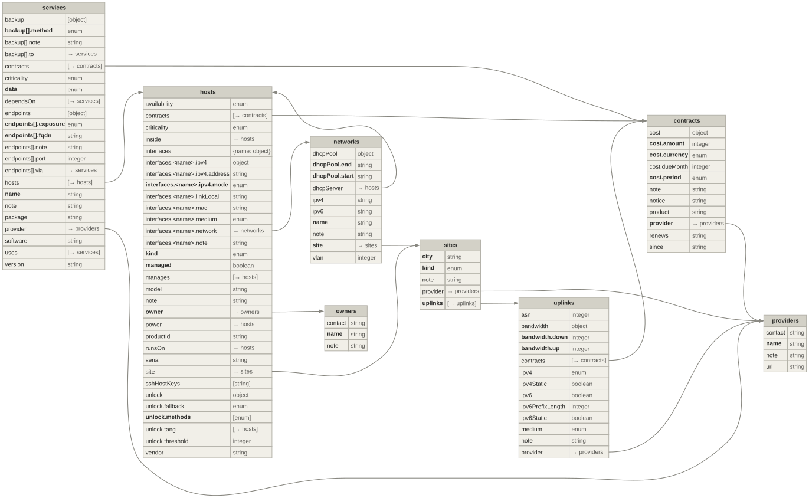

# Inventory schema

`inventory.json` follows a fixed format: eight sections, each an object of entries keyed by id, every field with a type, some of them references into another section. This page is the complete reference of that format – every field with its type, whether it is required, its default and its meaning, an example per section and a whole example inventory. *What* the inventory is for, how it is validated and what is derived from it is on [Inventory](inventory.md).

The format is defined once, in `spec` in `inventory.nix`. Everything on this page that describes a field is generated from it, so it cannot drift from what the validator checks:

| Generated | From | Kept fresh by |
| --- | --- | --- |
| `inventory.schema.json` – JSON Schema for the editor | `spec` | `just inventory-schema`, `checks.inventory-schema` |
| The field tables below | `inventory.schema.json` | the docs build (`docs/gen-reference.py`) |
| The diagram of all fields | `spec` | `just inventory-diagram`, `checks.inventory-diagram` |
| The examples below | `docs/inventory-example.json` | the docs build; a test (`tests/inventory.nix`) keeps the file valid |

## Overview

The arrows point from the field that holds the reference to the section it names. A section's references into itself are noted in its box (↺). Each box leads to its section below.

<figure class="nx-diagram">
<svg viewBox="0 0 680 416" role="img" aria-label="The eight sections of inventory.json and the fields that refer from one to another" xmlns="http://www.w3.org/2000/svg">
<style>.nx-t{font-family:'DejaVu Sans',sans-serif;font-size:14px;font-weight:bold;fill:#2c2c2a}.nx-s{font-family:'DejaVu Sans',sans-serif;font-size:11px;fill:#5f5e5a}.nx-line{fill:none;stroke:#888780;stroke-width:1.4}.nx-gray rect{fill:#f1efe8;stroke:#888780}.nx-gray .nx-t{fill:#2c2c2a}.nx-gray .nx-s{fill:#5f5e5a}.nx-purple rect{fill:#eeedfe;stroke:#534ab7}.nx-purple .nx-t{fill:#26215c}.nx-purple .nx-s{fill:#534ab7}.nx-coral rect{fill:#faece7;stroke:#993c1d}.nx-coral .nx-t{fill:#4a1b0c}.nx-coral .nx-s{fill:#993c1d}</style>
<path class="nx-line" d="M260 48 H180"/><path class="nx-line" d="M186 44 L180 48 L186 52"/>
<text class="nx-s" x="220" y="42" text-anchor="middle">owner</text>
<path class="nx-line" d="M500 40 H420"/><path class="nx-line" d="M426 36 L420 40 L426 44"/>
<text class="nx-s" x="460" y="34" text-anchor="middle">hosts[]</text>
<path class="nx-line" d="M420 66 H450 V198 H500"/><path class="nx-line" d="M494 194 L500 198 L494 202"/>
<text class="nx-s" x="456" y="130" text-anchor="start">contracts[]</text>
<path class="nx-line" d="M340 76 V170"/><path class="nx-line" d="M336 164 L340 170 L344 164"/>
<text class="nx-s" x="346" y="128" text-anchor="start">site</text>
<path class="nx-line" d="M290 76 V130 H120 V170"/><path class="nx-line" d="M116 164 L120 170 L124 164"/>
<text class="nx-s" x="205" y="147" text-anchor="middle">interfaces.*.network</text>
<path class="nx-line" d="M80 170 V110 H275 V76"/><path class="nx-line" d="M271 82 L275 76 L279 82"/>
<text class="nx-s" x="178" y="104" text-anchor="middle">dhcpServer</text>
<path class="nx-line" d="M180 198 H260"/><path class="nx-line" d="M254 194 L260 198 L254 202"/>
<text class="nx-s" x="220" y="192" text-anchor="middle">site</text>
<path class="nx-line" d="M300 226 V270 H100 V320"/><path class="nx-line" d="M96 314 L100 320 L104 314"/>
<text class="nx-s" x="200" y="264" text-anchor="middle">uplinks[]</text>
<path class="nx-line" d="M340 226 V320"/><path class="nx-line" d="M336 314 L340 320 L344 314"/>
<text class="nx-s" x="346" y="290" text-anchor="start">provider</text>
<path class="nx-line" d="M180 348 H260"/><path class="nx-line" d="M254 344 L260 348 L254 352"/>
<text class="nx-s" x="220" y="342" text-anchor="middle">provider</text>
<path class="nx-line" d="M580 226 V348 H420"/><path class="nx-line" d="M426 344 L420 348 L426 352"/>
<text class="nx-s" x="574" y="290" text-anchor="end">provider</text>
<path class="nx-line" d="M560 76 V170"/><path class="nx-line" d="M556 164 L560 170 L564 164"/>
<text class="nx-s" x="566" y="128" text-anchor="start">contracts[]</text>
<path class="nx-line" d="M660 48 H670 V364 H420"/><path class="nx-line" d="M426 360 L420 364 L426 368"/>
<text class="nx-s" x="540" y="380" text-anchor="middle">provider</text>
<path class="nx-line" d="M100 376 V400 H610 V226"/><path class="nx-line" d="M606 232 L610 226 L614 232"/>
<text class="nx-s" x="360" y="395" text-anchor="middle">contracts[]</text>
<a href="#owners" class="nx-gray"><rect x="20" y="20" width="160" height="56" rx="8" stroke-width="1"/><text class="nx-t" x="100" y="44" text-anchor="middle">owners</text><text class="nx-s" x="100" y="62" text-anchor="middle">who administers</text></a>
<a href="#hosts" class="nx-gray"><rect x="260" y="20" width="160" height="56" rx="8" stroke-width="1"/><text class="nx-t" x="340" y="44" text-anchor="middle">hosts</text><text class="nx-s" x="340" y="62" text-anchor="middle">↺ runsOn, power …</text></a>
<a href="#services" class="nx-purple"><rect x="500" y="20" width="160" height="56" rx="8" stroke-width="1"/><text class="nx-t" x="580" y="44" text-anchor="middle">services</text><text class="nx-s" x="580" y="62" text-anchor="middle">↺ dependsOn, uses …</text></a>
<a href="#networks" class="nx-gray"><rect x="20" y="170" width="160" height="56" rx="8" stroke-width="1"/><text class="nx-t" x="100" y="194" text-anchor="middle">networks</text><text class="nx-s" x="100" y="212" text-anchor="middle">layer 2 + prefix</text></a>
<a href="#sites" class="nx-gray"><rect x="260" y="170" width="160" height="56" rx="8" stroke-width="1"/><text class="nx-t" x="340" y="194" text-anchor="middle">sites</text><text class="nx-s" x="340" y="212" text-anchor="middle">where things stand</text></a>
<a href="#contracts" class="nx-coral"><rect x="500" y="170" width="160" height="56" rx="8" stroke-width="1"/><text class="nx-t" x="580" y="194" text-anchor="middle">contracts</text><text class="nx-s" x="580" y="212" text-anchor="middle">what is paid</text></a>
<a href="#uplinks" class="nx-gray"><rect x="20" y="320" width="160" height="56" rx="8" stroke-width="1"/><text class="nx-t" x="100" y="344" text-anchor="middle">uplinks</text><text class="nx-s" x="100" y="362" text-anchor="middle">internet lines</text></a>
<a href="#providers" class="nx-coral"><rect x="260" y="320" width="160" height="56" rx="8" stroke-width="1"/><text class="nx-t" x="340" y="344" text-anchor="middle">providers</text><text class="nx-s" x="340" y="362" text-anchor="middle">companies, clubs</text></a>
</svg>
</figure>

## All fields at a glance

Every section with all its fields – **bold** ones are required, nested objects are spelled out (`unlock.methods`, `endpoints[].fqdn`, `interfaces.<name>.mac`), and every reference field has its arrow (references inside a section only in the type column: `→ hosts`).

[](../assets/diagrams/inventory-schema.svg)

## Conventions

**Ids.** Entries are keyed by id: lower-case letters, digits and dashes, starting with a letter or digit (`grammi`, `realtox-dus`, `home-main`). A reference field holds such an id and must name an existing entry of the right section.

**Required and optional.** A field is optional unless the table says *required*. Optional fields left out are filled in by the derived view – with the default the table gives, otherwise `null` or `[]` – so a consumer never has to write `or`.

**Unknown fields are errors.** A typo (`critcality`) is reported with the list of the known fields, in the editor right away and in `nix flake check`.

**One direction.** Every relation is stored where it starts (`hosts.runsOn`, `services.dependsOn`, `hosts.contracts`); the reverse (`guests`, `neededBy`, `covers`) is derived.

**Formats.** Strings with a format are checked against it:

| Format | Example | Used by |
| --- | --- | --- |
| IPv4 address | `192.0.2.10` | `interfaces.<name>.ipv4.address`, `dhcpPool` |
| IPv4 prefix (no host bits) | `192.0.2.0/24` | `networks.ipv4` |
| IPv6 prefix | `2001:db8:1::/64` | `networks.ipv6` |
| MAC address, lower case | `52:54:00:12:34:56` | `interfaces.<name>.mac` |
| Link-local | `eui64`, `stable-privacy`, `random` or `fe80::1234` | `interfaces.<name>.linkLocal` |
| SSH public key without comment | `ssh-ed25519 AAAAC3Nz…` | `hosts.sshHostKeys` |
| Date | `2026-10-22` | `contracts.since`, `contracts.renews` |
| Domain name, lower case | `cloud.example.org` | `services.endpoints[].fqdn` |
| Interface name | `eno1`, `eno1.20`, `wlp2s0f0` | keys of `hosts.interfaces` |

**Money** is in whole cents (`899` = 8.99) – no floating point, no rounding.

**What the schema cannot say.** A JSON Schema checks one entry at a time. Everything between entries – references, cycles, addresses inside a prefix, a contract with the right provider – is checked by `inventory.nix` only; each section below lists those rules briefly, [Validation](inventory.md#validation) has them all.

## owners { #owners }

Who administers a device – whom to call and what may be changed.

| Field | Type | | Meaning (from the schema) |
| --- | --- | --- | --- |
| `contact` | string |  | Who to talk to when this owner's devices are affected. |
| `name` | string | required | Display name. |
| `note` | string |  | Free text: anything worth knowing that has no field of its own. |

```json
{
  "owners": {
    "lab": {
      "name": "Example lab",
      "contact": "admin@example.org"
    },
    "club": {
      "name": "Example hackerspace",
      "note": "Root on their hypervisor is root on our VM there."
    }
  }
}
```

Rule beyond the schema: every owner owns at least one host.

## providers { #providers }

A company or club the lab depends on: an ISP, a hoster, a service bought from outside, the hackerspace.

| Field | Type | | Meaning (from the schema) |
| --- | --- | --- | --- |
| `contact` | string |  | How to reach them (support address, phone, ticket system). |
| `name` | string | required | Display name of the company or club. |
| `note` | string |  | Free text: anything worth knowing that has no field of its own. |
| `url` | string |  | Website or customer portal. |

```json
{
  "providers": {
    "isp": {
      "name": "Example ISP",
      "url": "https://isp.example"
    },
    "hoster": {
      "name": "Example Hosting",
      "url": "https://hosting.example",
      "contact": "support@hosting.example"
    },
    "club": {
      "name": "Example hackerspace"
    },
    "mailco": {
      "name": "Example Mail"
    }
  }
}
```

Rule beyond the schema: something refers to every provider – a site, a line, a service or a contract.

## contracts { #contracts }

What is paid to a provider. A provider can have several; a host, line or service names the ones it is paid by.

| Field | Type | | Meaning (from the schema) |
| --- | --- | --- | --- |
| `cost` | object |  | What it costs. Leave it out until known - the contract is then listed in pending. |
| `cost.amount` | integer ≥ 0 | required | Amount per period in cents (899 = 8.99) - whole numbers only. |
| `cost.currency` | one of `EUR` `USD` `CHF` `GBP` | required | Currency of amount. Totals are kept per currency, never converted. |
| `cost.dueMonth` | integer 1–12 |  | Only with period year, and required there: the month (1-12) the yearly amount is charged in. |
| `cost.period` | one of `month` `year` `once` | required | How often amount is charged. |
| `note` | string |  | Free text: anything worth knowing that has no field of its own. |
| `notice` | string |  | Notice period, as the contract words it. |
| `product` | string |  | Product or plan name as the provider calls it. |
| `provider` | id from [providers](#providers) | required | Who the contract is with. |
| `renews` | string: a date like 2026-10-22 |  | Next date the contract renews or ends unless cancelled. |
| `since` | string: a date like 2026-10-22 |  | Start of the contract. |

```json
{
  "contracts": {
    "fiber": {
      "provider": "isp",
      "product": "Fiber 600",
      "cost": {
        "amount": 4995,
        "currency": "EUR",
        "period": "month"
      },
      "since": "2024-05-01",
      "notice": "1 month"
    },
    "vps": {
      "provider": "hoster",
      "product": "VPS M",
      "cost": {
        "amount": 12000,
        "currency": "EUR",
        "period": "year",
        "dueMonth": 3
      },
      "since": "2025-03-01",
      "renews": "2027-03-01"
    },
    "vps-ipv4": {
      "provider": "hoster",
      "product": "Additional IPv4",
      "cost": {
        "amount": 150,
        "currency": "EUR",
        "period": "month"
      }
    },
    "mail": {
      "provider": "mailco",
      "cost": {
        "amount": 3000,
        "currency": "USD",
        "period": "year",
        "dueMonth": 11
      }
    }
  }
}
```

Rules beyond the schema: `cost.dueMonth` exactly with `period` `year`; `renews` not before `since`; a contract named by a host, line or service is with that one's provider (for a host: the provider of its site). A contract without `cost` is listed under `pending`, one nothing names under `gaps`.

## uplinks { #uplinks }

An internet line. All fields are optional, so a line can be entered before its details are known.

| Field | Type | | Meaning (from the schema) |
| --- | --- | --- | --- |
| `asn` | integer ≥ 1 |  | Autonomous system number of the provider's network, without the AS prefix. |
| `bandwidth` | object |  | Booked bandwidth in Mbit/s. |
| `bandwidth.down` | integer ≥ 1 | required | Downstream in Mbit/s. |
| `bandwidth.up` | integer ≥ 1 | required | Upstream in Mbit/s. |
| `contracts` | list of id from [contracts](#contracts), no duplicates |  | The contracts this is paid for by (a rented VM, its extra IPv4, a line, a plan). |
| `ipv4` | one of `public` `cgnat` `none` |  | What the line gives for IPv4. |
| `ipv4Static` | boolean |  | Whether the public IPv4 address is fixed. Only meaningful with ipv4 = public. |
| `ipv6` | boolean |  | Whether the line has native IPv6. |
| `ipv6PrefixLength` | integer 1–128 |  | Size of the IPv6 prefix the provider delegates (e.g. 56 for a /56). Only with ipv6. |
| `ipv6Static` | boolean |  | Whether the delegated IPv6 prefix is fixed. Only with ipv6. |
| `medium` | one of `fiber` `dsl` `cable` `lte` `satellite` `datacenter` |  | Kind of line. |
| `note` | string |  | Free text: anything worth knowing that has no field of its own. |
| `provider` | id from [providers](#providers) |  | Internet provider (for a data centre: the hoster). |

```json
{
  "uplinks": {
    "home-fiber": {
      "provider": "isp",
      "contracts": [
        "fiber"
      ],
      "asn": 64496,
      "medium": "fiber",
      "bandwidth": {
        "down": 600,
        "up": 300
      },
      "ipv4": "public",
      "ipv4Static": false,
      "ipv6": true,
      "ipv6PrefixLength": 56,
      "ipv6Static": false
    },
    "home-lte": {
      "medium": "lte",
      "ipv4": "cgnat",
      "note": "Backup line, USB stick on the router."
    },
    "club-line": {
      "medium": "cable",
      "ipv4": "public",
      "ipv4Static": true,
      "ipv6": true
    },
    "dc": {
      "provider": "hoster",
      "asn": 64497,
      "medium": "datacenter",
      "ipv4": "public",
      "ipv4Static": true,
      "ipv6": true
    }
  }
}
```

Rules beyond the schema: `ipv6PrefixLength` and `ipv6Static` only with `ipv6`; every line is used by a site; `contracts` are with the line's `provider`.

## sites { #sites }

A place where devices stand.

| Field | Type | | Meaning (from the schema) |
| --- | --- | --- | --- |
| `city` | string | required | City the site is in. |
| `kind` | one of `residential` `hackerspace` `datacenter` | required | Kind of place. |
| `note` | string |  | Free text: anything worth knowing that has no field of its own. |
| `provider` | id from [providers](#providers) |  | Who runs the place (hoster, club); empty for a home. |
| `uplinks` | list of id from [uplinks](#uplinks), no duplicates | required | Internet lines of the site, the primary one first, backups after it. |

```json
{
  "sites": {
    "home": {
      "city": "Exampletown",
      "kind": "residential",
      "uplinks": [
        "home-fiber",
        "home-lte"
      ]
    },
    "club": {
      "city": "Exampletown",
      "kind": "hackerspace",
      "provider": "club",
      "uplinks": [
        "club-line"
      ]
    },
    "dc": {
      "city": "Exampleburg",
      "kind": "datacenter",
      "provider": "hoster",
      "uplinks": [
        "dc"
      ]
    }
  }
}
```

Rules beyond the schema: at least one uplink, the primary first; something stands at every site.

## networks { #networks }

A layer-2 network with its IPv4 prefix.

| Field | Type | | Meaning (from the schema) |
| --- | --- | --- | --- |
| `dhcpPool` | object |  | Range the DHCP server hands out dynamically; static addresses must lie outside it. |
| `dhcpPool.end` | string: an IPv4 address | required | Last address of the pool. |
| `dhcpPool.start` | string: an IPv4 address | required | First address of the pool. |
| `dhcpServer` | id from [hosts](#hosts) |  | The host serving DHCP for IPv4 here; it needs an interface in this network. |
| `ipv4` | string: an IPv4 prefix like 192.0.2.0/24 |  | IPv4 prefix. |
| `ipv6` | string: an IPv6 prefix like 2001:db8::/64 |  | IPv6 prefix, when it is fixed (ULA or static GUA). |
| `name` | string | required | Display name. |
| `note` | string |  | Free text: anything worth knowing that has no field of its own. |
| `site` | id from [sites](#sites) | required | Where the network is. |
| `vlan` | integer 1–4094 |  | 802.1Q VLAN id. Leave out for an untagged network. |

```json
{
  "networks": {
    "lan": {
      "name": "Home LAN",
      "site": "home",
      "ipv4": "192.0.2.0/24",
      "ipv6": "2001:db8:1::/64",
      "dhcpServer": "router",
      "dhcpPool": {
        "start": "192.0.2.100",
        "end": "192.0.2.199"
      }
    },
    "club-v10": {
      "name": "Hackerspace LAN",
      "site": "club",
      "vlan": 10,
      "ipv4": "198.51.100.0/24"
    }
  }
}
```

Rules beyond the schema: the prefix has no host bits; the pool lies inside it, start before end, and needs `ipv4` and `dhcpServer`; the DHCP server is at the site and has an interface in the network; a VLAN id once per site.

## hosts { #hosts }

Every device with an address that matters – managed by this flake or not.

| Field | Type | | Meaning (from the schema) |
| --- | --- | --- | --- |
| `availability` | one of `always-on` `intermittent` | default `"always-on"` | intermittent: being offline is normal (a laptop) and is not an incident. |
| `contracts` | list of id from [contracts](#contracts), no duplicates |  | The contracts this is paid for by (a rented VM, its extra IPv4, a line, a plan). |
| `criticality` | one of `core` `service` `lab` | default `"service"` | core: the lab stops working without it; service: a service is down; lab: nothing depends on it. |
| `inside` | id from [hosts](#hosts) |  | Physically built into another device, e.g. a PCIe KVM card in its host. |
| `interfaces` | object: name → object |  | Network interfaces by name (as the OS calls them; for an appliance any label like lan/wan). A VLAN interface (eno1.10) is an entry of its own. |
| `interfaces.<name>.ipv4` | object |  | IPv4 addressing of this interface in its network. |
| `interfaces.<name>.ipv4.address` | string: an IPv4 address |  | The address - required for reserved and static. |
| `interfaces.<name>.ipv4.mode` | one of `reserved` `static` `dhcp` | required | reserved: fixed DHCP lease by MAC; static: configured on the device; dhcp: dynamic. |
| `interfaces.<name>.linkLocal` | string: eui64, stable-privacy, random or an fe80:: address |  | How the IPv6 link-local address is formed: eui64 (computed from mac), stable-privacy (RFC 7217), random - or the fixed fe80:: address itself. |
| `interfaces.<name>.mac` | string: a lower-case MAC address like aa:bb:cc:dd:ee:ff |  | Hardware address, lower case. |
| `interfaces.<name>.medium` | one of `ethernet` `wifi` |  | Physical medium. |
| `interfaces.<name>.network` | id from [networks](#networks) |  | The network this interface is in. |
| `interfaces.<name>.note` | string |  | Free text: anything worth knowing that has no field of its own. |
| `kind` | one of `server` `hypervisor` `vm` `container` `router` `switch` `ap` `pdu` `ups` `kvm` `nas` `workstation` `laptop` `appliance` | required | What the device is. |
| `managed` | boolean | required | Configured by this flake (nixosConfigurations/darwinConfigurations). Must match the flake. |
| `manages` | list of id from [hosts](#hosts), no duplicates |  | Only kvm: the machines this KVM gives out-of-band access to. |
| `model` | string |  | Hardware model without the vendor (ThinkCentre M720q), or for a VM the provider's product or plan name. |
| `note` | string |  | Free text: anything worth knowing that has no field of its own. |
| `owner` | id from [owners](#owners) | required | Who administers the device. |
| `power` | id from [hosts](#hosts) |  | Where the power comes from: a PDU/UPS, a PoE switch, or the host a card sits in. |
| `productId` | string |  | The vendor's product id for drivers and firmware: Lenovo machine type (10T7...), Apple model identifier (Mac16,10). Not for vm/container. |
| `runsOn` | id from [hosts](#hosts) |  | Only vm/container: the machine it runs on. Optional - a rented VM's host is not in the inventory. |
| `serial` | string |  | Serial number. Unique lab-wide. Not for vm/container. |
| `site` | id from [sites](#sites) |  | Where the device is. Optional for entries with runsOn or inside - they inherit it. |
| `sshHostKeys` | list of string: an OpenSSH public key "<type> <base64>" without comment, no duplicates |  | The device's SSH host public keys (/etc/ssh/ssh_host_*_key.pub without the comment). Feeds known_hosts and the sops check. |
| `unlock` | object |  | Disk unlock after a reboot. Leave it out for an unencrypted disk. |
| `unlock.fallback` | one of `remote-ssh` `console` |  | How a human unlocks when the methods fail: over SSH (initrd, FileVault) or at the console/KVM. |
| `unlock.methods` | list of one of `tpm` `nbde`, no duplicates | required | Automatic unlock methods. Empty when only a human can unlock. |
| `unlock.tang` | list of id from [hosts](#hosts), no duplicates |  | Tang servers for nbde; any one of them is enough. |
| `unlock.threshold` | integer ≥ 1 | default `1` | How many of the methods must succeed (Clevis sss threshold). Defaults to 1. |
| `vendor` | string |  | Hardware manufacturer (Lenovo, Apple, GL.iNet). Not for vm/container. |

```json
{
  "hosts": {
    "router": {
      "kind": "router",
      "vendor": "Example Networks",
      "model": "R1",
      "site": "home",
      "owner": "lab",
      "managed": false,
      "criticality": "core",
      "interfaces": {
        "lan": {
          "network": "lan",
          "ipv4": {
            "mode": "static",
            "address": "192.0.2.1"
          }
        }
      }
    },
    "nas": {
      "kind": "nas",
      "vendor": "Example Corp",
      "model": "NAS 4",
      "productId": "EX-1000",
      "serial": "NAS0001",
      "site": "home",
      "owner": "lab",
      "managed": true,
      "unlock": {
        "methods": [
          "tpm"
        ],
        "fallback": "console"
      },
      "sshHostKeys": [
        "ssh-ed25519 AAAAC3NzaC1lZDI1NTE5AAAAINasNasNasNasNasNasNasNasNasNasNasNasNas"
      ],
      "interfaces": {
        "eno1": {
          "mac": "52:54:00:12:34:56",
          "medium": "ethernet",
          "linkLocal": "eui64",
          "network": "lan",
          "ipv4": {
            "mode": "reserved",
            "address": "192.0.2.10"
          }
        }
      }
    },
    "kvm": {
      "kind": "kvm",
      "inside": "nas",
      "power": "nas",
      "manages": [
        "nas"
      ],
      "owner": "lab",
      "managed": false,
      "criticality": "lab"
    },
    "laptop": {
      "kind": "laptop",
      "vendor": "Example Corp",
      "model": "Book 14",
      "site": "home",
      "owner": "lab",
      "managed": true,
      "criticality": "lab",
      "availability": "intermittent",
      "unlock": {
        "methods": [],
        "fallback": "console"
      },
      "interfaces": {
        "wlan0": {
          "mac": "aa:bb:cc:dd:ee:02",
          "medium": "wifi",
          "linkLocal": "stable-privacy",
          "network": "lan",
          "ipv4": {
            "mode": "dhcp"
          }
        }
      }
    },
    "pve": {
      "kind": "hypervisor",
      "site": "club",
      "owner": "club",
      "managed": false,
      "interfaces": {
        "vmbr0": {
          "network": "club-v10",
          "ipv4": {
            "mode": "static",
            "address": "198.51.100.2"
          }
        }
      }
    },
    "club-vm": {
      "kind": "vm",
      "model": "Proxmox VM",
      "runsOn": "pve",
      "owner": "lab",
      "managed": true,
      "unlock": {
        "methods": [
          "nbde"
        ],
        "tang": [
          "nas"
        ],
        "fallback": "remote-ssh"
      },
      "interfaces": {
        "ens18": {
          "mac": "bc:24:11:aa:bb:cc",
          "medium": "ethernet",
          "network": "club-v10",
          "ipv4": {
            "mode": "dhcp"
          }
        }
      }
    },
    "vps": {
      "kind": "vm",
      "model": "VPS M",
      "site": "dc",
      "owner": "lab",
      "managed": true,
      "criticality": "core",
      "contracts": [
        "vps",
        "vps-ipv4"
      ],
      "sshHostKeys": [
        "ssh-ed25519 AAAAC3NzaC1lZDI1NTE5AAAAIVpsVpsVpsVpsVpsVpsVpsVpsVpsVpsVpsVpsVps"
      ]
    }
  }
}
```

Rules beyond the schema (the most important ones – [Validation](inventory.md#validation) has all):

- `site` is required unless it can be inherited along `runsOn` or `inside`, and an explicit one matches the inherited one.
- `runsOn` only for `vm`/`container`, on an allowed kind; `manages` only for `kvm`; `vendor`/`productId`/`serial` not on a `vm`/`container`.
- `runsOn`, `inside` and `power` free of cycles; every host with `nbde` reaches a Tang server that comes up without a human.
- `managed` matches `flake.nix` in both directions.
- Addresses: inside the network's prefix, by mode (`reserved` needs `mac` and a DHCP server, `static` outside the pool), each once per network; MACs and host keys once lab-wide.

## services { #services }

What the hosts run, and what is bought from outside.

| Field | Type | | Meaning (from the schema) |
| --- | --- | --- | --- |
| `backup` | list of object, no duplicates |  | How its data is backed up. Only for stateful. |
| `backup[].method` | one of `restic` `arq` `btrbk` `pgdump` `provider-snapshot` | required | restic/arq copy to another service (to); btrbk, pgdump and provider-snapshot stay on the same machine or provider. |
| `backup[].note` | string |  | Free text: anything worth knowing that has no field of its own. |
| `backup[].to` | id from [services](#services) |  | Only restic/arq, required there: the service the copy goes to. |
| `contracts` | list of id from [contracts](#contracts), no duplicates |  | The contracts this is paid for by (a rented VM, its extra IPv4, a line, a plan). |
| `criticality` | one of `core` `service` `lab` | default `"service"` | core: the lab stops working without it; service: a service is down; lab: nothing depends on it. |
| `data` | one of `stateful` `stateless` | required | stateful: it keeps data that is lost with it; stateless: it can be rebuilt from the repository. |
| `dependsOn` | list of id from [services](#services), no duplicates |  | Services it cannot work without. |
| `endpoints` | list of object, no duplicates |  | How the service is reached. |
| `endpoints[].exposure` | one of `public` `proxy` `mesh` `lan` `loopback` | required | public: open on the internet from its own host; proxy: through a reverse proxy (name it in via); mesh: only inside the overlay network; lan: only in a local network; loopback: only on the host itself. |
| `endpoints[].fqdn` | string: a lower-case domain name like cloud.example.org | required | Name it is reached by. |
| `endpoints[].note` | string |  | Free text: anything worth knowing that has no field of its own. |
| `endpoints[].port` | integer 1–65535 |  | Port, when it is not the protocol's default. |
| `endpoints[].via` | id from [services](#services) |  | The service it is reached through - the reverse proxy for exposure proxy (required there). Counts as a dependency. |
| `hosts` | list of id from [hosts](#hosts), no duplicates |  | The machines it runs on. Exactly one of hosts and provider. |
| `name` | string | required | Display name. |
| `note` | string |  | Free text: anything worth knowing that has no field of its own. |
| `package` | string |  | Only on managed hosts: option path of the package in the host's configuration (services.paperless.package) - version, license and language are read from there. |
| `provider` | id from [providers](#providers) |  | For a service bought from outside: who runs it. Exactly one of hosts and provider. |
| `software` | string |  | The software it is (Paperless-ngx, Garage) - the version comes from package or version. |
| `uses` | list of id from [services](#services), no duplicates |  | Services it works without, but degraded (new logins fail, one feature is missing). |
| `version` | string |  | Version, by hand - only where there is no package to read it from. |

```json
{
  "services": {
    "login": {
      "name": "Login",
      "software": "Example IdP",
      "hosts": [
        "vps"
      ],
      "package": "services.example-idp.package",
      "criticality": "core",
      "endpoints": [
        {
          "fqdn": "auth.example.org",
          "exposure": "public"
        }
      ],
      "uses": [
        "mail"
      ],
      "data": "stateful",
      "backup": [
        {
          "method": "restic",
          "to": "storage",
          "note": "Bucket vps-backups."
        }
      ]
    },
    "proxy": {
      "name": "Reverse proxy",
      "hosts": [
        "vps"
      ],
      "criticality": "core",
      "endpoints": [
        {
          "fqdn": "proxy.example.org",
          "exposure": "public"
        }
      ],
      "data": "stateless"
    },
    "storage": {
      "name": "S3 storage",
      "software": "Example S3",
      "hosts": [
        "nas"
      ],
      "endpoints": [
        {
          "fqdn": "s3.example.org",
          "exposure": "lan",
          "port": 3900
        }
      ],
      "data": "stateful",
      "backup": [
        {
          "method": "btrbk",
          "note": "Hourly snapshots on the same disk."
        }
      ]
    },
    "docs": {
      "name": "Documents",
      "hosts": [
        "club-vm"
      ],
      "dependsOn": [
        "login"
      ],
      "endpoints": [
        {
          "fqdn": "docs.example.org",
          "exposure": "proxy",
          "via": "proxy"
        }
      ],
      "data": "stateful",
      "backup": [
        {
          "method": "pgdump"
        },
        {
          "method": "restic",
          "to": "storage"
        }
      ]
    },
    "route": {
      "name": "Route into the hackerspace",
      "software": "Overlay routing peer",
      "hosts": [
        "club-vm"
      ],
      "data": "stateless"
    },
    "mail": {
      "name": "Mail",
      "provider": "mailco",
      "contracts": [
        "mail"
      ],
      "data": "stateful"
    }
  }
}
```

Rules beyond the schema: exactly one of `hosts` and `provider`; `package` only on managed hosts and not together with `version`; no `core`/`service` service on an `intermittent` host; no hard dependency (`dependsOn`, `via`) on a less critical service, and none in a cycle; `via` required with `exposure` `proxy`; every `fqdn` once; `backup` only for `stateful`, `to` exactly with `restic`/`arq`. A `stateful` service whose backups all stay on its own hosts – `storage` above – is listed under `gaps`.

## A complete example

A valid inventory with every section – the source of the examples above, `docs/inventory-example.json`. Copy it as a start; `"$schema": "./inventory.schema.json"` at the top gives the editor its completion.

```json
{
  "owners": {
    "lab": {
      "name": "Example lab",
      "contact": "admin@example.org"
    },
    "club": {
      "name": "Example hackerspace",
      "note": "Root on their hypervisor is root on our VM there."
    }
  },
  "providers": {
    "isp": {
      "name": "Example ISP",
      "url": "https://isp.example"
    },
    "hoster": {
      "name": "Example Hosting",
      "url": "https://hosting.example",
      "contact": "support@hosting.example"
    },
    "club": {
      "name": "Example hackerspace"
    },
    "mailco": {
      "name": "Example Mail"
    }
  },
  "contracts": {
    "fiber": {
      "provider": "isp",
      "product": "Fiber 600",
      "cost": {
        "amount": 4995,
        "currency": "EUR",
        "period": "month"
      },
      "since": "2024-05-01",
      "notice": "1 month"
    },
    "vps": {
      "provider": "hoster",
      "product": "VPS M",
      "cost": {
        "amount": 12000,
        "currency": "EUR",
        "period": "year",
        "dueMonth": 3
      },
      "since": "2025-03-01",
      "renews": "2027-03-01"
    },
    "vps-ipv4": {
      "provider": "hoster",
      "product": "Additional IPv4",
      "cost": {
        "amount": 150,
        "currency": "EUR",
        "period": "month"
      }
    },
    "mail": {
      "provider": "mailco",
      "cost": {
        "amount": 3000,
        "currency": "USD",
        "period": "year",
        "dueMonth": 11
      }
    }
  },
  "uplinks": {
    "home-fiber": {
      "provider": "isp",
      "contracts": [
        "fiber"
      ],
      "asn": 64496,
      "medium": "fiber",
      "bandwidth": {
        "down": 600,
        "up": 300
      },
      "ipv4": "public",
      "ipv4Static": false,
      "ipv6": true,
      "ipv6PrefixLength": 56,
      "ipv6Static": false
    },
    "home-lte": {
      "medium": "lte",
      "ipv4": "cgnat",
      "note": "Backup line, USB stick on the router."
    },
    "club-line": {
      "medium": "cable",
      "ipv4": "public",
      "ipv4Static": true,
      "ipv6": true
    },
    "dc": {
      "provider": "hoster",
      "asn": 64497,
      "medium": "datacenter",
      "ipv4": "public",
      "ipv4Static": true,
      "ipv6": true
    }
  },
  "sites": {
    "home": {
      "city": "Exampletown",
      "kind": "residential",
      "uplinks": [
        "home-fiber",
        "home-lte"
      ]
    },
    "club": {
      "city": "Exampletown",
      "kind": "hackerspace",
      "provider": "club",
      "uplinks": [
        "club-line"
      ]
    },
    "dc": {
      "city": "Exampleburg",
      "kind": "datacenter",
      "provider": "hoster",
      "uplinks": [
        "dc"
      ]
    }
  },
  "networks": {
    "lan": {
      "name": "Home LAN",
      "site": "home",
      "ipv4": "192.0.2.0/24",
      "ipv6": "2001:db8:1::/64",
      "dhcpServer": "router",
      "dhcpPool": {
        "start": "192.0.2.100",
        "end": "192.0.2.199"
      }
    },
    "club-v10": {
      "name": "Hackerspace LAN",
      "site": "club",
      "vlan": 10,
      "ipv4": "198.51.100.0/24"
    }
  },
  "hosts": {
    "router": {
      "kind": "router",
      "vendor": "Example Networks",
      "model": "R1",
      "site": "home",
      "owner": "lab",
      "managed": false,
      "criticality": "core",
      "interfaces": {
        "lan": {
          "network": "lan",
          "ipv4": {
            "mode": "static",
            "address": "192.0.2.1"
          }
        }
      }
    },
    "nas": {
      "kind": "nas",
      "vendor": "Example Corp",
      "model": "NAS 4",
      "productId": "EX-1000",
      "serial": "NAS0001",
      "site": "home",
      "owner": "lab",
      "managed": true,
      "unlock": {
        "methods": [
          "tpm"
        ],
        "fallback": "console"
      },
      "sshHostKeys": [
        "ssh-ed25519 AAAAC3NzaC1lZDI1NTE5AAAAINasNasNasNasNasNasNasNasNasNasNasNasNas"
      ],
      "interfaces": {
        "eno1": {
          "mac": "52:54:00:12:34:56",
          "medium": "ethernet",
          "linkLocal": "eui64",
          "network": "lan",
          "ipv4": {
            "mode": "reserved",
            "address": "192.0.2.10"
          }
        }
      }
    },
    "kvm": {
      "kind": "kvm",
      "inside": "nas",
      "power": "nas",
      "manages": [
        "nas"
      ],
      "owner": "lab",
      "managed": false,
      "criticality": "lab"
    },
    "laptop": {
      "kind": "laptop",
      "vendor": "Example Corp",
      "model": "Book 14",
      "site": "home",
      "owner": "lab",
      "managed": true,
      "criticality": "lab",
      "availability": "intermittent",
      "unlock": {
        "methods": [],
        "fallback": "console"
      },
      "interfaces": {
        "wlan0": {
          "mac": "aa:bb:cc:dd:ee:02",
          "medium": "wifi",
          "linkLocal": "stable-privacy",
          "network": "lan",
          "ipv4": {
            "mode": "dhcp"
          }
        }
      }
    },
    "pve": {
      "kind": "hypervisor",
      "site": "club",
      "owner": "club",
      "managed": false,
      "interfaces": {
        "vmbr0": {
          "network": "club-v10",
          "ipv4": {
            "mode": "static",
            "address": "198.51.100.2"
          }
        }
      }
    },
    "club-vm": {
      "kind": "vm",
      "model": "Proxmox VM",
      "runsOn": "pve",
      "owner": "lab",
      "managed": true,
      "unlock": {
        "methods": [
          "nbde"
        ],
        "tang": [
          "nas"
        ],
        "fallback": "remote-ssh"
      },
      "interfaces": {
        "ens18": {
          "mac": "bc:24:11:aa:bb:cc",
          "medium": "ethernet",
          "network": "club-v10",
          "ipv4": {
            "mode": "dhcp"
          }
        }
      }
    },
    "vps": {
      "kind": "vm",
      "model": "VPS M",
      "site": "dc",
      "owner": "lab",
      "managed": true,
      "criticality": "core",
      "contracts": [
        "vps",
        "vps-ipv4"
      ],
      "sshHostKeys": [
        "ssh-ed25519 AAAAC3NzaC1lZDI1NTE5AAAAIVpsVpsVpsVpsVpsVpsVpsVpsVpsVpsVpsVpsVps"
      ]
    }
  },
  "services": {
    "login": {
      "name": "Login",
      "software": "Example IdP",
      "hosts": [
        "vps"
      ],
      "package": "services.example-idp.package",
      "criticality": "core",
      "endpoints": [
        {
          "fqdn": "auth.example.org",
          "exposure": "public"
        }
      ],
      "uses": [
        "mail"
      ],
      "data": "stateful",
      "backup": [
        {
          "method": "restic",
          "to": "storage",
          "note": "Bucket vps-backups."
        }
      ]
    },
    "proxy": {
      "name": "Reverse proxy",
      "hosts": [
        "vps"
      ],
      "criticality": "core",
      "endpoints": [
        {
          "fqdn": "proxy.example.org",
          "exposure": "public"
        }
      ],
      "data": "stateless"
    },
    "storage": {
      "name": "S3 storage",
      "software": "Example S3",
      "hosts": [
        "nas"
      ],
      "endpoints": [
        {
          "fqdn": "s3.example.org",
          "exposure": "lan",
          "port": 3900
        }
      ],
      "data": "stateful",
      "backup": [
        {
          "method": "btrbk",
          "note": "Hourly snapshots on the same disk."
        }
      ]
    },
    "docs": {
      "name": "Documents",
      "hosts": [
        "club-vm"
      ],
      "dependsOn": [
        "login"
      ],
      "endpoints": [
        {
          "fqdn": "docs.example.org",
          "exposure": "proxy",
          "via": "proxy"
        }
      ],
      "data": "stateful",
      "backup": [
        {
          "method": "pgdump"
        },
        {
          "method": "restic",
          "to": "storage"
        }
      ]
    },
    "route": {
      "name": "Route into the hackerspace",
      "software": "Overlay routing peer",
      "hosts": [
        "club-vm"
      ],
      "data": "stateless"
    },
    "mail": {
      "name": "Mail",
      "provider": "mailco",
      "contracts": [
        "mail"
      ],
      "data": "stateful"
    }
  }
}
```

What `just inventory` derives from it, for instance: `hosts.club-vm.site` is `club` (inherited from `pve`); `services.docs.upstreamHosts` is `club-vm`, `pve`, `vps`; `providers.hoster.affects` is `docs`, `login`, `proxy`; `costs.monthly` is `{"EUR": 6145, "USD": 250}`, and November carries the 30.00 USD of the mail contract in `costs.byMonth`.

## In the editor

`inventory.json` starts with `"$schema": "./inventory.schema.json"`. Editors that read JSON Schema (VS Code, Zed, IntelliJ, Neovim with a JSON language server) then offer the fields as completion, show the descriptions of the tables above on hover, and underline wrong types, unknown fields and malformed values while typing. References and every rule between entries are only checked by `nix flake check` (or `just inventory-test`).

After changing `spec` in `inventory.nix`: `just inventory-schema` and `just inventory-diagram`, a test case in `tests/inventory.nix`, and – if the example should show the new field – `docs/inventory-example.json`. The checks fail until all of it is in step.
